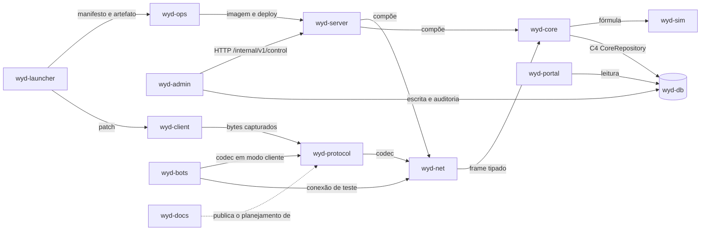

# WYD 1.0.0 — panorama e plano de execução

> **Estado: plano de trabalho, não decisão aprovada.** Este documento é o painel único do projeto
> inteiro: o que existe, o que está medido, em que ordem o planejamento avança e qual é o gate de
> cada etapa — inclusive o gate de cobertura funcional que fecha a `1.0.0` (§4.2). Ele **não**
> substitui o plano diretor de nenhum sistema e **não** decide arquitetura.
>
> Medido em **2026-11-19**. Toda contagem traz a fonte; número sem fonte é `H`.
>
> **Alvo declarado pelo dono em 2026-11-20:** a `1.0.0` é o **jogo completo** — todos os sistemas e
> funcionalidades do jogo oficial funcionando —, e o critério de saída é **cobertura funcional de
> 100%** (§4.2). O número de cobertura é medido em §1.5; nenhum total de funcionalidade é estimado
> aqui.

---

## 0. Como ler

| Se você quer… | Vá para |
|---|---|
| saber o que está pronto e o que não está | §1 |
| saber quanto do jogo já funciona | §1.5 |
| saber o que já foi decidido e o que está aberto | §2 |
| ver contradições que precisam de decisão do time | §3 |
| saber a ordem de execução e o gate de cada fase | §4 |
| saber o que este plano não decide | §5 |
| saber o que fazer em seguida, por ganho ÷ esforço | §6 |
| saber quem decide o quê, o que já pode ser ligado e em que ordem | §7 |
| saber onde cada artefato mora e qual sistema é dono dele | §8 |

---

## 1. Estado medido

### 1.1 Por sistema

| Sistema | Documentos | Estado | Evidência |
|---|---:|---|---|
| `wyd-db` | 348 | piloto parcial: 340 páginas com cabeçalho, **28 de 34** migrations escritas (os 6 seeds seguem bloqueados) e **28** `.sql` aplicados do zero em 2026-11-24, 37 páginas de `src/`, **13 de 13** em `tests/` (matriz `CAP-nn` de **39** capacidades, **14** cobertas), crate inicial `crates/wyd-db` com `dsn` e os alvos `sistema_pg` (13 cenários), `reversibilidade_pg` e `runner_pg` (7 casos), 0 em `prompts/` e `skills/`; dicionário **completo**, **109 das 109** páginas de tabela | `find planejamento-1.0.0/wyd-db -name '*.md'` e `grep -rl '^> Pergunta:'`, 2026-11-24 |
| `wyd-protocol` | 7 | 2º piloto aberto: plano diretor com teto de 131 páginas, 5 escritas, 20 lacunas (**18 decididas** — 17 em 2026-11-20 e `LPRT-09` em 2026-11-23; **2 abertas** por captura: `LPRT-03` e `LPRT-06`), nenhum ADR; série de entrega do crate `0.1.0` → `1.0.0` (§4.1) | `wyd-protocol-1.0.0.md` e `lacunas.md`, 2026-11-23 |
| `wyd-docs` | 10 | plano diretor e lacunas + site MkDocs 2.0 implementado; 5 páginas em `docs/`; proposta do gate de aceite em 2026-11-23 | `find planejamento-1.0.0/wyd-docs -name '*.md'`, 2026-11-23 |
| `wyd-portal` | 12 | planejado: dashboard, `lacunas.md`, plano de armaria e mercado e 8 páginas em `docs/` (11 de planejamento + o prompt); **33 `RF-POR`**, 10 `RNF-POR`, **0 lacunas abertas, 0 propostas e 9 fechadas** (`LAC-POR-09` fechou em 2026-11-23) | `wyd-portal/`; `lacunas.md` §1, 2026-11-23 |
| `wyd-admin` | 11 | planejado: dashboard, `lacunas.md` e 9 páginas em `docs/`; contrato C4 com 14 rotas (7 de staff, 4 de custódia de item, 3 utilitárias); **15 `RF-ADM`**, 10 fatias; zero lacunas abertas (as sete fecharam até 2026-11-22) | `wyd-admin/`, 2026-11-22 |
| `wyd-ops` | 6 | propostas de gestão de GitHub/ambientes e de versões/cobertura funcional + porta de entrada publicada, o plano da imagem do site e o ranking publicado das frentes (`docs/prioridade-do-projeto.md`, 2026-11-24); sem plano diretor e sem `RF-OPS` | `wyd-ops/`, 2026-11-22 |
| `wyd-net` | 3 | aberto em 2026-11-22: fronteira, 7 contratos (6 já decididos) e 4 lacunas no total (**1 aberta como medição, 3 fechadas**; `LNET-02`/`LNET-03` por decisão, `LNET-04` por regra vigente e a política de `LNET-01` por `Q-NET-1` = A, em 2026-11-23); sem `RF-NET` | `wyd-net/lacunas.md` §1, atualizado em 2026-11-23 |
| `wyd-core` | 4 | aberto em 2026-11-22: fronteira, 6 contratos e **0 abertas, 0 propostas, 4 fechadas** (`LCORE-01`–`LCORE-04`); C4 decidida em 2026-11-23; sem catálogo, sem `RF-CORE` | `wyd-core/lacunas.md` §1, 2026-11-23 |
| `wyd-server` | 5 | aberto em 2026-11-22: fronteira, 7 contratos (6 decididos; `S7` de captura com A1 autorizada em 2026-11-23) e 5 lacunas (**0 abertas, 5 fechadas**; `LSRV-05` fechou em C, com a condição **reprovada** na medição — peer de A1 pela opção A, implementação pendente); **esqueleto de ponta a ponta** e **spec do ECAP** propostos em 2026-11-23 (7 mensagens, 5 cenários/6 capturas, 7 goldens, C1–C7) | `wyd-server/lacunas.md` §1; `wyd-server/docs/specs/endpoint-de-captura.md` §9.1, 2026-11-23 |
| `wyd-sim` | 3 | aberto em 2026-11-22: fronteira, 4 contratos e 4 lacunas (**0 abertas, 0 propostas, 4 fechadas**; `LSIM-02` e `LSIM-03` fecharam por resposta explícita do dono em 2026-11-23); nenhuma fórmula ou fixture escrita | `wyd-sim/lacunas.md` §1, atualizado em 2026-11-23 |
| `wyd-launcher` | 3 | aberto em 2026-11-22: fronteira, 6 contratos e 4 lacunas (**0 abertas, 0 propostas, 4 fechadas**; `LLCH-01`–`LLCH-04` fecharam por decisão do dono em 2026-11-23) | `wyd-launcher/lacunas.md` §1, atualizado em 2026-11-23 |
| `wyd-client` | 5 | aberto em 2026-11-22: fronteira, 5 contratos, **5 lacunas próprias** (a de uso/distribuição entrou como proposta em 2026-11-23) + as 3 medições herdadas do protocolo; **registro medido** do cliente local | `wyd-client/lacunas.md` §1 e `registro-do-cliente.md`, 2026-11-23 |
| `wyd-bots` | 3 | aberto em 2026-11-22: fronteira, 5 contratos e 4 lacunas (**1 aberta como medição, 3 fechadas**; `LBOT-01`/`LBOT-02` por decisão do dono, `LBOT-04` por regra vigente e a política de `LBOT-03` por `Q-BOT-3` = A, em 2026-11-23) | `wyd-bots/lacunas.md` §1, atualizado em 2026-11-23 |

### 1.2 `wyd-db`, página por pasta

| Pasta | Escritas | Planejadas | Observação |
|---|---:|---:|---|
| `docs/` raiz (`index`, `convencoes`, `glossario`) | 3 | 3 | fecha |
| `docs/arquitetura/` | 17 | 17 | `index` + 13 páginas + 3 de `adr/`; `implantacao` e `modelo-conceitual` entraram no lote F (2026-11-24) e a pasta fecha; `retencao-e-capacidade` é `proposto` com volume pendente |
| `docs/specs/` | 20 | 20 | `index` + 19; os 6 fluxos e os 5 estados estão escritos; `requisitos-nao-funcionais` entrou no lote E e `stakeholders` e `rastreabilidade` no lote F (2026-11-24); a pasta fecha |
| `docs/dicionario-dados/` | 21 | 21 (+109 de tabela) | `index`, `como-ler` e os **19 domínios** (2026-11-21); as 109 por tabela são manuais (`M26`) e **109 existem** (2026-11-22) |
| `docs/planos/` | 9 | 10 | `index` + 8 planos escritos, inclusive `plano-de-documentacao`, `plano-de-testes` e `plano-de-manutencao` (lote C); falta `metricas` (`M20`) |
| `docs/roadmap/` | 42 | 42 | `index`, `fases` e as 40 `WYDDB-nnn` escritas; as issues nascem na Onda 8 |
| `docs/guia-desenvolvedor/` | 11 | 11 | 3 páginas anteriores + 7 recortes + `pool-e-transacoes` (lote E); fecha |
| `docs/guia-administrador/` | 8 | 8 | `index`, `configuracao`, `instalacao`, `diagnostico`, `backup-e-restore`, `recuperacao-de-desastre`, `sustentacao` e `manutencao-rotineira` (os dois últimos do lote D; pasta no teto) |
| `docs/guia-teste/` | 7 | 7 | `index`, contrato, sistema, `piramide-e-alvos`, `gates-e-anti-skip`, `fixtures-e-factories` e `dados-de-teste` (os dois últimos do lote D; pasta no teto) |
| `docs/guia-documentacao/` | 5 | **5** | `index`, `estilo-e-linguagem`, `estrutura-e-navegacao`, `revisao-e-publicacao` e `imagens-e-evidencias` (lote C); o teto da pasta caiu de 8 para 5 em 2026-11-24 (`Q-BLK-01`) |
| `migrations/` | 28 | 36 | `index` escrito em 2026-11-23 (`Q-M33-4`) + **1** página de seção por escrever (`serie-e-regras`) + 34 arquivos, 28 escritos |
| `src/` | 37 | 59 | `migrate/` e `provision/` têm página por arquivo |
| `tests/` | **12** | 12 | 2026-11-24: `index`, `fixtures-e-factories`, `dados-de-teste`, `resources/README`, 5 `alvos/*` e 3 `specs/*`, com a matriz `CAP-nn` |
| `prompts/` | 0 | 9 | |
| `skills/` | 0 | 9 | |

**Totais planejados:** **144** páginas autorais em `docs/` + 109 por tabela, escritas à mão (`M26`) + 36 de migration + 59 de `src/`
+ 12 de teste + 9 prompts + 9 skills (`wyd-db-1.0.0.md` §4). **Escritas:** **143 páginas autorais com
corpo** em `docs/` (143 arquivos, incluindo os índices que já viraram página), fora de `gerado/`, que reúne **110 arquivos**
(as 109 páginas de tabela e o índice); 28 em `migrations/`, 37 em `src/` (2026-11-24).

### 1.3 Série de migrations

| Indicador | Valor | Fonte |
|---|---:|---|
| Arquivos da série | 34 (29 originais + os adendos `0030`, `0031` e `0032` + os lotes `0033`, `0034`) | `plano-migrations.md` §3 |
| Tabelas | 109 | `plano-migrations.md` §3 (planejado) |
| Arquivos de seed | 6 | idem |
| Tabelas com DDL fechado | 109 de 109 | `ddl-confirmado.md` §1 |
| Tabelas desenhadas e aguardando aprovação | 0 | `ddl-confirmado.md` §1 |
| Arquivos com DDL inteiro fechado | 28 (todos menos os 6 seeds) | `migrations-checklist.md` §4, 2026-11-22 |
| `SCHEMA_VERSION` alvo | 34 | `plano-migrations.md` §6 |

### 1.4 Repositório, GitHub e operação

| Fato | Valor | Fonte |
|---|---|---|
| Visibilidade / branch padrão | público / `develop` | API do GitHub, 2026-11-19 |
| Issues / milestones / Projects | 40 abertas (#82–#121) / 13 milestones (M0–M5 + F1–F7) / habilitado, project `WYD 1.0.0` nº 10 ligado ao repositório, 40 itens com `Sistema`, `Fase`, `Prioridade`, `Marco` e `Status` preenchidos e 63 vínculos `blocked by` | API do GitHub, 2026-11-22; detalhe em `wyd-ops` §10.3 |
| Merge permitido | squash, branch apagada no merge | API do GitHub |
| Secret scanning / Dependabot | ativos | API do GitHub |
| `crates/*` | 10 pastas; 3 com comportamento e 7 com esqueleto desde 2026-11-26, nenhuma só `.gitkeep` | `find crates` |
| Código Rust real | `deprecated/` com 375 arquivos, **0 versionados** | `git ls-files deprecated` |
| Raiz | sem `Cargo.toml`, `rust-toolchain.toml`, `Makefile` | `ls` |
| CI | 7 workflows (2026-11-26): `code` (fmt/clippy/unitários em matriz + cobertura informativa + `gate-code`), `ci-db` (matriz PG17 + `gate-db`), `docs` (`gate-docs` + Pages), `docs-image`, `security` (`gate-security`) e `release`; `issue-status` mantém labels/Project. O antigo `full-workflow` foi removido; estado real em `wyd-ops/docs/devops/index.md` | `.github/workflows/` |
| Workflows de referência no legado | 3 (`ci`, `bench`, `release`) | `deprecated/.github/workflows/` |
| Site de documentação | MkDocs 2.0 (`2.0.dev6`) + Python 3.15; **267 páginas montadas de 13 sistemas**; build, `gate/checks/links.py` e `gate/checks/contagens.py` verdes | `wyd-docs-1.0.0.md` §9.1; `wyd-docs/`, 2026-11-22 |
| Cliente | 7.147 arquivos e 567 MB em `wyd-client/files/`, ignorado; `WYD.exe` com hash medido | `wyd-client/registro-do-cliente.md`, 2026-11-22 |

### 1.5 Cobertura funcional da `1.0.0`

A `1.0.0` é o jogo completo (§4.2), então a medida que decide a versão é **cobertura funcional**, não
página escrita. Esta seção é o **dono do número agregado**: total de funcionalidades do catálogo e
fração com prova, medidos com data, quando o catálogo existir.

Uma entrada conta quando está `aceita` — fluxo com passo a passo, dono entre os 13 sistemas, prova
(golden, captura datada ou leitura do cliente, com segunda leitura) e versão em que entra; sem prova
ela não conta. O molde da entrada é de `wyd-ops/proposta-versoes-e-cobertura-funcional.md` §7, que
ainda é proposta: enquanto não for executada, esta tabela fica em “não medido”, não em estimativa.

| Indicador | Valor (2026-11-20) | Fonte |
|---|---|---|
| Funcionalidades no catálogo | não medido | catálogo funcional não existe (`wyd-ops/proposta-versoes-e-cobertura-funcional.md` §7) |
| Funcionalidades `aceitas` | não medido | idem |
| Cobertura | meta **100%**, não medida | §4.2 |

**Escopo decidido em 2026-11-23 (`LCORE-01`):** a `1.0.0` continua jogo completo; o escopo é o
catálogo completo medido no cliente 7662, e o primeiro domínio executável é entrar na cena com
posição/estado inicial, sem inventário, combate ou chat. A lista completa continua sendo o catálogo,
não uma lista fixa inventada; a cobertura segue **não medida**.

Nenhum total é estimado antes do levantamento: os 13 sistemas técnicos não são 13 funcionalidades, a
lista de domínios citada pelo dono (classes, skills, refinamento, guerras, cidadania, estados
especiais, montarias, invocações, transformações, magias, quests, guildas) é pauta de levantamento,
não catálogo, e o inventário do legado (`wyd-protocol` §0.4) é baseline de referência, não total
alvo. Contagem de funcionalidade sem catálogo é `H`, nunca estimativa. Cobertura declarada sem data é
`H` também: cada valor desta tabela entra com a data em que foi medido.

---

## 2. O que está decidido e o que está aberto

### 2.1 Decidido (`aceito`)

| ID | Decisão | Data |
|---|---|---|
| `P-01` | 4 schemas por domínio: `content`, `game`, `portal`, `ops`; nada em `public` | 2026-11-17 |
| `P-02` | tabela no singular, `snake_case` | 2026-11-17 |
| `P-03`–`P-22` | PK identity, PK composta em filha, sem UUID, `TIMESTAMPTZ`, dinheiro inteiro, `TEXT`+`CHECK`, `INET`, coluna gerada, `NOT NULL` por padrão, constraint nomeada, índice parcial, FK indexada, trigger só mecânica, view de leitura, papéis separados, migration imutável, sem soft-delete genérico, retenção declarada, PII só em `portal` | 2026-11-17 |
| `ADR-DB-0001` | provisionamento de papel é fase própria, fora da série | 2026-11-17 |
| `ADR-DB-0002` | runner de migrations próprio, com ledger por versão | 2026-11-18 |
| `M1`–`M7`, `M9`, `M16`–`M20`, `M22`–`M25`, `A9`–`A10`, `A12`–`A16`, `D1`–`D14` | decisões de desenho fechadas, cada uma com evidência em `lacunas.md`; `M8` deferida e `M21`/`A11` externas | 2026-11-17/18 |

São **dois** ADRs. Não existe catálogo prévio; ADR nasce de decisão tomada, não de planejamento.

### 2.2 Aberto

| Grupo | Abertas | Exemplos |
|---|---:|---|
| Lacunas `B`/`A`/`M` | 0 | `M27` e `M28` fecharam em 2026-11-21, `M29`, `M30` e `M31` em 2026-11-22, e `M32` e `M33` em 2026-11-23; 35 fecharam; 0 propostas; 3 seguem `externa` (`A11`, `A20`, `M21`); a lista completa está em `wyd-db/lacunas.md` §1 |
| Externas | 3 | `A11`, `A20`, `M21` |
| Divergências do plano diretor | 0 | `P1`–`P11` fechadas (`wyd-db/lacunas.md` §1 e §3) |
| DDL não desenhado | 0 tabelas | todas as 109 têm coluna desenhada; 34 arquivos de migration para 109 tabelas (34/109, `plano-migrations.md` §3, 2026-11-22); os lotes `0022`, `0025`, `0026`, `0028` e `0029` foram aprovados em 2026-11-21, os `0033` e `0034` em 2026-11-22, e os seis seeds são escritos à mão (`plano-migrations.md` §4) |
| ADR de fronteira pessoa × conta | sem número | citada em `lacunas.md` §0.2 e `rascunho-accounts.md` |

---

## 3. Divergências que precisam de decisão do time

Estas não são tarefas: são contradições entre documentos ou entre documento e realidade. Ficam
registradas aqui até alguém decidir; nenhuma foi corrigida por conta própria.

| # | Divergência | Evidência | Efeito |
|---|---|---|---|
| D1 | `README.md` da raiz afirma desenvolvimento ativo, 10 crates, 34 issues ativas, 58 concluídas, 53 migrations e serviços no ar — **resolvido em 2026-11-19**: reescrito para o estado medido, sem contagem replicada | `README.md` × `git ls-files`, API do GitHub | agente e visitante leem estado falso |
| D2 | `crates/*` estão vazios, mas o README e o CI pressupõem workspace Rust | `find crates` | qualquer `cargo build` na raiz falha |
| D3 | O `full-workflow.yml` tem um job só, e o `run:` monta `$(0.0.0-<sha>)` e `$(<sha>)`, que o shell executa como comando — **medido em 2026-11-19**: o job **não** falha e publica metadado vazio | `V`: run #14 (`44505419869`) e job `Get Info` (`135495629487`) com `success`; log traz `command not found` nas linhas 40 e 44; 0 runs `failure`; detalhe em `wyd-ops` §2.1 | gate verde que não publica `version`/`commit`; não há build, teste, cobertura nem gate de código |
| D4 | O planejamento exige CI composto por actions reutilizáveis; `.github/actions/` tem só `docs-check` | `V`: `git ls-files .github`, 2026-11-19 | meta da `1.0.0` sem base: faltam as actions de Rust, cobertura e segurança de `wyd-ops` §4 |
| D5 | Gestão de trabalho: o roadmap de 40 issues do `wyd-db` não tinha onde viver | `V`, 2026-11-19: `has_projects: true`, 6 milestones (`M0`–`M5`) e project `WYD 1.0.0` nº 10; execução registrada em `wyd-ops` §10 | **resolvido em 2026-11-22:** as 40 issues #82–#121 existem no board, com milestone de fase, DoD, labels, os quatro campos preenchidos, 5 views e 63 vínculos `blocked by` (`wyd-ops` §10.3) |
| D6 | O plano diretor declara **144** páginas autorais; 84 estavam bloqueadas em 2026-11-18 e **1 segue** depois das 21 de recorte, das 40 `WYDDB-nnn`, da página de capacidade, dos cinco lotes de 2026-11-24 (o lote D aprovado por `Q-BLK-04`/`Q-BLK-05`, o lote E por `Q-BLK-06`/`Q-BLK-07`) e da retirada de três por `Q-BLK-01` | `proposta-paginas.md` §6 | escrever mais rápido exige fechar lacuna, não escrever autour |
| D7 | Não existe `mkdocs.yml` em lugar nenhum, mas `wyd-docs` é dono do site e o guia do `wyd-db` já prescreve recursos do MkDocs — **resolvido em 2026-11-19**: site em MkDocs 2.0 no `wyd-docs/`, sem `mkdocs.yml`; recursos do MkDocs 1.x convertidos na origem (§2.2 e `LPDOC-14`) | `find . -iname 'mkdocs*.yml'` sem resultado | site não publicável; exigência sem base executável |
| D8 | `docs/` na raiz não existe; no legado, `docs/` é referência — **resolvido em 2026-11-19**: a documentação publicada sai de `planejamento-1.0.0/*/docs/` por `wyd-docs/`, e o legado não é publicado | `ls` | risco de alguém publicar o legado como doc oficial |

---

## 4. Plano de fases

Cada fase termina com um gate verificável. Nenhuma fase começa antes do gate anterior, salvo decisão
explícita do time.

### Fase 0 — Fundação e memória do projeto ✅ (2026-11-19)

- [x] Medir repositório, planejamento, GitHub e CI sem alterar nada.
- [x] Reescrever `AGENTS.md` com hierarquia de fontes e invariantes.
- [x] Registrar panorama neste arquivo.
- [x] Criar memória de trabalho em `.agents/memory/estado-do-projeto.md`.
- [x] Criar skills `auditar-planejamento` e `planejar-sistema`, e o prompt de auditoria.

**Gate:** um agente novo consegue dizer o que está planejado, o que é referência e o que é proibido
sem abrir o legado.

### Fase 1 — Gestão do trabalho no GitHub ✅ (2026-11-19)

Proposta em `wyd-ops/proposta-gestao-github-e-ambientes.md` aprovada e executada (§10 dela).

- [x] Habilitar Projects do repositório e criar o project `WYD 1.0.0` com campos `Sistema`,
      `Fase`, `Prioridade` e `Marco` (além do `Status` padrão).
- [x] Criar as labels `area/*` (13), `estado/*` (3), `origem/legado` e `risco/*` (2), sem duplicar
      tipo em label.
- [x] Criar os milestones `M0 — Fundação` a `M5 — Operação`.
- [x] Criar `.github/ISSUE_TEMPLATE/` com `bug`, `planejamento`, `decisao`, `tarefa` e `config.yml`,
      e `.github/pull_request_template.md` com gate de documentação, prova e escopo.
- [x] Configurar ruleset de `develop` e `main`: PR obrigatório, sem deleção, sem force-push.
      **Sem *required status check***: não há check que reporte (entra na Fase 4).
- [x] Migrar as 40 issues planejadas de `docs/roadmap/` para issues reais **só depois** de as páginas
      existirem; as 40 páginas com DoD fecharam em 2026-11-22 e as issues #82–#121 foram criadas.

**Gate:** uma issue do roadmap chega ao board com sistema, fase e prioridade; o board mostra 40
itens, o mesmo número de páginas `WYDDB-nnn`. **Fechado em 2026-11-22** (`V`, `wyd-ops` §10.3): 40
itens com os cinco campos preenchidos, 5 views e o project ligado ao repositório.

### Fase 2 — Fechar o `wyd-db`

Ordem derivada de `plano-migrations.md` §9 e `proposta-paginas.md`; não é ordem nova.

- [ ] Fechar as lacunas pendentes com o dono nomeado em `lacunas.md` (bloqueantes primeiro).
- [ ] Escrever as 6 páginas de migration restantes (seeds), quando o dado de origem estiver verificado; os arquivos são escritos à mão, sem gerador (`plano-migrations.md` §4).
- [x] Aprovar os cinco lotes propostos (`0022`, `0025`, `0026`, `0028`, `0029`) em `ddl-confirmado.md` antes da página — aprovados em 2026-11-21; nenhum lote aguarda aprovação.
- [ ] Escrever `specs/` (requisitos, regras, NFR, casos de uso, fluxos, estados, rastreabilidade).
- [x] Concluir as 109 páginas por tabela (`M26`: à mão, sem gerador; **109/109** escritas em 2026-11-22); as **19** páginas de domínio também estão escritas (2026-11-22).
- [ ] Escrever `planos/` (testes, dados, qualidade, métricas, riscos, execução).
- [ ] Escrever `guia-administrador/`, `guia-documentacao/` e o restante de `guia-teste/`.
- [ ] Criar `tests/` e `prompts/`/`skills/` do sistema.
- [ ] Validar o site: `mkdocs build --strict` sem link morto nem diagrama inválido.

**Gate:** 34 páginas de migration (28 escritas, 6 seeds `bloqueada`) + 19 páginas de domínio + 109 páginas por tabela (**109/109** concluídas em 2026-11-22, `wyd-db-1.0.0.md` §6.8); `planos/metricas.md` mede o
fechamento; nenhuma afirmação de comportamento sem `V`; site estrito passa.

### Fase 3 — Planejar os 12 sistemas restantes

- [ ] Aprovar o molde de planejamento por sistema (o de `wyd-db` é a referência, não o texto).
- [x] Escolher o segundo piloto por dependência: **`wyd-protocol`**, decidido em 2026-11-19;
      `wyd-docs` também foi aberto para publicar a documentação oficial.
- [ ] Para cada sistema: dashboard `<sistema>-1.0.0.md`, `docs/` com público e pergunta por página,
      `src/` por unidade de responsabilidade, `tests/` por alvo, `prompts/`, `skills/`.
- [ ] Definir a comunicação entre sistemas (protocolo, mensagens, dono do contrato) antes de planejar
      o interior de cada um.
- [ ] Mapear o que cada sistema consome do `wyd-db` por porta, não por tabela.

**Gate:** todo sistema tem fronteira, entradas/saídas, requisitos com ID, plano de teste e roadmap
com DoD; nenhum sistema depende de tabela de outro sem contrato.

### Fase 4 — Implementação

- [ ] Criar o workspace Rust na raiz com `Cargo.toml`, `rust-toolchain.toml` e `Makefile`.
- [ ] Implementar na ordem de dependência, uma issue por PR, TDD, cobertura ≥ 85%.
- [ ] Substituir o CI stub por workflows reutilizáveis + actions compostas.
- [ ] Rodar o corte vertical do `wyd-db` (`0001`–`0007`, 22 tabelas) antes dos 25 arquivos restantes da série.
- [ ] Provar isolamento entre `portal` e `game` por `permission denied`, não por revisão.

**Gate:** `fmt`, `clippy -D warnings`, testes, cobertura, migrations e build verdes em PR; E2E do
sistema executando contra Postgres real; cobertura funcional de §1.5 medida a cada versão entregue.

### Fase 5 — Operação

- [ ] Ambiente local em Docker Compose; CI efêmero em runner hospedado.
- [ ] Homologação em free tier só para portal e banco, com dado sintético.
- [ ] Produção com servidor de jogo em máquina própria/VPS; free tier não serve (hiberna).
- [ ] Observabilidade e alertas definidos antes do primeiro deploy.

**Gate:** nenhum segredo em repositório; deploy reproduzível; rollback ensaiado; alerta testado.

### 4.1 Série de versões do `wyd-protocol` (`0.1.0` → `1.0.0`)

O `wyd-protocol` entrega em versões menores, abertas na `0.1.0` e fechadas na `1.0.0`. Escopo, gate
e pré-requisito de cada fatia são de `planejamento-1.0.0/wyd-protocol/wyd-protocol-1.0.0.md` §9.1 e
não se repetem aqui. Nesta seção a `1.0.0` é a versão do **crate**; o alvo do jogo completo é §4.2, e
as duas coisas não se substituem. Estado `P`: nenhuma versão entregue, nenhum opcode gerado, nenhuma
data.

A série é o eixo de entrega para fatiar sprints, issues e milestones: cada issue pertence a
exatamente uma versão — a que serve o gate dela — e a ordem das versões é ordem de entrega, não
calendário. Quem escreve issue usa o fatiamento de
`planejamento-1.0.0/wyd-protocol/docs/roadmap/fases.md`; como a versão aparece no board foi decidido
pelo dono de operação em 2026-11-20 — milestone por versão, com migração ainda não executada
(`wyd-ops/proposta-versoes-e-cobertura-funcional.md` §4) — e não é decisão desta página. Só o
`wyd-protocol` tem série escrita hoje: o fatiamento `0.1.0` → `1.0.0` dos outros sistemas é decisão
do dono de cada um, na mesma escala de versões já escolhida para o board.

Isso não muda as fases acima: fase é estágio do projeto; versão é fatia de entrega do crate e do
catálogo, dentro da Fase 4.

### 4.2 Critério de saída da `1.0.0` — jogo completo

`1.0.0` aqui não significa “planejamento concluído”: significa **jogo completo**. Declarado pelo dono
em 2026-11-20. A versão sai quando 100% das entradas do catálogo funcional estiverem `aceitas` — cada
uma com fluxo, dono, prova e versão —, sem entrada aberta e com todos os gates de sistema verdes.

O mesmo critério mede as versões menores: uma fatia `0.x` fecha quando as entradas que ela promete
estão `aceitas`, e o jogo fecha quando todas estiverem. A fatia não recalcula cobertura: lê a de §1.5,
que é a única contagem agregada.

| Critério | Como se verifica |
|---|---|
| fatia `0.x` | entradas prometidas pela fatia `aceitas`, lidas de §1.5 |
| cobertura funcional | total e fração de §1.5, medidos do catálogo, com data |
| fluxo por funcionalidade | entrada do catálogo com passo a passo e estado |
| prova por funcionalidade | golden, captura datada ou leitura do cliente, com segunda leitura |
| sistema dono | cada entrada aponta um dos 13 sistemas, sem dono duplicado |
| release | gate da Fase 5: deploy reproduzível e rollback ensaiado |

Consequências para este plano:

1. **Planejar página não é entregar funcionalidade.** Fechar as páginas de um sistema continua sendo
   pré-requisito para implementá-lo, mas não conta cobertura.
2. **O catálogo funcional é pré-requisito do plano de sprint.** Sem ele a `1.0.0` não tem como ser
   medida e nenhuma versão menor pode ser declarada completa — planejamento fechado não supre a
   falta do catálogo.
3. **A contagem é daqui.** Total de funcionalidades e fração coberta são números deste panorama
   (§1.5); o catálogo é dono da entrada e da prova, e nenhuma página recalcula o agregado.
4. **As fases continuam estágios.** A mudança é de alvo e de critério de saída, não de ordem: a Fase 4
   implementa, a Fase 5 opera, e a `1.0.0` exige as duas.

O catálogo funcional não existe hoje: a divisão de dono (`wyd-core`/`wyd-sim`/`wyd-db`) e o molde de
entrada estão propostos em `wyd-ops/proposta-versoes-e-cobertura-funcional.md` §7.

---

## 5. O que este documento não decide

- Não decide arquitetura de nenhum sistema; o dono é o plano diretor de cada um.
- Não decide data nem prioridade de release; o alvo “jogo completo” está registrado como declaração
  do dono (2026-11-20), com o critério em §4.2.
- Não fecha lacuna: lacuna é fechada em `lacunas.md`, pelo dono nomeado.
- Não estima cobertura funcional: §1.5 mede, com data e fonte, e “não medido” é resposta válida
  enquanto o catálogo não existir.
- Não declara versão entregue: declarar `0.x` ou `1.0.0` exige o critério de §4.2, não a conclusão
  das páginas de planejamento.
- Não cria ADR: ADR nasce de decisão tomada, com “como verificar”.
- Não define o molde dos 12 sistemas restantes; propõe que o de `wyd-db` seja a base.
- Não escolhe hospedagem: a proposta está em `wyd-ops/proposta-gestao-github-e-ambientes.md` e
  depende de aprovação.
- Não mede qualidade de código: não há código de produção para medir.

---

## 6. Próximos passos priorizados por ganho ÷ esforço (2026-11-19, revisto em 2026-11-23)

Ordem por **desbloqueio ÷ esforço**, não pela sequência das fases de §4. `automação` significa
executável agora, sem decisão pendente; `usuário` significa que só o dono decide ou autoriza. Todo
item termina num resultado observável — nenhum é "revisar" ou "amadurecer". O único passo que publicou foi o 2,
dentro da janela declarada pelo dono.

| # | Passo | Desbloqueia | Por que é rápido (o que já existe) | Pré-requisito | Executa | Termina quando |
|---:|---|---|---|---|---|---|
| 1 | Capturar o marcador público atual e registrar o custo de publicação | dimensiona a janela de congelamento e fixa o baseline `D0` do conteúdo público antes de congelar | reutilizou runs e deployments já identificados, os horários de `created_at`/status final e o marcador das duas árvores | nenhum | automação | **feito** (`V`, 2026-11-19): `assets/site.js` respondeu 200 com a URL literal do Highlight.js e as durações #4/#6/#8 foram 49/43/29 s; o registro está em `wyd-docs-1.0.0.md` §7.3 |
| 2 | Declarar a janela sem publicação e executar o checklist de rollback | fecha `LPDOC-01`, a lacuna que segura a publicação contínua do site | os dois runs estão elegíveis, o build dos dois commits passou em Linux (`V`, §7.3) e o checklist de 10 passos já está escrito | declaração de congelamento do dono | usuário declara; automação executa | **feito** (`V`, 2026-11-19): #2 publicou `2378b62b` (`npm/highlight.js`), #4 restaurou `0d765858` (`cdn-release`); deployments `7911886524` e `7911904845` `success`; `LPDOC-01` fechada |
| 3 | Decidir o conteúdo que fica público depois da restauração | evita manter o site atrás de `develop` sem decisão registrada | a consequência já estava no critério de parada de §7.3; a decisão coube em uma frase | nenhum | usuário | **feito** (`V`, 2026-11-19): decisão do dono — o site fica em `0d765858…` até o merge do PR, que publica o tip `aedd1f73…` de conteúdo idêntico; registrado em `wyd-docs-1.0.0.md` §7.3 (linha 3) e §9 |
| 4 | Fechar `LPDOC-12` fixando o build suportado em Linux/container | remove ambiguidade do build local; era a lacuna `P1` que faltava fechar | o erro `PosixPath` está reproduzido e o mesmo comando passa em container nos dois commits | nenhum | usuário (dono: operação) | **feito** (`V`, 2026-11-19): decisão do dono fixou Linux/container como build suportado, com Windows fora de escopo; `lacunas.md` fechou `LPDOC-12` e §7.1 registra que o build roda em Linux e que no Windows falha por `PosixPath` |
| 5 | Medir o comportamento real do CI `full-workflow` como baseline do plano do `wyd-ops` | dá base verificável para a Fase 4 (CI real) e tira a causa de `H` | runs, jobs e log já estavam acessíveis por leitura; faltava medir o efeito real do defeito de shell que `D3` apontava | nenhum | automação | **feito** (`V`, 2026-11-19): run #14 (`44505419869`) e job `Get Info` (`135495629487`) `success`, saída `version`/`commit` vazias; registrado em `wyd-ops` §2 e §2.1 |

**A fila que serve à `1.0.0` é outra.** Os cinco passos acima fecharam fundação e publicação do site;
nenhum deles mede funcionalidade. Com o alvo de §4.2, o primeiro passo que destrava a versão é o
catálogo funcional (§1.5): enquanto ele não existir, a cobertura fica “não medido” e nenhuma versão
pode ser declarada completa, por mais páginas que o planejamento feche. Executar a divisão
`wyd-core`/`wyd-sim`/`wyd-db` e o molde de entrada está proposto em
`wyd-ops/proposta-versoes-e-cobertura-funcional.md` §7 e é passo de `usuário`, não de automação.

**Foco revisto em 2026-11-23, depois de `Q-SRV-5` e `Q-PRT-1`. A ordem de execução daqui para frente é
esta seção** — §7.5 cita, não repete.

### 6.1 Estado medido das lacunas (2026-11-23, atualizado em 2026-11-25)

| Sistema | Lacunas | Abertas | Propostas | Fechadas | Externas | Fonte |
|---|---:|---:|---:|---:|---:|---|
| `wyd-protocol` | 20 | 2 | 0 | 18 | 0 | `lacunas.md` §1 |
| `wyd-client` | 6 | 3 | 0 | 3 | 0 | idem |
| `wyd-net` | 4 | 1 | 0 | 3 | 0 | idem |
| `wyd-core` | 4 | 0 | 0 | 4 | 0 | idem |
| `wyd-sim` | 4 | 0 | 0 | 4 | 0 | idem |
| `wyd-server` | 5 | 0 | 0 | 5 | 0 | idem |
| `wyd-db` | 38 | 0 | 0 | 35 | 3 | idem |
| `wyd-admin` | 7 | 0 | 0 | 7 | 0 | `lacunas.md` (Fechadas; 7 `LAC-ADM` + 2 decisões sem ID) |
| `wyd-portal` | 9 | 0 | 0 | 9 | 0 | `lacunas.md` §1 |
| `wyd-launcher` | 4 | 0 | 0 | 4 | 0 | `lacunas.md` §1 |
| `wyd-bots` | 4 | 1 | 0 | 3 | 0 | idem |
| `wyd-docs` | 14 | 0 | 0 | 14 | 0 | idem |
| **Total** | **119** | **7** | **0** | **109** | **3** | `*/lacunas.md` |

`LAC-POR-09` = A foi o delta `0 abertas / −1 proposta / +1 fechada`; `Q-NET-1` = A não alterou as
contagens, e a execução de `LCLI-02` em 2026-11-25 fechou a linha com `0 abertas / −1 proposta /
+1 fechada` (lista, manifesto e verificador do patch). `wyd-ops` não tem
`lacunas.md`; não entra na soma. As 3 externas do `wyd-db` são `A11`, `A20` e `M21`:
decididas, mas dependentes de frente fora do banco. O total de 118 é a soma das 12 tabelas de lacunas,
não uma estimativa; cada linha vem do registro do sistema. O `wyd-admin` registra ainda 2 decisões sem
ID, fora da soma de lacunas.

**Leitura.** 6 itens ainda não fechados, todos abertos e nenhum em proposta. Desses, **0 têm pergunta
de desenho isolada aguardando resposta**; **2 são medições com política decidida** (`LNET-01`,
`Q-NET-1` = A; `LBOT-03`, `Q-BOT-3` = A), ambas com execução autorizada e artefato pendente; **3 não
entram numa rodada de decisão técnica** (`LPRT-03` e `LPRT-06` são medição de fio e dependem do `ECAP`
operado; `LCLI-03` tem QA definido (Lucas Cantarelli, que não é o operador) e espera a primeira ficha
assinada); e **1 é jurídico sem recomendação** (`LCLI-05`, com
responsável nominal, `Q-IP-3`–`Q-IP-6` decididas, `Q-IP-1`/`Q-IP-2` com pedido externo iniciado e sem
evidência, distribuição congelada). Das 16 perguntas originalmente registradas sem resposta,
**quatorze foram respondidas pelo dono** — `Q-NET-2` = A (`LNET-02`), `Q-SIM-1` = A (`LSIM-01`),
`Q-SIM-4` = A (`LSIM-04`), `Q-SIM-3` = A (`LSIM-03`), `Q-SIM-2` = A (`LSIM-02`), `Q-BOT-1` = A
(`LBOT-01`), `Q-BOT-2` = A (`LBOT-02`), `Q-BOT-3` = A (política de `LBOT-03`), `Q-NET-1` = A (política de
`LNET-01`), `Q-LCH-1` = A (`LLCH-01`), `Q-LCH-2` = A (`LLCH-02`), `Q-LCH-3` = A (`LLCH-03`), `Q-LCH-4` =
A (`LLCH-04`) e `LAC-POR-09` = A — e **duas foram derivadas das regras vigentes**: `Q-NET-4` = A
(`LNET-04`) e `Q-BOT-4` = A (`LBOT-04`); não resta pergunta sem resposta. A autorização da captura (A1 = A, 2026-11-23) e o estado das respostas estão na
[`pauta`](wyd-ops/docs/pauta-de-decisoes-pendentes.md) e em `wyd-ops/docs/lacunas.md`.

**Fora da soma.** `wyd-ops` não tem `lacunas.md`; sua pergunta de hospedagem (`Q-OPS-2`,
`wyd-ops/docs/proposta-decisoes-ops.md` §4) foi **respondida em A em 2026-11-24** — VPS paga com
processo persistente e Compose — e **não** entra nos 118. A escolha não aplicou VPS, contrato, backup
nem operação; a execução continua pendente de `wyd-ops`.

### 6.2 Frentes candidatas, com o que cada uma fecha e libera

> **O ranking vigente das frentes do projeto é publicado em `wyd-ops/docs/prioridade-do-projeto.md`**
> (2026-11-24): ele ranqueia finalizar o `wyd-db`, expandir os outros sistemas e resolver as lacunas
> abertas, com número e fonte, e recomenda a trajetória. Esta tabela fica como registro da avaliação de
> 2026-11-19/23; onde divergir, vale a página publicada.

| Frente | Fecha com a recomendação | Tira da espera do dono | Libera | Pré-requisito | Custo |
|---|---:|---:|---|---|---|
| **A. Rodada de decisões do dono** (concluída: `wyd-sim`, `wyd-launcher`, `wyd-bots`, `wyd-net` e `wyd-portal`) | **1** (`LAC-POR-09`, fechada) | **0** | a onda B (versão e local dos vetores decididos; fixtures ainda dependem de implementação) e a decisão da F9 do portal | resposta do dono; nenhuma página nova | uma sessão de decisão; sem código |
| **B. Captura A1** (peer do passo 0, `ECAP`, CLI, captura) | **1** (`LPRT-03`); prepara `LPRT-06` | 1 | X12, offsets de payload por `Type`, handshake do `net`/`server` e o caminho do `bots` | autorizada em 2026-11-23; implementação pendente | implementação do peer, endpoint, CLI e captura — **11 arquivos autorais**, 0 migrations |
| **C1. Decidir o que resta do `wyd-db`** | **0 lacunas** (0 abertas, 0 propostas); `Q-CAP-1`, `Q-CAP-2` e `Q-CAP-3` decididas; `Q-DP-2/artefato` definido em A (2026-11-24), `Q-DP-2/validação` pendente; `Q-RET-3`, `Q-RET-6` e `Q-RET-7` decididas em A (2026-11-24), aplicação pendente | **0 decisões de retenção** | página de retenção entregue como `proposto`, com volume pendente; matriz e sinal aplicados; `Q-RET-3` é 1 tabela/1 tela sem job; `Q-RET-6/7` condicionam aplicação | `Q-CAP-1/2/3` resolvidas; `Q-DP-2/artefato` definido; `Q-RET-3/6/7` decididas; `Q-DP-2/validação` continua separada | página, matriz, sinal, formato, política de mercado, backup e retenção por ciclo de vida entregues; restam aplicações e validação separada |
| **C2. Executar o `wyd-db`** | **0 lacunas**; 7 páginas bloqueadas, 6 seeds, 1/28 migration aceita, 5 aplicações de retenção | 0 | `SCHEMA_VERSION` 34, aceite da série e corte vertical; expurgos só com job | 6 seeds do cliente 7662; aceite por página; `wyd-ops` | execução e curadoria, não decisão |
| **D. Expandir propostas** | **1–2** (`LCLI-02`; `LCLI-03` é execução) | 0–2 | nada além do próprio `wyd-client` | — | baixo retorno: nenhum dos 7 não fechados ainda espera resposta recomendada; `LPRT-03`/`LPRT-06` são medições |

**Recomendação registrada em 2026-11-23 (histórico): a frente B (captura A1) era a próxima.** A rodada A de decisões de lacuna encerrou:
`Q-SIM-2`, `Q-SIM-3`, `Q-BOT-1`, `Q-BOT-2`, `Q-BOT-3`, `Q-NET-1`, `Q-LCH-1`, `Q-LCH-2`, `Q-LCH-3`,
`Q-LCH-4` e `LAC-POR-09` já foram respondidas (A), e as lacunas de decisão do portal fecharam. Não resta
pergunta de desenho no quadro de lacunas; a captura A1 é a única autorização que remove o bloqueio de fio
e libera `LPRT-03`, além de preparar `LPRT-06`, `X12` e a onda C; **foi autorizada em 2026-11-23**. `LPRT-06`
só fecha com as capturas B/C e o seed sintético; `LBOT-03` e `LNET-01` esperam a primeira execução, não
uma resposta. `LNET-04` e `LBOT-04` já fecharam por regra vigente; a rodada não as reabre. **A
implementação de A1 era a frente seguinte até a reavaliação de 2026-11-24**: fecha 1 item (`LPRT-03`), prepara o segundo e é a única que
remove o bloqueio do fio; a autorização já foi dada. **C1 não tem decisão de retenção aberta**: `Q-RET-3`
foi resolvida em A (2026-11-24); `Q-CAP-1` foi resolvida e a página já existe como `proposto`, com volume pendente;
`Q-CAP-2` foi resolvida em A e aplicada na página; `Q-CAP-3` foi resolvida em A e aplicada;
`Q-RET-3` foi respondida em A (2026-11-24), sem parecer, e não é mais decisão aberta; `Q-RET-6` e `Q-RET-7` foram respondidas em A (2026-11-24) e suas aplicações continuam pendentes; o **artefato** de validação de `Q-DP-2` foi decidido em A (parecer escrito por finalidade) em 2026-11-24, mas o parecer não existe e `Q-DP-2/validação` continua pendente. **C2 é execução**, não decisão: 7 páginas bloqueadas, 6 seeds e 1/28 migration
aceita; os expurgos de `Q-RET-1/2/4` têm decisão, mas continuam pendentes de índice/`DELETE`/job e não
são código imediato. **D tem retorno marginal**: proposta nova só alcança `LCLI-02`/`LCLI-03`, e o resto é
medição ou direito autoral. O catálogo funcional (§1.5) continua sendo o que destrava a declaração de
versão; ele é descoberta e não substitui a rodada.

**Decisão do dono em 2026-11-23:** a próxima sessão é a captura A1; `Q-CAP-1` fica na sequência. A
implementação, a captura e o golden ainda não foram executados; a decisão é de prioridade, não de
fechamento de `LPRT-03`.

**Reavaliação de 2026-11-24 — `Q-FOCO-1 = D`:** o responsável priorizou a remoção dos bloqueios das
**26 páginas de `docs/` do `wyd-db`** antes de A1. A decisão de 2026-11-23 fica no histórico e **A1
não é cancelada**: continua autorizada, apenas deixa de ser o foco imediato. O foco D não tornava as 26
páginas daquele momento escrevíveis de uma vez (12 restam agora); a primeira sessão foi o lote de
**entrada na cena** (`Q-PAG-1 = A`):
`criacao-e-selecao-de-personagem`, `carregamento-e-save` e `estado/personagem`, usando o DDL fechado de
`0006`/`0009`. As três foram escritas em 2026-11-24 como `proposto`; a fila caiu de **26** para **23**.
O segundo lote, de **economia e custódia**, escreveu `concessao-de-grant`, `compra-e-credito`,
`estado/grant` e `estado/item-e-refino` com o DDL de `0011`/`0012`/`0021`, e a fila caiu de **23** para
**19**. Em seguida, as respostas de 2026-11-24 a `Q-BLK-01`–`Q-BLK-03` retiraram três páginas do teto
(**147 → 144**) e o **lote C** escreveu quatro (`imagens-e-evidencias`, `plano-de-manutencao`,
`backup-e-restore` e `recuperacao-de-desastre`), levando a fila de **19 para 12**, e `arquitetura/fluxo-de-dados.md`, escrita em seguida, levou a **11**. As **38 lacunas** seguem
**0/0/35/3** e as **7 decisões de retenção** seguem **7/0**. A comparação
quantitativa, a execução e as dependências declaradas estão em
[`pendencias-de-fechamento.md`](wyd-db/pendencias-de-fechamento.md) §6.5.

### 6.3 Perguntas do dono — nenhuma pergunta de desenho de lacuna; 0 decisões de retenção no `wyd-db`

Não há pergunta de desenho no quadro de lacunas. A última, `LAC-POR-09`, foi respondida em 2026-11-23:
BFF fecha o leilão vencido, `wyd-ops` agenda e alerta, e falha é reentrante. As opções, o trade-off e a
fonte de cada resposta estão nas páginas donas (`wyd-sim/docs/proposta-decisoes-sim.md`,
`wyd-launcher/docs/proposta-decisoes-launcher.md`, `wyd-bots/docs/proposta-decisoes-bots.md`,
`wyd-net/docs/proposta-decisoes-net.md` e `wyd-portal/docs/proposta-decisoes-portal.md`). A captura A1
foi autorizada em 2026-11-23; é autorização de implementação, não pergunta de desenho. A ordem e o custo estão na pauta em `wyd-ops/docs/pauta-de-decisoes-pendentes.md` §2 e nos
documentos donos.

Fora do quadro de lacunas, o `wyd-db` **não mantém decisão de retenção aberta** registrada em
[`pendencias-de-fechamento.md`](wyd-db/pendencias-de-fechamento.md) §3: `Q-RET-3` foi respondida em A
(2026-11-24), por ciclo de vida da pessoa, sem parecer e sem transformar a dispensa em validação jurídica.
`Q-RET-6` foi respondida em A (2026-11-24): financeiro/custódia sem expurgo e `market_notification` lida
com 90 dias; a aplicação (índice, job e preservação legal) continua pendente. `Q-RET-7` foi respondida em
A (2026-11-24): cópia diária de 30 dias, rotação, criptografia fora do host e restore trimestral;
fornecedor, RPO/RTO, rotina e ensaio continuam pendentes. `Q-CAP-1`, `Q-CAP-2` e `Q-CAP-3` foram
respondidas em 2026-11-23 (A); a página existe como `proposto`, com volume pendente de medição (`M20`), a
matriz de `Q-CAP-2` está aplicada e o sinal de `Q-CAP-3` também. Elas não são lacunas abertas e não são
execução; não resta decisão de capacidade nem de retenção. **Fora delas, o dono definiu em 2026-11-24 o
artefato de validação de `Q-DP-2` (A): parecer jurídico escrito, por finalidade; o parecer não existe e
`Q-DP-2/validação` continua pendente como registro separado.**

**Nomeações de 2026-11-23.** Fora da fila de desenho, o dono assumiu a segunda leitura da captura
(`LCLI-03`; **Lucas Cantarelli**, dono do produto, que não é o operador, com o dono do `wyd-protocol` como
suplente) e a responsabilidade nominal por direitos (`LCLI-05`), mantendo a distribuição congelada.
Também decidiu as políticas de `Q-IP-3`–`Q-IP-6`, iniciou o pedido externo de `Q-IP-1`/`Q-IP-2` e fixou
`Q-IP-2` no escopo B (árvore inteira); o inventário item a item
(`wyd-client/docs/specs/inventario-da-arvore.md`) e o pacote do pedido
(`wyd-client/docs/specs/pedido-ao-titular.md`) existem, mas o pedido não foi enviado. Nenhuma dessas decisões fecha lacuna: `LCLI-03` depende da ficha assinada e `LCLI-05`, de evidência do
titular; `LCLI-05` segue proposta, e `LCLI-02` foi executada e fechada em 2026-11-25 com a lista medida,
o manifesto e o verificador.

`Q-NET-2` saiu desta fila: o dono respondeu **A** em 2026-11-23 — impor o build-alvo 7662 no handshake,
com erro tipado para build não suportado — e `LNET-02` fechou no registro, com a decisão em
`wyd-net/docs/proposta-decisoes-net.md` §4 e §6. `Q-SIM-3` também saiu: o dono respondeu **A** em
2026-11-23 e `LSIM-03` fechou; local e formato estão definidos, mas as fixtures não foram
implementadas. `Q-SIM-2` saiu na mesma data: o dono respondeu **A** e `LSIM-02` fechou, com
`formula_version` próprio registrado junto do `content_version` usado. `Q-BOT-1` também saiu: o dono
respondeu **A** em 2026-11-23 e `LBOT-01` fechou, com o ambiente alvo em CI efêmero; `Q-BOT-2` foi
respondida na sequência.

`Q-BOT-2` saiu nesta data: o dono respondeu **A** — seed declarativo em `crates/wyd-db/seeds/dev.sql`,
banco recriado por execução, 5 linhas em 5 tabelas e hash Argon2id de `dev-only` — e `LBOT-02` fechou,
com B3 e B5 decididos; a próxima pergunta do `bots` era `Q-BOT-3` (política de limiar). O seed não foi
implementado.

`Q-LCH-1` saiu nesta data: o dono respondeu **A** — manifesto JSON versionado e canônico, com `sha256`
por arquivo, `channel`, `version` e `min_version` — e `LLCH-01` fechou, com o contrato L1 decidido e o
item 1 do gate cumprido; `Q-LCH-3` era a dependente seguinte. O manifesto não foi implementado.

`Q-LCH-3` saiu nesta data: o dono respondeu **A** — assinatura Ed25519 destacada sobre os bytes
canônicos, verificada antes de aplicar, chave privada só no `wyd-ops` — e `LLCH-03` fechou, com L5
decidido, item 2 do gate cumprido e `X11` **decidida**; `Q-LCH-2` era a pergunta seguinte. A assinatura
não foi implementada.

`Q-LCH-2` saiu nesta data: o dono respondeu **A** — portal/publicação com cache local, lendo
`game.server_channel` — e `LLCH-02` fechou, com L2 decidido. A lista não foi implementada.

`Q-LCH-4` saiu nesta data: o dono respondeu **A** — instalador Tauri (NSIS) + updater Ed25519,
publicado em GitHub Releases pelo `wyd-ops` — e `LLCH-04` fechou, com L6 decidido e o launcher em **0
lacunas abertas**. O instalador e o updater não foram implementados.

`Q-BOT-3` saiu nesta data: o dono respondeu **A** — medir e congelar o limiar na primeira execução no CI
efêmero, sem número antes da medição; ao atingi-lo, o bot para de subir, drena e reporta — fixando a
política de B4. **`LBOT-03` continua aberta como medição**, porque não há conexões, latência nem recusas
medidas. O cenário e o número não foram implementados.

`Q-NET-1` saiu nesta data: o dono respondeu **A** — medir e congelar os valores, com a forma do N6 fechada
(balde por conexão, porte por IP, total por shard, timeout; recusa tipada, contador e fechamento) —
fixando a política de `LNET-01`, que continua aberta como medição. O cenário de `Q-BOT-3` deve declarar o
perfil de teste para não medir o limite por IP; a pergunta seguinte foi `LAC-POR-09`. O crate e o número não
foram implementados.

`Q-SIM-4` saiu desta fila: o dono respondeu **A** em 2026-11-23 — aritmética inteira em estado e
economia, percentual em bps, arredondamento meio-para-longe-do-zero uma vez por fórmula, divisão
inteira com overflow verificado e `f64` só em exibição. A escala 1/1000 foi dispensada na mesma data:
não há coluna fracionária no schema (`grep` em `wyd-db/migrations`; vida/AC/dano em `INTEGER`/`SMALLINT`,
dinheiro e taxa em inteiro — `P-07`). `LSIM-04` fechou, com o motivo em
`wyd-sim/docs/proposta-decisoes-sim.md` §4 e §6.

`Q-SIM-1` também saiu: o dono respondeu **A** na mesma data — fatia vertical com vetor por fórmula
(dano físico, chance de acerto, drop, uma fórmula de economia e o deslocamento puro do passo 6) — e
`LSIM-01` fechou, com `X4` passando a `decidido`. Depois, o dono respondeu **Q-SIM-3 = A** e **Q-SIM-2 = A**: `LSIM-03`
fechou com local/formato dos vetores definidos e `LSIM-02` fechou com a versão de fórmula própria;
nenhuma fixture foi criada. O `sim` não tem mais pergunta aberta, e a onda B ainda exige a implementação
das fórmulas e fixtures para provar determinismo (`§7.7`). As demais respostas vêm por dependência: `LAC-POR-09` é da onda D/F9;
as respostas do launcher, do `wyd-bots` e do `wyd-net` já dadas são da onda E e a implementação depende da
C; `LNET-01`/`LBOT-03` esperam medição; e A1, autorizada em 2026-11-23, é implementação que destrava a onda C. `Q-NET-4` e `Q-BOT-4` saíram por regra vigente e não voltam à fila.

Com as recomendações A, `LNET-01` continua aberta como **medição**, não como decisão: a resposta fixa a
política e a lacuna só fecha com o número medido. `LBOT-03` já tem a política (`Q-BOT-3` = A) e também só
fecha com a primeira execução. Escolher B/C em qualquer uma delas fecha por decisão, mas com a
consequência da linha acima. A única resposta que restava, `LAC-POR-09`, foi fechada em 2026-11-23; as
duas medições continuam abertas. Cada fechamento entra no documento
dono com data e evidência, como manda `AGENTS.md` §5, item 8.

### 6.4 O que não entra nesta rodada

| Item | Por que não entra na rodada | Frente |
|---|---|---|
| `LPRT-03`, `LPRT-06` | são medição de fio, não escolha; a parte decidível já foi decidida em 2026-11-20 | B (captura A1) |
| `LCLI-02` | depende de `Q-IP-1`/`Q-IP-2` (direitos) e da lista do patch; não é escolha isolada | `LCLI-05`/direitos |
| `LCLI-03` | QA definido em 2026-11-23 (**Lucas Cantarelli**, dono do produto, que não é o operador); falta a primeira ficha assinada com o nome do operador | execução de B |
| `LCLI-05` | `Q-IP-1`–`Q-IP-6` são jurídicas; `Q-IP-3`–`Q-IP-6` decididas em 2026-11-23, `Q-IP-1`/`Q-IP-2` com pedido externo iniciado (Q-IP-2 no escopo B, árvore inteira), inventário e pacote prontos, pedido não enviado e sem evidência; distribuição congelada; **segue proposta**; `LCLI-02` fechada em 2026-11-25 | frente de direitos, fora desta rodada |

`LCLI-05` bloqueia a distribuição do conteúdo que a lista de `LCLI-02` descreve; nenhuma resposta
técnica a fecha. `LCLI-02` fechou em 2026-11-25 como decisão de conteúdo e verificação, mas o patch não
é publicado enquanto `LCLI-05` estiver aberta.

### 6.5 Depois da rodada

A rodada de respostas terminou. A captura A1 foi **autorizada em 2026-11-23 (resposta A)**, com motivo medido e custo da alternativa na pauta em `wyd-ops/docs/pauta-de-decisoes-pendentes.md` e
nos documentos donos;
`Q-LCH-1` = A, `Q-LCH-2` = A, `Q-LCH-3` = A, `Q-LCH-4` = A, `Q-BOT-1` = A, `Q-BOT-2` = A, `Q-BOT-3` = A,
`Q-NET-1` = A, `Q-SIM-2` = A, `Q-SIM-3` = A e `LAC-POR-09` = A já foram registradas. Os passos abaixo
são a consequência da rodada, não a fila de perguntas.

1. **Captura A1 pela opção A — autorizada em 2026-11-23** — implementar o peer do passo 0 com handshake
   mínimo local, o `ECAP` e a CLI, e capturar; fecha `LPRT-03` somente após a segunda leitura e registra a
   build de `LPRT-09` na ficha (já decidida em 2026-11-23). A segunda leitura tem assinante definido
   (`LCLI-03`: **Lucas Cantarelli**, dono do produto; suplente `wyd-protocol`). `LPRT-06` continua nas
   capturas B/C.
2. **`LPRT-06`**, com B e C, que exigem a conta sintética de `seeds/dev.sql`; os seis seeds de
   `wyd-db` entram aqui, não antes.
3. **`LNET-03` implementada** — a regra já está fixada em `R6`/`D9`/`ux_session_viva_por_conta`
   (`wyd-net/docs/proposta-decisoes-net.md` §5); falta o transporte, e a posição é antes da
   implementação de `LSIM` porque é o login (passo 2 do esqueleto, critério C3).
4. **`LSIM-01`/`LSIM-02`/`LSIM-04` implementadas** — a lista (com o deslocamento puro), a versão da
   fórmula e a aritmética estão decididas; falta escrever as fórmulas e os vetores no passo do esqueleto.
5. o **catálogo completo** segue como descoberta, com `LCORE-01` fixando que a `1.0.0` é jogo completo
   e o primeiro domínio é a entrada na cena.

Nenhuma posição é cronograma: é dependência declarada nas fontes citadas. O que continua aberto
depois da rodada e da captura é a primeira ficha assinada de `LCLI-03`, as respostas de `LCLI-05` no
cliente e as medições de `LNET-01` e `LBOT-03`; `LCLI-02` fechou em 2026-11-25.

---

## 7. Mapa dos sistemas, contratos e ordem de execução (2026-11-22)

> Esta seção é o **mapa**: quem decide o quê, o que cada sistema entrega a quem, o que já pode ser
> ligado e em que ordem. Ela **cita** o documento dono de cada contrato e de cada lacuna em vez de
> repetir o conteúdo — um fato, um dono. Medido em 2026-11-22: nenhum sistema tem código de
> produção (`crates/*` com 9 pastas e só `.gitkeep`).

### 7.1 Responsabilidade por sistema

“Responsabilidade” é o que **só** aquele sistema decide. Se a decisão aparece em dois sistemas, ela
tem dois donos e é defeito (§3).

| Sistema | Responsabilidade (decide sozinho) | Não é dele | Plano | Estado do plano |
|---|---|---|---|---|
| `wyd-protocol` | layout do fio, `Type`, cabeçalho, ofuscação, checksum, DTO e regra “sem I/O” | socket, sessão, regra de jogo | 7 páginas | aberto: 2º piloto, 5 escritas, 2 lacunas de captura (`LPRT-03`, `LPRT-06`); build-alvo fixado (`LPRT-09`) |
| `wyd-net` | conexão: aceite, sessão, ordem, timeout, limite, reação a erro | byte, opcode, regra | 3 páginas | proposto (2026-11-22) |
| `wyd-core` | comportamento: tick, cena, entidades, combate, IA, estados | fórmula, SQL, fio | 3 páginas | proposto (2026-11-22) |
| `wyd-sim` | cálculo puro e determinístico | quando aplicar, balanceamento | 3 páginas | proposto (2026-11-22) |
| `wyd-db` | schema, migrations, DDL, transação, retenção | comportamento, fio, UI | 308 páginas | piloto: 109/109 tabelas, 28/34 migrations |
| `wyd-server` | processo por canal, topologia, ciclo de vida, controle, captura local e peer de A1 | regra, fio, deploy | 6 páginas | proposto (2026-11-22); fatia mínima e ECAP propostos em 2026-11-23; `LSRV-05` em C com a condição reprovada — peer de A1 pela opção A, A1 autorizada em 2026-11-23 |
| `wyd-admin` | backoffice de staff, custódia de item, auditoria | regra de jogo, UI pública | 11 páginas | planejado: 15 `RF-ADM`, 0 lacuna aberta |
| `wyd-portal` | site público, conta web, armaria/mercado web, NOC | redirecionar ao admin, custódia | 12 páginas | planejado: 33 `RF-POR`, 0 abertas, 0 propostas e 9 fechadas |
| `wyd-launcher` | manifesto, patch aplicado, integridade local | conteúdo do patch, hospedagem | 3 páginas | proposto (2026-11-22) |
| `wyd-client` | captura e registro do cliente real, artefato de cliente | fio, manifesto, regra | 5 páginas | proposto (2026-11-22), com registro medido; A1 autorizada em 2026-11-23, CLI/peer pendentes |
| `wyd-bots` | cenário de QA de fio, carga e convivência | codec, ambiente, métrica | 3 páginas | proposto (2026-11-22) |
| `wyd-docs` | publicação, gate editorial, contagens do site | conteúdo de sistema | 10 páginas + site | implementado, gate verde |
| `wyd-ops` | CI, imagem, deploy, observabilidade, topologia de ambiente | regra, fio, escrita administrativa | 3 + 2 páginas | proposto: decisões sem plano diretor |

### 7.2 Grafo de dependência

Aresta = “consome contrato de”. A direção do dado é a da seta; quem decide o contrato é o alvo da
seta, exceto quando a linha do §7.3 diz outro dono.



Duas arestas são de **processo**, não de runtime: `client → protocol` (a captura alimenta a prova do
fio) e `docs → …` (o site publica o planejamento). Nenhuma delas é dependência de execução.

### 7.3 Contratos entre sistemas

Só entra aqui contrato com dono nomeado. Estado **decidido** = a decisão está escrita e datada no
documento citado; **proposto** = existe desenho, falta aprovação; **lacuna** = a pergunta está aberta.

| # | Contrato | De → para | Forma | Dono | Estado | Onde |
|---|---|---|---|---|---|---|
| X1 | codec do fio | `protocol` → `net`, `bots` | `encode`/`decode`, erro tipado, sem I/O | `wyd-protocol` | decidido | `LPRT-18`, `LPRT-08`, `LPRT-13` |
| X2 | ordem por conexão | `net` → `core` | entrega serializada | `wyd-net` | decidido | `LPRT-12` |
| X3 | payload tipado e validado | `protocol` → `core` | tipo por família, offset nunca cruza | `wyd-core` | decidido | `LPRT-18` |
| X4 | fórmula determinística | `sim` → `core` | função pura, sem I/O | `wyd-sim` | decidido | `LSIM-01`, `LSIM-02`, `LSIM-04` (2026-11-23) |
| X5 | leitura e persistência | `core` → `db` | `CoreRepository` com `load_session`, `load_character` e `commit(UoW)`; sem SQL no core | `wyd-core` (forma), `wyd-db` (adapter) | decidido | `LCORE-04`; `wyd-core-1.0.0.md` §3.2 |
| X6 | estado durável × memória | `core` ↔ `db` | durável crítico antes do ack; posição no release; sem snapshot periódico na primeira fatia | `wyd-core` + `wyd-db` | decidido | `LCORE-02`; `wyd-core-1.0.0.md` §3.2 |
| X7 | composição do processo | `server` monta `net`+`core` | uma porta por canal | `wyd-server` | decidido | `LSRV-01`, `LSRV-02` |
| X8 | controle administrativo | `admin` → `server` | `POST /internal/v1/control`, `200 {delivered_to}`, `503` sem escrita | `wyd-server` (forma), `wyd-admin` (elo) | decidido | `LAC-ADM-03` |
| X9 | segredo do elo de controle | `ops` → `server` | `WYD_SERVER_CONTROL_TOKEN`, distinto do portal | `wyd-ops` | decidido | `LAC-ADM-03` §3.3 |
| X10 | métrica para NOC | `server` → `portal` | `/metrics` Prometheus, coleta `wyd-ops` | `wyd-ops` | decidido | `LAC-POR-06` |
| X11 | manifesto e patch | `ops` → `launcher` → `client` | manifesto com hash por arquivo | `wyd-launcher` | **decidido em 2026-11-23:** JSON canônico (`Q-LCH-1`) + Ed25519 (`Q-LCH-3`); implementação pendente | `LLCH-01`, `LLCH-03` |
| X12 | captura como prova | `client` → `protocol` | bytes + ficha + anonimização + 2ª leitura | `wyd-protocol` (processo), `wyd-client` (execução) | processo e D3–D6 decididos; 0 capturas | `LPRT-10`, `goldens/como-capturar.md` |
| X13 | ambiente de bot | `ops` → `bots` | ambiente efêmero, conta sintética | `wyd-ops` + QA | decidido em 2026-11-23: ambiente em CI efêmero (`Q-BOT-1` = A) e conta/personagem em `seeds/dev.sql` (`Q-BOT-2` = A) | `LBOT-01`, `LBOT-02` |
| X14 | imagem do site | `ops` → `docs` | imagem publicada no GHCR, consumida por Compose | `wyd-ops` | decidido | `plano-imagem-e-compose-do-site.md` |

`LCORE-03` fixou a fronteira de X4: o `sim` é função pura e o core decide/aplica. X4 está **decidido**
desde 2026-11-23: a lista (`LSIM-01`/`Q-SIM-1`), a versão da fórmula (`LSIM-02`/`Q-SIM-2`) e a aritmética
(`LSIM-04`/`Q-SIM-4`) fecharam; falta escrever a fórmula e o vetor, não escolher contrato.

### 7.4 O que já pode ser ligado

“Ligado” = existe contrato decidido e dono nomeado o bastante para implementar **sem decisão nova**.
Isto não é previsão de entrega; é leitura de estado.

| Ligação | Por que já pode | O que ainda falta |
|---|---|---|
| `protocol` ↔ `net` (camada de quadro) | `LPRT-08`, `12`, `13` e `18` decididas; o codec não faz I/O | offsets de payload por `Type` — depende de captura |
| `db` ↔ dados (schema) | 109 de 109 tabelas com DDL fechado; 28 de 34 migrations escritas | 6 seeds e `SCHEMA_VERSION` 34 |
| `core` ↔ `db` (C4) | C4 decidida em 2026-11-23: uma porta, UoW por comando, transação no `db` | adapter, teste de contrato e schema de posição (fora desta decisão) |
| `sim` ↔ `core` (X4) | `LSIM-01`, `LSIM-02`, `LSIM-03` e `LSIM-04` decididas em 2026-11-23: lista com vetor por fórmula, versão própria da fórmula, local/formato dos vetores e aritmética fixa | escrever as fórmulas e fixtures nos vetores JSON decididos; falta `RF-SIM`; coeficiente sem fonte continua `H` |
| `admin` ↔ `db` | 14 rotas de C4, 15 `RF-ADM`, zero lacuna aberta | `server` para o elo de controle |
| `portal` ↔ `db` | 33 `RF-POR`, leitura por view, zero lacuna aberta | nada de decisão; falta código |
| `admin` → `server` (controle) | forma e autenticação decididas em 2026-11-22 | o endpoint no `server`, que não existe |
| `docs` ↔ todos | 13 sistemas publicados; build, `gate/checks/links.py` e contagens verdes na mesma montagem (2026-11-22) | nada de decisão; falta o conteúdo de cada sistema |
| `docs` ↔ `ops` (imagem) | Dockerfile, Compose e workflow escritos nesta entrega | primeira execução do workflow no GitHub |
| `client` (registro) | árvore medida com hash; localização e escopo estreito da ferramenta aprovados (`LCLI-04`) | D3–D6 decididos; `ECAP` especificado; peer de A1 pela opção A (C reprovada); falta implementar o `ECAP` e a CLI |
| `bots` ↔ `server` (E2E de fio) | código real (B1), ambiente (`B2`) e conta/personagem (`B3`) decididos em 2026-11-23; `Q-BOT-3` fixou a política de carga | o `server`, o cenário, o `seeds/dev.sql` e a primeira medição que fecha `LBOT-03`; roda na onda E |
| `launcher` ← `wyd-ops` / portal (manifesto, canais e pacote) | L1, L2, L5 e L6 decididos em 2026-11-23: JSON canônico + Ed25519 + portal/cache + instalador NSIS/updater | crate Tauri, assinador, rota/BFF, cache, `serverlist.bin`, `release.yml`, `/admin/launcher` e `/download` |

### 7.5 O que **não** pode ser ligado ainda

| Frente | Bloqueio | ID |
|---|---|---|
| limites do `net` | limite por conexão, timeout e rate-limit com forma decidida, sem valor medido | `LNET-01` |
| handshake do fio | `KeyWord` e encoding de texto dependem de captura; build-alvo fixado em 7662 (`Q-PRT-1`) | `LPRT-03`, `LPRT-06` |
| peer de captura A1 | a condição de C foi reprovada na medição (clone limpo sem o peer, `MIGRATIONS_DIR` manual e gate 12000 × cliente 7640/7662); A1 depende de A | `LSRV-05`; §9.1 da spec |


Consequência prática: **a onda jogável não começa antes do handshake provado**. O primeiro pacote
trocado é exatamente o que a captura prova, e a captura exige um endpoint do outro lado do socket.

**Decisão registrada em 2026-11-23: `Q-SRV-5` = C, com quarentena.** O peer de A1 seria o servidor legado
de `deprecated/`, executado localmente e somente como harness: loopback, versão/hash na ficha, sem cópia
de código e com os bytes do peer marcados como `H`. A condição foi **medida na mesma data e reprovada**
(`wyd-server/docs/specs/endpoint-de-captura.md` §9.1): o binário sobe em loopback, mas `deprecated/*` não
é versionado (`git ls-files deprecated` = 0), o boot exige `MIGRATIONS_DIR` fora do default
`/migrations` e o gate compilado espera 12000 contra o cliente 7640/7662. Pela contingência de
`Q-SRV-5`, **A1 passa a depender da opção A** — peer no `wyd-server`, passo 0 —; B continua recusada por
inventar handshake.

**Decisão de build registrada em 2026-11-23: `Q-PRT-1` = A.** O build-alvo é o cliente **7662**,
identificado por versão e **SHA-256 completos** medidos em `wyd-client/registro-do-cliente.md` §4; outro
build é não suportado. A decisão fecha `LPRT-09` como escolha de alvo, dá referência à ficha de captura e
ao `game.session.client_version` e remove o bloqueio de build que `LNET-02` citava. A política de versão
foi decidida logo depois, na mesma data, por **`Q-NET-2` = A**: a sessão impõe esse build no handshake,
com erro tipado para build não suportado, e `LNET-02` fechou. A decisão de alvo não substitui a leitura
que confirma a versão declarada pelo binário. O que continua não medido é o delta entre builds, que é leitura datada (§5 de
`goldens/como-capturar.md`) — `H`, não decisão pendente. Com isso o **alvo** do fio está decidido: resta
execução (peer da opção A, `ECAP`, CLI, captura) e as medições de `LPRT-03`/`LPRT-06`.

**A ordem em que esses bloqueios saem é a de §6**, que é o dono dela; esta seção só nomeia o bloqueio e o
ID. `LNET-03` não aparece na tabela acima porque não bloqueia ligação: a regra de uma sessão por conta já
existe e o que falta é o transporte implementá-la — por isso ela entra na fila de §6, não na lista de
bloqueios.

### 7.6 Mapa de testes por sistema

Nível mais alto que cada sistema precisa provar. “Contrato” = fronteira com outro sistema;
“sistema” = o sistema inteiro em processo; “E2E” = fluxo de usuário ou de fio. Regra de cobertura
mínima de 85% e proibição de `SKIP` silencioso são de `AGENTS.md` §8; a pirâmide detalhada é de
`wyd-db/docs/guia-teste/piramide-e-alvos.md`. **Nenhum teste existe hoje**: `crates/*` não tem
arquivo.

| Sistema | Unitário prova | Contrato prova | Sistema prova | E2E prova | Alvo de hoje |
|---|---|---|---|---|---|
| `wyd-protocol` | round-trip, cabeçalho, erro tipado | bytes dourados (`goldens`) | — | fluxo real via `bots` | 0 testes; vetores ainda não existem |
| `wyd-net` | buffer por conexão, classificação de erro e limites | codec falso + porta falsa | duas conexões sem vazamento de estado; flood contido | `bots` conectando | 0 testes; política de limites decidida (`Q-NET-1` = A), valores e código pendentes |
| `wyd-core` | regra isolada com semente fixa | repositório falso, sem banco | tick completo determinístico | `bots` em fluxo | 0 testes |
| `wyd-sim` | vetor de entrada e saída por fórmula | — | — | — | 0 vetores; versão decidida em `LSIM-02` e formato/local em `LSIM-03`, fixtures não implementadas |
| `wyd-db` | função de migration, provision | Postgres real, não mock | aplicar do zero e reverter | `admin`/`portal` contra banco migrado | 18 testes de sistema verdes (13 `sistema_pg` + 5 `runner_pg`, 2026-11-25); `tests/` escrito (13 páginas, matriz `CAP-nn`), 14 de 39 capacidades cobertas |
| `wyd-server` | configuração e ciclo de vida | HTTP do controle: `200` com ack, `503` sem escrita | dois canais isolados | `bots` por canal | 0 testes |
| `wyd-admin` | regra de custódia e permissão | HTTP de C4, 14 rotas | fluxo de staff | Playwright (obrigatório, `AGENTS.md` §8) | 0 testes |
| `wyd-portal` | cálculo de preço e filtro | HTTP e leitura por view | fluxo de armaria e mercado | Playwright (obrigatório) | 0 testes |
| `wyd-launcher` | verificação de hash/assinatura e lista de canais | manifesto assinado + lista contra fixture | patch aplicado em árvore de teste | nativo, script de fumaça | 0 testes; formato, assinatura, fonte da lista e distribuição decididos (`LLCH-01`–`LLCH-04`), não implementados |
| `wyd-client` | parsing do registro medido | captura aceita contra ficha | — | Playwright no site que publica o registro | 0 testes |
| `wyd-bots` | gerador de cenário e perfil | codec real em modo cliente | — | **é o próprio E2E** | 0 cenários; ambiente, conta e política de limiar decididos (`LBOT-01`/`LBOT-02`/`Q-BOT-3` = A), mas `LBOT-03` segue medição e o job/`seeds/dev.sql` não existem |
| `wyd-docs` | — | — | — | build + `gate/checks/links.py` + contagens | gate ativo (é o teste do sistema) |
| `wyd-ops` | validação de workflow e compose | build de imagem no CI | `compose up` do site | deploy publicado | pipeline escrito, 0 execução |

**Gate de teste do projeto:** nenhuma frente fecha issue sem o alvo da sua linha existindo e verde; o
E2E de `portal` e `client` é Playwright, o resto é Rust. Carga só entra depois do E2E de fio verde.

### 7.7 Ordem de execução (ondas)

| Onda | Conteúdo | Pré-requisito | Gate de saída |
|---|---|---|---|
| **A — fio e dado** | `protocol` `0.1.0` (quadro + DTO), `db` `SCHEMA_VERSION` 34 | nenhum | round-trip verde; migrations aplicam do zero e revertem |
| **B — cálculo** | `sim` com as fórmulas da `1.0.0` e vetores | lista decidida (`LSIM-01`); versão da fórmula decidida (`LSIM-02` = A); formato/local dos vetores decidido (`LSIM-03` = A); implementar fórmulas e fixtures | determinismo provado por vetor |
| **C — loop jogável** | `net` + `core` + `server` mínimo, um canal | handshake provado (`LPRT-03`/`09`) | login e movimento em dois canais; `503` do controle testado |
| **D — web** | `admin` e `portal` contra o banco migrado | onda A | 15 `RF-ADM` e 33 `RF-POR` cobertos; Playwright verde |
| **E — cliente e distribuição** | `client` (captura aceita), `launcher` (manifesto), `bots` (carga) | onda C | captura com ficha aceita; patch aplicado; cenário de carga medido |
| **F — operação** | `ops`: imagem, deploy, observabilidade | ondas C e D | `compose up` do servidor; dashboard com métrica real |

A fatia mínima da onda C — login, entrada no mundo e um passo, com as 7 mensagens, os 5 cenários/6
capturas e os
critérios C1–C7 — está detalhada em `wyd-server/docs/planos/esqueleto-de-ponta-a-ponta.md` (`P`,
2026-11-23). Ela serve ao gate desta tabela e não o altera.

A ordem não é cronograma: é **dependência**. `docs` atravessa todas as ondas porque publica o
planejamento de cada uma, e por isso o gate editorial (`AGENTS.md` §4) roda em toda entrega.

### 7.8 O que este mapa não decide

- Não atribui data, sprint nem responsável nominal a nenhuma onda — isso é `wyd-ops`/produto.
- Não fecha lacuna: cada ID fecha no `lacunas.md` do seu dono.
- Não declara cobertura funcional: sem catálogo, a cobertura segue “não medido” (§1.5).
- Não transforma proposta em decisão: `proposto` continua `proposto` até o dono aprovar.

---

## 8. Layout do repositório e dono de cada artefato (revisto em 2026-11-23)

> Esta é a seção **dona do layout físico** do repositório: onde cada tipo de artefato mora, qual
> sistema responde por ele e por que aquele lugar. Ela nasceu de uma dúvida concreta — “o Dockerfile
> mora em `wyd-ops/` ou na raiz?” — respondida de duas formas diferentes em 2026-11-22. As outras
> páginas **citam** esta seção em vez de repetir a tabela. A árvore foi medida em 2026-11-22 e o
> Compose/override foram rechecados em 2026-11-23; pasta que só tem `.gitkeep` está marcada como
> reservada, não como implementada.

### 8.1 A regra em uma frase

`planejamento-1.0.0/` é **só documentação** (`AGENTS.md` §5, item 6). Artefato executável mora na pasta real do
projeto, na raiz: `crates/<sistema>/` para Rust, `wyd-portal/` para o Next.js, `wyd-docs/` para o
site e `wyd-ops/` para imagem, Compose e CI. Os arquivos que ficam na raiz porque a **ferramenta** os
procura ali estão em §8.3 e na página autoritativa (`wyd-ops/docs/estrutura-de-pastas-e-modulos.md`
§2.4), não porque a raiz seja a casa natural deles.

### 8.2 Artefato, lugar e dono

| Artefato | Onde mora | Dono | Estado (2026-11-22; Compose/CI em 2026-11-26) |
|---|---|---|---|
| plano do sistema: dashboard, `lacunas.md`, `docs/` | `planejamento-1.0.0/<sistema>/` | o próprio sistema | 13 pastas, todas abertas; nenhuma `aceita` |
| Dockerfile da imagem do site | `wyd-ops/wyd-docs.Dockerfile` | `wyd-ops` | escrito; build medido em 2026-11-23; publicado no GHCR em 2026-11-26 (run `45827609542`) |
| `docker-compose.yml` | raiz | `wyd-ops` | 1 serviço (`docs`) consumindo `${WYD_DOCS_TAG:-latest}` — o que o CI publica —, **sem `build:`** |
| Dockerfiles dos serviços em esqueleto | `wyd-ops/wyd-server.Dockerfile`, `wyd-ops/wyd-admin.Dockerfile`, `wyd-ops/wyd-portal.Dockerfile` | `wyd-ops` | escritos em 2026-11-26; imagem do `server` construída e sondada em loopback |
| `docker-compose.override.yml` | raiz | `wyd-ops` | carregado automaticamente: traz `gate` e `db` sob perfis; não toca `docs` |
| `docker-compose.dev.yml` | raiz | `wyd-ops` | **opt-in** (`-f`), não mesclado automaticamente: `docs` com tag `:dev`, `pull_policy: build` e `restart: "no"`; perfil `stack` com `server`, `admin` e `portal` em esqueleto (2026-11-26) |
| `.dockerignore` | raiz | `wyd-ops` | escrito; tira `wyd-client/` (567 MB), `deprecated/` e artefatos de build (`target`, `.next` e `node_modules` do portal) do contexto |
| workflow de CI | `.github/workflows/` | `wyd-ops` | 8: `code.yml`, `ci-db.yml`, `docs.yml`, `docs-image.yml`, `security.yml`, `code-stable.yml`, `issue-status.yml` e `release.yml` (2026-11-26) |
| action composta | `.github/actions/<nome>/action.yml` | `wyd-ops` | 3: `docs-check`, `setup-rust`, `notify-failure` |
| crate Rust | `crates/<sistema>/` | o sistema | `wyd-db`, `wyd-launcher` e `wyd-ops-signer` com comportamento; 7 esqueletos com `Cargo.toml` e módulos reservados (2026-11-26); sem workspace na raiz |
| site MkDocs: montagem, tema, gate | `wyd-docs/` | `wyd-docs` | implementado, build e gate verdes |
| portal Next.js | `wyd-portal/` | `wyd-portal` | app Next.js 16 mínimo em `src/app`, imagem em `wyd-ops/wyd-portal.Dockerfile`; BFF, login e rotas não implementados (2026-11-26) |
| binários do cliente real | `wyd-client/files/` | `wyd-client` | existem, ignorados pelo git; patch versionado ainda não existe |
| ferramenta de captura do cliente (planejada) | `wyd-client/tools/` | `wyd-client` | opção A em `LCLI-04` (2026-11-23); D3–D6 decididos; `ECAP` especificado; falta implementar o `ECAP` e a CLI |
| peer de captura A1 | `docs/specs/endpoint-de-captura.md` | `wyd-server` + `wyd-protocol` | `Q-SRV-5`/`LSRV-05` decidida em C, com a condição reprovada em 2026-11-23 (§9.1); A1 depende de A |
| migration SQL | `crates/wyd-db/migrations/` | `wyd-db` | **28** `.sql` (`0001`–`0034`, 6 seeds ausentes), aplicados do zero em 2026-11-24; as páginas continuam em `planejamento-1.0.0/wyd-db/migrations/*.md` |
| segredo local | `.env` na raiz, ignorado | quem opera | existe; nunca lido nem versionado |
| legado | `deprecated/`, ignorado pelo git | ninguém — é nível 4, referência | existe; nunca é fonte |
| skills de agente | `.agents/skills/` | o time | existe; `.agents/memory/` é ignorado |

Não existe `crates/wyd-client`, `crates/wyd-docs`, `crates/wyd-ops` nem `crates/wyd-portal`: esses
quatro sistemas não são crate Rust — o cliente é artefato binário, o site é Python/MkDocs, o portal é
Next.js e o `wyd-ops` é Dockerfile, Compose e CI.

### 8.3 Arquivos de raiz exigidos ou descobertos automaticamente pelas ferramentas
**Sem arquivo no repositório:** `compose.yaml` — caminho planejado (ou nome do legado citado como referência); nenhum desses arquivos está versionado hoje.

| Arquivo | Por que fica na raiz | O que quebraria se mudasse |
|---|---|---|
| `docker-compose.yml` | `docker compose` procura `compose.yaml` ou `docker-compose.yml` no diretório de trabalho | todo comando viraria `docker compose -f wyd-ops/docker-compose.yml …` (caminho **hipotético**, que não existe hoje); o caminho usado na operação e na documentação deixaria de existir |
| `.dockerignore` | o Docker lê o arquivo na **raiz do contexto**, e o contexto é a raiz do repositório (o `preparar.py` lê `planejamento-1.0.0/`) | `wyd-client/` (567 MB) e `deprecated/` entrariam no contexto; build mais lento e imagem maior |
| `.github/workflows/` | caminho fixo do GitHub Actions | workflow não é encontrado; não existe alternativa de caminho |
| `docker-compose.override.yml` | o Compose carrega automaticamente o nome convencional de override ao rodar com o arquivo base na raiz; é o que mantém o `gate` disponível sem `-f` | se for movido ou renomeado, deixa de ser mesclado; `docker compose --profile gate run` passaria a exigir invocação explícita |

`wyd-ops` continua dono do Compose compartilhado, do `.dockerignore` e dos workflows. O override é
ferramenta local — o `gate` — e não transfere a responsabilidade do Compose base. `wyd-ops/` continua sendo a pasta de implementação do sistema, enquanto estes caminhos
de raiz são exceções por exigência ou convenção de descoberta da ferramenta.

**Caminho padrão e caminho de desenvolvimento (`V`, 2026-11-26):** o Compose base consome a imagem
publicada — `docker compose pull docs` e `up -d docs` — e **não tem `build:`**. O build da árvore
de trabalho mora em `docker-compose.dev.yml`, **versionado mas opt-in**: não é mesclado
automaticamente, então quem edita página invoca `docker compose -f docker-compose.yml -f
docker-compose.dev.yml up -d docs --build`. O override automático traz `gate` e `db`, sem tocar
`docs`. O `pull` real foi provado em 2026-11-26 com as tags `f271caa` e `0c4a612`; o histórico de
medição local está em `planejamento-1.0.0/wyd-ops/plano-imagem-e-compose-do-site.md` §5.1.

| Ajuste do dev file | Efeito |
|---|---|
| `image: …wyd-docs:dev` | o build local não usa a tag `:latest`, então não se confunde com a imagem publicada no GHCR |
| `pull_policy: build` | `up` constrói da árvore de trabalho em vez de puxar imagem antiga |
| `restart: "no"` | o site de desenvolvimento não reinicia sozinho depois de `down` ou de falha |

Porta (`${WYD_DOCS_PORT:-8000}:8000`), `build:`, `container_name` e contexto continuam vindo do
Compose base — nenhum dos dois arquivos duplica o Dockerfile. Medido: `docker compose config` sem
perfil lista só `docs` e a imagem `:latest`; o dev file produz `:dev` com `pull_policy: build`, sobe
em HTTP 200 e `down` sai 0. Decisão do dono em 2026-11-23: **produção não roda na máquina de
desenvolvimento**.

**Gate de documentação pelo Compose (`V`, 2026-11-23):** o override acrescenta o serviço `gate`, sob
perfil `gate`, que roda `preparar.py`, `mkdocs build` e `gate/checks/links.py` em um comando:

```bash
docker compose --profile gate run --rm gate
```

Ele usa o estágio `gate` do Dockerfile — onde vivem pip, `planejamento-1.0.0/`, `wyd-docs/` e
`gate/checks/links.py`; o runtime só tem `site/` — com tag `:gate` e `pull_policy: build`, então valida a
árvore de trabalho. Não publica porta nem reinicia. O perfil é o que mantém o `up` normal sem ele, e
`docker compose config` sem `--profile gate` não o lista. Medido em 2026-11-23: exit 0,
`verificação: 269 páginas, links, âncoras, navegação e sintaxe ok (267 fontes verificadas)` (dono do
número: `wyd-docs-1.0.0.md` §9.1). DoD e custo por execução ficam em
`planejamento-1.0.0/wyd-ops/plano-imagem-e-compose-do-site.md` §5 e §6.

**Estado real do CI (`V`, 2026-11-26):** o `docs-image` foi integrado em `develop` pelo PR
[#205](https://github.com/lucascantarelli/wyd/pull/205) (squash `0c4a612`) e a execução
[`45827609542`](https://github.com/lucascantarelli/wyd/actions/runs/45827609542) publicou no GHCR
`:0c4a612…`, `:develop` e `:latest`, com SBOM SPDX, provenance SLSA v1 e smoke HTTP 200. O Compose
puxa a imagem sem construir. O rollback foi exercitado com as tags publicadas `f271caa` e
`0c4a612`, ambas servindo HTTP 200 sem build local. O histórico de ensaio local de 2026-11-23
permanece em `planejamento-1.0.0/wyd-ops/plano-imagem-e-compose-do-site.md` §5.1; a prova de
publicação e rollback está em §5.2.

### 8.4 O que existe só como lugar reservado

| Pasta | Conteúdo | Significado |
|---|---|---|
| `planejamento-1.0.0/<sistema>/{src,tests}/` | `.gitkeep` | árvore de código planejada; o código real mora em `crates/<sistema>/` ou na pasta do sistema (2026-11-26) |
| `planejamento-1.0.0/wyd-admin/{src,tests}/` | `.gitkeep` | árvore de código planejada e vazia |
| `wyd-client/tools/` | existe reservada com `.gitkeep` | destino aprovado para a CLI Rust de captura (LCLI-04/D4); D3–D6 decididos; `ECAP` especificado; falta implementar o `ECAP` e a CLI |
| `planejamento-1.0.0/wyd-db/{tests,prompts,skills}/` | vazias no disco | reservadas; sem arquivo, não são versionadas |
| 10 dos 13 sistemas | `docs/` + dashboard | `src/`, `tests/`, `prompts/` e `skills/` só são criadas onde o dono abriu uma pergunta própria |
| `planejamento-1.0.0/wyd-ops/` | `docs/` + `plano-imagem-e-compose-do-site.md` | único sistema **sem** dashboard `<sistema>-1.0.0.md` e sem `lacunas.md`; o estado dele é o de propostas (AGENTS.md §6) |

`planejamento-1.0.0/wyd-db/src/` tem `dsn.md`, `migrate/` e `provision/`: são páginas que descrevem
módulos, não implementação. A regra de §8.1 vale por conteúdo, não por nome de pasta.

### 8.5 O que não existe e não deve ser criado por analogia

- **Pasta top-level `docker/`.** É o layout do legado (`deprecated/docker/Dockerfile.*`), não do
  planejamento novo. O Dockerfile do projeto mora no `wyd-ops/`; a pasta `docker/` foi removida em
  2026-11-22 depois de a imagem ter sido construída nela por engano.
- **Pasta top-level `tools/`.** Foi citada por versão anterior de AGENTS.md, nunca existiu e não é
  necessária: ferramenta nasce na pasta do sistema dono (`wyd-docs/gate/checks/links.py` é o exemplo).
  `wyd-client/tools/` é um caminho específico aprovado em LCLI-04 e listado em §8.2/§8.4; isso não
  autoriza criar uma pasta compartilhada na raiz.
- **`crates/wyd-{client,docs,ops,portal}`.** Ver §8.2: esses sistemas não são crate.

Referências a `deprecated/docker/...` em páginas de planejamento são legítimas e apontam para a
árvore ignorada do legado; não são referência a uma pasta `docker/` do projeto novo.

### 8.6 Como verificar

> A verificação operacional é `make layout` (página autoritativa:
> `wyd-ops/docs/estrutura-de-pastas-e-modulos.md` §6). Ela confere a árvore inteira, não só os
> exemplos abaixo.

```bash
# 1. nenhum artefato executável dentro do planejamento (saída vazia)
find planejamento-1.0.0 -type f \( -name '*.rs' -o -name '*.sql' -o -name '*.ts' \
  -o -name '*.py' -o -name '*.sh' \)

# 2. Dockerfiles do projeto novo: todos em wyd-ops/ (docs, server, admin e portal)
find . -name '*Dockerfile*' -not -path './deprecated/*' -not -path './.git/*'

# 3. layout completo, com a lista de desvios
make layout

# 3. nenhuma referência a pasta top-level docker/ (só deprecated/docker/ pode aparecer)
grep -rn 'docker/' --include='*.md' --include='*.yml' --include='*.yaml' . \
  | grep -v 'deprecated/' | grep -v '\.build/'
```

### 8.7 Organização de código, testes e operação por sistema (aprovada, 2026-11-25)

> **Estado: aprovada em D-04 = A em 2026-11-25.** Esta subseção define o alvo verificável de
> organização para os 13 sistemas e o checklist de D-04 = A. Ela **não cria pasta, código ou teste**;
> a árvore de cada sistema só nasce depois da página `aceita` e da aprovação do dono (`AGENTS.md` §5,
> item 1). A auditoria por sistema está em `wyd-ops/auditoria-de-organizacao.md`: **2 de 13** passaram
> (`wyd-db` e `wyd-admin`) e **11** ainda não. Medição histórica de 2026-11-24: `crates/wyd-db` era o
> único crate com código e os outros 8 `crates/*` tinham só `.gitkeep`; em 2026-11-26 os 10 crates já
> têm esqueleto (`Cargo.toml`, `Cargo.lock`, `src/lib.rs` e módulos reservados), sem comportamento de
> domínio. `wyd-admin` tem `src/` e `tests/` reservados;
> **10** sistemas não têm `RF` numerado e `wyd-ops` não tem plano diretor (fonte:
> `wyd-ops/docs/prioridade-do-projeto.md` §0.1, D-04). **D-05 = A foi aprovada em 2026-11-25**; o
> plano de migração para o workspace, toolchain, Makefile e digests está em
> `wyd-ops/plano-migracao-d-05.md` e ainda não foi executado.

#### Princípios que valem para todos

1. **Dependência aponta para dentro.** Regra de negócio não importa banco, HTTP, filesystem, relógio ou
   rede. A borda (binário, handler, adapter) conhece o interior; o interior não conhece a borda.
2. **Contrato antes de implementação.** Cada sistema declara o que consome e o que fornece, com dono
   nomeado. Tipo compartilhado mora no sistema dono do contrato — não em uma pasta “comum”.
3. **SOLID com problema nomeado.** Interface (porta) nasce quando há mais de uma implementação real ou
   quando o teste precisa isolar I/O; não se cria abstração para uma única chamada. `utils`, `helpers`,
   `common` e “base” sem dono são proibidos.
4. **Clean Architecture sem cerimônia.** Camadas existem para isolar dependência, não para duplicar tipo.
   Sistema puro (`protocol`, `sim`) não ganha `adapter/`; sistema com I/O (`db`, `net`, `core`,
   `server`, `admin`) separa domínio, aplicação e adaptador.
5. **Teste é parte do desenho.** Cada alvo declara o que prova, o dado que precisa e o comando; teste
   não é pasta criada depois do código.
6. **Operação é um sistema.** Imagem, Compose, workflow, segredo, ambiente e rollback têm lugar e dono
   antes do primeiro deploy.

#### Rust: um crate por sistema

`crates/<sistema>/` é a fronteira do crate. O alvo, quando o sistema tiver I/O:

```text
crates/<sistema>/
├── Cargo.toml                 # membro do workspace (D-05 = A aprovada), edição e lints declarados
├── src/
│   ├── lib.rs                 # API pública; nada de regra ou I/O por conveniência
│   ├── domain/                # tipos, invariantes e regras puras; sem sqlx/http/tokio/fs
│   ├── application/           # casos de uso e portas (traits); sem adaptador concreto
│   ├── adapter/               # PostgreSQL, HTTP, filesystem, relógio; implementa as portas
│   └── bin/<sistema>.rs       # composição: lê config, monta adapter e chama aplicação
├── tests/
│   ├── contract_<alvo>.rs     # contrato entre sistemas, com dublê/fixture
│   ├── system_<alvo>.rs       # sistema + PostgreSQL/HTTP reais, isolado
│   └── fixtures/              # dado versionado e legível; sem segredo
└── migrations/                # só wyd-db; SQL é artefato do sistema, não do planejamento
```

- Sistema **puro** (`wyd-protocol`, `wyd-sim`): `src/` com módulos por responsabilidade e testes
  unitários inline; `tests/contract_*` quando houver contrato; **não** cria `adapter/` vazio.
- `wyd-db` já tem `src/dsn.rs`, `src/migrate/` e `src/provision/` planejados; o padrão vale para o
  código novo e não obriga renomear página `aceita`. `dsn` é utilitário de configuração, não domínio.
- `wyd-client/tools/` é a exceção aprovada para a CLI de captura (`LCLI-04`); o crate continua em
  `crates/` quando a ferramenta virar crate, não em `tools/` na raiz.
- Nenhum crate nasce com `unsafe`; `unsafe_code = "forbid"` é o padrão do `wyd-db` e deve ser repetido
  salvo decisão registrada.

#### Portal Next.js

```text
wyd-portal/
├── src/app/                   # rotas e Server Components; sem SQL direto na página
├── src/<módulo>/              # auth, banco, bff, admin, cache, monitoramento, observabilidade
├── tests/                     # contrato, integração, e2e e acessibilidade
└── public/                    # assets estáticos
```

O BFF é a única borda que fala com `wyd-db`/`wyd-admin`; a página não recebe DSN nem credencial. O
portal não importa crate Rust: consome contrato HTTP/JSON documentado no sistema dono.

#### Site, operação e cliente

| Sistema | Árvore alvo | Regra |
|---|---|---|
| `wyd-docs` | `preparar.py`, `verificar*.py`, `tema/`, `tests/` e o site gerado fora do git | script de documento mora no `wyd-docs`; nada de `.py` em `planejamento-1.0.0/` |
| `wyd-ops` | `wyd-ops/wyd-docs.Dockerfile`, `wyd-ops/wyd-server.Dockerfile`, `wyd-ops/wyd-admin.Dockerfile`, `wyd-ops/wyd-portal.Dockerfile`, `scripts/`, `tests/smoke/`; workflows em `.github/` | quatro Dockerfiles; Compose na raiz por descoberta da ferramenta (§8.3); imagem por digest (D-05 = A aprovada) |
| `wyd-client` | `wyd-client/tools/` (CLI), `files/` ignorado, `tests/` da CLI | binário do cliente nunca é versionado; patch e manifesto têm hash |
| `wyd-admin` | `crates/wyd-admin/` quando virar Rust; HTTP/JSON interno | mesma separação domínio/aplicação/adaptador; auditoria não mora no handler |
| `wyd-launcher` | `crates/wyd-launcher/` (Tauri/Rust) + `tests/` | assinatura e updater testados antes de publicar |

`crates/wyd-client`, `crates/wyd-docs`, `crates/wyd-ops` e `crates/wyd-portal` não existem e não devem
ser criados por analogia (§8.5).

#### Testes: alvo, prova e comando

| Tipo | Onde | O que prova | Comando |
|---|---|---|---|
| unitário | inline `#[cfg(test)]` no módulo | regra pura, erro tipado, borda de cálculo | `cargo test --lib` |
| contrato | `tests/contract_<alvo>.rs` | forma e erro do contrato entre dois sistemas | `cargo test --test contract_<alvo>` |
| sistema | `tests/system_<alvo>.rs` | adapter + PostgreSQL/HTTP reais, isolamento | `cargo test --test system_<alvo> -- --test-threads=1` |
| E2E | `tests/e2e/` do portal/cliente | fluxo de jogador no navegador/cliente | Playwright, uma suíte por fluxo |
| fumaça de ops | `wyd-ops/tests/smoke/` | imagem sobe, healthcheck responde, rollback para | comando do `wyd-ops` |

Regras: dado de teste tem factory; `sleep` não sincroniza; estado global não vaza entre testes; `SKIP`
silencioso reprova; cobertura de **85%** é medida no gate do sistema, não no `code.yml` incremental
(D-02 = B). Teste que depende de segredo usa variável de ambiente e falha de forma legível quando ela
falta.

#### Operação e versões

- Workspace Rust na raiz, `rust-toolchain.toml`, `Makefile` e **um** `Cargo.lock` por D-05 = A
  (aprovada em 2026-11-25; execução em `wyd-ops/plano-migracao-d-05.md`). Enquanto o plano não for
  executado, o crate existente continua com o lock próprio e o CI o referencia explicitamente.
- Imagem de CI e de runtime fixada por **digest** por D-05 = A (aprovada em 2026-11-25); o plano
  `wyd-ops/plano-migracao-d-05.md` resolve os digests. Hoje `postgres:17` e `python:3.15-slim` ainda
  estão por tag e essa dívida está registrada em D-05.
- Workflow com permissão mínima, action por SHA e segredo só em secret; nenhum segredo em documento,
  log ou artefato.
- Toda imagem tem healthcheck; todo deploy tem rollback; nenhum ambiente de produção em free tier
  (`AGENTS.md` §9).

#### Checklist para declarar “organização definida” (D-04 = A)

Um sistema só recebe o carimbo depois de mostrar, no documento dono:

1. fronteira em uma página: o que faz, o que não faz e quem é dono de cada exclusão;
2. contratos com forma, direção, erro, timeout e dono;
3. árvore de `src/`, `tests/` e operação (ou ausência justificada de operação própria);
4. requisitos com ID e critério de aceitação verificável;
5. plano de teste com alvos, dados, isolamento e comando;
6. roadmap com DoD executável por issue;
7. dashboard que mede páginas, requisitos, issues e gate;
8. comando de gate que falha de verdade.

`wyd-ops` acrescenta runbook, ambientes e rollback; `wyd-portal` acrescenta a fronteira do BFF;
`wyd-client` acrescenta direitos, hash e segunda leitura. **Nenhum sistema é declarado organizado por
simetria:** os **13** passam pelo checklist, um a um, e a ausência de `RF` ou de plano diretor reprova.
A auditoria de 2026-11-25 declarou **2 de 13** organizados (`wyd-db` e `wyd-admin`); os **11** restantes
e a lacuna exata de cada um estão em `wyd-ops/auditoria-de-organizacao.md` §2–§3.

#### O que não fazer

- Criar pasta vazia “para simetria”, `docker/` ou `tools/` na raiz (§8.5).
- Colocar `.rs`, `.sql`, `.ts`, `.py` ou script executável em `planejamento-1.0.0/` (`AGENTS.md` §5,
  item 6).
- Criar crate compartilhado, `utils` ou “core comum” sem sistema dono e contrato.
- Implementar antes de a página que descreve o arquivo estar `aceita`.
- Tratar cobertura de linha como prova de capacidade: o gate funcional é do sistema.

#### Como verificar

```bash
# 1. um crate por sistema, sem manifesto órfão
find crates -maxdepth 2 -name Cargo.toml | sort

# 2. nenhum executável dentro do planejamento (saída vazia)
find planejamento-1.0.0 -type f \( -name '*.rs' -o -name '*.sql' -o -name '*.ts' -o -name '*.py' -o -name '*.sh' \)

# 3. o padrão de cada crate: API pública, domínio e teste declarados
cargo metadata --manifest-path crates/wyd-db/Cargo.toml --no-deps --format-version 1 >/dev/null

# 4. gate do sistema (documentação) e do código
docker compose --profile gate run --rm gate
cargo test --manifest-path crates/wyd-db/Cargo.toml --lib
```
