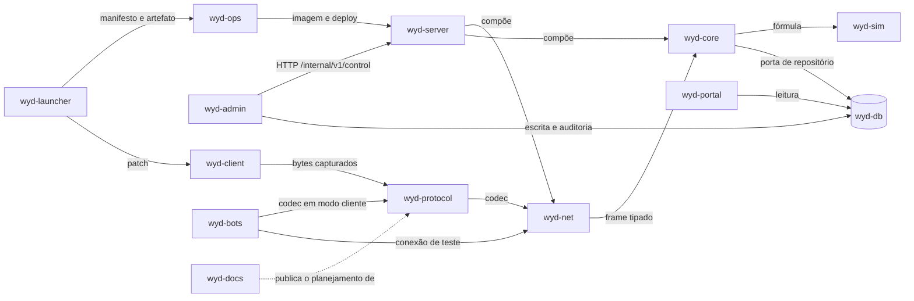

# WYD 1.0.0 — panorama e plano de execução

> **Estado: plano de trabalho, não decisão aprovada.** Este documento é o painel único do projeto
> inteiro: o que existe, o que está medido, em que ordem o planejamento avança e qual é o gate de
> cada etapa — inclusive o gate de cobertura funcional que fecha a `1.0.0` (§4.2). Ele **não**
> substitui o plano diretor de nenhum sistema e **não** decide arquitetura.
>
> Medido em **2026-11-19**. Toda contagem traz a fonte; número sem fonte é `H`.
>
> **Alvo declarado pelo dono em 2026-11-20:** a `1.0.0` é o **jogo completo** — todos os sistemas e
> funcionalidades do jogo oficial funcionando —, e o critério de saída é **cobertura funcional de
> 100%** (§4.2). O número de cobertura é medido em §1.5; nenhum total de funcionalidade é estimado
> aqui.

---

## 0. Como ler

| Se você quer… | Vá para |
|---|---|
| saber o que está pronto e o que não está | §1 |
| saber quanto do jogo já funciona | §1.5 |
| saber o que já foi decidido e o que está aberto | §2 |
| ver contradições que precisam de decisão do time | §3 |
| saber a ordem de execução e o gate de cada fase | §4 |
| saber o que este plano não decide | §5 |
| saber o que fazer em seguida, por ganho ÷ esforço | §6 |
| saber quem decide o quê, o que já pode ser ligado e em que ordem | §7 |
| saber onde cada artefato mora e qual sistema é dono dele | §8 |

---

## 1. Estado medido

### 1.1 Por sistema

| Sistema | Documentos | Estado | Evidência |
|---|---:|---|---|
| `wyd-db` | 246 | piloto parcial: 236 páginas com cabeçalho, **28 de 34** migrations escritas (os 6 seeds seguem bloqueados), 37 páginas de `src/`, 0 em `tests/`, `prompts/` e `skills/`; dicionário **completo**, **109 das 109** páginas de tabela | `find`/`grep` em 2026-11-22 |
| `wyd-protocol` | 7 | 2º piloto aberto: plano diretor com teto de 131 páginas, 5 escritas, 20 lacunas (17 decididas em 2026-11-20, 3 abertas por dependerem de captura), nenhum ADR; série de entrega do crate `0.1.0` → `1.0.0` (§4.1) | `wyd-protocol-1.0.0.md` e `lacunas.md`, 2026-11-22 |
| `wyd-docs` | 9 | plano diretor e lacunas + site MkDocs 2.0 implementado; 5 páginas em `docs/` | `wyd-docs-1.0.0.md`; `wyd-docs/`, 2026-11-22 |
| `wyd-portal` | 12 | planejado: dashboard, `lacunas.md`, plano de armaria e mercado e 8 páginas em `docs/` (11 de planejamento + o prompt); **33 `RF-POR`**, 10 `RNF-POR`, 0 lacunas abertas (8 fechadas; `09` em proposta) | `wyd-portal/`; `lacunas.md` §1, 2026-11-22 |
| `wyd-admin` | 11 | planejado: dashboard, `lacunas.md` e 9 páginas em `docs/`; contrato C4 com 14 rotas (7 de staff, 4 de custódia de item, 3 utilitárias); **15 `RF-ADM`**, 10 fatias; zero lacunas abertas (as sete fecharam até 2026-11-22) | `wyd-admin/`, 2026-11-22 |
| `wyd-ops` | 5 | propostas de gestão de GitHub/ambientes e de versões/cobertura funcional + porta de entrada publicada e o plano da imagem do site; sem plano diretor e sem `RF-OPS` | `wyd-ops/`, 2026-11-22 |
| `wyd-net` | 3 | aberto em 2026-11-22: fronteira, 7 contratos (4 herdados já decididos) e 4 lacunas abertas; sem `RF-NET` | `wyd-net/lacunas.md` §1, 2026-11-22 |
| `wyd-core` | 3 | aberto em 2026-11-22: fronteira, 6 contratos e 4 lacunas abertas; sem catálogo, sem `RF-CORE` | `wyd-core/lacunas.md` §1, 2026-11-22 |
| `wyd-server` | 3 | aberto em 2026-11-22: fronteira, 6 contratos (2 já decididos por `LAC-ADM-03`) e 4 lacunas abertas | `wyd-server/lacunas.md` §1, 2026-11-22 |
| `wyd-sim` | 3 | aberto em 2026-11-22: fronteira, 4 contratos e 4 lacunas; nenhuma fórmula escrita | `wyd-sim/lacunas.md` §1, 2026-11-22 |
| `wyd-launcher` | 3 | aberto em 2026-11-22: fronteira, 6 contratos e 4 lacunas abertas | `wyd-launcher/lacunas.md` §1, 2026-11-22 |
| `wyd-client` | 4 | aberto em 2026-11-22: fronteira, 5 contratos, 4 lacunas próprias + as 3 medições herdadas do protocolo; **registro medido** do cliente local | `wyd-client/registro-do-cliente.md`, 2026-11-22 |
| `wyd-bots` | 3 | aberto em 2026-11-22: fronteira, 5 contratos e 4 lacunas abertas | `wyd-bots/lacunas.md` §1, 2026-11-22 |

### 1.2 `wyd-db`, página por pasta

| Pasta | Escritas | Planejadas | Observação |
|---|---:|---:|---|
| `docs/` raiz (`index`, `convencoes`, `glossario`) | 3 | 3 | fecha |
| `docs/arquitetura/` | 13 | 17 | `index` + 12; faltam implantação, fluxo, modelo conceitual e retenção |
| `docs/specs/` | 10 | 20 | `index` + 9; faltam 4 de topo, 4 fluxos e 3 estados |
| `docs/dicionario-dados/` | 21 | 21 (+109 de tabela) | `index`, `como-ler` e os **19 domínios** (2026-11-21); as 109 por tabela são manuais (`M26`) e **109 existem** (2026-11-22) |
| `docs/planos/` | 8 | 10 | `index` + 7 planos escritos, inclusive `plano-de-documentacao` e `plano-de-testes` |
| `docs/roadmap/` | 42 | 42 | `index`, `fases` e as 40 `WYDDB-nnn` escritas; as issues nascem na Onda 8 |
| `docs/guia-desenvolvedor/` | 10 | 11 | 3 páginas anteriores + 7 recortes; falta `pool-e-transacoes` |
| `docs/guia-administrador/` | 4 | 8 | `index`, `configuracao`, `instalacao` e `diagnostico` |
| `docs/guia-teste/` | 5 | 7 | `index`, contrato, sistema, `piramide-e-alvos` e `gates-e-anti-skip` |
| `docs/guia-documentacao/` | 4 | 8 | `index`, `estilo-e-linguagem`, `estrutura-e-navegacao` e `revisao-e-publicacao` |
| `migrations/` | 28 | 36 | 2 páginas de seção (por escrever) + 34 arquivos, 28 escritos |
| `src/` | 37 | 59 | `migrate/` e `provision/` têm página por arquivo |
| `tests/` | 0 | 12 | |
| `prompts/` | 0 | 9 | |
| `skills/` | 0 | 9 | |

**Totais planejados:** 147 páginas autorais em `docs/` + 109 por tabela, escritas à mão (`M26`) + 36 de migration + 59 de `src/`
+ 12 de teste + 9 prompts + 9 skills (`wyd-db-1.0.0.md` §4). **Escritas:** **120 páginas autorais com
corpo** em `docs/` (120 arquivos, incluindo os índices que já viraram página), fora de `gerado/`, que reúne **110 arquivos**
(as 109 páginas de tabela e o índice); 28 em `migrations/`, 37 em `src/` (2026-11-22).

### 1.3 Série de migrations

| Indicador | Valor | Fonte |
|---|---:|---|
| Arquivos da série | 34 (29 originais + os adendos `0030`, `0031` e `0032` + os lotes `0033`, `0034`) | `plano-migrations.md` §3 |
| Tabelas | 109 | `plano-migrations.md` §3 (planejado) |
| Arquivos de seed | 6 | idem |
| Tabelas com DDL fechado | 109 de 109 | `ddl-confirmado.md` §1 |
| Tabelas desenhadas e aguardando aprovação | 0 | `ddl-confirmado.md` §1 |
| Arquivos com DDL inteiro fechado | 28 (todos menos os 6 seeds) | `migrations-checklist.md` §4, 2026-11-22 |
| `SCHEMA_VERSION` alvo | 34 | `plano-migrations.md` §6 |

### 1.4 Repositório, GitHub e operação

| Fato | Valor | Fonte |
|---|---|---|
| Visibilidade / branch padrão | público / `develop` | API do GitHub, 2026-11-19 |
| Issues / milestones / Projects | 40 abertas (#82–#121) / 13 milestones (M0–M5 + F1–F7) / habilitado, project `WYD 1.0.0` nº 10 ligado ao repositório, 40 itens com `Sistema`, `Fase`, `Prioridade`, `Marco` e `Status` preenchidos e 63 vínculos `blocked by` | API do GitHub, 2026-11-22; detalhe em `wyd-ops` §10.3 |
| Merge permitido | squash, branch apagada no merge | API do GitHub |
| Secret scanning / Dependabot | ativos | API do GitHub |
| `crates/*` | 9 pastas, só `.gitkeep` | `git ls-files` |
| Código Rust real | `deprecated/` com 375 arquivos, **0 versionados** | `git ls-files deprecated` |
| Raiz | sem `Cargo.toml`, `rust-toolchain.toml`, `Makefile` | `ls` |
| CI | `full-workflow`: 1 job (`Get Info`), **verde**, sem build/teste e com `version`/`commit` vazios (`V`: run #14 `44505419869`, job `135495629487`; detalhe em `wyd-ops` §2.1); `docs`: gate + publicação | `.github/workflows/` |
| Workflows de referência no legado | 3 (`ci`, `bench`, `release`) | `deprecated/.github/workflows/` |
| Site de documentação | MkDocs 2.0 (`2.0.dev6`) + Python 3.15; **267 páginas montadas de 13 sistemas**; build, `verificar.py` e `verificar-contagens.py` verdes | `wyd-docs-1.0.0.md` §9.1; `wyd-docs/`, 2026-11-22 |
| Cliente | 7.147 arquivos e 567 MB em `wyd-client/files/`, ignorado; `WYD.exe` com hash medido | `wyd-client/registro-do-cliente.md`, 2026-11-22 |

### 1.5 Cobertura funcional da `1.0.0`

A `1.0.0` é o jogo completo (§4.2), então a medida que decide a versão é **cobertura funcional**, não
página escrita. Esta seção é o **dono do número agregado**: total de funcionalidades do catálogo e
fração com prova, medidos com data, quando o catálogo existir.

Uma entrada conta quando está `aceita` — fluxo com passo a passo, dono entre os 13 sistemas, prova
(golden, captura datada ou leitura do cliente, com segunda leitura) e versão em que entra; sem prova
ela não conta. O molde da entrada é de `wyd-ops/proposta-versoes-e-cobertura-funcional.md` §7, que
ainda é proposta: enquanto não for executada, esta tabela fica em “não medido”, não em estimativa.

| Indicador | Valor (2026-11-20) | Fonte |
|---|---|---|
| Funcionalidades no catálogo | não medido | catálogo funcional não existe (`wyd-ops/proposta-versoes-e-cobertura-funcional.md` §7) |
| Funcionalidades `aceitas` | não medido | idem |
| Cobertura | meta **100%**, não medida | §4.2 |

Nenhum total é estimado antes do levantamento: os 13 sistemas técnicos não são 13 funcionalidades, a
lista de domínios citada pelo dono (classes, skills, refinamento, guerras, cidadania, estados
especiais, montarias, invocações, transformações, magias, quests, guildas) é pauta de levantamento,
não catálogo, e o inventário do legado (`wyd-protocol` §0.4) é baseline de referência, não total
alvo. Contagem de funcionalidade sem catálogo é `H`, nunca estimativa. Cobertura declarada sem data é
`H` também: cada valor desta tabela entra com a data em que foi medido.

---

## 2. O que está decidido e o que está aberto

### 2.1 Decidido (`aceito`)

| ID | Decisão | Data |
|---|---|---|
| `P-01` | 4 schemas por domínio: `content`, `game`, `portal`, `ops`; nada em `public` | 2026-11-17 |
| `P-02` | tabela no singular, `snake_case` | 2026-11-17 |
| `P-03`–`P-22` | PK identity, PK composta em filha, sem UUID, `TIMESTAMPTZ`, dinheiro inteiro, `TEXT`+`CHECK`, `INET`, coluna gerada, `NOT NULL` por padrão, constraint nomeada, índice parcial, FK indexada, trigger só mecânica, view de leitura, papéis separados, migration imutável, sem soft-delete genérico, retenção declarada, PII só em `portal` | 2026-11-17 |
| `ADR-DB-0001` | provisionamento de papel é fase própria, fora da série | 2026-11-17 |
| `ADR-DB-0002` | runner de migrations próprio, com ledger por versão | 2026-11-18 |
| `M1`–`M25`, `A9`–`A16`, `D1`–`D14` | decisões de desenho fechadas, cada uma com evidência em `lacunas.md` | 2026-11-17/18 |

São **dois** ADRs. Não existe catálogo prévio; ADR nasce de decisão tomada, não de planejamento.

### 2.2 Aberto

| Grupo | Abertas | Exemplos |
|---|---:|---|
| Lacunas `B`/`A`/`M` | 0 pendentes | `M27` e `M28` fecharam em 2026-11-21, `M29`, `M30` e `M31` em 2026-11-22; 33 fecharam; 3 seguem `externa` (`A11`, `A20`, `M21`); a lista completa está em `wyd-db/lacunas.md` §1 |
| Externas | 3 | `A11`, `A20`, `M21` |
| Divergências do plano diretor | 0 | `P1`–`P11` fechadas (`wyd-db/lacunas.md` §1 e §3) |
| DDL não desenhado | 0 tabelas | todas as 109 têm coluna desenhada; 34 arquivos de migration para 109 tabelas (34/109, `plano-migrations.md` §3, 2026-11-22); os lotes `0022`, `0025`, `0026`, `0028` e `0029` foram aprovados em 2026-11-21, os `0033` e `0034` em 2026-11-22, e os seis seeds são escritos à mão (`plano-migrations.md` §4) |
| ADR de fronteira pessoa × conta | sem número | citada em `lacunas.md` §0.2 e `rascunho-accounts.md` |

---

## 3. Divergências que precisam de decisão do time

Estas não são tarefas: são contradições entre documentos ou entre documento e realidade. Ficam
registradas aqui até alguém decidir; nenhuma foi corrigida por conta própria.

| # | Divergência | Evidência | Efeito |
|---|---|---|---|
| D1 | `README.md` da raiz afirma desenvolvimento ativo, 10 crates, 34 issues ativas, 58 concluídas, 53 migrations e serviços no ar — **resolvido em 2026-11-19**: reescrito para o estado medido, sem contagem replicada | `README.md` × `git ls-files`, API do GitHub | agente e visitante leem estado falso |
| D2 | `crates/*` estão vazios, mas o README e o CI pressupõem workspace Rust | `find crates` | qualquer `cargo build` na raiz falha |
| D3 | CI tem um job só, e o `run:` monta `$(0.0.0-<sha>)` e `$(<sha>)`, que o shell executa como comando — **medido em 2026-11-19**: o job **não** falha e publica metadado vazio | `V`: run #14 (`44505419869`) e job `Get Info` (`135495629487`) com `success`; log traz `command not found` nas linhas 40 e 44; 0 runs `failure`; detalhe em `wyd-ops` §2.1 | gate verde que não publica `version`/`commit`; não há build, teste, cobertura nem gate de código |
| D4 | O planejamento exige CI composto por actions reutilizáveis; `.github/actions/` tem só `docs-check` | `V`: `git ls-files .github`, 2026-11-19 | meta da `1.0.0` sem base: faltam as actions de Rust, cobertura e segurança de `wyd-ops` §4 |
| D5 | Gestão de trabalho: o roadmap de 40 issues do `wyd-db` não tinha onde viver | `V`, 2026-11-19: `has_projects: true`, 6 milestones (`M0`–`M5`) e project `WYD 1.0.0` nº 10; execução registrada em `wyd-ops` §10 | **resolvido em 2026-11-22:** as 40 issues #82–#121 existem no board, com milestone de fase, DoD, labels, os quatro campos preenchidos, 5 views e 63 vínculos `blocked by` (`wyd-ops` §10.3) |
| D6 | O plano diretor declara 147 páginas autorais; 84 estavam bloqueadas em 2026-11-18 e **27 seguem** depois das 21 de recorte e das 40 `WYDDB-nnn` | `proposta-paginas.md` §6 | escrever mais rápido exige fechar lacuna, não escrever autour |
| D7 | Não existe `mkdocs.yml` em lugar nenhum, mas `wyd-docs` é dono do site e o guia do `wyd-db` já prescreve recursos do MkDocs — **resolvido em 2026-11-19**: site em MkDocs 2.0 no `wyd-docs/`, sem `mkdocs.yml`; recursos do MkDocs 1.x convertidos na origem (§2.2 e `LPDOC-14`) | `find . -iname 'mkdocs*.yml'` sem resultado | site não publicável; exigência sem base executável |
| D8 | `docs/` na raiz não existe; no legado, `docs/` é referência — **resolvido em 2026-11-19**: a documentação publicada sai de `planejamento-1.0.0/*/docs/` por `wyd-docs/`, e o legado não é publicado | `ls` | risco de alguém publicar o legado como doc oficial |

---

## 4. Plano de fases

Cada fase termina com um gate verificável. Nenhuma fase começa antes do gate anterior, salvo decisão
explícita do time.

### Fase 0 — Fundação e memória do projeto ✅ (2026-11-19)

- [x] Medir repositório, planejamento, GitHub e CI sem alterar nada.
- [x] Reescrever `AGENTS.md` com hierarquia de fontes e invariantes.
- [x] Registrar panorama neste arquivo.
- [x] Criar memória de trabalho em `.agents/memory/estado-do-projeto.md`.
- [x] Criar skills `auditar-planejamento` e `planejar-sistema`, e o prompt de auditoria.

**Gate:** um agente novo consegue dizer o que está planejado, o que é referência e o que é proibido
sem abrir o legado.

### Fase 1 — Gestão do trabalho no GitHub ✅ (2026-11-19)

Proposta em `wyd-ops/proposta-gestao-github-e-ambientes.md` aprovada e executada (§10 dela).

- [x] Habilitar Projects do repositório e criar o project `WYD 1.0.0` com campos `Sistema`,
      `Fase`, `Prioridade` e `Marco` (além do `Status` padrão).
- [x] Criar as labels `area/*` (13), `estado/*` (3), `origem/legado` e `risco/*` (2), sem duplicar
      tipo em label.
- [x] Criar os milestones `M0 — Fundação` a `M5 — Operação`.
- [x] Criar `.github/ISSUE_TEMPLATE/` com `bug`, `planejamento`, `decisao`, `tarefa` e `config.yml`,
      e `.github/pull_request_template.md` com gate de documentação, prova e escopo.
- [x] Configurar ruleset de `develop` e `main`: PR obrigatório, sem deleção, sem force-push.
      **Sem *required status check***: não há check que reporte (entra na Fase 4).
- [x] Migrar as 40 issues planejadas de `docs/roadmap/` para issues reais **só depois** de as páginas
      existirem; as 40 páginas com DoD fecharam em 2026-11-22 e as issues #82–#121 foram criadas.

**Gate:** uma issue do roadmap chega ao board com sistema, fase e prioridade; o board mostra 40
itens, o mesmo número de páginas `WYDDB-nnn`. **Fechado em 2026-11-22** (`V`, `wyd-ops` §10.3): 40
itens com os cinco campos preenchidos, 5 views e o project ligado ao repositório.

### Fase 2 — Fechar o `wyd-db`

Ordem derivada de `plano-migrations.md` §9 e `proposta-paginas.md`; não é ordem nova.

- [ ] Fechar as lacunas pendentes com o dono nomeado em `lacunas.md` (bloqueantes primeiro).
- [ ] Escrever as 6 páginas de migration restantes (seeds), quando o dado de origem estiver verificado; os arquivos são escritos à mão, sem gerador (`plano-migrations.md` §4).
- [x] Aprovar os cinco lotes propostos (`0022`, `0025`, `0026`, `0028`, `0029`) em `ddl-confirmado.md` antes da página — aprovados em 2026-11-21; nenhum lote aguarda aprovação.
- [ ] Escrever `specs/` (requisitos, regras, NFR, casos de uso, fluxos, estados, rastreabilidade).
- [x] Concluir as 109 páginas por tabela (`M26`: à mão, sem gerador; **109/109** escritas em 2026-11-22); as **19** páginas de domínio também estão escritas (2026-11-22).
- [ ] Escrever `planos/` (testes, dados, qualidade, métricas, riscos, execução).
- [ ] Escrever `guia-administrador/`, `guia-documentacao/` e o restante de `guia-teste/`.
- [ ] Criar `tests/` e `prompts/`/`skills/` do sistema.
- [ ] Validar o site: `mkdocs build --strict` sem link morto nem diagrama inválido.

**Gate:** 34 páginas de migration (28 escritas, 6 seeds `bloqueada`) + 19 páginas de domínio + 109 páginas por tabela (**109/109** concluídas em 2026-11-22, `wyd-db-1.0.0.md` §6.8); `planos/metricas.md` mede o
fechamento; nenhuma afirmação de comportamento sem `V`; site estrito passa.

### Fase 3 — Planejar os 12 sistemas restantes

- [ ] Aprovar o molde de planejamento por sistema (o de `wyd-db` é a referência, não o texto).
- [x] Escolher o segundo piloto por dependência: **`wyd-protocol`**, decidido em 2026-11-19;
      `wyd-docs` também foi aberto para publicar a documentação oficial.
- [ ] Para cada sistema: dashboard `<sistema>-1.0.0.md`, `docs/` com público e pergunta por página,
      `src/` por unidade de responsabilidade, `tests/` por alvo, `prompts/`, `skills/`.
- [ ] Definir a comunicação entre sistemas (protocolo, mensagens, dono do contrato) antes de planejar
      o interior de cada um.
- [ ] Mapear o que cada sistema consome do `wyd-db` por porta, não por tabela.

**Gate:** todo sistema tem fronteira, entradas/saídas, requisitos com ID, plano de teste e roadmap
com DoD; nenhum sistema depende de tabela de outro sem contrato.

### Fase 4 — Implementação

- [ ] Criar o workspace Rust na raiz com `Cargo.toml`, `rust-toolchain.toml` e `Makefile`.
- [ ] Implementar na ordem de dependência, uma issue por PR, TDD, cobertura ≥ 85%.
- [ ] Substituir o CI stub por workflows reutilizáveis + actions compostas.
- [ ] Rodar o corte vertical do `wyd-db` (`0001`–`0007`, 22 tabelas) antes dos 25 arquivos restantes da série.
- [ ] Provar isolamento entre `portal` e `game` por `permission denied`, não por revisão.

**Gate:** `fmt`, `clippy -D warnings`, testes, cobertura, migrations e build verdes em PR; E2E do
sistema executando contra Postgres real; cobertura funcional de §1.5 medida a cada versão entregue.

### Fase 5 — Operação

- [ ] Ambiente local em Docker Compose; CI efêmero em runner hospedado.
- [ ] Homologação em free tier só para portal e banco, com dado sintético.
- [ ] Produção com servidor de jogo em máquina própria/VPS; free tier não serve (hiberna).
- [ ] Observabilidade e alertas definidos antes do primeiro deploy.

**Gate:** nenhum segredo em repositório; deploy reproduzível; rollback ensaiado; alerta testado.

### 4.1 Série de versões do `wyd-protocol` (`0.1.0` → `1.0.0`)

O `wyd-protocol` entrega em versões menores, abertas na `0.1.0` e fechadas na `1.0.0`. Escopo, gate
e pré-requisito de cada fatia são de `planejamento-1.0.0/wyd-protocol/wyd-protocol-1.0.0.md` §9.1 e
não se repetem aqui. Nesta seção a `1.0.0` é a versão do **crate**; o alvo do jogo completo é §4.2, e
as duas coisas não se substituem. Estado `P`: nenhuma versão entregue, nenhum opcode gerado, nenhuma
data.

A série é o eixo de entrega para fatiar sprints, issues e milestones: cada issue pertence a
exatamente uma versão — a que serve o gate dela — e a ordem das versões é ordem de entrega, não
calendário. Quem escreve issue usa o fatiamento de
`planejamento-1.0.0/wyd-protocol/docs/roadmap/fases.md`; como a versão aparece no board foi decidido
pelo dono de operação em 2026-11-20 — milestone por versão, com migração ainda não executada
(`wyd-ops/proposta-versoes-e-cobertura-funcional.md` §4) — e não é decisão desta página. Só o
`wyd-protocol` tem série escrita hoje: o fatiamento `0.1.0` → `1.0.0` dos outros sistemas é decisão
do dono de cada um, na mesma escala de versões já escolhida para o board.

Isso não muda as fases acima: fase é estágio do projeto; versão é fatia de entrega do crate e do
catálogo, dentro da Fase 4.

### 4.2 Critério de saída da `1.0.0` — jogo completo

`1.0.0` aqui não significa “planejamento concluído”: significa **jogo completo**. Declarado pelo dono
em 2026-11-20. A versão sai quando 100% das entradas do catálogo funcional estiverem `aceitas` — cada
uma com fluxo, dono, prova e versão —, sem entrada aberta e com todos os gates de sistema verdes.

O mesmo critério mede as versões menores: uma fatia `0.x` fecha quando as entradas que ela promete
estão `aceitas`, e o jogo fecha quando todas estiverem. A fatia não recalcula cobertura: lê a de §1.5,
que é a única contagem agregada.

| Critério | Como se verifica |
|---|---|
| fatia `0.x` | entradas prometidas pela fatia `aceitas`, lidas de §1.5 |
| cobertura funcional | total e fração de §1.5, medidos do catálogo, com data |
| fluxo por funcionalidade | entrada do catálogo com passo a passo e estado |
| prova por funcionalidade | golden, captura datada ou leitura do cliente, com segunda leitura |
| sistema dono | cada entrada aponta um dos 13 sistemas, sem dono duplicado |
| release | gate da Fase 5: deploy reproduzível e rollback ensaiado |

Consequências para este plano:

1. **Planejar página não é entregar funcionalidade.** Fechar as páginas de um sistema continua sendo
   pré-requisito para implementá-lo, mas não conta cobertura.
2. **O catálogo funcional é pré-requisito do plano de sprint.** Sem ele a `1.0.0` não tem como ser
   medida e nenhuma versão menor pode ser declarada completa — planejamento fechado não supre a
   falta do catálogo.
3. **A contagem é daqui.** Total de funcionalidades e fração coberta são números deste panorama
   (§1.5); o catálogo é dono da entrada e da prova, e nenhuma página recalcula o agregado.
4. **As fases continuam estágios.** A mudança é de alvo e de critério de saída, não de ordem: a Fase 4
   implementa, a Fase 5 opera, e a `1.0.0` exige as duas.

O catálogo funcional não existe hoje: a divisão de dono (`wyd-core`/`wyd-sim`/`wyd-db`) e o molde de
entrada estão propostos em `wyd-ops/proposta-versoes-e-cobertura-funcional.md` §7.

---

## 5. O que este documento não decide

- Não decide arquitetura de nenhum sistema; o dono é o plano diretor de cada um.
- Não decide data nem prioridade de release; o alvo “jogo completo” está registrado como declaração
  do dono (2026-11-20), com o critério em §4.2.
- Não fecha lacuna: lacuna é fechada em `lacunas.md`, pelo dono nomeado.
- Não estima cobertura funcional: §1.5 mede, com data e fonte, e “não medido” é resposta válida
  enquanto o catálogo não existir.
- Não declara versão entregue: declarar `0.x` ou `1.0.0` exige o critério de §4.2, não a conclusão
  das páginas de planejamento.
- Não cria ADR: ADR nasce de decisão tomada, com “como verificar”.
- Não define o molde dos 12 sistemas restantes; propõe que o de `wyd-db` seja a base.
- Não escolhe hospedagem: a proposta está em `wyd-ops/proposta-gestao-github-e-ambientes.md` e
  depende de aprovação.
- Não mede qualidade de código: não há código de produção para medir.

---

## 6. Próximos passos priorizados por ganho ÷ esforço (2026-11-19, revisto em 2026-11-20)

Ordem por **desbloqueio ÷ esforço**, não pela sequência das fases de §4. `automação` significa
executável agora, sem decisão pendente; `usuário` significa que só o dono decide ou autoriza. Todo
item termina num resultado observável — nenhum é "revisar" ou "amadurecer". O único passo que publicou foi o 2,
dentro da janela declarada pelo dono.

| # | Passo | Desbloqueia | Por que é rápido (o que já existe) | Pré-requisito | Executa | Termina quando |
|---:|---|---|---|---|---|---|
| 1 | Capturar o marcador público atual e registrar o custo de publicação | dimensiona a janela de congelamento e fixa o baseline `D0` do conteúdo público antes de congelar | reutilizou runs e deployments já identificados, os horários de `created_at`/status final e o marcador das duas árvores | nenhum | automação | **feito** (`V`, 2026-11-19): `assets/site.js` respondeu 200 com a URL literal do Highlight.js e as durações #4/#6/#8 foram 49/43/29 s; o registro está em `wyd-docs-1.0.0.md` §7.3 |
| 2 | Declarar a janela sem publicação e executar o checklist de rollback | fecha `LPDOC-01`, a lacuna que segura a publicação contínua do site | os dois runs estão elegíveis, o build dos dois commits passou em Linux (`V`, §7.3) e o checklist de 10 passos já está escrito | declaração de congelamento do dono | usuário declara; automação executa | **feito** (`V`, 2026-11-19): #2 publicou `2378b62b` (`npm/highlight.js`), #4 restaurou `0d765858` (`cdn-release`); deployments `7911886524` e `7911904845` `success`; `LPDOC-01` fechada |
| 3 | Decidir o conteúdo que fica público depois da restauração | evita manter o site atrás de `develop` sem decisão registrada | a consequência já estava no critério de parada de §7.3; a decisão coube em uma frase | nenhum | usuário | **feito** (`V`, 2026-11-19): decisão do dono — o site fica em `0d765858…` até o merge do PR, que publica o tip `aedd1f73…` de conteúdo idêntico; registrado em `wyd-docs-1.0.0.md` §7.3 (linha 3) e §9 |
| 4 | Fechar `LPDOC-12` fixando o build suportado em Linux/container | remove ambiguidade do build local; era a lacuna `P1` que faltava fechar | o erro `PosixPath` está reproduzido e o mesmo comando passa em container nos dois commits | nenhum | usuário (dono: operação) | **feito** (`V`, 2026-11-19): decisão do dono fixou Linux/container como build suportado, com Windows fora de escopo; `lacunas.md` fechou `LPDOC-12` e §7.1 registra que o build roda em Linux e que no Windows falha por `PosixPath` |
| 5 | Medir o comportamento real do CI `full-workflow` como baseline do plano do `wyd-ops` | dá base verificável para a Fase 4 (CI real) e tira a causa de `H` | runs, jobs e log já estavam acessíveis por leitura; faltava medir o efeito real do defeito de shell que `D3` apontava | nenhum | automação | **feito** (`V`, 2026-11-19): run #14 (`44505419869`) e job `Get Info` (`135495629487`) `success`, saída `version`/`commit` vazias; registrado em `wyd-ops` §2 e §2.1 |

**A fila que serve à `1.0.0` é outra.** Os cinco passos acima fecharam fundação e publicação do site;
nenhum deles mede funcionalidade. Com o alvo de §4.2, o primeiro passo que destrava a versão é o
catálogo funcional (§1.5): enquanto ele não existir, a cobertura fica “não medido” e nenhuma versão
pode ser declarada completa, por mais páginas que o planejamento feche. Executar a divisão
`wyd-core`/`wyd-sim`/`wyd-db` e o molde de entrada está proposto em
`wyd-ops/proposta-versoes-e-cobertura-funcional.md` §7 e é passo de `usuário`, não de automação.

**Próxima ação imediata:** as duas filas correm em paralelo. Na documentação, executar o próximo
passo ativo da fila do sistema dono — no `wyd-db`, as **109 das 109** páginas por tabela (`M26`,
2026-11-22) estão escritas em `wyd-db/docs/dicionario-dados/gerado/`; o que resta da árvore são as seis
páginas de migration dos seeds (`bloqueada`) e as pastas `specs/`, `planos/`, `tests/`, `prompts/` e
`skills/`. Na cobertura, a ação é a decisão do catálogo acima; o dicionário fecha planejamento, não a
`1.0.0`. O pacote anterior já foi mesclado no
PR #48 (`e08f7d1`, 2026-11-19), portanto não há commit, push nem PR pendente daquela entrega.
---

## 7. Mapa dos sistemas, contratos e ordem de execução (2026-11-22)

> Esta seção é o **mapa**: quem decide o quê, o que cada sistema entrega a quem, o que já pode ser
> ligado e em que ordem. Ela **cita** o documento dono de cada contrato e de cada lacuna em vez de
> repetir o conteúdo — um fato, um dono. Medido em 2026-11-22: nenhum sistema tem código de
> produção (`crates/*` com 9 pastas e só `.gitkeep`).

### 7.1 Responsabilidade por sistema

“Responsabilidade” é o que **só** aquele sistema decide. Se a decisão aparece em dois sistemas, ela
tem dois donos e é defeito (§3).

| Sistema | Responsabilidade (decide sozinho) | Não é dele | Plano | Estado do plano |
|---|---|---|---|---|
| `wyd-protocol` | layout do fio, `Type`, cabeçalho, ofuscação, checksum, DTO e regra “sem I/O” | socket, sessão, regra de jogo | 7 páginas | aberto: 2º piloto, 5 escritas, 3 lacunas dependem de captura |
| `wyd-net` | conexão: aceite, sessão, ordem, timeout, limite, reação a erro | byte, opcode, regra | 3 páginas | proposto (2026-11-22) |
| `wyd-core` | comportamento: tick, cena, entidades, combate, IA, estados | fórmula, SQL, fio | 3 páginas | proposto (2026-11-22) |
| `wyd-sim` | cálculo puro e determinístico | quando aplicar, balanceamento | 3 páginas | proposto (2026-11-22) |
| `wyd-db` | schema, migrations, DDL, transação, retenção | comportamento, fio, UI | 246 páginas | piloto: 109/109 tabelas, 28/34 migrations |
| `wyd-server` | processo por canal, topologia, ciclo de vida, controle | regra, fio, deploy | 3 páginas | proposto (2026-11-22) |
| `wyd-admin` | backoffice de staff, custódia de item, auditoria | regra de jogo, UI pública | 11 páginas | planejado: 15 `RF-ADM`, 0 lacuna aberta |
| `wyd-portal` | site público, conta web, armaria/mercado web, NOC | redirecionar ao admin, custódia | 12 páginas | planejado: 33 `RF-POR`, 0 lacuna aberta |
| `wyd-launcher` | manifesto, patch aplicado, integridade local | conteúdo do patch, hospedagem | 3 páginas | proposto (2026-11-22) |
| `wyd-client` | captura e registro do cliente real, artefato de cliente | fio, manifesto, regra | 4 páginas | proposto (2026-11-22), com registro medido |
| `wyd-bots` | cenário de QA de fio, carga e convivência | codec, ambiente, métrica | 3 páginas | proposto (2026-11-22) |
| `wyd-docs` | publicação, gate editorial, contagens do site | conteúdo de sistema | 9 páginas + site | implementado, gate verde |
| `wyd-ops` | CI, imagem, deploy, observabilidade, topologia de ambiente | regra, fio, escrita administrativa | 3 + 2 páginas | proposto: decisões sem plano diretor |

### 7.2 Grafo de dependência

Aresta = “consome contrato de”. A direção do dado é a da seta; quem decide o contrato é o alvo da
seta, exceto quando a linha do §7.3 diz outro dono.



Duas arestas são de **processo**, não de runtime: `client → protocol` (a captura alimenta a prova do
fio) e `docs → …` (o site publica o planejamento). Nenhuma delas é dependência de execução.

### 7.3 Contratos entre sistemas

Só entra aqui contrato com dono nomeado. Estado **decidido** = a decisão está escrita e datada no
documento citado; **proposto** = existe desenho, falta aprovação; **lacuna** = a pergunta está aberta.

| # | Contrato | De → para | Forma | Dono | Estado | Onde |
|---|---|---|---|---|---|---|
| X1 | codec do fio | `protocol` → `net`, `bots` | `encode`/`decode`, erro tipado, sem I/O | `wyd-protocol` | decidido | `LPRT-18`, `LPRT-08`, `LPRT-13` |
| X2 | ordem por conexão | `net` → `core` | entrega serializada | `wyd-net` | decidido | `LPRT-12` |
| X3 | payload tipado e validado | `protocol` → `core` | tipo por família, offset nunca cruza | `wyd-core` | decidido | `LPRT-18` |
| X4 | fórmula determinística | `sim` → `core` | função pura, sem I/O | `wyd-sim` | proposto | `LSIM-01`, `LSIM-04` |
| X5 | leitura e persistência | `core` → `db` | porta de repositório, sem SQL no core | `wyd-db` | proposto | `LCORE-04` |
| X6 | estado durável × memória | `core` ↔ `db` | frequência de save e perda aceitável | `wyd-core` + `wyd-db` | lacuna | `LCORE-02`, `WYDDB-017` |
| X7 | composição do processo | `server` monta `net`+`core` | uma porta por canal | `wyd-server` | lacuna | `LSRV-01`, `LSRV-02` |
| X8 | controle administrativo | `admin` → `server` | `POST /internal/v1/control`, `200 {delivered_to}`, `503` sem escrita | `wyd-server` (forma), `wyd-admin` (elo) | decidido | `LAC-ADM-03` |
| X9 | segredo do elo de controle | `ops` → `server` | `WYD_SERVER_CONTROL_TOKEN`, distinto do portal | `wyd-ops` | decidido | `LAC-ADM-03` §3.3 |
| X10 | métrica para NOC | `server` → `portal` | `/metrics` Prometheus, coleta `wyd-ops` | `wyd-ops` | decidido | `LAC-POR-06` |
| X11 | manifesto e patch | `ops` → `launcher` → `client` | manifesto com hash por arquivo | `wyd-launcher` | lacuna | `LLCH-01`, `LLCH-03` |
| X12 | captura como prova | `client` → `protocol` | bytes + ficha + anonimização + 2ª leitura | `wyd-protocol` (processo), `wyd-client` (execução) | decidido o processo, 0 capturas | `LPRT-10`, `goldens/como-capturar.md` |
| X13 | ambiente de bot | `ops` → `bots` | ambiente efêmero, conta sintética | `wyd-ops` + QA | lacuna | `LBOT-01`, `LBOT-02` |
| X14 | imagem do site | `ops` → `docs` | imagem publicada no GHCR, consumida por Compose | `wyd-ops` | decidido | `plano-imagem-e-compose-do-site.md` |

### 7.4 O que já pode ser ligado

“Ligado” = existe contrato decidido e dono nomeado o bastante para implementar **sem decisão nova**.
Isto não é previsão de entrega; é leitura de estado.

| Ligação | Por que já pode | O que ainda falta |
|---|---|---|
| `protocol` ↔ `net` (camada de quadro) | `LPRT-08`, `12`, `13` e `18` decididas; o codec não faz I/O | offsets de payload por `Type` — depende de captura |
| `db` ↔ dados (schema) | 109 de 109 tabelas com DDL fechado; 28 de 34 migrations escritas | 6 seeds e `SCHEMA_VERSION` 34 |
| `admin` ↔ `db` | 14 rotas de C4, 15 `RF-ADM`, zero lacuna aberta | `server` para o elo de controle |
| `portal` ↔ `db` | 33 `RF-POR`, leitura por view, zero lacuna aberta | nada de decisão; falta código |
| `admin` → `server` (controle) | forma e autenticação decididas em 2026-11-22 | o endpoint no `server`, que não existe |
| `docs` ↔ todos | 13 sistemas publicados; build, `verificar.py` e contagens verdes na mesma montagem (2026-11-22) | nada de decisão; falta o conteúdo de cada sistema |
| `docs` ↔ `ops` (imagem) | Dockerfile, Compose e workflow escritos nesta entrega | primeira execução do workflow no GitHub |
| `client` (registro) | árvore medida com hash; processo de captura decidido | endpoint que aceita a conexão (`LCLI-04`, `LSRV-01`) |

### 7.5 O que **não** pode ser ligado ainda

| Frente | Bloqueio | ID |
|---|---|---|
| escopo da `1.0.0` no `core` | não há catálogo funcional; “jogo completo” não tem lista | `LCORE-01`, §1.5 |
| topologia do `server` | quantos canais, qual porta, o que é `ready` | `LSRV-01`…`LSRV-03` |
| fórmula do `sim` | quais fórmulas, com que exemplo e com que aritmética | `LSIM-01`, `LSIM-04` |
| limites do `net` | limite por conexão, timeout e rate-limit sem valor medido | `LNET-01` |
| handshake do fio | `KeyWord`, encoding de texto e build-alvo sem captura | `LPRT-03`, `LPRT-06`, `LPRT-09` |
| patch e manifesto | formato e assinatura não decididos | `LLCH-01`, `LLCH-03` |
| carga e convivência | sem ambiente e sem conta sintética | `LBOT-01`, `LBOT-02` |

Consequência prática: **a onda jogável não começa antes do handshake provado**. O primeiro pacote
trocado é exatamente o que a captura prova, e a captura exige um endpoint do outro lado do socket.

### 7.6 Mapa de testes por sistema

Nível mais alto que cada sistema precisa provar. “Contrato” = fronteira com outro sistema;
“sistema” = o sistema inteiro em processo; “E2E” = fluxo de usuário ou de fio. Regra de cobertura
mínima de 85% e proibição de `SKIP` silencioso são de `AGENTS.md` §8; a pirâmide detalhada é de
`wyd-db/docs/guia-teste/piramide-e-alvos.md`. **Nenhum teste existe hoje**: `crates/*` não tem
arquivo.

| Sistema | Unitário prova | Contrato prova | Sistema prova | E2E prova | Alvo de hoje |
|---|---|---|---|---|---|
| `wyd-protocol` | round-trip, cabeçalho, erro tipado | bytes dourados (`goldens`) | — | fluxo real via `bots` | 0 testes; vetores ainda não existem |
| `wyd-net` | buffer por conexão, classificação de erro | codec falso + porta falsa | duas conexões sem vazamento de estado | `bots` conectando | 0 testes |
| `wyd-core` | regra isolada com semente fixa | repositório falso, sem banco | tick completo determinístico | `bots` em fluxo | 0 testes |
| `wyd-sim` | vetor de entrada e saída por fórmula | — | — | — | 0 vetores (`LSIM-03`) |
| `wyd-db` | função de migration, provision | Postgres real, não mock | aplicar do zero e reverter | `admin`/`portal` contra banco migrado | 0 testes; `tests/` planejado com 12 páginas |
| `wyd-server` | configuração e ciclo de vida | HTTP do controle: `200` com ack, `503` sem escrita | dois canais isolados | `bots` por canal | 0 testes |
| `wyd-admin` | regra de custódia e permissão | HTTP de C4, 14 rotas | fluxo de staff | Playwright (obrigatório, `AGENTS.md` §8) | 0 testes |
| `wyd-portal` | cálculo de preço e filtro | HTTP e leitura por view | fluxo de armaria e mercado | Playwright (obrigatório) | 0 testes |
| `wyd-launcher` | verificação de hash e manifesto | manifesto contra fixture | patch aplicado em árvore de teste | nativo, script de fumaça | 0 testes |
| `wyd-client` | parsing do registro medido | captura aceita contra ficha | — | Playwright no site que publica o registro | 0 testes |
| `wyd-bots` | gerador de cenário e perfil | codec real em modo cliente | — | **é o próprio E2E** | 0 cenários |
| `wyd-docs` | — | — | — | build + `verificar.py` + contagens | gate ativo (é o teste do sistema) |
| `wyd-ops` | validação de workflow e compose | build de imagem no CI | `compose up` do site | deploy publicado | pipeline escrito, 0 execução |

**Gate de teste do projeto:** nenhuma frente fecha issue sem o alvo da sua linha existindo e verde; o
E2E de `portal` e `client` é Playwright, o resto é Rust. Carga só entra depois do E2E de fio verde.

### 7.7 Ordem de execução (ondas)

| Onda | Conteúdo | Pré-requisito | Gate de saída |
|---|---|---|---|
| **A — fio e dado** | `protocol` `0.1.0` (quadro + DTO), `db` `SCHEMA_VERSION` 34 | nenhum | round-trip verde; migrations aplicam do zero e revertem |
| **B — cálculo** | `sim` com as fórmulas da `1.0.0` e vetores | catálogo de fórmulas (`LSIM-01`) | determinismo provado por vetor |
| **C — loop jogável** | `net` + `core` + `server` mínimo, um canal | handshake provado (`LPRT-03`/`09`) e topologia (`LSRV-01`/`02`) | login e movimento em dois canais; `503` do controle testado |
| **D — web** | `admin` e `portal` contra o banco migrado | onda A | 15 `RF-ADM` e 33 `RF-POR` cobertos; Playwright verde |
| **E — cliente e distribuição** | `client` (captura aceita), `launcher` (manifesto), `bots` (carga) | onda C | captura com ficha aceita; patch aplicado; cenário de carga medido |
| **F — operação** | `ops`: imagem, deploy, observabilidade | ondas C e D | `compose up` do servidor; dashboard com métrica real |

A ordem não é cronograma: é **dependência**. `docs` atravessa todas as ondas porque publica o
planejamento de cada uma, e por isso o gate editorial (`AGENTS.md` §4) roda em toda entrega.

### 7.8 O que este mapa não decide

- Não atribui data, sprint nem responsável nominal a nenhuma onda — isso é `wyd-ops`/produto.
- Não fecha lacuna: cada ID fecha no `lacunas.md` do seu dono.
- Não declara cobertura funcional: sem catálogo, a cobertura segue “não medido” (§1.5).
- Não transforma proposta em decisão: `proposto` continua `proposto` até o dono aprovar.

---

## 8. Layout do repositório e dono de cada artefato (revisto em 2026-11-23)

> Esta é a seção **dona do layout físico** do repositório: onde cada tipo de artefato mora, qual
> sistema responde por ele e por que aquele lugar. Ela nasceu de uma dúvida concreta — “o Dockerfile
> mora em `wyd-ops/` ou na raiz?” — respondida de duas formas diferentes em 2026-11-22. As outras
> páginas **citam** esta seção em vez de repetir a tabela. A árvore foi medida em 2026-11-22 e o
> Compose/override foram rechecados em 2026-11-23; pasta que só tem `.gitkeep` está marcada como
> reservada, não como implementada.

### 8.1 A regra em uma frase

`planejamento-1.0.0/` é **só documentação** (AGENTS.md §5.6). Artefato executável mora na pasta real do
projeto, na raiz: `crates/<sistema>/` para Rust, `wyd-portal/` para o Next.js, `wyd-docs/` para o
site e `wyd-ops/` para imagem, Compose e CI. Três arquivos ficam na raiz porque a **ferramenta** os
procura ali, não porque a raiz seja a casa natural deles (§8.3).

### 8.2 Artefato, lugar e dono

| Artefato | Onde mora | Dono | Estado (2026-11-22) |
|---|---|---|---|
| plano do sistema: dashboard, `lacunas.md`, `docs/` | `planejamento-1.0.0/<sistema>/` | o próprio sistema | 13 pastas, todas abertas; nenhuma `aceita` |
| Dockerfile da imagem do site | `wyd-ops/wyd-docs.Dockerfile` | `wyd-ops` | escrito; `docker compose build docs` verde |
| `docker-compose.yml` | raiz | `wyd-ops` | 1 serviço (`docs`), exceção de ferramenta (§8.3) |
| `docker-compose.override.yml` | raiz | `wyd-ops` | camada de desenvolvimento versionada (2026-11-23): tag `:dev`, `pull_policy: build` e `restart: "no"`; porta herdada do base |
| `.dockerignore` | raiz | `wyd-ops` | escrito; tira `wyd-client/` (567 MB) do contexto |
| workflow de CI | `.github/workflows/` | `wyd-ops` | 3: `docs.yml`, `docs-image.yml`, `full-workflow.yml` (stub) |
| action composta | `.github/actions/<nome>/action.yml` | `wyd-ops` | 1: `docs-check` |
| crate Rust | `crates/<sistema>/` | o sistema | 9 pastas, só `.gitkeep` |
| site MkDocs: montagem, tema, gate | `wyd-docs/` | `wyd-docs` | implementado, build e gate verdes |
| portal Next.js | `wyd-portal/` | `wyd-portal` | só `.gitkeep` |
| binários do cliente real | `wyd-client/files/` | `wyd-client` | existem, ignorados pelo git; patch versionado ainda não existe |
| migration SQL | `crates/wyd-db/migrations/` | `wyd-db` | planejada; hoje só as páginas `planejamento-1.0.0/wyd-db/migrations/*.md` |
| segredo local | `.env` na raiz, ignorado | quem opera | existe; nunca lido nem versionado |
| legado | `deprecated/`, ignorado pelo git | ninguém — é nível 4, referência | existe; nunca é fonte |
| skills de agente | `.agents/skills/` | o time | existe; `.agents/memory/` é ignorado |

Não existe `crates/wyd-client`, `crates/wyd-docs`, `crates/wyd-ops` nem `crates/wyd-portal`: esses
quatro sistemas não são crate Rust — o cliente é artefato binário, o site é Python/MkDocs, o portal é
Next.js e o `wyd-ops` é Dockerfile, Compose e CI.

### 8.3 Arquivos de raiz exigidos ou descobertos automaticamente pelas ferramentas

| Arquivo | Por que fica na raiz | O que quebraria se mudasse |
|---|---|---|
| `docker-compose.yml` | `docker compose` procura `compose.yaml` ou `docker-compose.yml` no diretório de trabalho | todo comando viraria `docker compose -f wyd-ops/docker-compose.yml …`; o caminho usado na operação e na documentação deixaria de existir |
| `.dockerignore` | o Docker lê o arquivo na **raiz do contexto**, e o contexto é a raiz do repositório (o `preparar.py` lê `planejamento-1.0.0/`) | `wyd-client/` (567 MB) e `deprecated/` entrariam no contexto; build mais lento e imagem maior |
| `.github/workflows/` | caminho fixo do GitHub Actions | workflow não é encontrado; não existe alternativa de caminho |
| `docker-compose.override.yml` | o Compose carrega automaticamente o nome convencional de override ao rodar com o arquivo base na raiz | se for movido ou renomeado, deixa de ser mesclado automaticamente; seria necessário indicá-lo explicitamente na invocação do Compose |

`wyd-ops` continua dono do Compose compartilhado, do `.dockerignore` e dos workflows. O override
local é configuração do operador para desenvolvimento; ele não transfere a responsabilidade do
Compose base. `wyd-ops/` continua sendo a pasta de implementação do sistema, enquanto estes caminhos
de raiz são exceções por exigência ou convenção de descoberta da ferramenta.

**Camada de desenvolvimento do Compose (`V`, 2026-11-23):** `docker-compose.override.yml` é
**versionado de propósito** — não é arquivo pessoal nem configuração de máquina. Quem clona o
repositório roda `docker compose up` e obtém o mesmo comportamento de desenvolvimento, sem copiar
arquivo, exportar variável ou montar comando à mão. Se ele fosse local e ignorado, cada pessoa
precisaria reproduzir estes ajustes sozinha e o clone não teria comportamento único.

| Ajuste | Efeito |
|---|---|
| `image: …wyd-docs:dev` | o build local não usa a tag `:latest`, então não se confunde com a imagem publicada no GHCR |
| `pull_policy: build` | `docker compose up` constrói da árvore de trabalho em vez de puxar imagem antiga |
| `restart: "no"` | o site de desenvolvimento não reinicia sozinho depois de `down` ou de falha |

Porta (`${WYD_DOCS_PORT:-8000}:8000`), `build:`, `container_name` e contexto continuam vindo do
Compose base — o override não duplica o Dockerfile. Decisão do dono em 2026-11-23: **produção não
roda na máquina de desenvolvimento**; a imagem de produção (`:latest`) só é consumida pelo Compose
fora da estação local. Verificado: `docker compose config` difere do base exatamente nesses três
pontos, e `docker compose up -d docs` construiu `:dev`, recriou o container com `restart: no` e
respondeu HTTP 200.

**Estado real do CI (`V`, 2026-11-23):** `.github/workflows/docs-image.yml` está versionado (commit
`8b23cc2`), mas **não há evidência de execução nem de imagem publicada**: a leitura anônima do
manifesto `ghcr.io/lucascantarelli/wyd-docs:latest` respondeu `denied`. A página não trata `:latest`
como disponível; a publicação continua pendente da primeira execução do workflow.

### 8.4 O que existe só como lugar reservado

| Pasta | Conteúdo | Significado |
|---|---|---|
| `crates/<9 sistemas>/` | `.gitkeep` | crate ainda não nasceu; reservado, não “livre para inventar” |
| `wyd-portal/` | `.gitkeep` | portal ainda sem código |
| `planejamento-1.0.0/wyd-admin/{src,tests}/` | `.gitkeep` | árvore de código planejada e vazia |
| `planejamento-1.0.0/wyd-db/{tests,prompts,skills}/` | vazias no disco | reservadas; sem arquivo, não são versionadas |
| 10 dos 13 sistemas | `docs/` + dashboard | `src/`, `tests/`, `prompts/` e `skills/` só são criadas onde o dono abriu uma pergunta própria |
| `planejamento-1.0.0/wyd-ops/` | `docs/` + `plano-imagem-e-compose-do-site.md` | único sistema **sem** dashboard `<sistema>-1.0.0.md` e sem `lacunas.md`; o estado dele é o de propostas (AGENTS.md §6) |

`planejamento-1.0.0/wyd-db/src/` tem `dsn.md`, `migrate/` e `provision/`: são páginas que descrevem
módulos, não implementação. A regra de §8.1 vale por conteúdo, não por nome de pasta.

### 8.5 O que não existe e não deve ser criado por analogia

- **Pasta top-level `docker/`.** É o layout do legado (`deprecated/docker/Dockerfile.*`), não do
  planejamento novo. O Dockerfile do projeto mora no `wyd-ops/`; a pasta `docker/` foi removida em
  2026-11-22 depois de a imagem ter sido construída nela por engano.
- **`tools/`.** Foi citada por versão anterior de AGENTS.md, nunca existiu e não é necessária:
  ferramenta nasce na pasta do sistema dono (`wyd-docs/verificar.py` é o exemplo).
- **`crates/wyd-{client,docs,ops,portal}`.** Ver §8.2: esses sistemas não são crate.

Referências a `deprecated/docker/...` em páginas de planejamento são legítimas e apontam para a
árvore ignorada do legado; não são referência a uma pasta `docker/` do projeto novo.

### 8.6 Como verificar

```bash
# 1. nenhum artefato executável dentro do planejamento (saída vazia)
find planejamento-1.0.0 -type f \( -name '*.rs' -o -name '*.sql' -o -name '*.ts' \
  -o -name '*.py' -o -name '*.sh' \)

# 2. o único Dockerfile do projeto novo é o do wyd-ops
find . -name '*Dockerfile*' -not -path './deprecated/*' -not -path './.git/*'

# 3. nenhuma referência a pasta top-level docker/ (só deprecated/docker/ pode aparecer)
grep -rn 'docker/' --include='*.md' --include='*.yml' --include='*.yaml' . \
  | grep -v 'deprecated/' | grep -v '\.build/'
```
