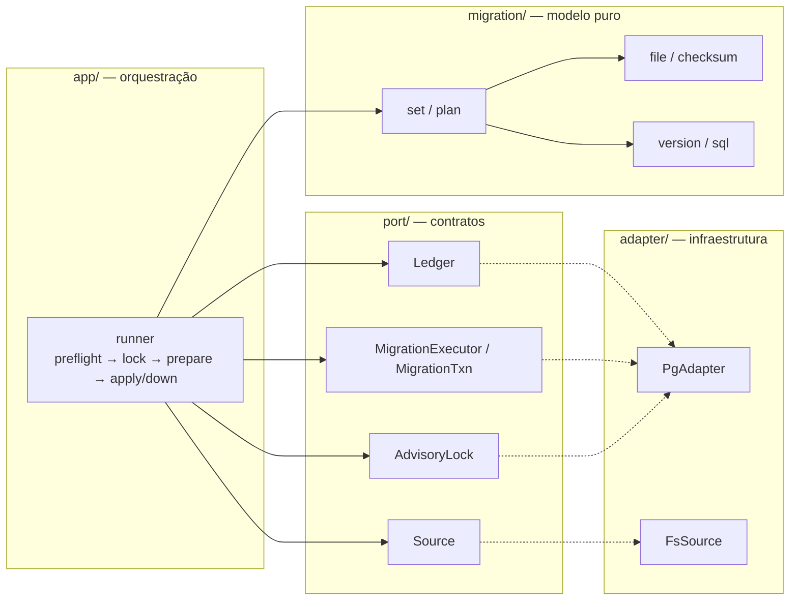
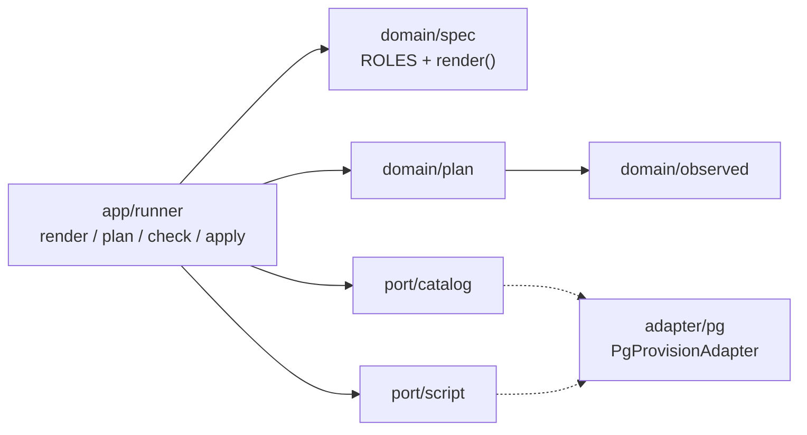

> Pergunta: "quais peças internas do `wyd-db` executam migrations e provisionamento, e como elas se ligam?"
> Público: Arquiteto, desenvolvedor do crate e revisor de PR
> Dono: equipe do `wyd-db`
> Base: `src/migrate/spec.md` §10; `src/provision/spec.md` §5; `wyd-db-1.0.0.md` §6.16
> Revisado em: 2026-11-22

**Estado:** proposto (2026-11-22)

Esta página é o C4 de componentes (nível 3) **dois módulos executáveis**: `src/migrate/` e
`src/provision/`. O resto do crate (`model`, `pool`, `repo`, `transfer`) tem página planejada, mas
ainda não tem contrato de componente; ele não é desenhado aqui. O contexto e os containers estão em
[`contexto-c4.md`](contexto-c4.md).

## 1. Componentes do runner

| Componente | Arquivos | Responsabilidade | Contrato |
|---|---|---|---|
| modelo de migration | `migration/version.rs`, `checksum.rs`, `sql.rs`, `file.rs`, `set.rs`, `applied.rs`, `plan.rs` | validar versão, slug, checksum e SQL; ler a série; decidir `UpToDate`/`Apply`/`Drift` | não conhece banco, arquivo nem ambiente |
| portas | `port/source.rs`, `ledger.rs`, `unit_of_work.rs`, `lock.rs` | receber arquivos, ler ledger, executar transação e serializar | cinco traits pequenas, sem `sqlx` e sem `std::fs` |
| orquestração | `app/runner.rs` | ordenar preflight, lock, prepare, plano e execução | depende de `migration` e `port`, nunca de `adapter` |
| adapters | `adapter/pg.rs`, `adapter/fs.rs` | falar PostgreSQL e ler o diretório | único lugar com `sqlx` e `std::fs` |
| fachada | `mod.rs`, `config.rs`, `error.rs` | montar `run`, validar `MigrateConfig`, fechar a taxonomia de erro | não lê ambiente; o binário monta a configuração |

## 2. Componentes do provisionamento

| Componente | Arquivos | Responsabilidade | Contrato |
|---|---|---|---|
| estado desejado | `domain/spec.rs` | manter `ROLES`, `OWNER`, `MIGRATOR` e emitir o texto determinístico | `render()` é infalível e não lê ambiente |
| observado | `domain/observed.rs` | representar o que o catálogo leu | dado puro, sem I/O |
| plano | `domain/plan.rs` | comparar desejado × observado e separar `Apply` de `Drift` | função pura, sem conexão |
| portas | `port/catalog.rs`, `port/script.rs` | ler `pg_roles`/`pg_auth_members` e aplicar o script | duas portas separadas, sem `sqlx` |
| adapter | `adapter/pg.rs` | implementar as duas portas com um pool | único ponto de SQL do módulo |
| fachada | `mod.rs`, `error.rs` | expor `run` e a taxonomia de erro | não formata saída; o binário formata |

## 3. Regra de dependência

`migration/` e `domain/` não importam `port`, `app` nem `adapter`; `app` não importa `adapter`;
`sqlx` e `std::fs` só existem em `adapter/`. A regra completa, arquivo por arquivo, está em
`src/migrate/spec.md` §10 e `src/provision/spec.md` §5. Ela é o contrato que permite testar o runner
com portas falsas, sem PostgreSQL e sem disco.

## 4. O que esta página não cobre

- **Componentes de `model`, `pool`, `repo` e `transfer`:** só têm nome de página em
  `wyd-db-1.0.0.md` §6.16; não há desenho de componente aprovado.
- **Portas de repositório:** não têm contrato; [`portas-e-contratos.md`](../guia-desenvolvedor/portas-e-contratos.md)
  cobre apenas as sete portas de `migrate` e `provision`.
- **Implantação, porta de rede e volume:** são de [`../planos/plano-de-implantacao.md`](../planos/plano-de-implantacao.md)
  e não foram medidos.
- **Fluxo de dados do jogo:** é de [`fronteira-hot-cold.md`](fronteira-hot-cold.md), não do runner.
