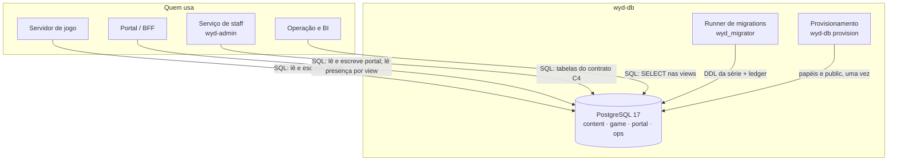

> Pergunta: "quem usa o `wyd-db` e com o que ele conversa?"
> Público: Arquiteto de schema, desenvolvedor e operação
> Dono: equipe do `wyd-db`
> Base: `padrao-banco.md` §0 e §2; `docs/arquitetura/seguranca.md`; `src/provision/spec.md` §3; `plano-migrations.md` §3
> Revisado em: 2026-11-22

**Estado:** proposto (2026-11-22)

O `wyd-db` é **um banco PostgreSQL 17** com quatro schemas — `content`, `game`, `portal` e `ops` — e
**três fronteiras de escrita** aplicadas pelo próprio banco: o jogo escreve o estado vivo, o portal
escreve identidade e PII, e a operação lê por view. Quem não tem `GRANT` não escreve, mesmo que o
código peça. Esta página é o C4 de contexto (nível 1) e de containers (nível 2); o nível 3, com as
peças internas do crate, é `componentes-c4.md`, e o nível 4 é `implantacao.md`.

## 1. Contexto (C4 nível 1)

O banco **não conversa por HTTP, fila ou evento**: a única interface é o protocolo do PostgreSQL. A
leitura cruzada entre jogo e portal também não é chamada de serviço — é view no schema de quem lê
(`game.v_live_session` para o portal e `portal.v_person_identity` para o jogo), e a ponte de escrita
entre os dois é `ops.delivery_queue` (`padrao-banco.md` §2 e §7).

## 2. Atores e o que cada um pode

| Ator | Credencial | Lê | Escreve | Não pode |
|---|---|---|---|---|
| servidor de jogo | `WYD_DB_URL_GAME` (`wyd_game`) | `game`; identidade por `portal.v_person_identity` (id, papel, status — sem e-mail); `content` no boot | estado vivo em `game` | ler `portal.person` cru, escrever em `portal`, DDL |
| portal / BFF | `WYD_DB_URL_PORTAL` (`wyd_portal`) | `portal`; presença por `game.v_live_session` | `portal`; trilha em `ops` | escrever estado vivo em `game`; conceder item direto (só por `ops.delivery_queue`) |
| serviço de staff | `WYD_DB_URL_ADMIN` (`wyd_admin`, decisão `M27`) | as tabelas do contrato C4 | as tabelas de ação do C4 em `game`, `character_item` da custódia (com `DELETE`) e `INSERT` em `ops.audit_log` | escrever em `portal`/`content`, `DELETE` fora da custódia, DDL |
| operação e BI | `WYD_DB_URL_READ` (`wyd_read`) | `SELECT` nas views | nada | qualquer escrita |
| runner de migrations | `WYD_DB_URL_MIGRATOR` (`wyd_migrator`) | catálogo, ledger | DDL da série, ledger | servir requisição de jogo ou portal |
| provisionamento | `WYD_PROVISION_DSN` (admin do cluster e dono do banco) | catálogo, `pg_authid` | papéis, `public` | rodar a série no lugar do runner |

`wyd_owner` existe como dono dos schemas e é `NOLOGIN`; ninguém conecta com ele em runtime. Os seis
papéis e o efeito de cada `GRANT` estão em [`seguranca.md`](seguranca.md), dono da tabela de
privilégios; aqui fica só o recorte de quem é ator.

## 3. Containers (C4 nível 2)

| Container | Responsabilidade | Onde vive | Credencial |
|---|---|---|---|
| PostgreSQL 17 | guarda os quatro schemas, as constraints, as views e o ledger | cluster | — |
| runner de migrations | lê a série, valida contiguidade e checksum, aplica `up`/`down`, mantém o ledger | binário `wyd-db` | `WYD_DB_URL_MIGRATOR` |
| provisionamento | cria papéis e o estado de `public`, fora da série | binário `wyd-db provision` | `WYD_PROVISION_DSN` |
| serviços consumidores | jogo, portal e staff; cada um com a sua conexão e o seu papel | `wyd-server`, `wyd-portal`, `wyd-admin` | a DSN do próprio papel |

O desenho do crate que hospeda runner e provisionamento é de `componentes-c4.md`; a ordem de
instalação é de [`plano-de-implantacao.md`](../planos/plano-de-implantacao.md).

## 4. O que o banco não decide

| Decisão | Quem decide | Por que não é do banco |
|---|---|---|
| regra de jogo e o que roda no tick | `wyd-server` / `wyd-sim` | o banco guarda estado; trigger de regra de negócio é proibido (`padrao-banco.md` `P-16`) |
| validação de senha, PIN e emissão de sessão | portal e jogo | o banco guarda hash e sessão; a comparação e o token são do código (`specs/fluxos/login-e-sessao.md`) |
| autorização de rota do staff | contrato C4 do `wyd-admin` | o banco aplica privilégio por tabela, não autoriza rota |
| topologia de canais (grupo, host, manutenção) | dado de instalação | `game.server_channel` é preenchido pelo ambiente, não por seed (`plano-migrations.md` §3.2) |
| quando um item da fila é entregue | jogo, ao drenar `ops.delivery_queue` | o banco enfileira; não empurra nem agenda entrega |
| backup, restore e retenção executada | operação | a política de retenção é decidida (`M22`), a execução é do operador |
| protocolo do cliente 7662 | `wyd-protocol` | o banco guarda login e hash; o fio é do protocolo |

## 5. O que esta página não cobre

- **Privilégio por tabela:** a lista completa, incluindo a custódia do mercado, está em
  [`seguranca.md`](seguranca.md).
- **Significado de cada tabela:** é do [`dicionário de dados`](../dicionario-dados/index.md).
- **Dado inicial e proveniência:** é de
  [`plano-de-dados-e-seeds.md`](../planos/plano-de-dados-e-seeds.md).
- **Peças internas do crate:** é de `componentes-c4.md` (recorte, ainda não escrito).
