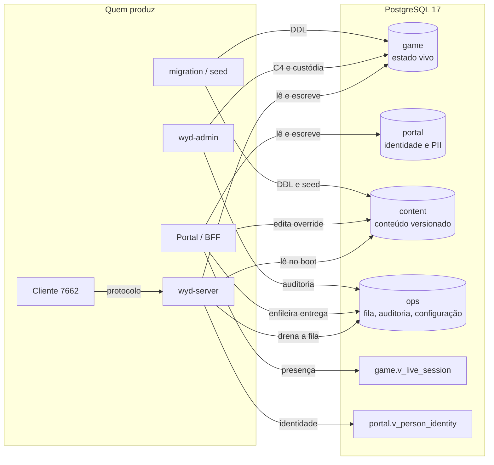

> Pergunta: "que dados entram, mudam e saem, e onde eles podem se perder ou ficar parados?"
> Público: Arquiteto de schema, desenvolvedor de jogo/portal/admin e operação
> Dono: equipe do `wyd-db`
> Base: `migrations/0029-views.md` §7–§8; `migrations/0012-ops-delivery.md` §8; `migrations/0033-ops-idempotency.md`; `migrations/0022-content-overrides.md` §2; `docs/arquitetura/fronteira-hot-cold.md` §1–§3; `docs/arquitetura/contexto-c4.md` §2; `docs/dicionario-dados/gerado/index.md`
> Revisado em: 2026-11-24

**Estado:** proposto (2026-11-24)

Esta página é o **mapa geral de dados**: quem produz, por onde passa e onde termina. Ela não repete o passo
a passo de cada caso — isso é de `specs/fluxos/` — nem a regra de escrita de cada schema, que é de
[`fronteira-hot-cold.md`](fronteira-hot-cold.md). O que ela acrescenta é a tabela origem → caminho →
destino, a classificação do dado e o **ponto de perda** de cada caminho.

## 1. O que existe hoje (medido)

| Fato | Medição | Fonte |
|---|---:|---|
| tabelas com DDL fechado | **109** | `dicionario-dados/gerado/index.md` |
| `content` | **41** tabelas | idem |
| `game` | **36** tabelas | idem |
| `portal` | **26** tabelas | idem |
| `ops` | **6** tabelas | idem |
| views | **2** (`game.v_live_session`, `portal.v_person_identity`) | `migrations/0029-views.md` |
| arquivos na série | **34** (28 com página escrita, 6 seeds bloqueados) | `migrations-checklist.md` §2 |
| volume, crescimento e latência | **não medidos** (`M20`) | `retencao-e-capacidade.md` |

Nenhum número desta tabela é estimativa: todos saem do catálogo e do índice da série. A soma
41 + 36 + 26 + 6 = **109** fecha com `plano-migrations.md` §3.

## 2. Diagrama de contexto de dados

As setas para `v_live_session` e `v_person_identity` são **desenho, não leitura ativa**: as duas views
existem desde `0029`, mas `0001` não dá `USAGE` no schema cruzado e `0029` não tem `GRANT` — a permissão
ficou sem decisão em 2026-11-21 (`0029-views.md` §7–§8). O caminho está declarado e **não funciona hoje**.

## 3. Origem → caminho → destino

Uma linha por caminho de dado, não por tabela: as 109 páginas de tabela já dizem quem escreve e quem lê
cada uma. O destino cita o schema ou o grupo, e a coluna de classe usa a definição de §4.

| # | Origem | Caminho | Destino | Classe | Ponto de perda possível |
|---:|---|---|---|---|---|
| 1 | cliente 7662, no login | protocolo → `wyd-server` → `INSERT` | `game.session`; `game.account` lido | persistente + efêmero (estado em memória) | sessão aberta sem `released_at` se o processo cai antes do encerramento; o reaper é de `wyd-ops` e não tem número |
| 2 | `wyd-server`, na seleção | leitura C4 → memória do core | `game.character` e tabelas `character_*` | persistente lido, efêmero em memória | o que mudou em memória e não entrou no lote de save |
| 3 | `wyd-server`, no save | `transfer/save.rs` — **planejado**, uma transação por lote (`WYDDB-017`) | `game.character*` | persistente | lote em memória no shutdown: o DoD de `WYDDB-017` exige flush, a implementação não existe |
| 4 | `wyd-server`, no inventário | escrita direta no quente | `game.character_item`, `game.vault_item` | persistente | item movido em memória e não salvo; não há outra tabela que reconstrua o item |
| 5 | `wyd-server`, no movimento de moeda | escrita no quente de saldo e razão | `game.account_wallet` + `game.account_ledger` | persistente + derivado (`balance_after`) | lote não salvo; o `CHECK` garante cada linha, e a atomicidade entre saldo e lançamento não tem regra decidida (`H`) |
| 6 | staff, na área da web | BFF `INSERT` → fila → dreno do `wyd-server` | `ops.delivery_queue` → `game` | persistente (fila) | `pending` **não** é expurgada: a entrega não se perde, fica parada; `attempt_count` registra a tentativa |
| 7 | portal, na compra com cash | BFF `INSERT` do débito e da linha de fila | `portal.donate_debit` / `portal.donate_credit` + `ops.delivery_queue` | persistente + derivado (extrato) | débito gravado sem entrega drenada; cash não tem coluna de saldo, então o extrato é a única leitura |
| 8 | portal, no mercado | `INSERT` de anúncio, lance e transação; custódia movida por `wyd_admin` | `portal.market_*` + `game.market_escrow` | persistente | escrow sem desfecho: só `wyd_admin` move o item, e `DELETE` não existe em runtime para ele |
| 9 | portal, no login web | sessão e token do portal | `portal.person_session`, `portal.person_token` | persistente | expiração e TTL: `person_session` 30 dias após `expires_at` (`M22`) e `person_token` 30 dias (`Q-RET-1`); o expurgo ainda não é executado |
| 10 | portal, na área administrativa | `INSERT` append-only | `ops.config_revision`, `ops.config_change` | persistente, imutável | nada se perde por desenho; corrigir é revisão nova, nunca `UPDATE` (`Q-RET-5`) |
| 11 | `wyd-admin`, nas rotas do C4 | rotas do contrato, com chave de idempotência | tabelas de ação em `game`, `game.market_escrow`, `ops.audit_log`, `ops.idempotency_record` | persistente | resposta perdida: reenviar com a mesma chave é seguro por **7 dias** (`M30`); depois, a chave não protege mais |
| 12 | migration/seed (`wyd_migrator`) | série aplicada e carga de conteúdo | `content.*` + `content_version` | persistente (frio) | seed bloqueado (6 arquivos) e recarga a quente **não desenhada**: o jogo lê no boot e não tem contrato de reload |
| 13 | portal, na edição de regra | loader lê `COALESCE(override, base)` | `content.refine_rate_override`, `sanc_rate_override`, `combine_value_override` | derivado (valor efetivo) | apagar o override devolve o valor base; o valor efetivo nunca é gravado, então não há histórico do que o jogador viu |
| 14 | `wyd-server` e portal | `INSERT` por runtime | `ops.audit_log` | persistente, append-only | nada é reescrito (`UPDATE`/`DELETE` não existem para runtime); a atomicidade entre a ação e a trilha não está decidida (`H`), então a ação pode ficar sem linha |
| 15 | `wyd-server`, para o portal | view `game.v_live_session` | leitura de presença | derivado | **sem `GRANT`**: hoje a leitura não acontece (`0029-views.md` §7–§8) |
| 16 | portal, para o jogo | view `portal.v_person_identity` | leitura de identidade mínima (`person_id`, `role`, `status`) | derivado | **sem `GRANT`**: idem; e a view nunca expõe e-mail ou credencial (`0029-views.md` §8) |

## 4. Efêmero, persistente e derivado

| Classe | Definição nesta árvore | Exemplos com fonte |
|---|---|---|
| **efêmero** | vive no processo e não tem tabela; se o processo cai, não há o que restaurar | estado do personagem em memória entre a seleção e o save (`carregamento-e-save.md` §4); a “sessão viva” é a **linha** `game.session` com `released_at IS NULL`, não um objeto em memória |
| **persistente** | tem tabela com DDL fechado e sobrevive ao processo | as 109 tabelas: `game` (36), `portal` (26), `content` (41), `ops` (6) |
| **derivado** | não tem tabela própria ou não é a fonte do valor; é calculado na leitura ou espelhado no ato da escrita | as 2 views; o extrato de cash (`donate_credit`/`donate_debit`); o valor efetivo de regra (`COALESCE(override, base)`); `account_ledger.balance_after`, espelho do saldo no lançamento |

Regra prática: **o derivado não é fonte** — quem lê view, valor efetivo de override ou extrato está lendo
uma projeção; corrigir a projeção não corrige o dado. Por isso não existe tabela de saldo de cash nem
tabela de regra efetiva: as duas seriam uma segunda verdade.

## 5. Onde o dado para ou se perde

| Situação | Onde aparece | Dono de resolver |
|---|---|---|
| janela de save | itens 2–5 da tabela | `WYDDB-017` (implementação) e `wyd-server` |
| entrega parada na fila | item 6 | `WYDDB-018` (dreno); a fila não perde, mas não avança sozinha |
| débito sem entrega | item 7 | `WYDDB-019`/`WYDDB-020`; a reconciliação não existe (`compra-e-credito.md` §Falhas) |
| escrow sem desfecho | item 8 | contrato do `wyd-admin` e `LAC-POR-01` |
| replay além da janela | item 11 | `M30` fixou 7 dias; ampliar exige decisão, não código |
| recarga de conteúdo | item 12 | `padrao-banco.md` §2; contrato de reload não desenhado (`fronteira-hot-cold.md` §3) |
| leitura cruzada bloqueada | itens 15–16 | decisão de fronteira pendente desde 2026-11-21 (`0029-views.md` §8) |
| ação sem trilha | item 14 | atomicidade entre ação e trilha não decidida (`H`); `WYDDB-019` é o precedente de ordem |

Nenhuma dessas situações tem prazo, volume ou custo medido: `M20` continua pendente, e esta página não
inventa número.

## 6. O que esta página não cobre

- **O passo a passo de cada fluxo:** é de `specs/fluxos/` — login, criação/seleção, carga e save, grant,
  compra e crédito, carga de conteúdo. Aqui só o caminho do dado.
- **A regra de escrita quente × fria e a ponte única:** é de
  [`fronteira-hot-cold.md`](fronteira-hot-cold.md).
- **Quem pode ler e escrever cada tabela:** é de [`seguranca.md`](seguranca.md); o recorte por ator está
  em [`contexto-c4.md`](contexto-c4.md) §2.
- **O significado de cada tabela e coluna:** é do [`dicionário de dados`](../dicionario-dados/index.md).
- **Retenção por tabela e capacidade:** é de
  [`retencao-e-capacidade.md`](retencao-e-capacidade.md).
- **Conteúdo inicial e sua proveniência:** é de
  [`plano-de-dados-e-seeds.md`](../planos/plano-de-dados-e-seeds.md).
