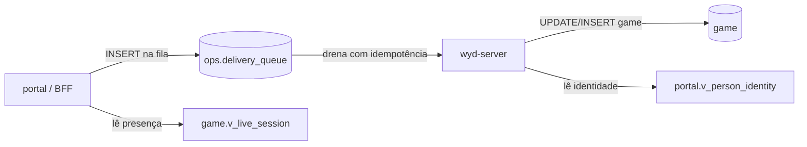

> Pergunta: "o que é estado quente, o que é estado frio e por onde a escrita atravessa a fronteira?"
> Público: Arquiteto, desenvolvedor do jogo e da operação
> Dono: equipe do `wyd-db`
> Base: `padrao-banco.md` §0, §2 e `P-17`; `ddl-confirmado.md` §5.16 e §5.29; `plano-migrations.md` §3
> Revisado em: 2026-11-22

**Estado:** proposto (2026-11-22)

A fronteira hot/cold é uma **regra de escrita**, não uma tecnologia de cache. O estado quente é o que
o jogo altera a cada sessão e lê no caminho crítico; o frio é conteúdo versionado, auditoria e dado
de operação, escrito por migration, portal ou staff. Os dois vivem no mesmo PostgreSQL 17 e são
separados por schema, papel e caminho de leitura — não por um segundo banco.

## 1. O que é quente e o que é frio

| Faixa | Exemplos | Quem escreve | Como o outro lado lê |
|---|---|---|---|
| quente | `game.account`, `game.character`, `game.session`, `game.character_item` | `wyd_game` | portal lê presença por `game.v_live_session` |
| frio de conteúdo | `content.item_catalog`, `content.map_definition`, `content.quest` | migration/seed (`wyd_migrator`) | jogo lê no boot por `repo/content.rs` |
| frio de identidade | `portal.person`, `portal.person_session`, `portal.person_consent` | `wyd_portal` | jogo lê identidade por `portal.v_person_identity` |
| frio operacional | `ops.audit_log`, `ops.delivery_queue`, `ops.idempotency_record` | staff, portal e jogo, cada um no seu recorte | operação lê por view/papel; auditoria é append-only |

`content` e `portal` não são lidos “por dentro” pelo jogo: a leitura crua é negada por `GRANT`; a
view é o contrato. A matriz de quem pode o quê é de [`seguranca.md`](seguranca.md), não desta página.

## 2. A única ponte de escrita

O portal **não escreve** em `game`. Quando precisa entregar item, moeda ou grant, grava uma linha em
`ops.delivery_queue`; o servidor drena a fila e aplica o efeito no schema quente. A fila é a ponte
única desenhada em `ddl-confirmado.md` §5.16 (`0012_ops_delivery.sql`). O caminho de leitura cruzada
usa as duas views de `0029_views.sql`; nenhum dos lados recebe `SELECT` na tabela crua do outro.

## 3. O que a fronteira garante

| Garantia | Onde é aplicada | O que não garante |
|---|---|---|
| escrita separada por papel | `GRANT`/`REVOKE` do provisionamento e da série | que o código não tente a escrita; a tentativa recebe `permission denied` |
| leitura cruzada só por view | as duas views de `0029` | consistência transacional entre uma escrita e a próxima leitura; não há snapshot compartilhado entre processos |
| fila como única ponte de escrita | `ops.delivery_queue` | entrega exactly-once; a idempotência é do consumidor e do registro de `ops` |
| conteúdo versionado | `content_version` em `0001` | recarga a quente; o contrato de reload não foi desenhado |

## 4. O que esta página não decide

- **Cache, réplica ou event bus:** não existem no desenho da `1.0.0`; não há cache a invalidar.
- **TTL, tamanho de lote e frequência de drenagem:** não foram medidos nem aprovados. O consumidor
  deve tratar a fila como durável, sem inventar um número nesta página.
- **Consistência entre banco e memória do servidor:** é do `wyd-server`; o banco só garante a
  transação de cada escrita.
- **Retenção e capacidade:** são de `retencao-e-capacidade.md` (bloqueada por medição) e de
  `plano-migrations.md` §4; não há número para citar.

## 5. Dependência dura declarada

A ponte existe no DDL, mas o **consumidor** (`repo/grants.rs`/`transfer` e o loop do servidor) ainda
não tem contrato publicado. Esta página descreve a direção e o contrato de dados; não afirma que a
drenagem funciona. O detalhe do domínio fica em
[`../dicionario-dados/dominio-ponte-web-jogo.md`](../dicionario-dados/dominio-ponte-web-jogo.md).
