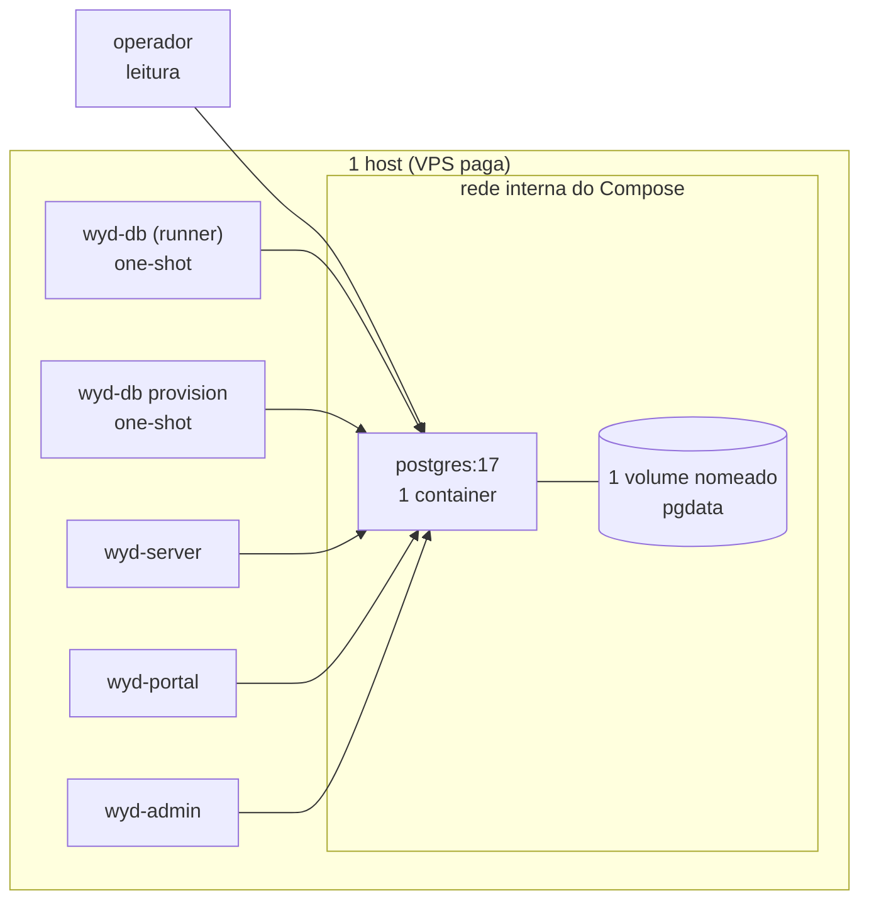

> Pergunta: "como isso roda — em quantos hosts, com quantos containers, em que porta e sob qual supervisor?"
> Público: Quem instala, quem opera e quem revisa o Compose
> Dono: equipe do `wyd-db`
> Base: `contexto-c4.md` §3; `../planos/plano-de-implantacao.md`; `../guia-administrador/instalacao.md`; `../guia-administrador/configuracao.md` §3; `../guia-desenvolvedor/pool-e-transacoes.md` §2; `../../pendencias-de-fechamento.md` §6.6.9
> Revisado em: 2026-11-24

**Estado:** proposto (2026-11-24)

Esta página responde "como isso roda?" no nível 4 do C4: **1 host**, PostgreSQL 17 em **1 container** com
**1 volume** nomeado, **5432 fora da rede interna não publicada**, runner e `provision` como one-shot, e o
`restart: unless-stopped` do Compose como supervisor. A decisão `Q-BLK-10` = A (2026-11-24) fixou esse
recorte; ela fecha o vazio que [`../guia-administrador/instalacao.md`](../guia-administrador/instalacao.md)
declarava ("instalação de serviço, porta, volume, imagem e tempo: não há desenho aprovado").

## 1. A ordem de instalação

A ordem é a de [`../planos/plano-de-implantacao.md`](../planos/plano-de-implantacao.md) §"Ordem", e cada
passo tem verificador próprio:

| # | Passo | Quem executa | Como se confirma |
|---:|---|---|---|
| 1 | banco no ar, com `public` vazio | Compose | `SELECT version()` responde 17; nenhum schema de produto existe |
| 2 | papéis e estado de `public` | `wyd-db provision` (`WYD_PROVISION_DSN`) | os 6 papéis existem; rodar de novo não altera nada |
| 3 | schema: a série inteira | runner (`WYD_DB_URL_MIGRATOR`) | ledger com a série aplicada e checksum íntegro |
| 4 | conteúdo: seed e `content_version` | carga de conteúdo | um único `content_version` corrente |
| 5 | serviços consumidores | `wyd-server`, `wyd-portal`, `wyd-admin` | cada um conecta com a própria DSN e recusa a dos outros |

O passo 5 é o único que depende de outro sistema; os passos 1 a 4 são do banco. Reverter segue a ordem
inversa e está em §"Rollback" do plano — esta página não repete o procedimento.

## 2. Topologia do host

Nada acima do host alcança o banco: não há balanceador, réplica, pooler externo nem túnel. O que o
diagrama mostra é a **única** topologia aprovada; variantes (vários hosts, um container por canal) não
têm medição que as sustente — o orçamento de conexões cabe em um host (§5).

## 3. Processos, porta, volume e supervisor

| Processo | Imagem ou binário | Porta | Volume | Supervisor | Credencial |
|---|---|---|---|---|---|
| PostgreSQL 17 | imagem oficial `postgres:17` | **5432 não publicada** | `pgdata` (nomeado) | `restart: unless-stopped` | — |
| runner de migrations | binário `wyd-db` | — | lê a série do repositório | one-shot (`run --rm`) | `WYD_DB_URL_MIGRATOR` |
| provisionamento | binário `wyd-db provision` | — | — | one-shot (`run --rm`) | `WYD_PROVISION_DSN` |
| servidor de jogo | imagem do `wyd-server` | — | — | `restart: unless-stopped` | `WYD_DB_URL_GAME` |
| portal/BFF | imagem do `wyd-portal` | — | — | `restart: unless-stopped` | `WYD_DB_URL_PORTAL` |
| `wyd-admin` | imagem do `wyd-admin` | — | — | `restart: unless-stopped` | `WYD_DB_URL_ADMIN` |
| leitura operacional | `psql` do host | — | — | nenhum (manual) | `WYD_DB_URL_READ` |
| suíte de sistema | binário de teste | — | banco descartável | nenhum (CI) | `WYD_DB_URL_TEST` |

**Supervisor:** o container do banco não tem supervisor próprio — quem o reergue é o Docker, pela política
`restart: unless-stopped`, que o `docker-compose.yml` do repositório já usa no serviço `docs`. Não há
`systemd`, `supervisord` nem cron dentro do container: um supervisor a mais seria um segundo dono do
mesmo restart.

**Volume:** **1** volume nomeado, `pgdata`, montado no diretório de dados do cluster. O dado não vive no
container: recriar o container preserva o banco, e apagar o volume apaga o banco — o que é a fronteira de
`Q-BLK-03` (backup no storage do mesmo provedor da VPS, 2026-11-24).

**Porta:** `5432` **não** é publicada no host. Os consumidores falam com o banco pela rede interna do
Compose, pelo nome do serviço; o operador usa `docker compose exec` e a DSN `READ`. Publicar a porta
exporia o cluster à rede do provedor sem ganho — não há cliente fora do host.

## 4. O que o host precisa ter

| Requisito | Número | Fonte |
|---|---|---|
| Docker com Compose v2 | — | `docker-compose.yml` do repositório |
| PostgreSQL 17 como única major suportada | 17 | `../guia-administrador/instalacao.md` §1 |
| 4 schemas, 109 tabelas, 2 views após o passo 3 | 109 / 2 | `../dicionario-dados/index.md`; `modelo-logico.md` §1 |
| conexões simultâneas previstas | 53 de 97 | `../guia-desenvolvedor/pool-e-transacoes.md` §2 |
| variáveis de conexão | 7 (1 `WYD_PROVISION_DSN` + 6 `WYD_DB_URL_*`) | `../guia-administrador/configuracao.md` §3 |

## 5. Capacidade: por que um host basta

O teto do PostgreSQL 17 é **97** conexões para papéis comuns (100 menos 3 reservadas), e a soma dos
consumidores é **53** — sobram 44. A conta é aritmética, não estimativa: 4 pools de 10, 2 conexões do
runner, 1 do `provision` e 10 da suíte. Um host com um container atende esse orçamento com folga; a
alternativa de vários hosts não tem número que a justifique, e DBaaS contraria `Q-OPS-2` = A e
`Q-BLK-03`.

**O que ainda não tem número:** CPU, memória, IOPS e tempo de restauração. Esta página não os inventa; o
que ela fixa é a forma (1 host, 1 container, 1 volume), e a medição de carga é trabalho da série.

## 6. Ligação com o repositório

O runner e o `provision` não são imagens novas: são subcomandos do binário `wyd-db`, cujo desenho de crate
é de [`componentes-c4.md`](componentes-c4.md). O desenho de imagem e de Compose do serviço Rust é de
`docs/rust/05-stack-docker.md` do repositório — **essa página ainda não existe**, e esta não a antecipa:
aqui fica só o que é do banco (container, volume, porta, supervisor e credencial). Quando a página do
repositório existir, ela é o dono da imagem e do `build`; esta continua dona da topologia.

## 7. Verificação pós-implantação

| O que se verifica | Como | Falha se |
|---|---|---|
| versão do servidor | `SELECT version()` | não for 17 |
| schemas | `\dn` | faltar `portal`, `game`, `content` ou `ops` |
| objeto | contagem de tabelas e views | não fechar 109 e 2 |
| série | ledger do runner | contiguidade ou checksum divergir |
| conteúdo | `SELECT` da versão corrente | houver mais de um `content_version` ativo |
| provisionamento | rodar `provision` de novo | alterar qualquer coisa |
| conexão por papel | conectar com cada DSN | um papel conseguir o que não é dele |

O detalhe do procedimento e o rollback ficam em
[`../planos/plano-de-implantacao.md`](../planos/plano-de-implantacao.md) §"Verificação pós-implantação" e
§"Rollback".

## 8. O que esta página não decide

- **Não fixa tag de imagem:** `postgres:17` é a major; a tag exata (`17.x`) se fixa na janela, com o
  backup de `Q-BLK-03` já existindo.
- **Não fixa CPU, memória, disco nem IOPS:** não há medição; a forma (1 host, 1 container) é o que esta
  página decide.
- **Não decide backup nem retenção:** `Q-BLK-03` é o backup; retenção e partição continuam bloqueadas em
  [`../planos/`](../planos/index.md).
- **Não decide a janela:** data e duração são do plano de implantação, com o cliente 7662.
- **Não desenha a imagem do serviço Rust:** é de `docs/rust/05-stack-docker.md`, que ainda não existe.
- **Não publica porta:** 5432 fica na rede interna; abrir porta é decisão nova, não consequência desta.
