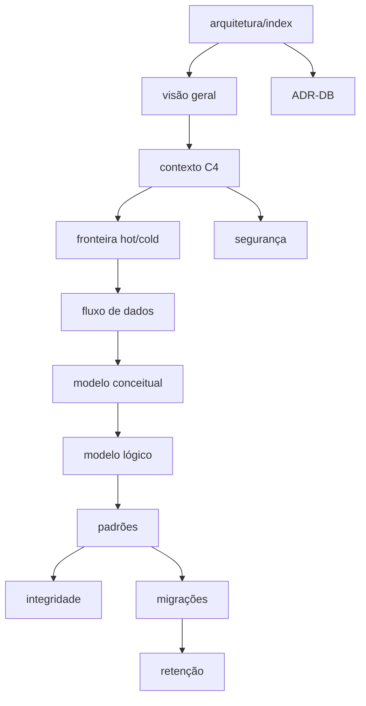

> Pergunta: "qual página de arquitetura eu leio para a minha dúvida?"
> Público: Arquiteto de schema, desenvolvedor e revisor
> Dono: equipe do `wyd-db`
> Base: `wyd-db-1.0.0.md` §4 e §6.2; `docs/convencoes.md`; `proposta-paginas.md` §5–§6
> Revisado em: 2026-11-22

**Estado:** proposto (2026-11-22)

A pasta de arquitetura responde **por que** o banco é assim: o que ele é, quem fala com ele, onde
termina o tick, como o dado circula, como o modelo vira tabela e qual padrão vale. Ela não é o
dicionário (que diz o que cada tabela significa) nem o guia de migration (que diz como escrever a
próxima): quando a dúvida é “o que faço agora”, a página é outra.

## 1. Mapa das 13 páginas

| Página | Pergunta que responde | Estado |
|---|---|---|
| [`visao-geral.md`](visao-geral.md) | o que é o `wyd-db` em 10 minutos? | escrita |
| [`contexto-c4.md`](contexto-c4.md) | quem usa e com o que ele conversa? | escrita |
| `componentes-c4.md` | quais são as peças internas do crate? | recorte (§5) |
| `implantacao.md` | como isso roda? | não escrita |
| `fronteira-hot-cold.md` | onde termina o tick e começa o banco? | recorte (§5) |
| `fluxo-de-dados.md` | que dados entram, mudam e saem? | não escrita |
| `modelo-conceitual.md` | quais entidades existem e como se relacionam? | não escrita |
| `modelo-logico.md` | como o conceitual vira tabela? | recorte (§5) |
| [`integridade-e-constraints.md`](integridade-e-constraints.md) | que regra o banco garante sozinho? | escrita |
| [`padroes-postgres.md`](padroes-postgres.md) | qual é o padrão de modelagem? | escrita |
| [`migracoes.md`](migracoes.md) | por que a série é assim? | escrita |
| `retencao-e-capacidade.md` | o que cresce e o que fazer com isso? | não escrita |
| [`seguranca.md`](seguranca.md) | quem pode o quê e o que é auditado? | escrita |

As sete páginas sem link ainda não existem: caminho em `code` é “vai existir e é aqui que ele mora”,
não link. O estado de recorte ou de não escrita é o de `proposta-paginas.md` §5–§6, dono da fila;
esta página só o reflete.

## 2. Ordem de leitura

1. **Visão geral → contexto:** o que o banco é e quem o consome.
2. **Fronteira → fluxo:** onde o tick para e por onde o dado anda.
3. **Modelo conceitual → lógico → padrões:** a entidade, a tabela e o critério de modelagem.
4. **Integridade, migrações e retenção:** o que o banco garante, como a série nasce e o que cresce.
5. **Segurança e ADRs:** quem pode o quê e as decisões estruturais já tomadas.

## 3. Decisões e o porquê

As duas ADRs aceitas ficam em [`adr/index.md`](adr/index.md): uma por decisão estrutural, com contexto,
decisão, consequências, alternativas e como verificar. Não existe catálogo prévio de ADR; a lista
cresce quando uma decisão é tomada (`wyd-db-1.0.0.md` §6.4).

## 4. O que esta página não cobre

- **O significado de tabela e coluna:** é do [`dicionário de dados`](../dicionario-dados/index.md).
- **O passo a passo de uma migration:** é do
  [`guia do desenvolvedor`](../guia-desenvolvedor/index.md).
- **O que já foi entregue e o que falta:** é de
  [`planos/registro-de-execucao.md`](../planos/registro-de-execucao.md) e de
  `planos/metricas.md` (planejado).
- **A fila de escrita:** é de `proposta-paginas.md` §8 (planejamento), não desta pasta.
