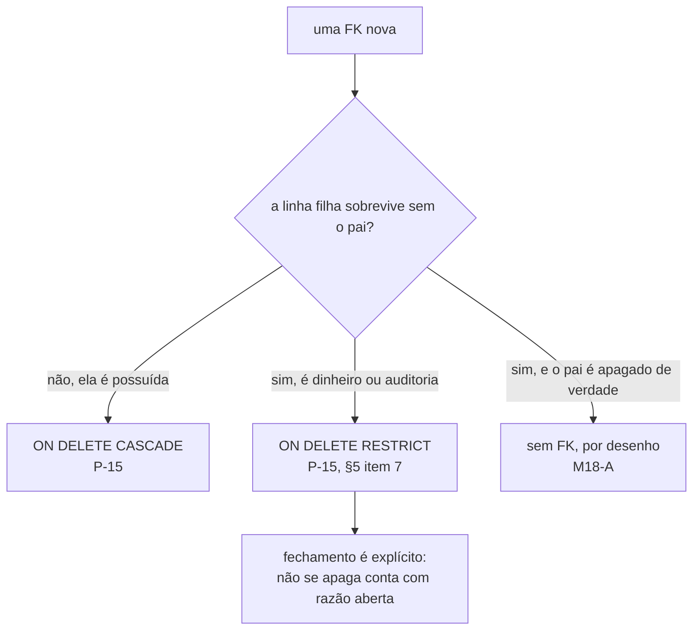

> Pergunta: "que regra o banco garante sozinho, e o que fica de propósito para o código?"
> Público: Arquiteto de schema e desenvolvedor que for mexer em `crates/wyd-db/migrations/`
> Dono: equipe do `wyd-db`
> Base: `padrao-banco.md` §5, §8, §10; `ddl-confirmado.md` §1, §5; `lacunas.md` §1, §2.1–§2.3
> Revisado em: 2026-11-18

**Estado:** proposto (2026-11-18)

Três níveis de afirmação convivem aqui:

- **`P`** — as constraints descritas são planejadas e só existem em documento de DDL; nenhuma foi
  criada em banco nenhum.
- **`H`** — ausência de decisão, dita na seção em que o assunto aparece; não é uma escolha diferente.
- **sem marca** — comportamento do PostgreSQL em si: constraint não tem `WHERE`, `NULLS NOT DISTINCT`
  só existe a partir do PG15, `DEFERRABLE` só valida no `COMMIT`, e entre um `COUNT` e o `INSERT` cabe
  outra transação. É plataforma, não planejamento; as fontes estão em `padrao-banco.md` §13.

A escolha de tipo, de índice e de nome é de [`padroes-postgres.md`](padroes-postgres.md); aqui está o
que o banco **proíbe** e o que ele deixa de propósito para o código.

Esta página não lista constraint por tabela. O inventário — o que cada `CHECK` proíbe, com o nome e o
predicado — mora na página de `migrations/` do arquivo que cria a tabela, e o resumo do que já tem
DDL fechado é de `ddl-confirmado.md` §1. Aqui mora a **política**: onde cada tipo de regra vive e por
quê; a divisão entre esta política e a lista fechada de `padrao-banco.md` §5 é a de
[`../convencoes.md`](../convencoes.md) §*Nota de enunciação*.

## 1. Onde a regra mora

Uma regra de integridade tem três endereços possíveis, e a escolha não é de gosto:

| Tipo de regra | Endereço | Por quê |
|---|---|---|
| o dado errado não pode existir | `NOT NULL`, `CHECK`, unicidade | vale para toda escrita: código, correção manual, script de operação (`padrao-banco.md` §5) |
| o recurso finito não pode ser estourado | `CHECK` de faixa + índice único parcial | a criação concorrente também perde; `COUNT` no app perde a corrida (`padrao-banco.md` §5, item 3) |
| quem pode escrever | schema + `GRANT` | `padrao-banco.md` §8, com a proibição de trigger em §1 (`P-16`) |
| imutabilidade de linha (append-only) | `REVOKE UPDATE`/`DELETE` | `padrao-banco.md` §8 (`P-16`) |
| regra de jogo | código, fora do banco | depende de estado em memória, não de linha; em trigger fica invisível e sem teste (`padrao-banco.md` §0) |

**Regra de ouro da seção:** se a violação precisa ser impossível **em qualquer escrita**, é constraint.
Se precisa apenas acontecer **no fluxo normal**, é código — e o banco não finge garanti-la.

## 2. Política de FK

`ON DELETE` é escolha explícita em toda FK, nunca default (`P-15`). O que decide é a pergunta: **a
linha filha faz sentido sem o pai?**

| Caso | Escolha | Consequência aceita |
|---|---|---|
| filho possuído pelo pai | `CASCADE` | apagar o pai apaga o filho — e só nesse caso (`P-15`) |
| dinheiro, razão, auditoria | `RESTRICT` | apagar o pai **falha** enquanto houver linha; o fechamento é ato explícito, não efeito colateral (`padrao-banco.md` §5, item 7) |
| ator de auditoria | **sem FK** | a linha de auditoria sobrevive ao ator e nunca bloqueia nem cascateia (`M18-A`, `ddl-confirmado.md` §5.3) |
| topologia entre tabelas do mesmo domínio | FK composta | a combinação inteira é a chave; validar metade não prova nada (`ddl-confirmado.md` §5.5) |

**Sem FK é decisão declarada, não esquecimento.** A única família de tabela que dispensa FK é a de
auditoria, e o custo é conhecido: não existe rótulo congelado do ator — o nome de quem agiu é lido por
join no instante da consulta. Isso só é honesto porque pessoa e conta **nunca são apagadas**:
fechamento com tombstone (`A12`) e conta fechada com linha preservada (`M1`). Se um dia alguém
propuser `DELETE` nessas duas tabelas, o formato de `actor` quebra e a decisão volta à mesa
(`lacunas.md` §2.3).

## 3. `CHECK`: o que o padrão exige

Cinco famílias de `CHECK` são obrigatórias quando o caso aparece. O predicado de cada uma mora na
página de migration do arquivo dono — esta página diz **quando ele é devido**.

| Família | Devida quando | Regra em |
|---|---|---|
| faixa | quantidade curta: vaga, nível, passo, contador | `padrao-banco.md` §4 |
| conjunto fechado | o valor é um de uma lista que só a migration muda | `P-08` |
| coerência estado × carimbo | a tabela tem estado e o estado tem data | `padrao-banco.md` §5, item 1 |
| coerência de par | dois campos só são válidos juntos (ou nulos juntos) | `padrao-banco.md` §5, item 6 |
| forma de segredo | a coluna guarda hash ou token | `padrao-banco.md` §4 |

> [!DANGER] Estado e carimbo divergentes é o defeito silencioso
> `(status = 'closed') = (closed_at IS NOT NULL)` é a forma da regra, e ela é `CHECK` porque o
> contrário — status fechado sem data, ou data sem status — passa despercebido em qualquer revisão
> de código e envenena toda consulta de retenção (`padrao-banco.md` §5, item 1).

**Um estado, um dono.** Bloqueio disciplinar e ciclo de vida não são a mesma coluna: o ciclo de vida
fica no `status`, e o bloqueio disciplinar vive na tabela de moderação, com autor, motivo e instante.
Duas fontes para o mesmo estado é o antipadrão que `padrao-banco.md` §5 (item 5) e §11 proíbem, e a
decisão de qual tabela guarda o quê é de `lacunas.md` §1 (`M1`) com o DDL em `ddl-confirmado.md` §5.1
e §5.2.

## 4. Unicidade

| Caso | Mecanismo | Por quê |
|---|---|---|
| "um vivo por chave" | índice único **parcial** | constraint não tem `WHERE`; filtrar por estado no app perde a corrida (`P-14`) |
| unicidade que não depende de estado | índice **total** | o valor não pode ser reutilizado nem pela linha morta (`padrao-banco.md` §5, item 4) |
| unicidade com nulo intencional | `NULLS NOT DISTINCT` | evita o truque do `coalesce` dentro de índice parcial (`P-14`) |
| linha que morre e libera o valor | anonimização explícita | e-mail de pessoa fechada é substituído por endereço sintético, com `CHECK` que garante a forma (`A12`, `ddl-confirmado.md` §5.1) |

Nenhuma dessas garantias se implementa com `COUNT` antes do `INSERT`: entre a contagem e a escrita cabe
outra transação. O banco decide; o app trata o erro.

## 5. `DEFERRABLE`, `MATCH FULL` e o que não está decidido

- **`MATCH FULL`** entra só quando a chave é composta e parcialmente nula; a preferência é `NOT NULL`,
  porque a alternativa é resolver por constraint o que o desenho poderia impedir
  (`padrao-banco.md` §5, item 6).
- **`DEFERRABLE`** — `H`: não há decisão registrada. Nenhuma constraint da série é declarada adiável
  até que exista um caso que exija (troca de duas FKs na mesma transação), e a página não promove a
  ausência a contrato: se o caso aparecer, a decisão entra com dono e motivo, não por conveniência de
  escrita.

> [!NOTE] Por que esta seção existe mesmo sem decisão
> O molde da página exige o assunto. Declarar **ausência** é diferente de omitir: quem for escrever
> DDL precisa saber que adiar constraint hoje é escolha sem registro, e que a decisão não foi tomada
> por esquecimento.

## 6. O que o banco não garante, de propósito

| Fato | Onde é garantido | Por que não no banco |
|---|---|---|
| limite de conexões por IP por pessoa | transporte (`rascunho-accounts.md` §3; `R16` em §2) | não é propriedade de linha: é política de sessão e de rede |
| 5 contas da mesma pessoa online ao mesmo tempo | consequência da regra de sessão por **conta**, não por pessoa (`rascunho-accounts.md` §3) | o banco garante "um vivo por conta"; proibir por pessoa seria a barreira que a cultura do jogo recusa |
| entrega de grant ao servidor | fila de entrega com `RESTRICT` na origem | a garantia do banco é não perder o pedido; quando ele é aplicado é do dreno (`plano-migrations.md` §3.1) |
| `updated_at` andando | a única trigger permitida na série | alternativa a repetir o carimbo em cada `UPDATE` escrito à mão (`padrao-banco.md` §7) |
| ordem e momento de aplicar a série | lock de sessão e ledger do runner | é do runner, não do schema (`src/migrate/spec.md` §3 e §5, planejamento) |

## 7. Como cada grupo é provado

Constraint sem teste é comentário (`padrao-banco.md` §10). Cada família de §3 e §4 tem uma prova
própria, e a prova é sempre **tentar violar e receber o erro esperado** — não conferir que a constraint
existe.

| Grupo | Prova | Esperado | Alvo |
|---|---|---|---|
| constraint nomeada e presente | varredura do DDL da série | toda constraint com nome; nenhuma anônima | contrato |
| `CHECK` violado | `INSERT` que fura o predicado | `23514` | sistema (PostgreSQL real) |
| unicidade violada | duas linhas com a mesma chave | `23505` no índice citado | sistema |
| `FK` violada | filho apontando para pai inexistente | `23503` | sistema |
| `RESTRICT` | apagar o pai com filho vivo | `23503`, e o pai continua lá | sistema |
| fronteira de escrita | escrever no schema do outro papel | `permission denied` | fronteira |
| ciclo up → down → up | série inteira | contagens idênticas e nenhuma tabela ao fim do `down` | sistema |

Os códigos de erro são os mesmos que a página de migration documenta para o chamador
(`migrations-checklist.md` §5, item 7); os alvos e como rodá-los estão em
[`testes-de-sistema.md`](../guia-teste/testes-de-sistema.md) e, para o contrato, em
`guia-teste/testes-de-contrato.md` (planejado).

## 8. O que quebra se mudar

| Mudança | O que quebra |
|---|---|
| afrouxar um `CHECK` "porque o app valida" | escrita manual, correção de operação e caminho concorrente passam a gravar o impossível (`padrao-banco.md` §5) |
| trocar índice único parcial por verificação no app | duas transações simultâneas criam o segundo "vivo" (`P-14`) |
| trocar `RESTRICT` por `CASCADE` em tabela de dinheiro | apagar conta apaga a razão, e a auditoria deixa de explicar o saldo (`padrao-banco.md` §5, item 7) |
| criar FK para o ator de auditoria | fechar conta passa a ser bloqueado por uma linha de auditoria — o oposto do motivo de a auditoria existir (`M18-A`) |
| acrescentar trigger com regra de negócio | a regra some do código, não aparece no erro e não tem teste de violação (`P-16`) |
| declarar `DEFERRABLE` sem caso que exija | a validação passa a acontecer no `COMMIT`, e o erro deixa de apontar a linha que o causou (§5) |

## 9. O que esta página não decide

1. **Não enuncia DDL.** Predicado, nome e tabela de cada constraint são de `ddl-confirmado.md` §3–§5 e,
   depois da série, do `.sql` e da página de `migrations/`.
2. **Não decide estado de tabela.** `pronto`/`provisório`/`planejado` derivam do estado do arquivo, e a
   derivação é de `migrations-checklist.md` §1.2 — citada em [`convencoes.md`](../convencoes.md), não
   recalculada aqui.
3. **Não decide o que é regra de jogo** — isso é de `specs/` (planejado).
4. **Não fecha `DEFERRABLE`.** Ver §5: ausência declarada, com o caso que reabriria a decisão.
5. **Não decide retenção.** Quanto tempo a linha fica é de `plano-de-manutencao`/`retencao-e-capacidade`
   (planejados), com a decisão de operação registrada em `lacunas.md` §2.3 (`M22`, fechada).
6. **Não é a lista nominal.** As sete regras de integridade são de `padrao-banco.md` §5, e é lá que
   regra nova entra, com `P` próprio.
