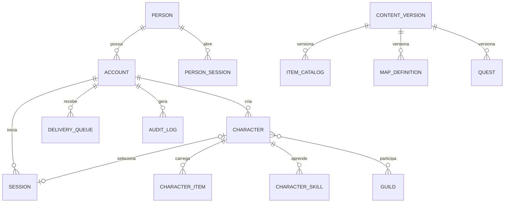

> Pergunta: "quais entidades existem e como se relacionam, antes de virarem tabela?"
> Público: Arquiteto de dados, desenvolvedor e revisor de migration
> Dono: equipe do `wyd-db`
> Base: `../dicionario-dados/index.md` (19 domínios); `modelo-logico.md` §1 e §3; `ddl-confirmado.md` §5; `fronteira-hot-cold.md`
> Revisado em: 2026-11-24

**Estado:** proposto (2026-11-24)

Esta página responde "quais entidades existem e como se relacionam?" — **19** domínios, **109** tabelas,
**5** agregados e as cardinalidades que o modelo lógico usa. Ela não tem coluna, tipo nem `CHECK`: a forma
física é do dicionário e da migration. A decisão `Q-BLK-11` = A (2026-11-24) fixou o recorte por domínio:
cada bloco é o assunto que o dicionário já trata como dono.

## 1. Como ler

- **Entidade** é o conceito com identidade e ciclo de vida; **tabela** é a forma que ele tomou. Uma
  entidade sem ciclo de vida não vira tabela — vira coluna (`padrao-banco.md` §1 `P-02`/`P-03`).
- **Cardinalidade** é `1—1`, `1—N` ou `N—N`, e só aparece aqui quando já está no DDL ou no modelo lógico.
  Este é o **dono** da cardinalidade; [`modelo-logico.md`](modelo-logico.md) §4 deixou de repeti-la.
- **Agregado** é o conjunto que muda junto e é lido junto: conta, personagem, clã, conteúdo e operação.
- **`N—N` vira tabela de ligação**, com PK composta e, quando tem atributo, vira entidade — regra de
  [`modelo-logico.md`](modelo-logico.md) §2.

## 2. Os cinco agregados

| Agregado | Domínios | Tabelas | O que ele garante |
|---|---|---:|---|
| **conta** | acesso (9), economia (22), moderação (1) | 32 | quem entra, quanto tem e o que lhe foi bloqueado |
| **personagem** | personagem (5), progressão (5), inventário (3), arena (4) | 17 | quem joga, o que evoluiu e o que carrega |
| **clã** | social (4) | 4 | a associação entre personagens |
| **conteúdo** | configuração (5), mundo (13), catálogo (7), combate (4), refino (8), quests (4), eventos (5), conteúdo do portal (5) | 51 | o que é definido, versionado e lido no boot |
| **operação** | canal (1), auditoria (3), ponte web↔jogo (1) | 5 | quem lê, quem audita e o que atravessa a fronteira |

A soma fecha as **109** tabelas: 32 + 17 + 4 + 51 + 5. A coluna de domínios é de
[`../dicionario-dados/index.md`](../dicionario-dados/index.md); o recorte por agregado é desta página.

## 3. Os dezenove domínios

| Domínio | Entidades | Tabelas | Agregado |
|---|---|---:|---|
| [acesso](../dicionario-dados/dominio-acesso.md) | pessoa, perfil, consentimento, sessão e token do portal, conta, carteira, reset de PIN, sessão de jogo | 9 | conta |
| [canal](../dicionario-dados/dominio-canal.md) | topologia de servidor: grupo, canal, capacidade e papel | 1 | operação |
| [auditoria](../dicionario-dados/dominio-auditoria.md) | ação auditada, tentativa de login, idempotência | 3 | operação |
| [configuração](../dicionario-dados/dominio-configuracao.md) | versão do conteúdo, revisão de configuração, ajuste por seção | 5 | conteúdo |
| [personagem](../dicionario-dados/dominio-personagem.md) | personagem e satélites de estado | 5 | personagem |
| [progressão](../dicionario-dados/dominio-progressao.md) | skill, linhagem, afeto, chaos | 5 | personagem |
| [inventário](../dicionario-dados/dominio-inventario.md) | mochila, baú, piedade de refino | 3 | personagem |
| [social](../dicionario-dados/dominio-social.md) | guilda, membro, relação, torre | 4 | clã |
| [mundo](../dicionario-dados/dominio-mundo.md) | mapa, rota, NPC, spawn, região, zona | 13 | conteúdo |
| [catálogo](../dicionario-dados/dominio-catalogo.md) | taxonomia, item e skill de catálogo | 7 | conteúdo |
| [combate](../dicionario-dados/dominio-combate.md) | stats de inimigo, equipamento, drop | 4 | conteúdo |
| [refino](../dicionario-dados/dominio-refino.md) | refino, SANC, composição, gema, acessório, override | 8 | conteúdo |
| [economia](../dicionario-dados/dominio-economia.md) | cidade, preço, loja, imposto, cash, ledger, mercado entre jogadores | 22 | conta |
| [quests](../dicionario-dados/dominio-quests.md) | definição, passo, recompensa, progresso | 4 | conteúdo |
| [eventos](../dicionario-dados/dominio-eventos.md) | evento, agenda, participação, Kefra, castelo | 5 | conteúdo |
| [arena](../dicionario-dados/dominio-arena.md) | modo, partida, round, placar | 4 | personagem |
| [moderação](../dicionario-dados/dominio-moderacao.md) | bloqueio de conta | 1 | conta |
| [ponte web↔jogo](../dicionario-dados/dominio-ponte-web-jogo.md) | fila de concessão do portal para o jogo | 1 | operação |
| [conteúdo do portal](../dicionario-dados/dominio-conteudo-portal.md) | notícia, banner, guia, versão do launcher, segundo fator de staff | 5 | conteúdo |

**Dois recortes que a tabela esconde e o texto declara:** `quests` tem a definição no agregado de
conteúdo e o **progresso** no de personagem; `economia` guarda o mercado do portal e o dinheiro do jogo no
mesmo agregado de conta porque a moeda é uma só (`RN-DB-005`). Nenhuma das duas divisões cria segundo
dono: o domínio continua sendo a página do dicionário.

## 4. Relações e cardinalidades

| Relação | Cardinalidade | Regra que a explica |
|---|---|---|
| pessoa → conta | `1—N` | até 5 contas por pessoa (`RF-DB-014`, `RN-DB-001`) |
| pessoa → sessão do portal | `1—N` | várias sessões ao longo do tempo; token é credencial, não a sessão |
| conta → personagem | `1—N` | uma conta cria vários personagens |
| conta → sessão de jogo | `1—N` | várias sessões ao longo do tempo; uma viva (`RF-DB-006`) |
| personagem `0..1` → sessão | `1—1` opcional | a sessão nasce sem personagem e a seleção preenche |
| personagem → item carregado | `1—N` | o item é catálogo; o estado é do personagem |
| personagem → skill | `1—N` | o que foi aprendido |
| personagem ↔ clã | `N—N` | o personagem participa de clã, e o clã tem vários personagens |
| versão de conteúdo → item, mapa, quest | `1—N` | um boot lê um corte; a segunda versão corrente é recusada na escrita (`RF-DB-017`) |
| conta → fila de entrega | `1—N` | a fila não escreve no jogo; o consumidor aplica |
| conta → trilha de auditoria | `1—N` | a trilha é append-only e sem FK (`RF-DB-011`) |

As cardinalidades de `1—N` e `N—N` acima são as de [`modelo-logico.md`](modelo-logico.md) §1 e §3; a de
`0..1` é a da FK anulável de `game.session.character_id`. Nenhuma relação nova é criada aqui.

## 5. A fronteira quente e fria

O modelo não divide os agregados por velocidade: a divisão quente/fria é de
[`fronteira-hot-cold.md`](fronteira-hot-cold.md), e esta página apenas a cita. Em uma frase: o que o
servidor de jogo escreve em partida é quente; o que o portal e a operação leem é frio; a passagem é por
fila e por trilha, não por escrita cruzada.

## 6. O que esta página não decide

- **Não define coluna, tipo, nulidade, default, `CHECK` ou índice:** é do DDL e da página da migration.
- **Não repete o modelo lógico:** agregado por schema, chave e ação de FK ficam em
  [`modelo-logico.md`](modelo-logico.md).
- **Não redesenha 109 tabelas uma a uma:** o dicionário tem uma página por tabela; aqui há o mapa por
  domínio e a cardinalidade.
- **Não decide retenção, partição nem volume:** dependem de medição da série, e a página de retenção
  continua bloqueada.
- **Não decide a fronteira quente/fria:** ela é de [`fronteira-hot-cold.md`](fronteira-hot-cold.md).
- **Não cria relação:** toda cardinalidade acima já existe em DDL fechado ou no modelo lógico.
