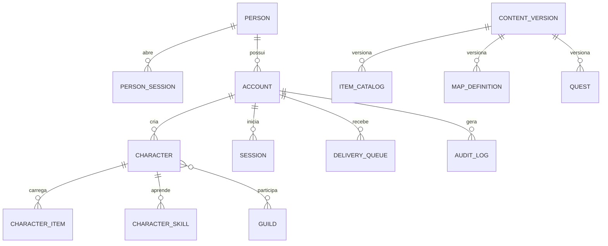

> Pergunta: "como as 109 tabelas se organizam em agregados e como o modelo conceitual vira tabela?"
> Público: Arquiteto de dados, desenvolvedor e revisor de migration
> Dono: equipe do `wyd-db`
> Base: `ddl-confirmado.md` §5; `plano-migrations.md` §3; `docs/dicionario-dados/` (19 domínios); `padrao-banco.md` §1–§3
> Revisado em: 2026-11-22

**Estado:** proposto (2026-11-22)

O modelo lógico tem **109 tabelas e 2 views** planejadas, distribuídas em quatro schemas. Esta página
dá o mapa dos agregados e a regra de passagem do conceitual para o físico; a coluna, o tipo e a
constraint de cada tabela ficam no dicionário e na página da migration, que são os donos da forma.
O ER completo, tabela a tabela, não é redesenhado aqui.

## 1. Agregados e schemas

| Schema | Agregados | Tabelas | Página de domínio |
|---|---|---:|---|
| `portal` | pessoa, perfil, consentimento, sessão, MFA, conteúdo do portal, mercado | 18 | [`dominio-acesso`](../dicionario-dados/dominio-acesso.md), [`dominio-conteudo-portal`](../dicionario-dados/dominio-conteudo-portal.md) |
| `game` | conta, personagem, sessão, habilidades, inventário, clã, economia, quests/eventos, arena | 55 | [`dominio-personagem`](../dicionario-dados/dominio-personagem.md), [`dominio-inventario`](../dicionario-dados/dominio-inventario.md), [`dominio-social`](../dicionario-dados/dominio-social.md) |
| `content` | taxonomia, item, skill, mundo, regras, overrides, mapas, combate, quests/eventos | 31 | [`dominio-catalogo`](../dicionario-dados/dominio-catalogo.md), [`dominio-mundo`](../dicionario-dados/dominio-mundo.md), [`dominio-combate`](../dicionario-dados/dominio-combate.md) |
| `ops` | auditoria, tentativa de login, fila de entrega, idempotência, configuração | 5 | [`dominio-auditoria`](../dicionario-dados/dominio-auditoria.md), [`dominio-economia`](../dicionario-dados/dominio-economia.md) |

As contagens por schema são **planejadas** e vêm de `plano-migrations.md` §3; a soma fecha as 109
tabelas. O dicionário é o dono da contagem por domínio e do estado de cada página; esta tabela é um
recorte de leitura, não uma segunda fonte.

## 2. Do conceitual ao lógico

| Passagem | Regra | Onde a forma é decidida |
|---|---|---|
| entidade → tabela | uma entidade com identidade própria vira tabela; valor que não tem ciclo de vida vira coluna | `padrao-banco.md` §1 `P-02`/`P-03`; página do domínio |
| relação 1:N → FK | a FK mora no lado N; o nome e a ação (`RESTRICT`/`CASCADE`) são explícitos | `integridade-e-constraints.md`; DDL da migration |
| relação N:N → tabela de ligação | a ligação ganha PK composta e, quando tem atributo, vira entidade | `padrao-banco.md` §1; dicionário do domínio |
| herança → tabela satélite | o núcleo fica na tabela principal; o detalhe vai para satélite 1:1 com PK/FK | `padrao-banco.md` §5; `ddl-confirmado.md` §5.10 |
| derivado → view | leitura cruzada vira view; cálculo de jogo não vira coluna persistida sem decisão | `padrao-banco.md` `P-17`; `0029_views.sql` |
| conteúdo → versão | o catálogo referencia `content_version`; a versão é o corte de coerência do boot | `plano-migrations.md` §4; `carga-de-conteudo.md` |

Nenhuma tabela nova entra “porque é conveniente”: a forma nasce no DDL do arquivo da série e a
página do dicionário só a explica. Se o DDL e o dicionário divergirem, prevalece o DDL e a página é
defeito a corrigir (`convencoes.md`).

## 3. Chaves e relações que atravessam domínio

| Relação | Chave | Consequência |
|---|---|---|
| `game.account.person_id` → `portal.person.id` | FK entre schemas | o jogo referencia a pessoa; não copia e-mail nem senha |
| `game.session.character_id` → `game.character.id` | FK anulável | a sessão nasce sem personagem; a seleção preenche depois |
| `game.character_item.item_id` → `content.item_catalog.id` | FK para conteúdo | o item é catálogo; o estado do jogador é `game` |
| `ops.delivery_queue.account_id` → `game.account.id` | FK para o quente | a fila não escreve no jogo; o consumidor aplica |
| `content.*.version` → `content_version.version` | FK/versão | um boot lê um corte; mistura de versões é recusada |

## 4. O que esta página não cobre

- **ER completo das 109 tabelas:** o dicionário tem uma página por tabela e 19 páginas de domínio;
  repetir o ER aqui criaria uma segunda fonte de cardinalidade.
- **Coluna, nulidade, default, CHECK e índice:** são do DDL e da página da migration.
- **Volume, retenção e partição:** dependem de medição da série; a página de retenção está bloqueada.
- **Modelo conceitual independente:** `modelo-conceitual.md` continua bloqueado; este recorte usa os
  agregados que já têm DDL fechado.
