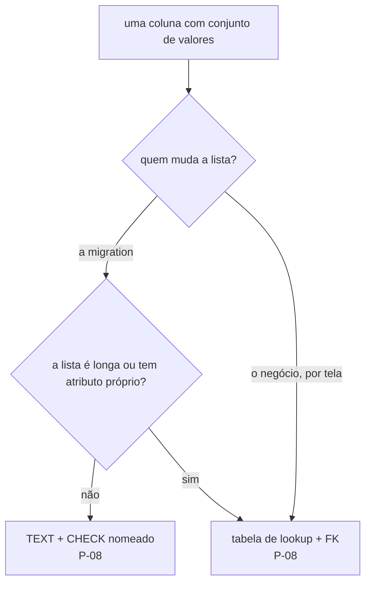

> Pergunta: "qual é o padrão de modelagem — como se escolhe o tipo, quando criar índice, como concorrer e o que é proibido?"
> Público: Arquiteto de schema e desenvolvedor que for mexer em `crates/wyd-db/migrations/`
> Dono: equipe do `wyd-db`
> Base: `padrao-banco.md` §0–§7, §11; `plano-migrations.md` §1–§2
> Revisado em: 2026-11-18

**Estado:** proposto (2026-11-18)

Três níveis de afirmação convivem aqui, e cada um se reconhece:

- **`P`** — tudo o que a página diz sobre o schema, a série ou o crate: nenhuma tabela existe, nenhum
  índice foi criado e o `crates/wyd-db/migrations/` da `1.0.0` ainda não foi escrito.
- **`H`** — ausência de decisão, dita e localizada com o ID que a reabre; não é uma escolha diferente.
- **sem marca** — comportamento do PostgreSQL em si: constraint não tem `WHERE`, o índice não cobre o
  lado filho da FK, remover valor de `ENUM` exige recriar o tipo. É plataforma, não planejamento, e as
  fontes estão em `padrao-banco.md` §13.

Esta página não enuncia DDL de tabela nenhuma. O texto de cada `CREATE TABLE` é de
`ddl-confirmado.md` §3–§5 e, depois da série, do `.sql` e da página daquele arquivo em `migrations/`.
O que mora aqui é a **regra de escolha** — que tipo, que índice, que constraint — com a razão de cada
uma; o valor concreto (nome, predicado, coluna) fica na página que o enuncia. O arranjo entre esta
página e a seção de raiz de onde o critério veio é o de [`../convencoes.md`](../convencoes.md)
§*Nota de enunciação*.

## 1. Os quatro critérios que decidem uma coluna

| Pergunta | Se a resposta for… | A regra muda assim | Regra em |
|---|---|---|---|
| o dado errado pode existir? | não | `NOT NULL`, `CHECK` ou unicidade no banco, não no código | `padrao-banco.md` §5 |
| quem pode escrever nisto? | não é todo mundo | schema + `GRANT` por domínio; a fronteira é do banco | [`seguranca.md`](seguranca.md) |
| isso cresce para sempre? | sim | retenção declarada; partição só no limite medido | `padrao-banco.md` §1 (`P-21`) |
| isso é regra de jogo ou de armazenamento? | regra de jogo | fica no código; trigger é proibido para isso | `padrao-banco.md` §1 (`P-16`) |

> [!WARNING] Regra de jogo em trigger é o erro mais caro
> Trigger é invisível no código, não aparece no erro que o jogador vê e não tem teste de violação
> natural. A única trigger que a série aceita é a de `updated_at`, e ela existe porque a alternativa
> seria repetir o carimbo em cada `UPDATE` escrito à mão (`padrao-banco.md` §7).

## 2. Tipo: o que decide a escolha

Nenhum tipo entra por hábito de outra linguagem nem por "é o que eu uso sempre". Três perguntas
resolvem, e cada resposta tem decisão registrada:

1. **o valor precisa somar exato?** dinheiro e saldo vão para inteiro na menor unidade, e taxa vão
   para inteiro em bps — ponto flutuante e tipo monetário ficam fora (`P-07`);
2. **o valor é um instante?** vai para o tipo com fuso; o sem fuso guarda uma foto de relógio, que
   mente na virada e passa a depender de quem escreveu (`P-06`);
3. **o conteúdo é filtrado ou ordenado?** vira coluna tipada; `JSONB` fica para payload que ninguém
   consulta (`P-09`).

O caso que tem ramo — o **conjunto de valores** — é o único que esta página desenha:

Dois assuntos de tipo são de outra página e não se repetem aqui: **segredo** — hash com forma
verificável, e o comprimento imposto pelo tipo de domínio na borda, não pelo banco — está em
`padrao-banco.md` §4; **faixa de quantidade curta** é do `CHECK`, não do tipo, e a família está em
[`integridade-e-constraints.md`](integridade-e-constraints.md) §3.

**A lista fechada — cada intenção com o seu tipo e o que é proibido — é a tabela de
`padrao-banco.md` §4**, e é ela que vale. Intenção nova entra naquela tabela, com `P` próprio, e não
nesta página.

## 3. Nulidade

`NOT NULL` é o **padrão**; nulo é exceção com motivo escrito na nota da coluna do catálogo
(`padrao-banco.md` §1, `P-12`). O motivo de a regra ser essa: a maioria das colunas de um desenho
correto é obrigatória, e nulo sem motivo é regra de negócio escondida em três estados (`NULL`, vazio,
zero) que o código passa a ter de distinguir.

Nulidade só se justifica quando a ausência é **um estado legítimo** — a linha existe antes de o dado
existir. Exemplo de forma, não de conteúdo: a coluna que só faz sentido em um tipo de linha e é nula
nos demais, com `CHECK` de coerência garantindo que os dois lados andam juntos
(`padrao-banco.md` §5, item 6).

## 4. Nome e constraint

Toda constraint é **nomeada** (`P-13`); constraint anônima trunca em 63 bytes, colide e chega ao erro
do jogador sem dizer o que violou. Os prefixos por tipo de objeto e o limite de bytes do identificador
estão em `padrao-banco.md` §3.

Duas consequências práticas do nome único:

- o nome é o que a página de migration documenta e o que o teste de violação espera receber no erro
  (`migrations-checklist.md` §5, item 7);
- renomear constraint já aplicada é mudança de schema, não de estilo: exige arquivo novo, porque
  arquivo aplicado é imutável (`plano-migrations.md` §2).

## 5. Índice: invariante × desempenho

A distinção que evita quase todo índice inútil é **por que** ele existe:

| Por que o índice existe | O que autoriza a criação | Decisão |
|---|---|---|
| **invariante** — o banco precisa recusar um estado | a própria regra: sem o índice, o estado proibido passa | `P-14` ("um vivo por chave"), `P-15` (lado filho de toda FK) |
| **desempenho** — uma consulta ficou cara | a medição, e só ela: sem leitura que justifique, não entra | `padrao-banco.md` §6 |

Índice de invariante entra sem medição, porque ele **é** a garantia. Índice de desempenho sem medição
é escrita mais lenta em toda tabela quente. E as quatro respostas que a medição pede — que vista
consultar, em que ordem compor as colunas, quando `CONCURRENTLY`, que limiar autoriza partição — são
de `padrao-banco.md` §6, que é o dono delas.

## 6. Concorrência

Três garantias de concorrência têm decisão registrada:

1. **Um arquivo de migration, uma transação.** Nenhum arquivo da série abre ou fecha transação
   própria (`src/migrate/spec.md` §6, planejamento).
2. **Dois processos não aplicam a série ao mesmo tempo.** A serialização é por lock de sessão com
   chave própria, e não por disciplina de quem executa (`src/migrate/spec.md` §5, planejamento).
3. **Recurso finito não se resolve com `COUNT` no app.** Duas criações concorrentes do mesmo recurso
   disputam o índice único parcial e a segunda recebe erro do banco (`padrao-banco.md` §5, item 3).

> [!NOTE] O que esta página **não** afirma sobre concorrência
> `H` — não há decisão registrada para versionamento otimista de linha (coluna de versão) nem para
> `SELECT … FOR UPDATE SKIP LOCKED` no consumo da fila de entrega. As duas aparecem no molde desta
> página porque o assunto é desta seção, não porque existam: enquanto não houver decisão, a série
> não ganha coluna de versão nem consulta de fila escrita por conta desta página
> (`lacunas.md` §2.3, `M17`, aberta).

## 7. Armadilhas: quatro famílias de defeito

A lista nominal de antipadrões é de `padrao-banco.md` §11, e é **fechada**. O que esta seção faz é
agrupar pelo **defeito que a proibição evita**, porque o revisor reconhece o sintoma no diff antes de
procurar a regra:

| Família | O sintoma no diff | Por que custa caro | Regra em |
|---|---|---|---|
| **dado mal tipado** | texto onde deveria haver número ou instante; tipo nativo para conjunto que o produto edita | perde faixa, ordenação e soma exata, e o conserto é reescrita de coluna sob bloqueio | `P-06`, `P-07`, `P-08` |
| **regra invisível** | trigger que "só mantém" um campo; auditoria dentro de trigger | some do código, não aparece no erro e não tem teste de violação | `P-16` |
| **histórico mentiroso** | editar arquivo já aplicado; `ALTER` dentro do `up`; seed de correção como migration | o ledger deixa de explicar o schema e o `down` passa a mentir | `plano-migrations.md` §2 |
| **duplicação de estado** | status + booleano para a mesma coisa; `deleted_at` universal | as duas fontes divergem no primeiro caminho que esquece uma, e o carimbo sai de todo `WHERE` | `padrao-banco.md` §5, itens 4–5; `P-20` |

Armadilha que não caiba em nenhuma das quatro famílias não é caso novo de revisão: é linha nova em
`padrao-banco.md` §11, decidida lá — e só então esta tabela ganha família nova.

## 8. O que quebra se mudar

| Mudança | O que quebra |
|---|---|
| trocar o tipo de uma coluna já criada | o arquivo aplicado é imutável: exige arquivo novo com conversão, e toda consulta que dependia do tipo antigo (`plano-migrations.md` §2) |
| introduzir `ALTER TABLE` no `up` | o parser do catálogo reprova e o histórico deixa de explicar o schema (`plano-migrations.md` §2, `padrao-banco.md` §11) |
| remover valor de um `ENUM` | recriação do tipo e reescrita da coluna sob bloqueio exclusivo — por isso `ENUM` não entra (`P-08`) |
| tirar o `CHECK` de faixa "porque o app valida" | o banco passa a aceitar o impossível, inclusive por escrita concorrente e por correção manual (`padrao-banco.md` §5) |
| indexar tudo por precaução | escrita mais lenta em todas as tabelas quentes, sem consulta que justifique (`padrao-banco.md` §6) |
| trocar `TIMESTAMPTZ` por tipo sem fuso | o instante passa a depender do fuso de quem escreveu e a ordenação entre servidores deixa de valer (`P-06`) |

## 9. Checklist de revisão de DDL

Cada item reprova o arquivo sozinho; a lista é a mesma que o revisor usa em
[`como-adicionar-tabela.md`](../guia-desenvolvedor/como-adicionar-tabela.md) e em
[`como-adicionar-migration.md`](../guia-desenvolvedor/como-adicionar-migration.md).

1. nome qualificado com schema em `CREATE TABLE`, `REFERENCES` e `CREATE INDEX`;
2. PK identity nomeada; PK composta só onde a chave natural é a identidade;
3. toda constraint nomeada, com o prefixo do tipo de objeto;
4. nenhum tipo proibido — a lista fechada está em `padrao-banco.md` §11;
5. toda coluna `NOT NULL`, ou nulidade com motivo escrito;
6. `CHECK` de faixa em toda quantidade curta; `CHECK` de coerência em todo par estado × carimbo;
7. índice no lado filho de toda FK; índice parcial para "um vivo por chave";
8. nenhuma FK para tabela criada em arquivo posterior (`plano-migrations.md` §2);
9. seed em arquivo próprio, depois do DDL do domínio;
10. `down` derruba, no mesmo arquivo, tudo o que o `up` criou.

## 10. O que esta página não decide

1. **Não enuncia DDL.** Coluna, tipo concreto, predicado de `CHECK` e nome de índice são de
   `ddl-confirmado.md` §3–§5 e, depois da série, do `.sql` e da página de `migrations/`.
2. **Não decide ordem, contagem nem nome de arquivo da série** — isso é `plano-migrations.md` §2–§3.
3. **Não decide permissão.** Quem lê e quem escreve cada schema é [`seguranca.md`](seguranca.md), e o
   texto do artefato de papel é de `src/provision/spec.md` §4 (planejamento).
4. **Não decide regra de produto.** O que é permitido ao jogador é de `specs/` (planejado).
5. **Não fecha o desenho de concorrência de runtime**: ver a nota da §6.
