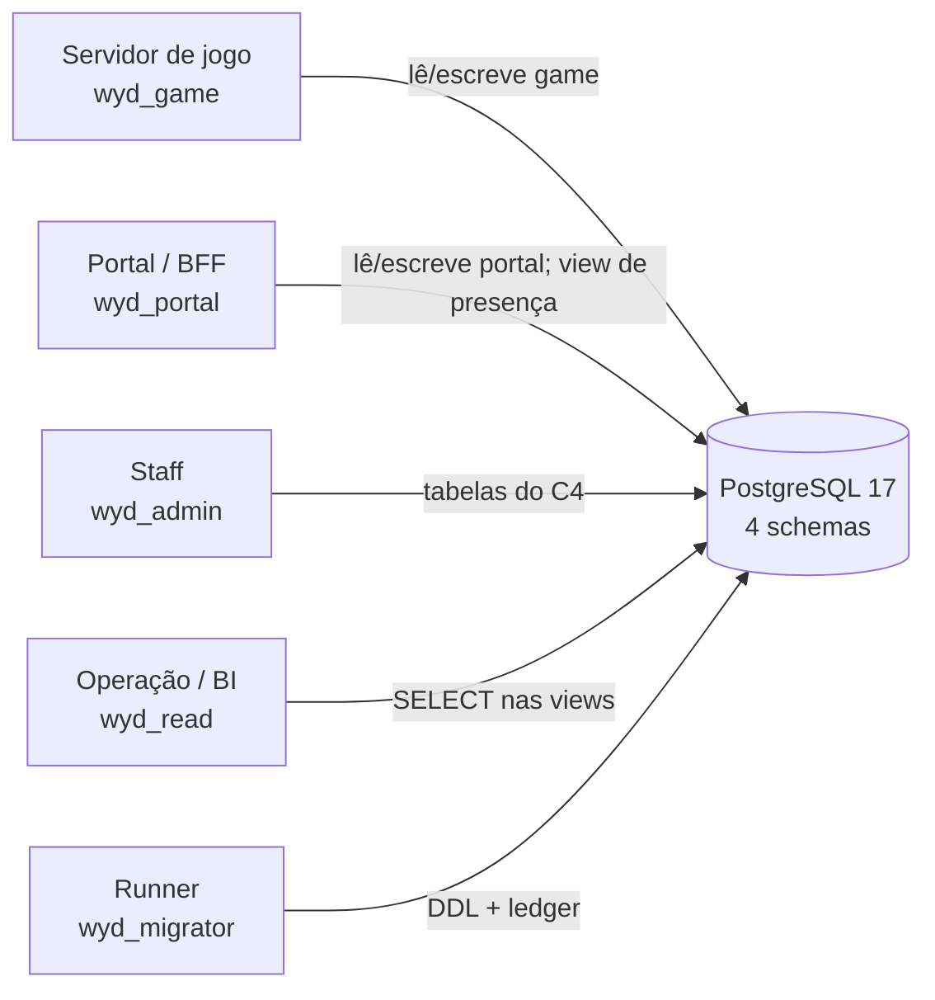

> Pergunta: "o que é o `wyd-db` em 10 minutos?"
> Público: todos os públicos de §2 do plano diretor — é a visão de conjunto
> Dono: equipe do `wyd-db`
> Base: `wyd-db-1.0.0.md` §1.2 e §6.17; `plano-migrations.md` §2–§4; `padrao-banco.md` §0–§2; `src/migrate/adapter/mod.md`
> Revisado em: 2026-11-22

**Estado:** proposto (2026-11-22)

O `wyd-db` é a **persistência do WYD em PostgreSQL 17**: o schema, a série de migrations que o cria,
as portas de domínio e o adapter que fala SQL, o pool, as filas de transferência e a carga de
conteúdo. Ele não é o servidor de jogo nem o portal — é o banco que os dois usam, com papéis
diferentes e fronteira aplicada por `GRANT`. Esta página dá o mapa; o detalhe de cada parte fica nas
páginas irmãs.

## 1. Para que existe

O banco existe para que **três consumidores com poderes diferentes** — jogo, portal e operação —
compartilhem o mesmo dado sem que a diferença de poder dependa de disciplina de código. A regra de
ouro e as quatro perguntas que decidem cada tabela estão em `padrao-banco.md` §0; o resultado é um
schema por domínio, com escrita separada e leitura cruzada só por view.

## 2. O que guarda e o que não guarda

| Guarda | Não guarda |
|---|---|
| o estado vivo do jogo: conta, personagem, item, clã, economia, quests, arena | a regra de jogo executada no tick — ela é do servidor |
| identidade e PII em `portal`: pessoa, perfil, consentimento, sessão, token | e-mail ou hash de senha fora de `portal`; `game` referencia `person_id`, não copia |
| conteúdo versionado: catálogo, mundo, regras, mapas, quests e eventos | dado de jogador real; a `1.0.0` não tem carga de base legada decidida |
| operação: auditoria, tentativa de login, configuração, fila de entrega, idempotência | segredo de assinatura ou token em claro; só hash (`sha256`) |
| o ledger da série e o `content_version` | backup, retenção executada ou topologia de canal — são do ambiente |

O recorte oficial de dentro/fora é `wyd-db-1.0.0.md` §1.2; esta tabela é a leitura dele em uma tela.

## 3. Tecnologias

| Peça | Escolha | Onde está decidido |
|---|---|---|
| banco | PostgreSQL **17** | `padrao-banco.md` §1; `plano-migrations.md` §1 |
| linguagem do crate | Rust | `wyd-db-1.0.0.md` §1.2 e §6.16 |
| acesso a SQL | `sqlx`, confinado ao `adapter` | `src/migrate/adapter/mod.md`; `src/migrate/adapter/pg.md` |
| assíncrono | Tokio; `spawn_blocking` para I/O de arquivo no adapter | `src/migrate/adapter/fs.md` |
| schemas | `content`, `game`, `portal`, `ops`; `public` vazio | `padrao-banco.md` `P-01` e §2 |
| migrations | arquivo com `-- migrate:up`/`-- migrate:down`, ledger e checksum | `src/migrate/spec.md` §2–§4 |

O runtime assíncrono do crate **não está decidido em documento** além do uso de Tokio no adapter; a
página não promete modelo de executor, número de workers nem política de pool.

## 4. Os números, com fonte e data

| Número | O que conta | Fonte | Data | Estado |
|---:|---|---|---|---|
| **34** | arquivos da série da `1.0.0` | `plano-migrations.md` §3 | 2026-11-22 | `P` |
| **109** | tabelas criadas pela série | `plano-migrations.md` §3 | 2026-11-22 | `P` |
| **34** | `SCHEMA_VERSION` na troca (hoje a série herdada mantém **53**) | `plano-migrations.md` §2 e §6 | 2026-11-22 | `P` |
| **2** | views de leitura cruzada | `plano-migrations.md` §3 | 2026-11-22 | `P` |
| **5** | alvos de teste do crate | `wyd-db-1.0.0.md` §6.17 | 2026-11-22 | `P` |

Nenhum desses números foi medido em catálogo: a série nova ainda **não foi aplicada**, e o número
real sai do catálogo depois que ela existir. Quem é dono da contagem é `plano-migrations.md` §3; esta
página **cita**, não redigita. Contagem de página da documentação é outra coisa e fica no censo do
site.

## 5. Contexto em uma imagem

O recorte de atores, credenciais e do que o banco **não** decide é
[`contexto-c4.md`](contexto-c4.md); o modelo de dados começa no
[`dicionário`](../dicionario-dados/index.md).

## 6. O que não está decidido

- **Runtime assíncrono do crate:** o uso de Tokio no adapter está descrito; o modelo do resto do
  crate não está em documento.
- **Números medidos:** os cinco da §4 são `P` até a série ser aplicada e o catálogo lido.
- **Carga de base legada:** a `1.0.0` não decidiu ETL nem janela para dado antigo; a página de
  implantação declara a pendência.
- **Seis seeds:** os arquivos `0016`–`0018`, `0020`, `0023` e `0027` esperam dado de origem
  verificado; o plano deles é
  [`plano-de-dados-e-seeds.md`](../planos/plano-de-dados-e-seeds.md).
