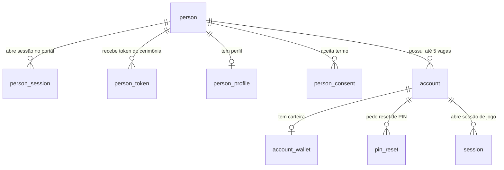

> Pergunta: "quais tabelas cuidam de acesso — pessoa, conta, credencial e sessão — e como se relacionam?"
> Público: Arquiteto de schema e desenvolvedor do `wyd-db`
> Dono: equipe do wyd-db
> Base: `ddl-confirmado.md` §4, §5.1, §5.2, §5.5, §5.6, §5.7
> Revisado em: 2026-11-18

**Estado:** proposto (2026-11-18)

Esqueleto de página: as nove tabelas e as relações estão fechadas; a série ainda não foi aplicada. O que não estiver escrito aqui **não** é omissão de redação — é
dicionário ainda não gerado.

Três níveis de afirmação convivem aqui, e cada um se reconhece:

- **`P`** — o que está desenhado e ainda não aplicado: as nove tabelas, as views e os `GRANT`.
- **`H`** — semântica não verificada, na tabela do fim da página, com o ID que a reabre.
- **sem marca** — comportamento do PostgreSQL: índice parcial, FK composta, `CHECK` de coerência.

## Propósito do domínio

Acesso é **quem entra**: a pessoa (identidade do portal), a conta de jogo que ela possui, a credencial
de cada uma e a sessão viva. É o único domínio em que `portal` e `game` compartilham assunto por
desenho: a pessoa autentica no portal, a conta autentica no cliente 7662, e o vínculo entre as duas é
uma FK, não uma cópia de e-mail.

**Não cobre:** personagem e inventário (`dominio-personagem`, `dominio-inventario`), o bloqueio de
conta ([moderação](dominio-moderacao.md)), auditoria de login (`dominio-auditoria`) nem configuração
do dono (`dominio-configuracao`). Papel de canal é `game.server_channel` (`dominio-canal`).

## Diagrama de relações

## Tabela de tabelas

**Estado não se digita aqui.** Ele deriva do estado do arquivo em `migrations-checklist.md` §1.2 —
dono único da derivação: as tabelas de `0003`, `0004`, `0005` e `0007` estão em arquivo `pronta`
(`planejado`). Nenhuma é `pronto`: isso exige a migration aplicada com o checksum vigente no ledger.

| Tabela | Papel em uma linha | Escreve | Lê | Colunas |
|---|---|---|---|---|
| `portal.person` (0003) | identidade do portal: e-mail único normalizado, senha argon2id, papel e status | portal | portal | `gerado/person.md` |
| `portal.person_profile` (0003) | perfil 1:1 da pessoa: nome de exibição, país, nascimento | portal | portal | `gerado/person_profile.md` |
| `portal.person_consent` (0003) | aceite versionado de termo, privacidade e marketing, com revogação | portal | portal | `gerado/person_consent.md` |
| `portal.person_session` (0004) | sessão revogável do portal: hash do cookie, expiração absoluta | portal | portal | `gerado/person_session.md` |
| `portal.person_token` (0004) | token de cerimônia (`email_verify`, `password_reset`, `email_change`) | portal | portal | `gerado/person_token.md` |
| `game.account` (0005) | conta de jogo na vaga 1–5 da pessoa, com login e PIN próprios | `wyd_game` | `wyd_game, wyd_read` | `gerado/account.md` |
| `game.account_wallet` (0005) | carteira 1:1 da conta; `coin` no teto do campo do fio | `wyd_game` | `wyd_game, wyd_read` | `gerado/account_wallet.md` |
| `game.pin_reset` (0005) | pedido de reset de PIN: hash do token, origem e consumo | portal | portal | `gerado/pin_reset.md` |
| `game.session` (0007) | sessão viva do jogador num canal da topologia | `wyd_game` | `wyd_game, wyd_read` | `gerado/session.md` |

**Papel, não sistema.** `account`, `account_wallet` e `session` nomeiam o papel porque a fronteira é de
schema, não de serviço: `0001` §7 concede `USAGE` em `game` a `wyd_game` e `wyd_read`, e `0005` §8 registra
`wyd_portal` **sem** `USAGE` ali. A prova é o item "portal não cruza fronteira" de `0005` §9:
`SET ROLE wyd_portal; SELECT * FROM game.account;` responde `42501 permission denied for schema game`.
A view não escapa disso — `0029` §8.3 decidiu, em 2026-11-21, nascer sem `GRANT`, e o §9.4 da mesma
página espera o mesmo `42501`. Resta uma pergunta que esta página não responde: `A7` decidiu que a
conta de jogo **nasce no portal** depois do `email_verify`, mas nenhuma migration dá ao portal caminho
de escrita em `game`, então quem escreve ali hoje é `wyd_game` e a criação pelo portal ainda não tem
prova de execução. `M27` e `M28` fecharam em 2026-11-21: a escrita de staff em `game` é do `wyd_admin`
(`0032`) e a "API interna" é o serviço `wyd-admin` (redação B). `game.pin_reset` continua escrito pelo
portal no desenho e cai na mesma pergunta; a célula continua com o papel porque a criação pelo portal
segue sem prova de execução.

`game.session` depende de `game.character` (`0006`, ainda sem coluna desenhada): a FK para personagem
é `planejado` como o resto, mas não pode virar SQL antes de `0006` — esta página não antecipa essa
forma.

As páginas `gerado/<tabela>.md` existem em parte: são escritas à mão em lotes (`M26`, decidida em
2026-11-21), sem gerador, e cada uma aponta para a página de `migrations/` como dona da forma. Quantas
existem diz [`gerado/index.md`](gerado/index.md), dono único da contagem.
Até lá, coluna, tipo, nulidade, default e índice vivem em `ddl-confirmado.md`, e esta página só os cita
([`../convencoes.md`](../convencoes.md) §*Nota de enunciação*).

## Ciclo de vida do dado

O que **define** cada coluna é política de `padrao-banco.md` §5 (itens 1, 4 e 7), `P-15` e `P-20`; esta
tabela lê a política por tabela, neste domínio.

| Tabela | Nasce | Muda | Morre |
|---|---|---|---|
| `person` | cadastro no portal, `status = 'pending'` | verificação de e-mail, troca de senha, suspensão (`B4`), fechamento | nunca por `DELETE`: `status = 'closed'` com anonimização coerente |
| `person_profile` | junto do cadastro | edição do dono | `CASCADE` com a pessoa (dado de perfil, não de dinheiro) |
| `person_consent` | aceite registrado | revogação (`revoked_at`) | `CASCADE` com a pessoa |
| `person_session` | login no portal | `last_seen_at`, `revoked_at` | expiração absoluta, revogação ou `CASCADE` com a pessoa |
| `person_token` | pedido de cerimônia | `used_at`, `attempt_count` | expiração, consumo, reemissão ou `CASCADE` |
| `account` | criação pelo portal, na vaga livre | login, senha, PIN, contadores, `last_login_at` | `closed_at`; nunca `DELETE` |
| `account_wallet` | criação da conta, 1:1 | crédito/débito de `coin` | não morre: `RESTRICT` |
| `pin_reset` | pedido de reset | `used_at` | expiração ou consumo; histórico fica |
| `session` | handshake do jogo | `renewed_at`, `character_id` na seleção | `released_at` pelo canal ou pelo reaper |

**Órfão possível:** `person_token` e `pin_reset` vencidos sem uso acumulam; é assunto de
`retencao-e-capacidade.md`, não de schema. `session` liberada é trilha de auditoria (`M22`, aberta).

## Regras e armadilhas

**O schema garante sozinho:**

Cada item é constraint de `ddl-confirmado.md` §5.1–§5.7 — nome, predicado, tipo e índice ficam lá;
esta página lê o que eles garantem **neste** domínio.

- e-mail e login únicos por coluna dobrada (`lower(btrim(...))` gerada) — dois cadastros com caixa
  diferente colidem no índice, não no código.
- senha e PIN só entram no formato `$argon2id$…` (`ck_person_senha_hasheada` e equivalente na conta).
- vaga de conta em 1–5 e **uma** conta ativa por vaga (`ux_account_slot … WHERE status <> 'closed'`).
- uma sessão viva por conta e uma por personagem, por índice parcial — a segunda conexão falha no
  banco, não só na aplicação.
- sessão só em canal existente: FK composta `(group_id, channel)` e `channel BETWEEN 1 AND 10`.
- conta não se apaga: as três FKs para `game.account` e a de `account` para `person` são `RESTRICT`.

**Só o código garante:** limite de tentativas por janela, política de senha, conteúdo do e-mail de
cerimônia, expiração idle da sessão do portal (é `last_seen_at + intervalo`, **não** é coluna) e
anonimização de pessoa fechada além do que o CHECK de coerência exige. O critério de o que fica no
código é a regra de ouro de `integridade-e-constraints.md` §1, e o que já está classificado está em §6
da mesma página.

**Armadilhas de leitura:**

- `game.account.slot` é **vaga** (1–5), não o `slot` de personagem (0–3) — ver `vaga` no glossário.
- não existe `released_reason` em `game.session` (`A10`): o motivo de liberação é evento em
  `ops.audit_log`, e procurar a coluna é perder tempo.
- `pin_reset` **não** tem o índice "um vivo por conta" que `ux_person_token_vivo` dá ao portal —
  diferença declarada, a alinhar quando `0005` fechar.
- `session.character_id` é nulo entre o handshake e a seleção: consulta que exige personagem precisa
  filtrar, não assumir.

**`H` — semântica não verificada, com o que falta:**

| Ponto | Falta |
|---|---|
| conjunto de caracteres aceito no `login` de 1–16 (`A11`) | captura do cliente 7662; hoje só o tamanho é regra |
| política de PIN (bloqueio, reemissão) | decisão `B3`; o schema só guarda contador e instante |
| transferência de conta entre pessoas (`A17`) | decidir a forma: histórico em tabela de titularidade no `0005` ou instante da última troca como coluna em `game.account`, que reabre tabela fechada; o arquivo `0005` muda nas duas |
| razão de lançamento de `coin` (`M16`) | decidir se a carteira precisa de ledger; muda o arquivo `0005` |

## Requisitos atendidos

Os IDs `RF-DB`/`RN-DB` nascem em `specs/` (onda 3) e ainda não existem; esta seção lista o que o
domínio cobre para que a rastreabilidade os ligue depois, sem inventar identificador agora:

- cadastro de pessoa, verificação de e-mail e aceite de termo;
- login do portal, sessão revogável e logout;
- criação, limite e fechamento de conta de jogo por vaga;
- login do jogo com senha e PIN, com contagem de falhas e bloqueio temporário;
- reset de PIN por token;
- sessão única de jogo por conta e por personagem;
- bloqueio de conta por staff com motivo e autor.
