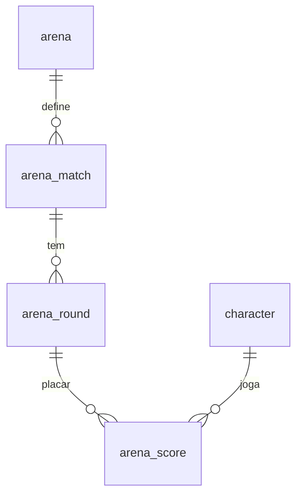

> Pergunta: "como a arena é definida e como partida, round e placar se encaixam?"
> Público: Arquiteto de schema e desenvolvedor do `wyd-db`
> Dono: equipe do wyd-db
> Base: `ddl-confirmado.md` §5.26, §5.28; `migrations-checklist.md` §2
> Revisado em: 2026-11-21

**Estado:** proposto (2026-11-21) — DDL fechado, série não aplicada.

## Propósito do domínio

Arena é **competição com regra e placar**: a definição do modo (times, rounds, tempo) em `content` e o
histórico da partida em `game` — partida, round e placar por jogador. Quatro tabelas, uma de definição e
três de estado.

**Não cobre:** personagem ([personagem](dominio-personagem.md)), guilda ([social](dominio-social.md)) nem
eventos de mundo (`dominio-eventos`).

## Tabela de tabelas

| Tabela | Schema | Papel em uma linha |
|---|---|---|
| `content.arena` | content | modo de arena por `code`: tipo, tamanho de time, rounds e tempo |
| `game.arena_match` | game | partida: arena, início, fim e time vencedor |
| `game.arena_round` | game | round da partida, com vencedor e desempate |
| `game.arena_score` | game | placar por jogador e round |

## Relações

- `arena_match` → `content.arena` com `RESTRICT`: apagar a definição com partida registrada falha alto.
- `arena_round` → `arena_match` e `arena_score` → `arena_round` com `CASCADE`: round e placar são linhas
  possuídas.
- `arena_score` usa FK **composta** `(match_id, round_no)`: o placar não pode citar round de outra
  partida.

## Ciclo de vida do dado

| Tabela | Nasce | Muda | Morre |
|---|---|---|---|
| `content.arena` | seed `0027` | nunca em runtime | com o seed |
| `arena_match` | abertura da partida | `ended_at`, `winner_team` | com o personagem? não: com a definição, por `RESTRICT` |
| `arena_round` | início do round | fim e vencedor | com a partida |
| `arena_score` | fim do round | nunca | com o round ou com o personagem |

## O que o schema garante

- **modo finito:** `kind IN ('royal', 'battle_royale')`; time de 1 a 64; 1 a 9 rounds; `round_ms > 0`;
  `respawns` 0–9; nível mínimo 1–400.
- **partida com tempo coerente:** `ended_at IS NULL OR ended_at >= started_at`.
- **vencedor é time 1 ou 2:** `winner_team IN (1, 2)`, quando houver.
- **round numerado na faixa:** `round_no BETWEEN 1 AND 9`, com `(match_id, round_no)` como PK.
- **placar não negativo:** mortes, assists, kills, dano e deaths `>= 0`.
- **time do placar é 1 ou 2**, e cada jogador aparece uma vez por round.

## Armadilhas de leitura

- `arena_match` **não** guarda o placar: ele é por round em `arena_score`.
- `is_tiebreak` marca round de desempate; não é um round extra fora de 1–9.
- `arena_score.damage` é `BIGINT`; kills/assists/deaths são `SMALLINT` — não compare tipos diferentes.
- partida sem `ended_at` está em andamento; `winner_team` nulo nesse estado não é erro.
- a FK para `content.arena` é `RESTRICT`, mas a FK de `arena_match` para personagem **não existe**: a
  partida não é "de um personagem".

## `H` — semântica não verificada

| Ponto | Falta |
|---|---|
| regra de vitória por modo | `0015_arena.sql` do legado, sem reverificação |
| efeito de `respawns` e `round_ms` | runtime, não schema |
| `min_level` e elegibilidade | regra de entrada não verificada |
| desempate | quando `is_tiebreak` é usado não tem trace |
