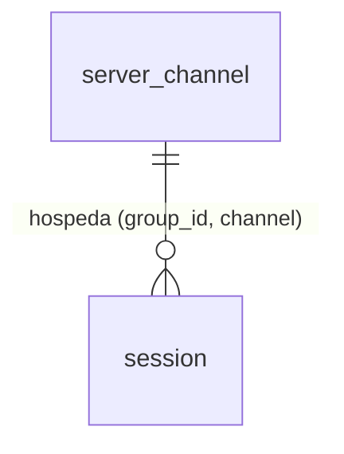

> Pergunta: "o que é um canal de jogo, quem o opera e o que o schema garante sobre ele?"
> Público: Arquiteto de schema e desenvolvedor do `wyd-db`
> Dono: equipe do wyd-db
> Base: `ddl-confirmado.md` §5.5; `migrations-checklist.md` §2; `0007-game-session.md`
> Revisado em: 2026-11-21

**Estado:** proposto (2026-11-21) — DDL fechado, série não aplicada.

## Propósito do domínio

Canal é **onde o jogo roda**: a instalação (grupo) e a faixa jogável que o cliente 7662 enxerga. Uma
linha de `game.server_channel` descreve um canal físico — host, endereço de status, capacidade e papel —
e é dado de **operação**, não de conteúdo nem de jogador.

O domínio tem uma tabela só. A sessão que ocupa o canal (`game.session`) é assunto de
[acesso](dominio-acesso.md), porque nasce do handshake e morre com o jogador.

**Não cobre:** sessão viva (acesso), personagem, economia nem status do `serv00.htm` como serviço.

## Tabela de tabelas

| Tabela | Papel em uma linha | Escreve | Lê |
|---|---|---|---|
| `game.server_channel` (0007) | topologia: grupo 0–9 e canal 0–10, com host, capacidade e papel | operação (fora da série) | jogo, portal (status), `wyd_read` |

Colunas, `CHECK`s e trigger vivem em `migrations/0007-game-session.md`; esta página lê o significado.

## Relações

A FK é composta e mora em `game.session`: a sessão só existe num canal que existe na topologia. Não há
FK de saída em `server_channel` — nada em `game` é dono de um canal.

## Ciclo de vida do dado

| Momento | O que acontece |
|---|---|
| nascimento | **operação**, por ambiente: `host`, `status_url` e capacidade são dado de instalação, não da migration |
| mudança | staff/operação ajusta `max_players`, `maintenance` e `role`; `updated_at` é carimbado por trigger |
| morte | não há `DELETE` previsto: canal desativado é `enabled = false` |

**Decisão de 2026-11-18 (`M23`):** `channel_capacity` e `channel_role` do legado foram fundidas nesta
tabela. Eram 1:1 com a topologia e existiam só porque o legado proibia `ALTER TABLE` no `up`; numa série
criada do zero, os três campos nascem no `CREATE TABLE`.

## O que o schema garante

- **duas linhas não descrevem o mesmo canal:** PK `(group_id, channel)`.
- **faixa fechada:** `group_id` 0–9 e `channel` 0–10; a sessão só aceita 1–10, então `channel = 0` nunca
  recebe jogador.
- **linha de status é diferente de canal jogável:** `ck_server_channel_jogavel` exige os três campos de
  operação nulos no canal 0 e preenchidos no canal 1–10.
- **papel é finito:** `normal` ou `verde` (canal de novato, sem PvP).
- **capacidade não é negativa:** `max_players >= 0`; `host` não é vazio e `status_url` cabe em 32
  caracteres.

## Armadilhas de leitura

- `channel = 0` **não é** "canal zero": é a linha de status lida pelo `serv00.htm`. Consulta de ocupação
  precisa filtrar `channel BETWEEN 1 AND 10`.
- capacidade, manutenção e papel são **anuláveis de propósito**; `NULL` ali não é dado faltando, é a
  linha de status.
- `max_players` é dado de operação (1000 no legado), não constante de código.
- **não** existe seed de canal na série: dois ambientes com o mesmo `host` numa migration seria mentira
  sobre o segundo. O `down` do `0007` não apaga canal porque o `up` não cria.

## `H` — semântica não verificada

| Ponto | Falta |
|---|---|
| papel `verde` além de "sem PvP" | trace do servidor 7662; hoje só o nome e a ausência de PvP estão registrados |
| valor real de capacidade por canal | medição de operação; o número não é regra de schema |
| uso de `status_url` pelo launcher/portal | contrato do `serv00.htm` não foi reverificado no planejamento novo |
