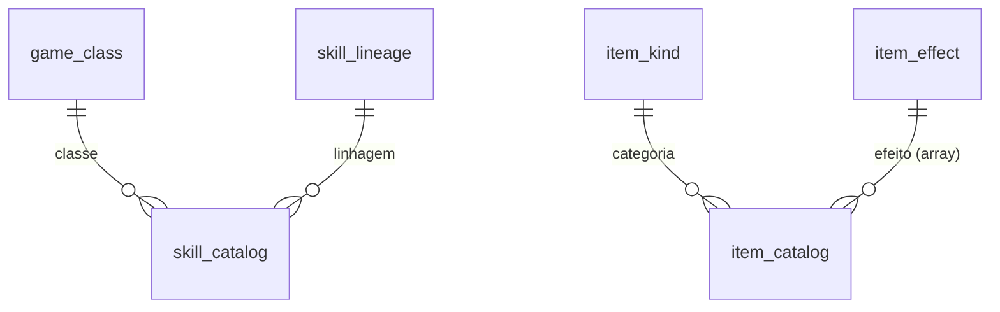

> Pergunta: "quais catálogos o jogo lê — taxonomias, item e skill — e o que é chave natural neles?"
> Público: Arquiteto de schema e desenvolvedor do `wyd-db`
> Dono: equipe do wyd-db
> Base: `ddl-confirmado.md` §5.17, §5.18, §5.19; `migrations-checklist.md` §2
> Revisado em: 2026-11-21

**Estado:** proposto (2026-11-21) — DDL fechado, série não aplicada; os três seeds seguem `bloqueada`.

## Propósito do domínio

Catálogo é **o que existe no jogo**, não o que o jogador tem: cinco taxonomias de look-up, o catálogo de
item (3.220 linhas no seed) e o de skill (154). É o único bloco de `content` que o portal também lê para
a wydpedia.

**Não cobre:** item no inventário ([inventário](dominio-inventario.md)), mundo e NPCs
([mundo](dominio-mundo.md)), regra de combate ([combate](dominio-combate.md)) nem skill aprendida
([progressão](dominio-progressao.md)).

## Tabela de tabelas

| Tabela | Papel em uma linha |
|---|---|
| `content.game_system` (0013) | sistema de jogo, por `slug` |
| `content.game_class` (0013) | classe, com `mastery_cap` (default 320) |
| `content.skill_lineage` (0013) | linhagem de skill, por `slug` |
| `content.item_kind` (0013) | categoria de item, por `slug` |
| `content.item_effect` (0013) | efeito de item, por `slug` (55 `EF_*` no seed `0017`) |
| `content.item_catalog` (0014) | item por `item_index` 0–32767, com preço, grau e efeitos |
| `content.skill_catalog` (0015) | skill por `skill_index` 0–247, com classe e linhagem |

A função `content.fn_fold` nasce em `0013` e é usada por colunas geradas de `0014` (`P-11`).

## Relações

- `item_catalog.kind_slug` é **anulável**: `NULL` = categoria não provada.
- `skill_catalog.class_slug`/`lineage_slug` são anuláveis com FK.
- Nenhuma tabela de `0013` tem FK de saída; o schema `content` não aponta para `game`/`portal`.

## Ciclo de vida do dado

Seed (`0016`–`0018`), preso à verificação do dado de origem: as contagens não foram reconferidas na
fonte. As três páginas de migration desses seeds seguem `bloqueada`; o DDL está fechado, o dado não.

## O que o schema garante

- **chave natural = identidade:** `slug` `snake_case` de 2–32 caracteres, `item_index` 0–32767 e
  `skill_index` 0–247. Não há `id` sintético onde o número do cliente já é a chave (`P-04`).
- **nome não vazio:** 1–64 caracteres em todo catálogo.
- **dobra de busca:** `name_fold` gerado por `fn_fold`, com índice `text_pattern_ops` para prefixo.
- **preço e grau não negativos:** `base_price >= 0`, `grade >= 0`.
- **efeito é lista sem nulo:** `array_position(effect_names, NULL) IS NULL`, índice GIN para busca.
- **skill não negativa:** o `CHECK` cobre os campos numéricos do catálogo.
- **teto de maestria é lido, não fixado:** `game_class.mastery_cap` 0–320; o `CHECK` global de
  `game.character_skill` é 320, e a classe só reduz.

## Armadilhas de leitura

- `item_catalog` **não** guarda `IndexMesh`, `IndexTexture`, `IndexVisualEffect`, `nUnique`, `nPos` nem
  `Extra`: fora por falta de consumidor, não por esquecimento. Campo fora não é dívida.
- `skill_catalog.name` é **curadoria do seed**: o parser do `SkillData.csv` descarta o nome.
- `delay` e `affect_time` são gravados **brutos**; a conversão é do runtime.
- **não existe FK** de `game.character_skill.skill_index` para o catálogo: 248 índices possíveis contra
  154 linhas. A ausência é decisão, não lacuna.
- `game_class.mastery_cap` default 320 é o teto global, não uma restrição por classe.

## `H` — semântica não verificada

| Ponto | Falta |
|---|---|
| contagens do seed | 3.220 itens e 154 skills são de 2026-11-08/15, não reconferidas na fonte |
| mapa dos 55 `EF_*` | se coincide com todo slug habilitado de `item_effect` |
| `grade` e `requirements` | semântica do legado, sem trace no planejamento novo |
| por que 3 skills vêm da Kersef | origem medida, significado não |
