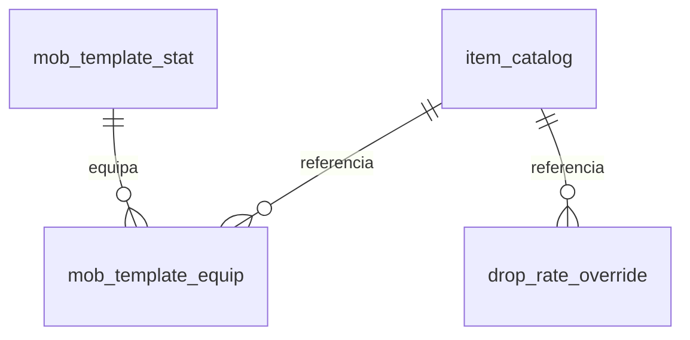

> Pergunta: "o que define o inimigo e a chance de drop — stats, equipamento e multiplicador — e o que não é probabilidade?"
> Público: Arquiteto de schema e desenvolvedor do `wyd-db`
> Dono: equipe do wyd-db
> Base: `ddl-confirmado.md` §5.25; `migrations-checklist.md` §2; `0025-content-combat.md`
> Revisado em: 2026-11-21

**Estado:** proposto (2026-11-21) — DDL fechado, série não aplicada.

## Propósito do domínio

Combate, aqui, é **o insumo do inimigo**: stats por template, o que ele equipa, a tabela de drop e o
multiplicador de taxa por família. Quatro tabelas de `content`, seed-only e read-only em runtime — a
fórmula de combate não mora no banco (`padrao-banco.md` §0).

**Não cobre:** scores e vida do personagem ([personagem](dominio-personagem.md)), item do drop como
catálogo ([catálogo](dominio-catalogo.md)) nem taxa de refino ([refino](dominio-refino.md)).

## Tabela de tabelas

| Tabela | Papel em uma linha |
|---|---|
| `content.mob_template_stat` (0025) | stats do template: nível, PV, ataque, defesa, EXP e ouro |
| `content.mob_template_equip` (0025) | item equipado pelo template, por slot 0–15 |
| `content.drop_rate_override` (0025) | drop por **peso**, com faixa de quantidade |
| `content.content_rate_override` (0025) | multiplicador por `kind`, em basis points |

## Relações

`mob_template_stat` usa o próprio `template_name` como PK (`P-04`), e `mob_template_equip` usa
`(template_name, slot)` com `CASCADE`: o equipamento não existe sem o template. As FKs de item usam
`RESTRICT` — decisão de 2026-11-21.

## Ciclo de vida do dado

Seed. Sem carimbo e sem procedência por linha: `content_source` é de [mundo](dominio-mundo.md) e a
edição viva, quando existir, vai por `content_rate_override` com auditoria em `ops`.

## O que o schema garante

- **stats coerentes:** nível 1–400, `max_hp > 0`, ataque e ataque mágico `>= 0`, EXP `>= 0`,
  `gold_min >= 0 AND gold_max >= gold_min`.
- **equipamento no slot do cliente:** `slot` 0–15 e `item_index` 0–32767.
- **drop é peso, não porcentagem:** `weight > 0` e é comparado ao roll 1..1.000.000 do servidor.
- **pilha coerente:** `min_qty > 0 AND max_qty >= min_qty`.
- **multiplicador limitado:** `rate_bps BETWEEN 0 AND 1000000` — o teto de 1.000.000 aprovado em
  2026-11-21 (10000 = 100%).
- **tipo de multiplicador finito:** o `CHECK` de `kind` fecha a lista de famílias.

## Armadilhas de leitura

- `weight` **não** é percentual: 0–100 aqui seria erro de leitura. O roll do servidor é 1..1.000.000.
- `content_rate_override` é **override do valor base**, e o base continua em `content.game_setting`;
  a multiplicação é do runtime, não do banco.
- `rate_bps` tem teto **1.000.000**, não 10.000: 10.000 é 100%, e o teto permite multiplicar até 100×.
- `mob_template_stat` e `mob_template_equip` usam `template_name` como chave e têm FK para
  `content.npc_template` com `CASCADE` (`0025` §4); o que não existe é FK entre `mob_template_stat` e
  `mob_template_equip` — os dois são irmãos, filhos do mesmo template.
- nenhum `GRANT` novo: `0001` já dá `SELECT` em `content`, e nenhum runtime escreve estas tabelas.

## `H` — semântica não verificada

| Ponto | Falta |
|---|---|
| faixas de defesa e resistência | ficha de `0012_combate.sql`, sem trace no planejamento novo |
| significado de cada `kind` de multiplicador | lista fechada no `CHECK`, semântica por família não verificada |
| unidade de `exp_reward` e do ouro | herdada do legado; nenhum consumidor provado no planejamento novo |
| se `weight` é comparado antes ou depois do multiplicador | ordem do cálculo é do runtime |
