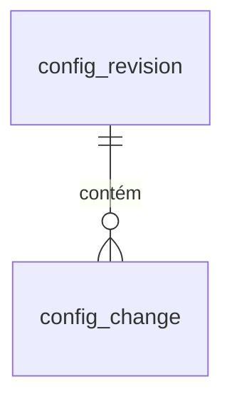

> Pergunta: "onde mora o que é configurável — versão do conteúdo, revisão de configuração e ajuste de staff — e como o antes/depois é provado?"
> Público: Arquiteto de schema e desenvolvedor do `wyd-db`
> Dono: equipe do wyd-db
> Base: `ddl-confirmado.md` §3, §5.9, §5.21, §5.22; `migrations-checklist.md` §2
> Revisado em: 2026-11-21

**Estado:** proposto (2026-11-21) — DDL fechado, série não aplicada.

## Propósito do domínio

Configuração é **o que muda sem deploy**: a versão do conteúdo aplicado, o valor de uma chave de regra e
o registro de quem mudou o quê. O desenho separa três coisas que o legado misturava:

1. **versão** — `content.content_version`, linha única, incrementa a cada seed aplicado;
2. **valor** — em `content`, como `game_setting`/`game_matrix` (seed) e as tabelas de override de `0022`;
3. **história da edição** — `ops.config_revision` + `ops.config_change`, append-only.

**Não cobre:** estado de jogo (personagem, item, guilda), taxa de refino como tabela base (`dominio-refino`, a
ser escrito) nem autoria de conteúdo editorial do portal.

## Tabela de tabelas

| Tabela | Papel em uma linha | Escreve | Lê |
|---|---|---|---|
| `content.content_version` (0001) | linha única (`id = 1`) com a versão do conteúdo aplicado | seed | jogo, portal, `wyd_read` |
| `ops.config_revision` (0002) | cabeçalho de uma revisão: autor tripartido, nota, instante de aplicação | portal (`INSERT` só) | portal, `wyd_read` |
| `ops.config_change` (0002) | uma linha por chave alterada, com valor anterior e novo em texto canônico | portal (`INSERT` só) | portal, `wyd_read` |
| `content.game_setting` (0019) | par `(section, key)` lido no boot — valor base de regra | seed | jogo, `wyd_read` |
| `content.game_matrix` (0019) | bloco numérico posicional `(section, block_index, line_index)` | seed | jogo, `wyd_read` |

## Relações

`config_change.revision_id` é `NOT NULL` com FK `RESTRICT`: mudança órfã é impossível e revisão com
histórico não some. `config_change` **não** tem FK para a tabela alvo — o alvo é descrito por
`schema` + `tabela` + `chave`, em texto.

## Ciclo de vida do dado

| Tabela | Nasce | Muda | Morre |
|---|---|---|---|
| `content_version` | primeiro seed | novo seed incrementa `version` e carimba `applied_at` | nunca |
| `config_revision` | edição do staff, já aplicada (`applied_at` na criação) | nunca | nunca (sem purge) |
| `config_change` | junto da revisão | nunca | junto da revisão, por `RESTRICT` |
| `game_setting`/`game_matrix` | seed | novo seed | nunca |

**Voltar atrás é revisão nova**, nunca `UPDATE` nem `DELETE`: o portal só tem `SELECT, INSERT` nas duas
tabelas de `ops`.

## O que o schema garante

- versão única e monotônica no piso: `ck_content_version_linha_unica` e `version >= 1`.
- revisão com autor: `ck_config_revision_autor` exige pessoa com `author_id` ou processo com
  `author_ref`, nunca os dois nem nenhum.
- revisão aplicada não antecede a criação: `applied_at >= created_at`; não há rascunho na `1.0.0`.
- mudança muda alguma coisa: `old_value IS DISTINCT FROM new_value`, e pelo menos um dos dois não é nulo
  (nulo significa "a chave não existia" ou "deixou de existir").
- uma chave muda uma vez por revisão: `uq_config_change_alvo`.
- alvo é nomeado, não JSON: `target_schema` em `content`/`game`/`portal`/`ops`, tabela em `snake_case`,
  chave de 1–200 caracteres, valores até 4000.

## Armadilhas de leitura

- `applied_at` **não** é "quando entrou em vigor depois": a revisão nasce aplicada, e o par
  `created_at`/`applied_at` existe para o registro ficar coerente, não para agendar.
- os valores são **texto canônico do tipo da coluna alvo**, não `JSONB`. Comparar número exige conversão
  explícita.
- `game_setting` e `game_matrix` são **seed-only**: o runtime não escreve `content`; a edição viva de
  taxa acontece nas tabelas de override (`0022`), que são as únicas com `UPDATE` para o portal.
- `M21` (2026-11-20) colocou a edição na área administrativa do portal — o jogo lê, não configura.

## `H` — semântica não verificada

| Ponto | Falta |
|---|---|
| catálogo de chaves de `game_setting` | cada chave só vira regra quando o runtime a consome; hoje não há lista fechada |
| semântica de `game_matrix` por seção | blocos posicionais do legado, sem trace que prove o significado de cada índice |
| o que o staff edita na `1.0.0` | escopo da tela administrativa; o schema aceita qualquer alvo nomeado |
