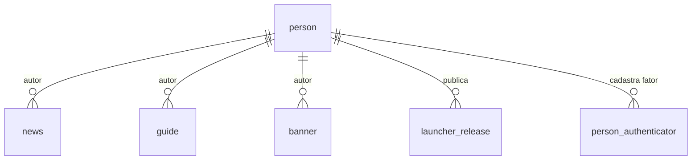

> Pergunta: "o que o portal publica — notícia, banner, guia, versão do launcher — e como o segundo fator do staff é guardado?"
> Público: Arquiteto de schema e desenvolvedor do `wyd-db`
> Dono: equipe do wyd-db
> Base: `ddl-confirmado.md` §5.15, §5.20; `migrations-checklist.md` §2; `0030_portal_content.md`, `0031_portal_mfa.md`
> Revisado em: 2026-11-21

**Estado:** proposto (2026-11-21) — DDL fechado, série não aplicada.

## Propósito do domínio

Este domínio é **o que o portal publica e como o staff se autentica**: conteúdo editorial (notícia,
banner, guia), a versão que o launcher baixa e o segundo fator TOTP do staff. Cinco tabelas de `portal`,
todas escritas pelo BFF — nenhuma é escrita pelo jogo.

É o **19º domínio**, criado em 2026-11-21 para cobrir as cinco tabelas dos adendos `0030` e `0031`, que
são posteriores à lista original dos 18. O segundo fator entra aqui por decisão do dono: é peça de
segurança do portal, sem domínio de jogo correspondente.

**Não cobre:** pessoa e sessão ([acesso](dominio-acesso.md)), cash e bônus ([economia](dominio-economia.md))
nem telemetria do launcher (não tem tabela).

## Tabela de tabelas

| Tabela | Papel em uma linha | Escreve | Lê |
|---|---|---|---|
| `portal.news` (0030) | notícia com `slug` estável, estado e destaque | BFF (CMS) | portal |
| `portal.banner` (0030) | banner por posição, com janela e prioridade | BFF (CMS) | portal (o BFF serve o launcher) |
| `portal.guide` (0030) | guia/Wydpedia por `slug` e categoria | BFF (CMS) | portal |
| `portal.launcher_release` (0030) | versão publicada por canal, com manifesto e hash | BFF (launcher) | portal (o BFF serve o launcher) |
| `portal.person_authenticator` (0031) | segundo fator TOTP do staff, com segredo cifrado | BFF (segurança) | BFF |

## Relações

As FKs de autoria usam `RESTRICT`: pessoa não é apagada (`A12`), e notícia/guia/banner não perdem autor.
A FK do segundo fator usa `CASCADE` (linha possuída, `P-15`). `banner.featured_character_id` **não tem
FK**: personagem é de `game`, e `portal` não alcança esse schema (`P-17`).

## Ciclo de vida do dado

| Tabela | Nasce | Muda | Morre |
|---|---|---|---|
| `news`, `guide` | `draft` | publicação, edição, arquivamento | `archived`; nunca `DELETE` |
| `banner` | criado, `enabled = true` | janela (`starts_at`/`ends_at`), prioridade, desligar | desligado ou fora da janela; linha fica |
| `launcher_release` | `draft` | publicação, revogação | `revoked`; nunca `DELETE` |
| `person_authenticator` | inscrição pendente (`confirmed_at` nulo) | confirmação, uso, revogação | `revoked_at` com segredo `NULL`; linha fica |

**Publicar não apaga o anterior:** `ux_launcher_release_vigente` garante **uma** versão publicada por
canal, então publicar a próxima exige revogar a vigente na mesma transação.

## O que o schema garante

- **`slug` é identidade editorial:** único em `news` e em `guide`, minúsculas, dígitos e hífen
  (`^[a-z0-9]+(-[a-z0-9]+)*$`), 3–120 caracteres.
- **estado coerente:** `draft`/`published`/`archived` com carimbo — publicado tem `published_at`,
  arquivado tem `archived_at`; notícia fixada (`pinned`) só pode estar publicada.
- **banner disciplinado:** posição em `home_hero`/`home_side`/`login`/`launcher`, prioridade 0–999,
  `ends_at` posterior a `starts_at`, imagem e link só `https`.
- **launcher verificável:** `version` e `min_version` no formato `X.Y.Z[-sufixo]`, `manifest_url` só
  `https`, `manifest_sha256` hex de 64, versão única por canal, e autor obrigatório fora de `draft`.
- **segundo fator com segredo pareado:** ativo tem `secret_encrypted` (32–512 bytes), revogado tem
  `NULL`; `confirmed_at` não antecede `created_at`; `last_used_step` só existe depois de confirmado e é
  `>= 0`; `revoked_at` não antecede criação nem confirmação.
- **um fator ativo por pessoa e tipo:** `ux_person_authenticator_ativo (person_id, kind) WHERE revoked_at IS NULL`.

## Armadilhas de leitura

- `person_authenticator.secret_encrypted` é **cifrado, não hash**: é a única coluna de segredo
  reversível da série, e a chave mora no ambiente do BFF, nunca no banco.
- revogar o fator é `UPDATE` com `revoked_at` e `secret_encrypted = NULL`, **nunca** `DELETE`; o
  histórico de que o fator existiu é o que responde a incidente.
- `kind` só aceita `totp` na `1.0.0`; WebAuthn exigiria decisão nova, não linha nova de `CHECK`.
- `last_used_step` guarda o passo de 30 s já aceito; repetir o passo é replay, e quem recusa é o BFF.
- `launcher_release.min_version` é **texto semver**, não número: comparação de versão é do launcher.
- `banner.featured_character_id` não tem FK e `> 0` é só o piso; validar personagem é do BFF.
- `news.cover_url` e `banner.image_url` são `TEXT` com `^https://`; não há upload nem storage no schema.

## `H` — semântica não verificada

| Ponto | Falta |
|---|---|
| significado de `stable` × `beta` na operação | regra de distribuição é do `wyd-ops`, sem medição |
| efeito real de `min_version` | contrato do launcher não reverificado no planejamento novo |
| quem publica (papel exigido) | o schema não restringe papel de `portal.person`; é regra do BFF |
| retenção de linha revogada do fator | sem prazo na `1.0.0`; política é do `wyd-ops` |
| i18n de notícia/guia | não há coluna de idioma; se a `1.0.0` é só pt-BR, é decisão de produto |
| algoritmo e custódia da chave de cifra | implementação do BFF; o schema fixa só o tipo e o tamanho |
