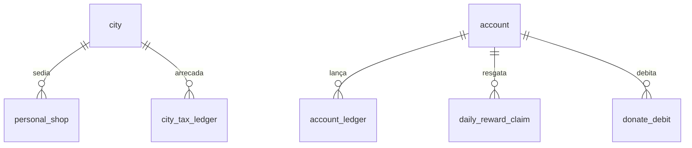

> Pergunta: "onde mora o dinheiro — cidade, preço, loja, imposto, cash e ledger — e como o saldo é provado?"
> Público: Arquiteto de schema e desenvolvedor do `wyd-db`
> Dono: equipe do wyd-db
> Base: `ddl-confirmado.md` §5.2, §5.14, §5.34; `migrations-checklist.md` §2; `0011-game-economy.md`
> Revisado em: 2026-11-22

**Estado:** proposto (2026-11-22) — DDL fechado, série não aplicada.

## Propósito do domínio

Economia é **quanto vale e quem paga**: preço de NPC, loja pessoal, imposto de cidade e o dinheiro
"cash" do portal (compra, bônus diário, capa de reino). Onze tabelas de `0011` (dez) e `0005` (o ledger da
conta, que fecha o saldo com motivo); desde 2026-11-22 o domínio também cobre o **mercado entre
jogadores** — as onze tabelas do lote `0034` (`M31`), que usam o mesmo crédito do portal.

**Não cobre:** ouro do personagem (`game.character.coin`, em [personagem](dominio-personagem.md)),
carteira da conta ([acesso](dominio-acesso.md)), refino como custo (`dominio-refino`) nem entrega de item
(`ops.delivery_queue`).

## Tabela de tabelas

| Tabela | Papel em uma linha | Escreve | Lê | Colunas |
|---|---|---|---|---|
| `game.city` | cidade, capital e alíquota em bps | `wyd_game` | `wyd_game`, `wyd_read` | `gerado/city.md` |
| `game.item_price` | preço de compra e venda por `(item_index, npc_id)` | `wyd_game` | `wyd_game`, `wyd_read` | `gerado/item_price.md` |
| `game.personal_shop` | loja de personagem, uma aberta por vez | `wyd_game` | `wyd_game`, `wyd_read` | `gerado/personal_shop.md` |
| `game.city_tax_ledger` | imposto arrecadado por cidade, com motivo | `wyd_game` | `wyd_game`, `wyd_read` | `gerado/city_tax_ledger.md` |
| `game.account_ledger` | lançamento de moeda com saldo e motivo | `wyd_game` | `wyd_game`, `wyd_read` | `gerado/account_ledger.md` |
| `portal.donate_shop_item` | item de loja cash, com preço em créditos | `wyd_portal` | `wyd_portal`, `wyd_read` | `gerado/donate_shop_item.md` |
| `portal.daily_reward_item` | item do bônus diário, por dia 1–7 | `wyd_portal` | `wyd_portal`, `wyd_read` | `gerado/daily_reward_item.md` |
| `portal.daily_reward_claim` | resgate do bônus, um por conta/dia | `wyd_portal` | `wyd_portal`, `wyd_read` | `gerado/daily_reward_claim.md` |
| `portal.kingdom_cape_price` | linha única do preço da capa de reino | `wyd_portal` | `wyd_portal`, `wyd_read` | `gerado/kingdom_cape_price.md` |
| `portal.donate_credit` | crédito de cash, idempotente | `wyd_portal` | `wyd_portal`, `wyd_read` | `gerado/donate_credit.md` |
| `portal.donate_debit` | débito de cash, idempotente, com motivo | `wyd_portal` | `wyd_portal`, `wyd_read` | `gerado/donate_debit.md` |

`A19` mantém seis tabelas em `portal` e quatro em `game`; o ledger da conta é `game`, herdado de
`0005`.

### Mercado entre jogadores (`0034`, forma em `armaria-e-mercado.md` §3)

| Tabela | Papel em uma linha | Escreve | Lê | Colunas |
|---|---|---|---|---|
| `portal.market_wallet` | saldo de crédito do mercado, uma linha por conta | `wyd_portal` | `wyd_portal`, `wyd_read` | onda 4 |
| `portal.market_ledger` | extrato do crédito de mercado, append-only, idempotente | `wyd_portal` | `wyd_portal`, `wyd_read` | onda 4 |
| `portal.market_fee_rule` | taxa da casa em bps, com vigência por `effective_from` | `wyd_portal` | `wyd_portal`, `wyd_read` | onda 4 |
| `portal.market_listing` | anúncio de item real, com o retrato da instância e a taxa congelada | `wyd_portal` | `wyd_portal`, `wyd_read` | onda 4 |
| `portal.market_bid` | lance de leilão, com o crédito retido em `hold_ledger_id` | `wyd_portal` | `wyd_portal`, `wyd_read` | onda 4 |
| `portal.market_transaction` | liquidação de um anúncio, com taxa e líquido | `wyd_portal` | `wyd_portal`, `wyd_read` | onda 4 |
| `portal.market_review` | avaliação do comprador sobre a transação | `wyd_portal` | `wyd_portal`, `wyd_read` | onda 4 |
| `portal.market_reputation` | agregado de vendas e notas por conta | `wyd_portal` | `wyd_portal`, `wyd_read` | onda 4 |
| `portal.market_notification` | aviso do mercado para a conta | `wyd_portal` | `wyd_portal`, `wyd_read` | onda 4 |
| `portal.market_dispute` | disputa de uma transação, com desfecho e autor | `wyd_portal` | `wyd_portal`, `wyd_read` | onda 4 |
| `game.market_escrow` | custódia do item fora do inventário, escrita pelo executor | `wyd_admin` | `wyd_admin`, `wyd_game`, `wyd_read` | onda 4 |

"onda 4" é o lote de páginas por tabela de `M26` (`gerado/index.md` é o dono da contagem): nenhuma das onze
tem página `gerado/` ainda, e o estado delas é `planejado`, derivado de `migrations-checklist.md` §2.

Escreve e lê das onze primeiras são de `0011` §8, dono da permissão das dez: `wyd_game` escreve as
quatro de `game`, `wyd_portal` escreve as seis de `portal` e `wyd_read` lê as dez. As onze do mercado
seguem o mesmo recorte, com uma diferença declarada: `game.market_escrow` é escrita por `wyd_admin`
(`0032`), não por `wyd_game`, porque custódia é ato do executor (`LAC-POR-01`). `account_ledger`, de `0005`, fica no
mesmo `game` e herda o mesmo default privilege — por isso a quinta linha de `wyd_game`. Nenhuma tabela
deste domínio tem escritor dos dois lados: `wyd_portal` não tem `USAGE` em `game` e `wyd_game` não tem
em `portal` (`P-17`), e o cruzamento falha com `42501` (`0011` §9, item 15).

## Relações

`portal` não tem FK para `game` (`P-17`): `donate_credit`, `donate_debit` e `daily_reward_claim`
guardam `account_id` como número, e a integridade é do BFF, não da constraint. A exceção fica **dentro**
do próprio schema: `daily_reward_claim.reward_item_id` tem FK `RESTRICT` para `daily_reward_item`
(`ddl-confirmado.md` §5.14). Isso é decisão de fronteira, não esquecimento.

## Ciclo de vida do dado

| Tabela | Nasce | Muda | Morre |
|---|---|---|---|
| `city` | seed | alíquota, nome | nunca |
| `item_price` | seed | preço | nunca |
| `personal_shop` | abertura pelo jogador | imposto pago, fechamento | `closed_at`; histórico fica |
| `city_tax_ledger` | imposto recolhido | nunca | nunca |
| `account_ledger` | lançamento com motivo | nunca | nunca |
| cash (portal) | compra/bônus | nunca | nunca |
| `market_wallet` | primeira operação no mercado | saldo | nunca |
| `market_ledger` | recarga, taxa, retenção, devolução, estorno | nunca | nunca |
| `market_listing` | custódia confirmada | lance, prazo, estado | estado final; histórico fica |
| `market_bid` | lance | superado, vencedor, cancelado | nunca |
| `market_transaction` | liquidação | nunca | nunca |
| `market_review` | avaliação | ocultação por moderação | nunca |
| `market_reputation` | primeira venda/avaliação | contadores | nunca |
| `market_notification` | evento do mercado | `read_at` | expurgo próprio, ainda não decidido |
| `market_dispute` | abertura pelo comprador ou vendedor | análise, desfecho | nunca |
| `market_escrow` | custódia | `entregue`/`devolvido` | nunca |

## O que o schema garante

- **alíquota limitada:** `tax_rate_bps` e `tax_bps` entre 0 e 10000.
- **preço não negativo:** compra e venda `>= 0`; preço cash `> 0`.
- **loja com estado coerente:** `is_open = (closed_at IS NULL)` e **uma** loja aberta por personagem
  (`ux_personal_shop_aberta … WHERE is_open`).
- **bônus diário único por dia:** `uq_daily_reward_claim_dia (account_id, claim_date)`.
- **resgate aponta para recompensa existente:** FK `RESTRICT` de `daily_reward_claim` para
  `daily_reward_item`; apagar a recompensa com resgate registrado falha alto.
- **bônus tem conteúdo:** `item_index IS NOT NULL OR gold > 0`.
- **cash idempotente:** `idempotency_key` única em crédito e débito (`M17`).
- **débito com motivo finito:** `portal` ou `shop_purchase`.
- **capa é linha única:** `ck_kingdom_cape_price_singleton (id = 1)`, com custo 4–32 nas duas moedas.
- **lançamento não é zero:** `delta <> 0`, saldo coerente com o delta e motivo de 1–64 caracteres.
- **imposto não negativo:** `amount >= 0`, com motivo em lista fechada.
- **mercado com dinheiro conservado:** `fee_amount + net_amount = price_gross`; saldo de carteira e
  `balance_after` do extrato nunca negativos; `amount <> 0` em todo lançamento.
- **anúncio ativo tem custódia e o leilão tem prazo:** `ck_market_listing_custodia` e
  `ck_market_listing_prazo`.
- **um lance ativo por comprador e anúncio; uma disputa viva por transação:** índices únicos parciais
  `ux_market_bid_comprador_ativo` e `ux_market_dispute_aberta`.
- **decisão de disputa tem autor:** as duas resoluções exigem `resolution` e `decided_by_person_id`.
- **extrato não é editável:** `REVOKE UPDATE, DELETE` em `portal.market_ledger` para `wyd_portal`.

## Armadilhas de leitura

- quatro saldos diferentes: `character.coin` (ouro do personagem), `account_wallet.coin` (carteira),
  `account_ledger` (histórico) e o **cash** do portal (`donate_credit`/`donate_debit`). Nenhum é o outro.
- `donate_credit`/`donate_debit` **não** são a carteira: são o extrato do cash, e o saldo é derivado.
- `donate_shop_item.item_index` e `daily_reward_item.item_index` **não têm FK** para
  `content.item_catalog`: o catálogo é de `0014` e a integridade é do seed (§5.14).
- `city.map_id` é anulável porque o mapa da cidade não é publicado pelo cliente (`H`); não preencha com
  suposição.
- `personal_shop` fechada não é apagada: o histórico de imposto fica no ledger.
- `kingdom_cape_price.version` não é a versão do conteúdo; é a versão da tabela de preço.
- **quatro saldos, agora cinco**: o do mercado é `market_wallet.balance`, separado do cash de
  `donate_credit`/`donate_debit`. Transferir entre os dois é operação do BFF, não do schema.
- `market_listing` guarda **retrato** da instância (`refine`, `ancient`, `gem_*`, `flags`): o item real está
  em `game.market_escrow`, e comparar os dois campos é conferência de custódia, não redundância.
- `market_transaction.listing_id` é único: um anúncio liquida uma vez; leilão relistado é anúncio novo.

## `H` — semântica não verificada

| Ponto | Falta |
|---|---|
| motivos de `city_tax_ledger` | lista fechada, sem significado documentado no planejamento novo |
| mapa da cidade | `map_id` nulo até trace do cliente |
| regra de conversão crédito↔ouro | contrato do BFF; o schema só guarda o valor |
| efeito de `duration_days` do item cash | semântica do legado, sem consumidor provado |
