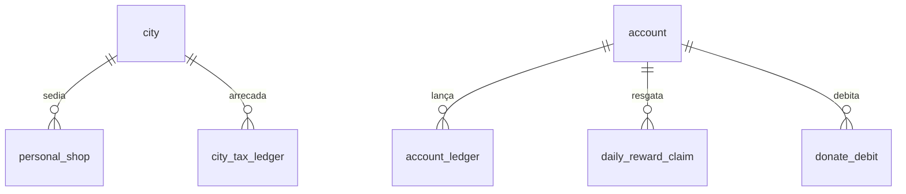

> Pergunta: "onde mora o dinheiro — cidade, preço, loja, imposto, cash e ledger — e como o saldo é provado?"
> Público: Arquiteto de schema e desenvolvedor do `wyd-db`
> Dono: equipe do wyd-db
> Base: `ddl-confirmado.md` §5.2, §5.14; `migrations-checklist.md` §2; `0011-game-economy.md`
> Revisado em: 2026-11-21

**Estado:** proposto (2026-11-21) — DDL fechado, série não aplicada.

## Propósito do domínio

Economia é **quanto vale e quem paga**: preço de NPC, loja pessoal, imposto de cidade e o dinheiro
"cash" do portal (compra, bônus diário, capa de reino). Onze tabelas: dez de `0011` e o ledger da conta,
que fecha o saldo com motivo.

**Não cobre:** ouro do personagem (`game.character.coin`, em [personagem](dominio-personagem.md)),
carteira da conta ([acesso](dominio-acesso.md)), refino como custo (`dominio-refino`) nem entrega de item
(`ops.delivery_queue`).

## Tabela de tabelas

| Tabela | Schema | Papel em uma linha |
|---|---|---|
| `game.city` | game | cidade, capital e alíquota em bps |
| `game.item_price` | game | preço de compra e venda por `(item_index, npc_id)` |
| `game.personal_shop` | game | loja de personagem, uma aberta por vez |
| `game.city_tax_ledger` | game | imposto arrecadado por cidade, com motivo |
| `game.account_ledger` | game | lançamento de moeda com saldo e motivo |
| `portal.donate_shop_item` | portal | item de loja cash, com preço em créditos |
| `portal.daily_reward_item` | portal | item do bônus diário, por dia 1–7 |
| `portal.daily_reward_claim` | portal | resgate do bônus, um por conta/dia |
| `portal.kingdom_cape_price` | portal | linha única do preço da capa de reino |
| `portal.donate_credit` | portal | crédito de cash, idempotente |
| `portal.donate_debit` | portal | débito de cash, idempotente, com motivo |

`A19` mantém seis tabelas em `portal` e quatro em `game`; o ledger da conta é `game`.

## Relações

`portal` não tem FK para `game` (`P-17`): as tabelas de cash guardam `account_id` como número e a
integridade é do BFF, não da constraint. Isso é decisão de fronteira, não esquecimento.

## Ciclo de vida do dado

| Tabela | Nasce | Muda | Morre |
|---|---|---|---|
| `city` | seed | alíquota, nome | nunca |
| `item_price` | seed | preço | nunca |
| `personal_shop` | abertura pelo jogador | imposto pago, fechamento | `closed_at`; histórico fica |
| `city_tax_ledger` | imposto recolhido | nunca | nunca |
| `account_ledger` | lançamento com motivo | nunca | nunca |
| cash (portal) | compra/bônus | nunca | nunca |

## O que o schema garante

- **alíquota limitada:** `tax_rate_bps` e `tax_bps` entre 0 e 10000.
- **preço não negativo:** compra e venda `>= 0`; preço cash `> 0`.
- **loja com estado coerente:** `is_open = (closed_at IS NULL)` e **uma** loja aberta por personagem
  (`ux_personal_shop_aberta … WHERE is_open`).
- **bônus diário único por dia:** `uq_daily_reward_claim_dia (account_id, claim_date)`.
- **bônus tem conteúdo:** `item_index IS NOT NULL OR gold > 0`.
- **cash idempotente:** `idempotency_key` única em crédito e débito (`M17`).
- **débito com motivo finito:** `portal` ou `shop_purchase`.
- **capa é linha única:** `ck_kingdom_cape_price_singleton (id = 1)`, com custo 4–32 nas duas moedas.
- **lançamento não é zero:** `delta <> 0`, saldo coerente com o delta e motivo de 1–64 caracteres.
- **imposto não negativo:** `amount >= 0`, com motivo em lista fechada.

## Armadilhas de leitura

- quatro saldos diferentes: `character.coin` (ouro do personagem), `account_wallet.coin` (carteira),
  `account_ledger` (histórico) e o **cash** do portal (`donate_credit`/`donate_debit`). Nenhum é o outro.
- `donate_credit`/`donate_debit` **não** são a carteira: são o extrato do cash, e o saldo é derivado.
- `city.map_id` é anulável porque o mapa da cidade não é publicado pelo cliente (`H`); não preencha com
  suposição.
- `personal_shop` fechada não é apagada: o histórico de imposto fica no ledger.
- `kingdom_cape_price.version` não é a versão do conteúdo; é a versão da tabela de preço.

## `H` — semântica não verificada

| Ponto | Falta |
|---|---|
| motivos de `city_tax_ledger` | lista fechada, sem significado documentado no planejamento novo |
| mapa da cidade | `map_id` nulo até trace do cliente |
| regra de conversão crédito↔ouro | contrato do BFF; o schema só guarda o valor |
| efeito de `duration_days` do item cash | semântica do legado, sem consumidor provado |
