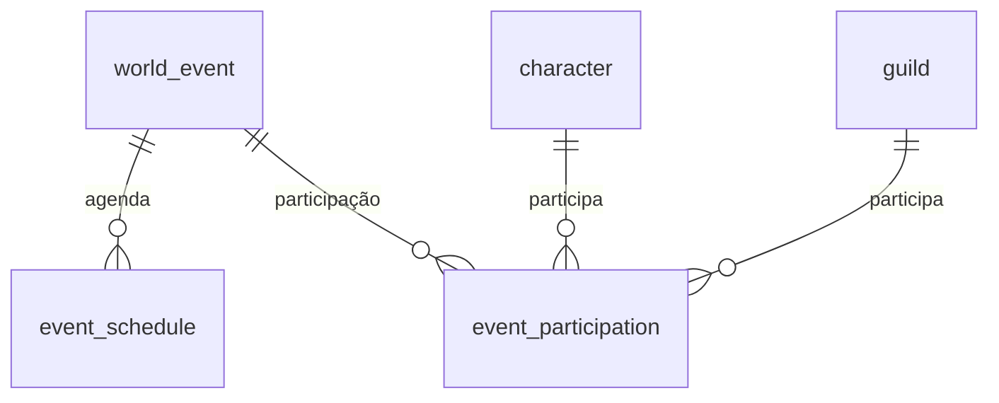

> Pergunta: "como um evento é definido, quando ele acontece e o que o jogo guarda de participação, Kefra e castelo?"
> Público: Arquiteto de schema e desenvolvedor do `wyd-db`
> Dono: equipe do wyd-db
> Base: `ddl-confirmado.md` §5.26, §5.28; `migrations-checklist.md` §2
> Revisado: 2026-11-21

**Estado:** proposto (2026-11-21) — DDL fechado, série não aplicada; o seed `0027` segue `bloqueada`.

## Propósito do domínio

Eventos são **o que acontece no mundo em horário marcado**: a definição do evento, a agenda semanal e o
que ficou registrado depois — participação, estado de Kefra e dono do castelo. Cinco tabelas: duas de
definição em `content`, três de estado em `game`.

**Não cobre:** quests (`dominio-quests`), arena (`dominio-arena`), guilda ([social](dominio-social.md))
nem zona de guilda como conteúdo ([mundo](dominio-mundo.md)).

## Tabela de tabelas

| Tabela | Schema | Papel em uma linha |
|---|---|---|
| `content.world_event` | content | definição por `code`, com nome e tipo |
| `content.event_schedule` | content | janela semanal: dia, minuto de início, duração e fuso |
| `game.event_participation` | game | histórico de participação, com resultado e pontos |
| `game.kefra_state` | game | linha única do estado de Kefra |
| `game.castle_state` | game | linha única do castelo: dono, cofre e cidade |

## Relações

`event_participation` aponta para `content.world_event` com **`RESTRICT`** e para personagem/guilda com
`CASCADE`/`SET NULL`, conforme o dono da linha. `kefra_state.last_guild_id` e
`castle_state.owner_guild_id` usam `SET NULL`: estado único sobrevive à guilda que o detinha.

## Ciclo de vida do dado

| Tabela | Nasce | Muda | Morre |
|---|---|---|---|
| `world_event`, `event_schedule` | seed `0027` | nunca em runtime | com o seed |
| `event_participation` | fim de participação | nunca | com o personagem |
| `kefra_state` | primeira disputa | dono, contador | nunca (linha única) |
| `castle_state` | primeira conquista | dono, cofre | nunca (linha única) |

## O que o schema garante

- **código é identidade:** `code` em `snake_case` de 2–64.
- **tipo de evento finito:** o `CHECK` de `kind` fecha a lista.
- **agenda sem duplicata:** único `(event_code, weekday, start_minute)`.
- **horário é minuto do dia:** `start_minute BETWEEN 0 AND 1439`, `weekday` 0–6; **sem** `TIME` (`P-06`).
- **duração positiva** e período de 1–8 semanas.
- **fuso explícito:** `timezone` de 1–64 caracteres, para o evento não andar quando o host muda de fuso.
- **participação coerente:** resultado em lista fechada e `score >= 0`.
- **Estado único é singular:** `kefra_state` e `castle_state` têm `CHECK (id = 1)`.
- **cofre não negativo:** `vault_gold >= 0`; `kill_count >= 0`.

## Armadilhas de leitura

- `start_minute` é **minuto do dia**, não hora: 19h30 é 1170.
- o fuso é por linha de agenda: dois eventos no mesmo dia podem ter fusos diferentes.
- `kefra_state` e `castle_state` **não** são conteúdo: são estado, e sobrevivem à guilda (`SET NULL`).
- `event_participation` é histórico, não "quem está participando agora": presença ao vivo é do runtime,
  não do banco.
- apagar definição de evento com histórico falha (`RESTRICT`), por desenho.

## `H` — semântica não verificada

| Ponto | Falta |
|---|---|
| calendário do 7662 | dias, horários e fusos não reconferidos na fonte (seed `0027` bloqueado) |
| efeito de `every_n_weeks` | regra de repetição no runtime |
| significado de cada `kind` de evento | lista fechada, semântica por tipo não verificada |
| contadores de `kefra_state` | colunas do legado, sem trace |
