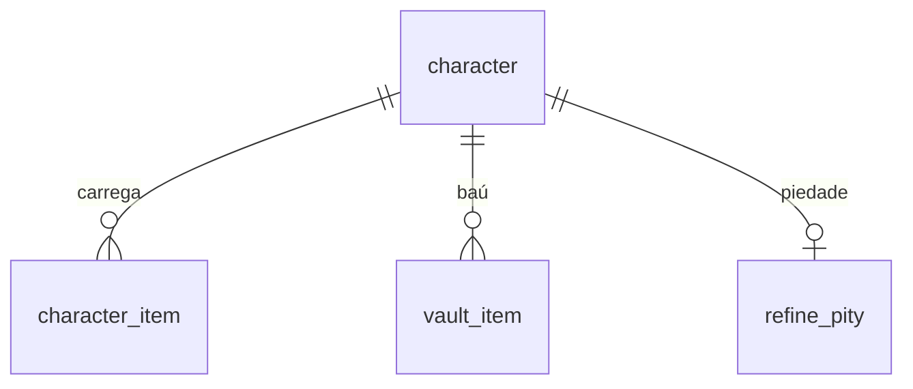

> Pergunta: "onde ficam os itens do personagem e do baú, o que é refino neles e o que o schema impede?"
> Público: Arquiteto de schema e desenvolvedor do `wyd-db`
> Dono: equipe do wyd-db
> Base: `ddl-confirmado.md` §5.12; `migrations-checklist.md` §2; `0009-game-inventory.md`
> Revisado em: 2026-11-21

**Estado:** proposto (2026-11-21) — DDL fechado, série não aplicada.

## Propósito do domínio

Inventário é **o que o personagem carrega e o que guarda**: 80 posições no personagem, 128 no baú e um
contador de piedade de refino. O item é identificado por `item_index` do cliente; o catálogo
(`content.item_catalog`) é de `dominio-catalogo` e não aparece aqui.

**Não cobre:** catálogo de item, efeito de gema como regra (`dominio-refino`), preço de NPC
(`dominio-economia`) nem entrega de item pelo portal (`ops.delivery_queue`).

## Tabela de tabelas

| Tabela | Papel em uma linha | Escreve | Lê |
|---|---|---|---|
| `game.character_item` (0009) | item na posição 0–79 do personagem, com refino e gema | jogo | jogo |
| `game.vault_item` (0009) | item na posição 0–127 do baú da conta | jogo | jogo |
| `game.refine_pity` (0009) | contador de piedade por personagem/item (0–20) | jogo | jogo |

## Relações

`character_item` e `refine_pity` são filhos possuídos (`CASCADE`). `vault_item` é do **baú**: a chave é
do personagem, mas o conteúdo é compartilhado pela conta na leitura do jogo — a decisão de escopo está na
página do lote.

## Ciclo de vida do dado

| Tabela | Nasce | Muda | Morre |
|---|---|---|---|
| `character_item` | item entra na mochila | `qty`, `refine`, `ancient`, gema | consumo, venda ou `CASCADE` |
| `vault_item` | item guardado | `qty`, `refine`, gema | retirada ou `CASCADE` |
| `refine_pity` | primeira tentativa de refino | contador sobe, zera no sucesso | com o personagem |

## O que o schema garante

- **posição é chave:** `(character_id, slot)` em `character_item` e `(character_id, slot)` em
  `vault_item`; duas linhas na mesma posição são impossíveis.
- **faixas do cliente:** mochila 0–79, baú 0–127, refino 0–15.
- **quantidade positiva:** `qty >= 1` — item com zero é ausência de linha, não linha zerada.
- **gema coerente:** `gem_effect` 0–4, `gem_value >= 0` e `(gem_effect = 0) = (gem_value = 0)` — efeito
  sem valor e valor sem efeito são impossíveis.
- **gema só onde o cliente permite:** `gem_effect = 0 OR ancient OR refine >= 10`.
- **piedade limitada:** `pity BETWEEN 0 AND 20`.

## Armadilhas de leitura

- `slot` aqui é **posição de inventário** (0–79/0–127), não a vaga de personagem (0–3) nem a vaga de
  conta (1–5). Três "slots" diferentes no schema.
- `item_index` não tem FK nesta tabela: a ordem da série põe `content.item_catalog` em `0014`, depois de
  `0009`. A integridade é do seed e da aplicação, e a FK futura é decisão registrada, não esquecimento.
- `flags` é campo do `STRUCT_ITEM` sem semântica documentada no planejamento novo.
- `refine_pity` não guarda histórico de tentativa: é contador, e o histórico é evento de jogo.
- `ancient` não é refinamento: é marca do item, e muda a regra de gema.

## `H` — semântica não verificada

| Ponto | Falta |
|---|---|
| `flags` bit a bit | `STRUCT_ITEM` do cliente, sem trace no planejamento novo |
| regra de `pity` (quando sobe, quando zera) | contador é schema; a regra é do runtime e não foi reverificada |
| escopo do baú (personagem × conta) | a chave é do personagem; o compartilhamento é regra de jogo |
| gema em item `ancient` sem refino 10 | o `CHECK` permite; a regra de jogo por trás não tem trace |
