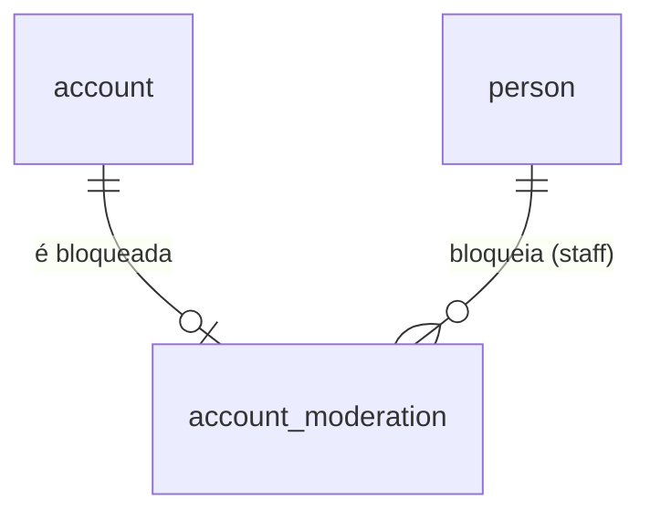

> Pergunta: "como o bloqueio de conta é representado e o que o schema exige para ele ser válido?"
> Público: Arquiteto de schema e desenvolvedor do `wyd-db`
> Dono: equipe do wyd-db
> Base: `ddl-confirmado.md` §5.2; `migrations-checklist.md` §2; `0005_game_account.md`
> Revisado em: 2026-11-21

**Estado:** proposto (2026-11-21) — DDL fechado, série não aplicada.

## Propósito do domínio

Moderação, no schema da `1.0.0`, é **o bloqueio de conta**: uma linha 1:1 que diz se a conta está
bloqueada, por quê, por quem e desde quando. Não há tabela de punição, histórico de advertência nem fila
de recurso — se existirem, serão decisão nova.

**Não cobre:** fechamento de conta (`status = 'closed'`, em [acesso](dominio-acesso.md)), suspensão de
pessoa (`portal.person.suspended_by`), auditoria da ação (`ops.audit_log`, em
[auditoria](dominio-auditoria.md)) nem o bloqueio temporário por falha de login (contador em
`game.account`).

## Tabela de tabelas

| Tabela | Papel em uma linha | Escreve | Lê | Colunas |
|---|---|---|---|---|
| `game.account_moderation` (0005) | bloqueio 1:1 da conta, com autor, motivo e instante | `wyd-admin` (staff) | jogo, portal | `gerado/account_moderation.md` |

**Dono único da tabela:** esta é a única página do dicionário que a lista, descreve o ciclo de vida e
mantém as relações. [acesso](dominio-acesso.md) cita o bloqueio como assunto fora de escopo e aponta
para cá, sem repetir inventário nem diagrama.

## Relações

Duas FKs, ambas `RESTRICT`: conta não é apagada (`closed_at`) e pessoa não é apagada (`A12`), então nada
cascateia. `account_id` é a PK: o bloqueio é um estado da conta, não um evento.

## Ciclo de vida do dado

| Momento | O que acontece |
|---|---|
| nascimento | primeiro bloqueio: `blocked = true`, motivo, autor e instante |
| mudança | desbloqueio (`blocked = false`) ou novo motivo no mesmo bloqueio |
| morte | nunca: a linha fica, porque a conta fica |

**Não há histórico de bloqueio** nesta tabela: bloquear → desbloquear → bloquear de novo produz uma
linha só, com o último motivo. O histórico, quando existir, é `ops.audit_log`.

## O que o schema garante

- **estado coerente:** com `blocked = true`, `blocked_at` e `blocked_by` são obrigatórios
  (`ck_account_moderation_instante`, `ck_account_moderation_autor`) e o motivo não pode ser vazio.
  Desbloquear **força** `blocked_at` a nulo, mas `reason` e `blocked_by` **podem permanecer
  preenchidos** — a constraint não limpa nem exige limpar (`ddl-confirmado.md` §5.2).
- **motivo obrigatório no bloqueio:** `NOT blocked OR char_length(btrim(reason)) > 0`; desbloqueado pode
  ter motivo vazio.
- **um bloqueio por conta:** `account_id` é PK.
- **índice de leitura:** parcial em `account_id WHERE blocked`, para listar só as bloqueadas.

## Armadilhas de leitura

- `blocked = false` **não** apaga a linha: `reason` e `blocked_by` podem continuar preenchidos com o
  bloqueio anterior; `blocked_at` **não** — o desbloqueio o força a nulo. Ler motivo antigo como
  bloqueio atual é erro.
- bloqueio de conta ≠ suspensão de pessoa: `portal.person.status = 'suspended'` fecha o acesso ao portal;
  `account_moderation` bloqueia a conta de jogo.
- não confunda com o **contador** de falhas de login (`login_failure_count`): aquele é automático e
  temporário, este é ato de staff.
- o autor é `portal.person`, não `game.account`: staff é pessoa, não conta de jogo.

## `H` — semântica não verificada

| Ponto | Falta |
|---|---|
| duração do bloqueio | não há coluna de fim: bloqueio é por tempo indeterminado até desbloqueio |
| efeito no jogo (login, sessão viva) | regra do runtime; o schema só guarda o estado |
| histórico e recurso | não existem tabela nem fluxo; seria decisão nova |
| quem pode bloquear | papel de `portal.person`; a constraint não restringe papel |
| motivo e autor residuais após desbloqueio | o schema os permite com `blocked = false`; se é contexto desejado ou dado a limpar é decisão de comportamento |
