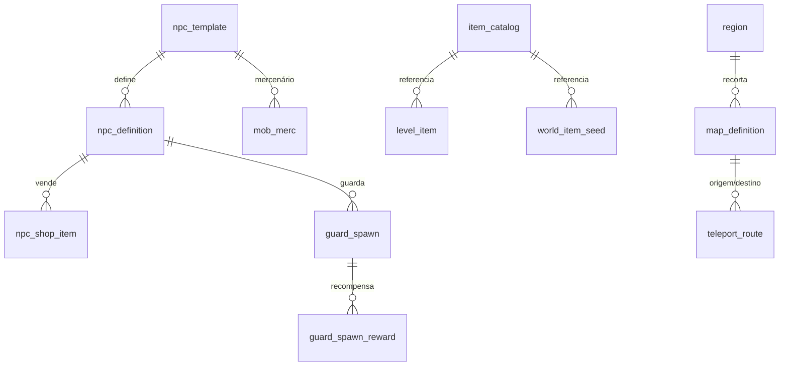

> Pergunta: "o que descreve o mundo — mapas, NPCs, regiões, spawns e rotas — e o que é import do legado?"
> Público: Arquiteto de schema e desenvolvedor do `wyd-db`
> Dono: equipe do wyd-db
> Base: `ddl-confirmado.md` §5.21, §5.24; `migrations-checklist.md` §2; `0019-content-world.md`, `0024-content-maps.md`
> Revisado em: 2026-11-21

**Estado:** proposto (2026-11-21) — DDL fechado, série não aplicada.

## Propósito do domínio

Mundo é **o cenário que o servidor carrega no boot**: mapas e rotas de teleporte, regiões, NPCs e seus
spawns, lojas de NPC, tabelas de nível, mercenários, itens no chão e zonas de guilda. Treze tabelas,
todas de `content` — nenhuma é escrita em runtime. As duas tabelas de configuração por seção
(`game_setting` e `game_matrix`) vivem em [configuração](dominio-configuracao.md).

**Não cobre:** catálogo de item e skill ([catálogo](dominio-catalogo.md)), regra de combate
([combate](dominio-combate.md)) nem estado de jogador (`game.*`).

## Tabela de tabelas

| Tabela | Papel em uma linha |
|---|---|
| `content.content_source` (0019) | proveniência por dataset: caminho, `sha256`, tamanho e linhas |
| `content.npc_template` (0019) | arquivo de template do NPC (756/816/920 B), com hash e codificação de origem |
| `content.npc_definition` (0019) | NPC no mapa: posição, origem, gerador e seguidor |
| `content.npc_shop_item` (0019) | item vendido por NPC, na posição 0–26 |
| `content.level_item` (0019) | item por classe e nível, com extras posicionais |
| `content.guard_spawn` (0019) | spawn de guarda, ligado ao NPC |
| `content.guard_spawn_reward` (0019) | requisito de recompensa do guarda, por slot 0–7 |
| `content.mob_merc` (0019) | mercenário: renovação, renascimento e itens |
| `content.region` (0019) | retângulo nomeado do mapa, com `name_fold` |
| `content.world_item_seed` (0019) | item no chão, por mapa e posição |
| `content.guild_zone` (0019) | definição de zona de guilda: `(clan, zone)`, vitória e imposto |
| `content.map_definition` (0024) | mapa por `map_id`, apontando para a região |
| `content.teleport_route` (0024) | rota origem→destino explícita, com custo e requisito |

Todas são seed-only e read-only em runtime: `wyd_game` e `wyd_portal` leem pelo default privilege de
`0001`, e ninguém escreve em runtime.

## Relações

- `npc_shop_item` **não** tem FK para item: o insumo de loja cita item fora do catálogo e índice
  negativo; o `CHECK (item_index > 0)` é o limite, e o seed reporta o que falta.
- `level_item.class_id` fica sem FK porque `content.game_class` tem `slug`, não o código numérico do
  arquivo de origem.

## Ciclo de vida do dado

Seed por deploy, com `content_version` incrementada ([configuração](dominio-configuracao.md)). As
tabelas de import puro não têm carimbo; `region`, `world_item_seed`, `guild_zone` e `npc_definition`
têm `enabled`/`updated_at` porque são aposentados ou editados sem `DELETE`.

## O que o schema garante

- **proveniência obrigatória:** `content_source` exige `sha256` hex, tamanho > 0 e caminho de 1–512.
- **template com forma conhecida:** `source_size IN (756, 816, 920)` e codificação em
  `utf8`/`cp949-as-latin1` — template fora disso não entra.
- **mapa e item no domínio do cliente:** `map_id` 0–255, `item_index` 0–32767.
- **spawn com teto:** `max_num_mob >= 1`; `minute_generate >= 0`; gerador em JSON **objeto**.
- **retângulo coerente:** `x2 >= x1 AND y2 >= y1`, com único por nome e quatro coordenadas.
- **item no chão não duplica:** único `(map_id, pos_x, pos_y, item_index)`.
- **rota sem duplicata:** único com `NULLS NOT DISTINCT` sobre origem, destino e NPC.
- **custo e requisito de rota:** `coin >= 0`, `req_level >= 1`, item opcional com coerência.
- **posição explícita:** destino é ponto, nunca centro de região — o "bug clássico de teleporte".

## Armadilhas de leitura

- `content.region` é **dono único do retângulo**; `map_definition` só aponta, sem repetir coordenada.
- `coin` de `teleport_route` é o ouro **do personagem**, não a carteira da conta.
- `npc_template` guarda o arquivo, **não** o `STRUCT_MOB` de 816 B: o blob não tem consumidor na `1.0.0`.
- `game_matrix.row_values` e `guard_spawn_reward.req_values` são arrays posicionais, não JSON.
- `guild_zone` é só **definição**; estado de guerra fica em `game` ([social](dominio-social.md)).
- **quase todo campo deste lote é `H`**: a forma veio das fichas do legado, e aprovar o desenho não
  promove a semântica a fato.

## `H` — semântica não verificada

| Ponto | Falta |
|---|---|
| nome e significado de cada coluna de `0019` | trace do servidor 7662; a ficha do legado é hipótese |
| conteúdo de `generator_data`, `extras` e `items` | estrutura interna heterogênea, sem consumidor provado |
| codificação `cp949-as-latin1` | conversão do legado; só a origem está registrada |
| por que `npc_shop_item` cita item fora do catálogo | 22 casos medidos no insumo, sem explicação |
