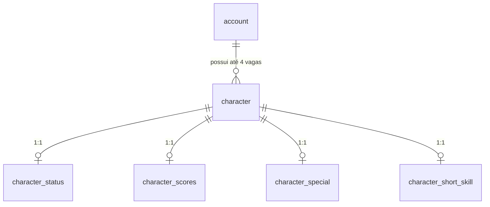

> Pergunta: "o que é um personagem no banco, o que é estado dele e o que o schema garante?"
> Público: Arquiteto de schema e desenvolvedor do `wyd-db`
> Dono: equipe do wyd-db
> Base: `ddl-confirmado.md` §5.10, §5.8; `migrations-checklist.md` §2; `0006_game_character.md`
> Revisado em: 2026-11-21

**Estado:** proposto (2026-11-21) — DDL fechado, série não aplicada.

## Propósito do domínio

Personagem é **quem joga**: a linha de `game.character` mais os quatro satélites 1:1 que guardam estado
mutável de combate e de atalhos. A separação é por frequência de escrita: a linha principal muda ao
subir de nível e ao trocar de mapa; os satélites mudam a cada tick.

**Não cobre:** skills e linhagem ([progressão](dominio-progressao.md)), itens
([inventário](dominio-inventario.md)), guilda ([social](dominio-social.md)) nem a conta que o possui
([acesso](dominio-acesso.md)).

## Tabela de tabelas

| Tabela | Papel em uma linha | Escreve | Lê | Colunas |
|---|---|---|---|---|
| `game.character` (0006) | identidade do personagem: vaga, nome, classe, nível, ouro e soft-delete | jogo | jogo, portal (via view de `0029`) | `gerado/character.md` |
| `game.character_status` (0006) | vida, mana, pontos de PvP, regeneração e resistências | jogo | jogo | `gerado/character_status.md` |
| `game.character_scores` (0006) | atributos e scores **base** e **atuais** | jogo | jogo | `gerado/character_scores.md` |
| `game.character_special` (0006) | quatro valores especiais do `STRUCT_MOB` | jogo | jogo | `gerado/character_special.md` |
| `game.character_short_skill` (0006) | quatro atalhos de skill da barra | jogo | jogo | `gerado/character_short_skill.md` |

## Relações

Todos os satélites usam `character_id` como PK e FK com `ON DELETE CASCADE`: são **linhas possuídas**,
não entidades. Apagar o personagem leva o estado junto.

## Ciclo de vida do dado

| Momento | O que acontece |
|---|---|
| nascimento | criação na vaga livre da conta (0–3), com `level = 1` e `tier = 'mortal'` |
| mudança | nível, EXP, ouro e `content_version` na linha principal; satélites a cada tick |
| morte | **soft-delete** (`A14`): `deleted_at` preenchido; a linha nunca some |

O soft-delete é decisão, não conveniência: sessão, histórico e FKs de outros domínios continuam
apontando para a linha. Por isso os únicos de nome e vaga são **parciais** (`WHERE deleted_at IS NULL`) —
nome de personagem apagado volta a ficar livre, e a vaga também.

## O que o schema garante

- **nome único entre vivos:** `ux_character_nome` sobre `name_fold`, que é `lower(btrim(name))` gerado;
  "Kersef" e "kersef" colidem no índice.
- **vaga única entre vivos:** `ux_character_vaga (account_id, slot) WHERE deleted_at IS NULL`.
- **faixas do cliente:** vaga 0–3, classe 0–5, nível 1–400, `critical` e `save_mana` 0–255,
  `learned_skill_mask` até `4294967295` (máscara de 32 bits).
- **nada negativo onde o cliente não tem sinal:** `exp`, `coin` e `magic` são `>= 0`.
- **vida e mana coerentes com o teto:** `hp BETWEEN 0 AND hp_max` e o equivalente de mana.
- **resistências na faixa de 8 bits:** cada uma entre -128 e 127.
- **atributos não negativos** e scores "unsigned" (attack run, direção, chaos rate) em 0–255.

## Armadilhas de leitura

- `game.character.coin` é o **ouro do personagem**; a carteira da conta é
  `game.account_wallet` ([acesso](dominio-acesso.md)) e o ledger é `dominio-economia`. São três saldos
  diferentes.
- `name_fold` é coluna gerada: não se escreve nela, e comparação de nome é por ela.
- `content_version` no personagem (`D-39`) diz contra qual versão de conteúdo ele foi gravado; não é a
  versão vigente (`content.content_version`, [configuração](dominio-configuracao.md)).
- `scores` tem **base** e **atual**: efeito de item e buff entra em `current_*`, não em `base_*`.
- apagar personagem **não** libera o nome na hora se o soft-delete não for usado — o índice parcial é o
  que devolve a vaga e o nome.

## `H` — semântica não verificada

| Ponto | Falta |
|---|---|
| significado de `class` 0–5 | o mapa classe→nome vem de `content.game_class`; a correspondência numérica é do cliente |
| `tier` (mortal→nightmare) | a sequência está registrada, mas a regra de progressão entre tiers não tem trace |
| `special_1..4` e `flags` | campos do `STRUCT_MOB` sem consumidor provado no planejamento novo |
| `regen_hp`/`regen_mp` como taxa | unidade por tick não verificada |
