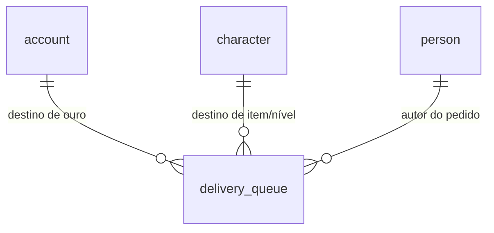
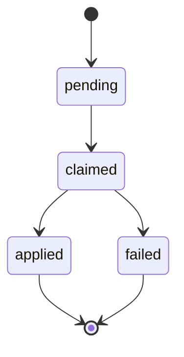

> Pergunta: "como o portal entrega algo ao jogo sem escrever estado vivo, e o que a fila garante?"
> Público: Arquiteto de schema e desenvolvedor do `wyd-db`
> Dono: equipe do wyd-db
> Base: `ddl-confirmado.md` §5.16; `migrations-checklist.md` §2; `0012_ops_delivery.md`
> Revisado em: 2026-11-21

**Estado:** proposto (2026-11-21) — DDL fechado, série não aplicada.

## Propósito do domínio

A ponte é **a passagem única entre frio e quente**: o portal não escreve personagem, item nem carteira;
ele **enfileira** um pedido, e o servidor de jogo **drena** e aplica. Uma tabela, `ops.delivery_queue`,
com o pedido, o destino, o estado e a prova de quem pediu.

**Não cobre:** a carteira e o ledger ([acesso](dominio-acesso.md), [economia](dominio-economia.md)), o
item em si ([inventário](dominio-inventario.md)) nem a auditoria da ação
([auditoria](dominio-auditoria.md)).

## Tabela de tabelas

| Tabela | Papel em uma linha | Escreve | Lê |
|---|---|---|---|
| `ops.delivery_queue` (0012) | pedido de concessão (item, ouro ou nível), com chave idempotente e estado | portal (enfileira) e jogo (drena e fecha) | portal, jogo, `wyd_read` |

## Relações

Três FKs, todas `RESTRICT`: concessão pendente impede apagar conta ou personagem. O autor é
`portal.person` — staff que pediu pela web —, e pessoa nunca é apagada (`A12`).

## Ciclo de vida do dado

| Estado | Significado | Carimbo |
|---|---|---|
| `pending` | na fila, ainda não tomada | `claimed_at` nulo |
| `claimed` | um processo do jogo tomou para si | `claimed_at` preenchido |
| `applied` | aplicada com sucesso | `closed_at` preenchido |
| `failed` | falhou, com motivo | `closed_at` e `failure_reason` preenchidos |

**Retenção (`M22`/`M25`):** `applied` e `failed` são expurgadas 30 dias após `closed_at`; **`pending`
nunca** é expurgada.

## O que o schema garante

- **reenvio não duplica:** `idempotency_key UUID` única (`M17`) — o BFF reenvia e recebe a mesma linha.
- **tipo finito:** `item`, `gold` ou `level`.
- **cada tipo carrega só os seus campos:** item exige personagem, `item_index` e `qty >= 1`; ouro exige
  conta e `gold_amount > 0`; nível exige personagem e `level_delta > 0`. Campos dos outros tipos são
  nulos.
- **estado com carimbo coerente:** pendente não tem reivindicação; todo outro estado foi reivindicado;
  `applied`/`failed` têm `closed_at`; `failed` tem motivo de 1–200.
- **ordem temporal:** `closed_at >= claimed_at`.
- **dreno sem contenção:** índice parcial em `id WHERE status = 'pending'`, lido com
  `SELECT … FOR UPDATE SKIP LOCKED` em transação curta (`M25`).

## Armadilhas de leitura

- a fila **não** é ledger: `applied` diz que o jogo aplicou, e o saldo real está em
  `account_wallet`/`account_ledger`.
- `status = 'claimed'` sem `applied` é pedido em processamento ou órfão de processo que caiu — o estado
  não expira sozinho.
- `account_id` é nulo em entrega de item/nível; `character_id` é nulo em entrega de ouro.
- `created_by_person_id` é **autor**, não destinatário.
- `pending` nunca é expurgada: fila parada cresce, e é sinal de dreno quebrado, não de retenção.

## `H` — semântica não verificada

| Ponto | Falta |
|---|---|
| política de retry e limite de tentativas | `attempt_count` é guardado; o teto é do runtime |
| quem pode enfileirar | papel de staff; a tabela não restringe |
| tempo máximo em `claimed` | não há coluna de prazo; a recuperação é do dreno |
| ordem de aplicação entre pedidos | o dreno lê por `id`, mas a garantia de ordem não foi medida |
