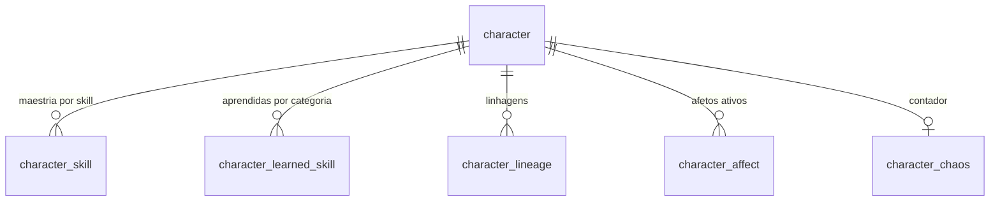

> Pergunta: "como o personagem progride — skills, linhagem, afetos e chaos — e o que o banco guarda de cada um?"
> Público: Arquiteto de schema e desenvolvedor do `wyd-db`
> Dono: equipe do wyd-db
> Base: `ddl-confirmado.md` §5.11, §5.19; `migrations-checklist.md` §2; `0008_game_skills.md`
> Revisado em: 2026-11-21

**Estado:** proposto (2026-11-21) — DDL fechado, série não aplicada.

## Propósito do domínio

Progressão é **o que o personagem aprendeu e o que está ativo nele**: maestria por skill, skills
aprendidas por categoria, linhagem escolhida, afetos temporários e o contador de chaos. Cinco tabelas,
todas filhas de `game.character` e escritas pelo jogo enquanto roda.

**Não cobre:** atributos e nível ([personagem](dominio-personagem.md)), catálogo de skill
(`dominio-catalogo`) nem efeito de item ([inventário](dominio-inventario.md)).

## Tabela de tabelas

| Tabela | Papel em uma linha | Escreve | Lê | Colunas |
|---|---|---|---|---|
| `game.character_skill` (0008) | maestria por skill: `(character_id, skill_index)` com 0–320 | jogo | jogo | `gerado/character_skill.md` |
| `game.character_learned_skill` (0008) | skills aprendidas por categoria, em máscara de 8 bits | jogo | jogo | `gerado/character_learned_skill.md` |
| `game.character_lineage` (0008) | linhagem escolhida e sua maestria | jogo | jogo | `gerado/character_lineage.md` |
| `game.character_affect` (0008) | afeto/estado ativo com nível e ticks restantes | jogo | jogo | `gerado/character_affect.md` |
| `game.character_chaos` (0008) | contador de chaos em pontos de caos (-75 a 75) | jogo | jogo | `gerado/character_chaos.md` |

## Relações

Todas as FKs usam `ON DELETE CASCADE` com o personagem: progressão não sobrevive a quem progrediu. O
`skill_index`/`lineage_code` **não** têm FK para `content`: o catálogo cobre só parte dos índices, e a FK
continua fora por decisão (§5.19), não por esquecimento.

## Ciclo de vida do dado

| Tabela | Nasce | Muda | Morre |
|---|---|---|---|
| `character_skill` | primeira maestria na skill | `mastery`, `updated_at` | com o personagem |
| `character_learned_skill` | skill aprendida | máscara da categoria | com o personagem |
| `character_lineage` | escolha de linhagem | `mastery` | com o personagem |
| `character_affect` | efeito aplicado | `remaining_ticks`, `level` | quando expira (`DELETE`) ou com o personagem |
| `character_chaos` | primeiro ponto de caos | `cp` | com o personagem |

`character_affect` é a única do domínio com morte em runtime: efeito expirado é removido, não marcado.

## O que o schema garante

- **índices do cliente:** `skill_index` 0–247 (`MAX_SKILLINDEX 248`) e maestria 0–320. O teto por classe
  é lido de `content.game_class.mastery_cap` — o `CHECK` global não substitui a classe.
- **chave composta:** `(character_id, skill_index)` impede a mesma skill duas vezes.
- **categoria finita:** `category` 0–3 e máscara 0–255 em `character_learned_skill`.
- **linhagem é código:** `lineage_code` no mesmo formato `snake_case` de `content.skill_lineage.slug`.
- **afeto não negativo:** `affect_type`, `level` e `remaining_ticks` são `>= 0`.
- **chaos é faixa simétrica:** `cp BETWEEN -75 AND 75`.

## Armadilhas de leitura

- `character_skill.mastery` **não** é nível de skill: é maestria (0–320), e o teto efetivo depende da
  classe.
- máscara de skill aprendida é **por categoria**, não uma máscara única do personagem; a máscara global
  fica em `game.character.learned_skill_mask`.
- `character_affect.remaining_ticks` conta tick de servidor, não segundo; conversão é do runtime.
- `skill_index` sem FK é proposital: o catálogo de `0015` tem 154 linhas para 248 índices possíveis.
- `character_lineage` é histórico por linha, não "uma linhagem por personagem" — o único é
  `(character_id, lineage_code)`.

## `H` — semântica não verificada

| Ponto | Falta |
|---|---|
| mapa `category` 0–3 → nome | vem do cliente; o planejamento novo não reverificou |
| regra de maestria por classe acima do teto global | `mastery_cap` é 320 por default; a regra de redução é do runtime |
| efeito de cada `affect_type` | tabela de efeitos do legado, sem trace no planejamento novo |
| efeito de `cp` fora da faixa | -75..75 é faixa do cliente; o que acontece no limite é regra de jogo |
