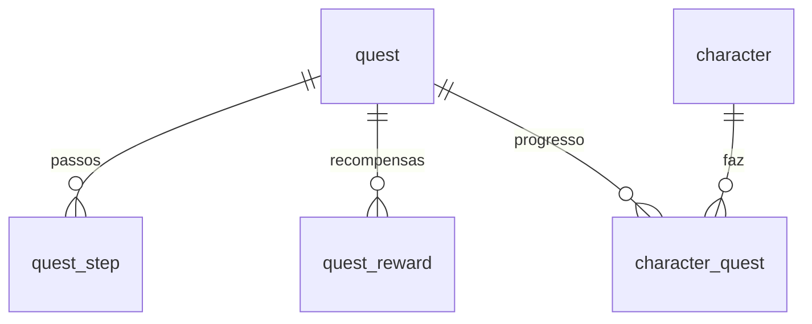

> Pergunta: "como uma quest é definida, como o passo e a recompensa se ligam a ela e como o progresso do jogador é guardado?"
> Público: Arquiteto de schema e desenvolvedor do `wyd-db`
> Dono: equipe do wyd-db
> Base: `ddl-confirmado.md` §5.26, §5.28; `migrations-checklist.md` §2
> Revisado em: 2026-11-21

**Estado:** proposto (2026-11-21) — DDL fechado, série não aplicada; o seed `0027` segue `bloqueada`.

## Propósito do domínio

Quests são **definição em `content` e progresso em `game`**: a quest com seus passos e recompensas, e a
linha que diz onde o personagem parou. Quatro tabelas — três de definição em `content` e uma de estado em
`game` —, e o único bloco de definição que o estado de jogo referencia por FK.

**Não cobre:** eventos e arena (`dominio-eventos`, `dominio-arena`), item da recompensa
([catálogo](dominio-catalogo.md)) nem entrega do prêmio (`ops.delivery_queue`).

## Tabela de tabelas

| Tabela | Schema | Papel em uma linha |
|---|---|---|
| `content.quest` | content | definição por `code`, com tipo, nível e pré-requisito |
| `content.quest_step` | content | passo `(quest_code, step)` com objetivo e alvo |
| `content.quest_reward` | content | recompensa por tipo, com item opcional |
| `game.character_quest` | game | progresso do personagem na quest |

## Relações

`quest_step` e `quest_reward` são filhos possuídos (`CASCADE`). `character_quest` aponta para
`content.quest` com **`RESTRICT`**: apagar definição com progresso dependente falha alto, em vez de levar
o progresso junto (a ficha do legado dizia `CASCADE`).

## Ciclo de vida do dado

| Tabela | Nasce | Muda | Morre |
|---|---|---|---|
| `quest`, `quest_step`, `quest_reward` | seed `0027` | nunca em runtime | só com o seed |
| `character_quest` | primeira interação com a quest | `step`, `progress`, conclusão | com o personagem (`CASCADE`) |

## O que o schema garante

- **código é a identidade:** `code` em `snake_case` de 2–64, sem `id` sintético (`P-04`).
- **tipo finito:** `main`, `class`, `daily`, `event` ou `sub`.
- **passo positivo e ordenado:** `(quest_code, step)` com `step > 0`.
- **passo tem objetivo:** o `CHECK` exige objetivo preenchido; `reach` exige mapa **e** coordenada.
- **contagem positiva:** `count > 0`.
- **recompensa sem duplicata:** único `(quest_code, kind, item_index)` com `NULLS NOT DISTINCT` — duas
  recompensas de ouro para a mesma quest são impossíveis.
- **item só quando é item:** `(kind = 'item') = (item_index IS NOT NULL)`.
- **valor positivo:** `amount > 0`.
- **progresso coerente:** `step > 0` e `progress >= 0`; `completed_at` é nulo ou **não anterior** a
  `started_at` (`>=`) — posterior é permitido, anterior não. O schema **não** deriva conclusão de
  `progress`/`step`: chegar ao último passo não preenche `completed_at` sozinho.

## Armadilhas de leitura

- `quest_step.target_id` é **polimórfico** (mob, item, mapa) e por isso **não tem FK**; a integridade é do
  seed.
- `quest_reward` tem `id` identity **e** único natural: a linha precisa de identidade porque `item_index`
  é nulo em recompensa de ouro/EXP.
- `character_quest` guarda `step`, não a lista de passos concluídos: passo vencido não deixa histórico.
- a FK de `character_quest` para `content.quest` é `RESTRICT`; o `CASCADE` é só com o personagem.
- `content.quest.class_code` tem FK para `content.game_class (slug)` com `RESTRICT` (`0026` §4); `NULL`
  é "todas as classes", não ausência de ligação.

## `H` — semântica não verificada

| Ponto | Falta |
|---|---|
| cadeia de quests do 7662 | contagem e ordem não verificadas na fonte (seed `0027` bloqueado) |
| semântica de `requires` | formato do pré-requisito no legado, sem trace |
| efeito de `cooldown_seconds` por tipo | runtime, não schema |
| conclusão de quest diária | regra de reset do dia não verificada |
| ligação entre conclusão e progresso | não há `CHECK` que amarre `completed_at` a `progress` ou ao último passo; quem marca é o runtime |
