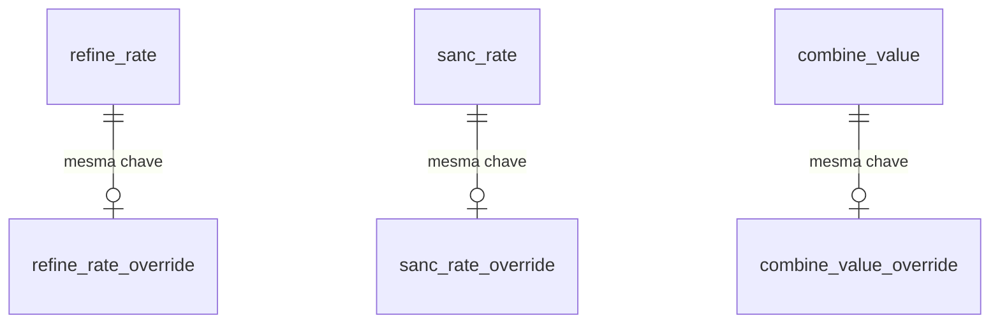

> Pergunta: "como refino, SANC, composição, gema e acessório são representados, e como o staff sobrescreve a base?"
> Público: Arquiteto de schema e desenvolvedor do `wyd-db`
> Dono: equipe do wyd-db
> Base: `ddl-confirmado.md` §5.22, §5.23; `migrations-checklist.md` §2
> Revisado em: 2026-11-21

**Estado:** proposto (2026-11-21) — DDL fechado, série não aplicada; o seed `0023` segue `bloqueada`.

## Propósito do domínio

Refino é **a tabela de regra**: chance por passo, efeito de gema, SANC por pó, valor de composição e
receita de acessório — mais três tabelas de **override** que o staff edita sem deploy. Oito tabelas: cinco
base (seed, read-only) e três de edição.

**Não cobre:** item do personagem ([inventário](dominio-inventario.md)), catálogo de efeito
([catálogo](dominio-catalogo.md)) nem a auditoria da edição ([configuração](dominio-configuracao.md)).

## Tabela de tabelas

| Tabela | Papel em uma linha | Escreve |
|---|---|---|
| `content.refine_rate` (0021) | chance de refino por `(kind, step)`, em bps | seed |
| `content.refine_gem_effect` (0021) | efeito de gema por item, com valor fixo e por nível | seed |
| `content.sanc_rate` (0021) | chance de SANC por `(powder, refine_index)` | seed |
| `content.combine_value` (0021) | valor de composição por `(family, key)` | seed |
| `content.accessory_refine_rule` (0021) | receita, falha e bônus de acessório | seed |
| `content.refine_rate_override` (0022) | substitui a linha base de `(kind, step)` | portal |
| `content.sanc_rate_override` (0022) | substitui a linha base de `(powder, refine_index)` | portal |
| `content.combine_value_override` (0022) | substitui a linha base de `(family, key)` | portal |

## Relações

A PK do override é **exatamente** a PK da base, e a FK composta usa `ON DELETE CASCADE`. Override de
chave inexistente é impossível; apagar a linha base leva a edição junto.

## Ciclo de vida do dado

| Momento | Base | Override |
|---|---|---|
| nascimento | seed `0023` (bloqueado pelo dado) | edição do staff, substituindo a linha inteira |
| mudança | novo seed | `UPDATE` ou nova linha com a mesma chave |
| morte | nunca | `DELETE` = reset para o valor da base, sem tombstone |

## O que o schema garante

- **taxa em bps:** 0–10000 em `refine_rate`, `sanc_rate`, `accessory_refine_rule` e nos overrides de
  refino/SANC — 10000 = 100%.
- **passo do refino:** `step` 1–15 e `refine_index` 0–15.
- **SANC só com pó nomeado:** `powder IN ('PO', 'PL', 'AMAGO')`.
- **composição tem uma unidade só:** exatamente um entre taxa e moeda, na base e no override.
- **falha de acessório finita:** `fail_mode IN ('keep', 'reset', 'destroy')`, com material > 0 e ouro
  `>= 0`.
- **efeito de gema não negativo:** valores `>= 0` e faixa de índice verificada.
- **override vale por linha inteira:** não há `COALESCE` coluna a coluna; o `COALESCE` sem origem seria
  o erro que o desenho evita.
- **taxa ausente é ausência de linha**, nunca `0%`.

## Armadilhas de leitura

- **não existe default compilado como seed:** `sanc_rate` só recebe célula com fonte explícita.
- o override é **substituição**, não delta: quem lê precisa escolher a linha do override quando ela
  existe, e a base quando não existe.
- `effect_code` reusa o `slug` de `content.item_effect` **com FK** (`fk_refine_gem_effect_codigo`,
  `RESTRICT`); quem não tem FK é `material_item` de `accessory_refine_rule`.
- `coin` de composição é a moeda da **operação de refino**, não a carteira da conta.
- `updated_at` é o único carimbo do override; **quem** editou e o valor anterior ficam em
  `ops.config_change`, e não há `updated_by` porque `content` não aponta para `portal`.
- `accessory_refine_rule` é posterior ao cliente 7662: não há regra oficial confirmada.

## `H` — semântica não verificada

| Ponto | Falta |
|---|---|
| famílias e semântica de `refine_rate.step` | ficha do legado, sem trace no planejamento novo |
| exaustividade das células de `sanc_rate` | regra de "célula ausente" no runtime |
| famílias/chaves de `combine_value` | lista medida no legado, sem confirmação |
| receitas, transições e bônus do acessório | origem posterior ao 7662; sem regra oficial |
| por que o staff edita cada família | operação; nenhum uso medido |
