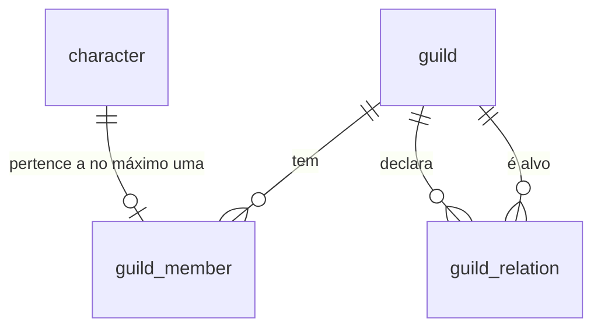

> Pergunta: "como guilda, membros, relações e torre se organizam no banco e o que o schema garante?"
> Público: Arquiteto de schema e desenvolvedor do `wyd-db`
> Dono: equipe do wyd-db
> Base: `ddl-confirmado.md` §5.13, §5.21; `migrations-checklist.md` §2; `0010-game-guild.md`
> Revisado em: 2026-11-21

**Estado:** proposto (2026-11-21) — DDL fechado, série não aplicada.

## Propósito do domínio

Social é **organização entre jogadores**: a guilda, seus membros com papel, as relações declaradas entre
guildas e o estado único da torre. Quatro tabelas, todas de estado de jogo — o portal não escreve
nenhuma delas.

**Não cobre:** zona de guilda como **conteúdo** (`content.guild_zone`, em `dominio-mundo`), castelo e
Kefra (`dominio-eventos`) nem personagem ([personagem](dominio-personagem.md)).

## Tabela de tabelas

| Tabela | Papel em uma linha | Escreve | Lê |
|---|---|---|---|
| `game.guild` (0010) | guilda com nome único dobrado | jogo | jogo, portal (ranking) |
| `game.guild_member` (0010) | vínculo personagem↔guilda, com papel | jogo | jogo |
| `game.guild_relation` (0010) | relação `ally` ou `hostile` entre duas guildas | jogo | jogo |
| `game.guild_tower` (0010) | linha única (`id = 1`) do estado da torre | jogo | jogo |

## Relações

`guild_member.character_id` tem único: **um personagem em uma guilda só**. `guild_relation` tem duas FKs
para `guild` (origem e alvo) e `CHECK (guild_id <> target_guild_id)`.

## Ciclo de vida do dado

| Tabela | Nasce | Muda | Morre |
|---|---|---|---|
| `guild` | fundação | nome (raro), `updated_at` | não há `DELETE` previsto |
| `guild_member` | entrada | papel | saída (`DELETE`) ou expulsão |
| `guild_relation` | declaração | tipo | rompimento (`DELETE`) |
| `guild_tower` | primeira disputa | dono e contadores | nunca (linha única) |

## O que o schema garante

- **nome único:** `ux_guild_nome` sobre `name_fold` gerado; nome de 3 a 16 caracteres depois de aparar.
- **um líder por guilda:** `ux_guild_member_lider (guild_id) WHERE role = 'leader'`.
- **um grupo por personagem:** `ux_guild_member_personagem (character_id)`.
- **papel finito:** `leader`, `sub_leader` ou `member`.
- **relação não é consigo mesma** e o tipo é `ally` ou `hostile`.
- **torre é singular:** `ck_guild_tower_singleton CHECK (id = 1)`.
- **sem FK para `content`:** zona de guilda é conteúdo e vive em `0019`; o estado de guerra fica aqui.

## Armadilhas de leitura

- `guild_tower` **não** é a definição da zona: é o estado (dono, contadores). A definição é
  `content.guild_zone`, em `dominio-mundo`.
- ser líder é **papel na linha**, não coluna em `guild`; trocar líder é `UPDATE` no papel, e o único
  parcial garante que não existam dois.
- `guild_relation` é direcionada: aliança declarada por A não cria a linha de B automaticamente.
- o nome é comparado por `name_fold`; escrever `name` com caixa diferente não cria guilda nova.

## `H` — semântica não verificada

| Ponto | Falta |
|---|---|
| regra de fundação e custo | legado `0004_guildas.sql`, sem reverificação no planejamento novo |
| efeito de `ally`/`hostile` no combate | regra de jogo, não de schema |
| estado da torre além do dono | colunas vieram de `0028_estado_de_jogo.sql`, sem trace |
| limite de membros | não há `CHECK`; se existe teto, é do runtime |
