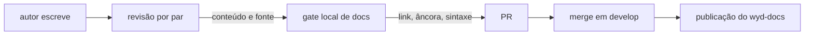

> Pergunta: "como uma página é revisada, aprovada e publicada sem quebrar link ou ID?"
> Público: Autor, revisor e mantenedor do site
> Dono: equipe do `wyd-db`
> Base: `wyd-db-1.0.0.md` §7 e §10; `convencoes.md`; `wyd-docs/preparar.py`; `wyd-docs/gate/checks/links.py`
> Revisado em: 2026-11-22

**Estado:** proposto (2026-11-22)

A revisão tem dois donos: o autor revisa conteúdo e fonte; o `wyd-docs` revisa build, link e
publicação. A página só é considerada pronta quando o gate local passa e o revisor consegue refazer o
caminho sem adivinhar. Publicar no GitHub Pages é do `wyd-docs`, não desta pasta.

## 1. Fluxo de revisão

1. O autor escreve com cabeçalho de 5 campos, `**Estado:**` e fonte no `Base:`.
2. Um par revisa pergunta, fronteira, links e números; não reescreve a página no lugar do autor.
3. O autor roda o gate local e corrige na origem, não no artefato.
4. O PR descreve o que mudou e a evidência; o merge é squash.
5. O `wyd-docs` publica o que está em `develop`; a página não publica a si mesma.

## 2. Checklist de pronto

- [ ] A página responde à pergunta do título e não repete a introdução.
- [ ] O cabeçalho tem pergunta, público, dono, base e data.
- [ ] O estado é `aceito` ou `proposto`; não há “em construção”.
- [ ] Todo número tem fonte e data, ou está marcado `P`/`H`.
- [ ] Nenhum link relativo aponta para fora de `docs/` ou para página inexistente.
- [ ] Nenhuma âncora foi inventada; títulos e links coincidem.
- [ ] Nada de `TODO`, placeholder ou seção de enfeite.
- [ ] Nenhum segredo, DSN, token ou PII.
- [ ] O conteúdo não duplica `convencoes.md` nem o dono de outra pasta.
- [ ] O gate de docs passou após a última edição.

## 3. Gate local

O gate é o de `wyd-docs`: `preparar.py`, `mkdocs build` e `gate/checks/links.py`, seguidos de
`gate/checks/contagens.py` e `gate/checks/censos.py`. Ele verifica link, âncora, navegação, sintaxe 1.x,
censo por estado, contagens da série e os quatro censos citados entre páginas (atos de aceite,
páginas aceitas, células pendentes e `Q-BLK` abertas). Um build que gera HTML sem os verificadores
**não** é gate completo.

| Falha | Correção |
|---|---|
| destino inexistente | corrigir o caminho relativo ou criar a página no mesmo PR |
| âncora inexistente | usar o título real ou remover a âncora |
| sintaxe 1.x | trocar por tabela, bloco ou Mermaid suportado |
| contagem divergente | corrigir a fonte dona, não o dashboard |
| página sem navegação | conferir `index.md` e a cópia para o site |

## 4. O que muda entre rascunho e publicado

| Estado | O que existe | O que não é prometido |
|---|---|---|
| `proposto` | conteúdo e fonte declaradas; pode ter lacuna | que o desenho já roda |
| `aceito` | revisão e evidência registradas | que o código está implantado |
| publicado | página no site do `wyd-docs` | que o conteúdo é imutável |

O estado editorial não é status de implementação. Uma página `aceito` pode descrever algo `P`; o que
muda é a confiança na fonte, não a existência do código.

## 5. O que esta página não cobre

- **Publicação, URL, Pages e rollback:** são do `wyd-docs` (`LPDOC`), não desta pasta.
- **Aprovação de arquitetura:** é de `lacunas.md`/ADR, não do revisor de texto.
- **Sintaxe e estilo linha a linha:** são de `estilo-e-linguagem.md` e `convencoes.md`.
- **CI real:** o gate local é manual; o workflow de docs é do `wyd-docs`.
