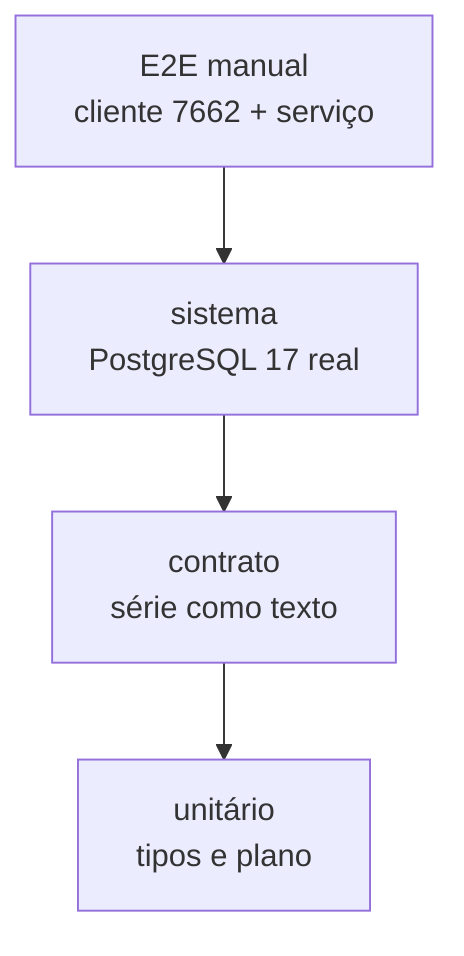

> Pergunta: "que tipo de teste eu escrevo e o que cada nível pode tocar?"
> Público: Desenvolvedor e QA
> Dono: equipe do `wyd-db`
> Base: `wyd-db-1.0.0.md` §6.13 e §6.17; `plano-de-testes.md`; `padrao-banco.md` §10
> Revisado em: 2026-11-22

**Estado:** proposto (2026-11-22)

A pirâmide do `wyd-db` tem três níveis dentro do crate e um E2E fora dele. O nível não é status: é o
que o teste **pode tocar**. Unitário não toca banco nem disco; contrato lê a série como texto; sistema
usa PostgreSQL 17 real. O E2E com cliente 7662 é evidência manual datada, não um alvo de `cargo test`.

## 1. Níveis

| Nível | Pode tocar | Prova | Exemplo |
|---|---|---|---|
| unitário | tipos puros, parser, `plan` | regra local e variantes de erro | `Version(0)` recusado; `Sql` com `COMMIT` recusado |
| contrato | série como texto + portas falsas | ordem, commit por arquivo, drift, `down` | `FakeSource`/`FakeLedger`/`FakeLock` |
| sistema | PostgreSQL 17 real e DSN de teste | comportamento do banco e do adapter | aplicar, reaplicar, ciclo, concorrência |
| E2E | cliente 7662 + serviço + banco | corte vertical do login/seleção | evidência manual, não `cargo test` |

O teste de contrato não abre conexão; o de sistema não substitui o banco por um falso. Um teste de
unidade que lê arquivo ou ambiente está no nível errado.

## 2. Critério de escolha

1. A regra depende de valor puro? **Unitário.**
2. A regra depende da forma da série ou da ordem do runner, sem banco? **Contrato.**
3. A regra depende de `CHECK`, `GRANT`, transação, lock ou `down` real? **Sistema.**
4. A regra depende do cliente/serviço completo? **E2E**, com evidência fora do crate.

Se a resposta for “os dois”, separe: um teste unitário para a decisão e um de sistema para o efeito. Não
duplique o mesmo cenário em três níveis.

## 3. O que cada nível não pode tocar

| Nível | Proibido |
|---|---|
| unitário | `std::fs`, `std::env`, `sqlx`, `tokio`, relógio real |
| contrato | conexão PostgreSQL; fixture que depende de dado de produção |
| sistema | `FakeLedger` para provar o banco; `sleep` para ordenar; estado global |
| E2E | dado real de jogador; segredo em captura; conclusão sem data e versão do cliente |

## 4. Pirâmide de custo e feedback

A base é barata e roda sem ambiente; o topo é caro e não substitui os níveis de baixo. Custo e tempo
por nível **não foram medidos**; a ordem acima é de dependência de ambiente, não uma promessa de
duração.

## 5. O que esta página não cobre

- **Cenários de cada alvo:** são de `tests/alvos/`, com seis páginas de alvo desde 2026-11-27.
- **Fixtures e factories:** são de [`fixtures-e-factories.md`](fixtures-e-factories.md) e do harness
  `tests/comum/mod.rs`.
- **Matriz de capacidades:** é de `tests/specs/capacidades.md`; o anti-skip está em
  [`gates-e-anti-skip.md`](gates-e-anti-skip.md).
- **Cobertura, tempo e paralelismo:** não medidos.
