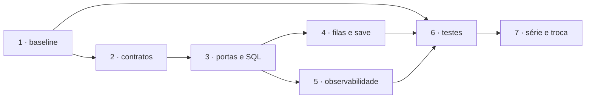

> Pergunta: "como o trabalho do `wyd-db` é agrupado em fases e o que cada fase precisa para sair?"
> Público: Produto, arquitetura, desenvolvimento e QA
> Dono: equipe do `wyd-db`
> Base: `wyd-db-1.0.0.md` §6.10; `D-7` aprovada em 2026-11-22; `plano-migrations.md` §9
> Revisado em: 2026-11-22

**Estado:** proposto (2026-11-22)

`FASE` agrupa escopo; `P-n` ordena prioridade dentro da fase. As duas coisas não são sinônimos: uma
issue pode ser `P1` e estar na fase 3 porque depende de uma porta que ainda não existe. A distribuição
abaixo é a de `D-7`: **40 issues**, 4+6+6+5+5+8+6, e cada uma tem página `WYDDB-nnn` com DoD.

## 1. As sete fases

| Fase | Escopo | Pré-requisito | Critério de saída | Issues |
|---:|---|---|---|---|
| 1 | higiene e baseline: documentação de item público, contrato do crate e comentários de modelo | repositório e crate existentes | `cargo doc` sem warning e `cargo test` do baseline verde | `WYDDB-001`–`004` |
| 2 | contratos e erros tipados: `Dsn`, `Command`/`Report`, taxonomias e códigos de saída | fase 1 | testes de contrato das mensagens e códigos passam | `WYDDB-005`–`010` |
| 3 | decomposição de portas e separação de SQL | fase 2 | nenhuma porta importa `sqlx`; o SQL de repositório tem um dono | `WYDDB-011`–`016` |
| 4 | filas, save e shutdown: lote de save, drenagem, idempotência e fechamento | fase 3 | cenários de fila e save passam com efeito único | `WYDDB-017`–`021` |
| 5 | observabilidade e diagnóstico: spans, resumo, correlação e consultas de lock | fase 3 | um incidente simulado é diagnosticado sem ler DSN ou SQL | `WYDDB-022`–`026` |
| 6 | testes de lacuna e harness: unitário, contrato, sistema, fixtures e anti-skip | fases 1–5 | os alvos de `plano-de-testes.md` §2 passam sem `SKIP` | `WYDDB-027`–`034` |
| 7 | migrations e evolução de schema: primeira série, contrato, ciclo e troca | fase 6 e DDL confirmado | `0001`–`0034` aplicam e desfazem; `SCHEMA_VERSION = 34` | `WYDDB-035`–`040` |

As fases 3 e 5 podem andar em paralelo depois da fase 2; a fase 4 depende da 3; a 6 depende das
portas e do save; a 7 é a última porque a série viva só troca depois do corte vertical.

## 2. Dependência entre fases

A seta quer dizer “pode começar quando o anterior tem critério de saída”, não “todo item do anterior
está fechado”. A fase 6 pode começar na fase 1 com os testes unitários e crescer; a fase 7 não começa
antes de a suíte de contrato e sistema estar verde.

## 3. Regra de entrada e de saída

- **Entrada:** a página `WYDDB-nnn` existe, tem DoD executável e não depende de decisão aberta.
- **Saída:** o comando do DoD roda, a evidência fica na issue e a página é atualizada na mesma
  entrega.
- **Bloqueio:** issue que depende de seed, cliente 7662, captura de protocolo ou CI real continua
  fora da fila; ela não é “concluída por documento”.
- **Contagem:** a soma é **40**; se uma página faltar, a fase não fecha e a contagem é corrigida na
  fonte, não por issue criada sem página.

## 4. O que esta página não cobre

- **Prazo, custo e velocidade:** não há estimativa aprovada.
- **Ordem de prioridade entre fases:** é a da dependência acima; `P-n` ordena dentro da fase.
- **Detalhe de cada entrega:** está na página `WYDDB-nnn`; esta página não repete DoD.
- **Milestone do GitHub:** o nome e o número são operacionais; a fase de produto é esta.
