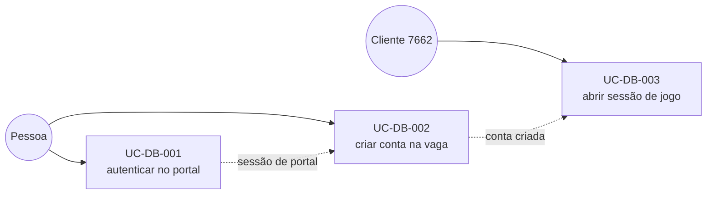

> Pergunta: "quem faz o quê, passo a passo, no bloco de identidade?"
> Público: Produto / gestão e arquitetura
> Dono: equipe do `wyd-db`
> Base: `rascunho-accounts.md` §2–§3; `ddl-confirmado.md` §4, §5.1, §5.2, §5.5; `docs/specs/requisitos-funcionais.md`
> Revisado em: 2026-11-22

**Estado:** proposto (2026-11-22)

Três casos de uso fecham hoje: autenticar no portal, criar conta na vaga e abrir sessão de jogo. São
os únicos que não dependem de fluxo bloqueado (`lacunas.md` §3). Cada passo diz **o dado que muda**;
o que é cálculo de código aparece como cálculo, não como coluna inventada.

## Atores e casos

| Ator | Quem é | O que pode |
|---|---|---|
| Pessoa | titular da identidade no portal | autenticar e criar até cinco contas de jogo |
| Cliente 7662 | cliente do jogo, via `wyd-server` | abrir sessão com login, senha e PIN |
| Staff | pessoa com papel `moderator`/`admin` no portal | bloquear conta; não é passo dos casos abaixo |

## UC-DB-001 — autenticar no portal

- **Ator:** pessoa com cadastro no portal.
- **Pré-condição:** pessoa existe, com `password_hash` argon2id; `status` diferente de `closed`.
- **Fluxo principal:**
  1. a pessoa envia e-mail e senha ao BFF;
  2. o BFF dobra o e-mail (`email_fold`) e busca a pessoa pelo índice total;
  3. verifica a senha com argon2id;
  4. grava `portal.person_session` com `token_hash` (sha256 do token opaco), `expires_at` de 8 h,
     `ip` e `user_agent`;
  5. atualiza `person.last_login_at`, zera `failed_login_count` e grava `ops.login_attempt` com
     `result = 'ok'`.
- **Alternativos:**
  - senha errada → incrementa `failed_login_count`; grava `bad_secret`; resposta genérica;
  - e-mail inexistente → grava `unknown_identifier` com o hash do e-mail; resposta genérica;
  - pessoa `suspended` ou `closed` → recusa; grava `blocked`;
  - limite de falhas atingido → `locked_until` preenchido e recusa; grava `locked`.
- **Pós-condição:** uma linha viva em `portal.person_session`; a pessoa pode ter N sessões de portal,
  cada uma revogável.
- **Requisitos cobertos:** `RF-DB-010`, `RF-DB-013`; `RN-DB-004`.
- **Tabelas tocadas:** `portal.person`, `portal.person_session`, `ops.login_attempt`.

## UC-DB-002 — criar conta na vaga

- **Ator:** pessoa autenticada no portal.
- **Pré-condição:** pessoa `active`; menos de cinco contas não fechadas.
- **Fluxo principal:**
  1. a pessoa escolhe login e senha de jogo (1–16 e 12 bytes no fio);
  2. o BFF calcula o **menor** slot livre entre 1 e 5;
  3. grava `game.account` com `person_id`, `slot`, `login`, `password_hash` e `role = 'player'`;
  4. grava `game.account_wallet` com `coin = 0`.
- **Alternativos:**
  - sexta conta → `23505` em `ux_account_slot`;
  - login já usado por outra pessoa → `23505` em `ux_account_login` (índice total);
  - duas criações concorrentes na mesma vaga → uma falha em `ux_account_slot`, não em código.
- **Pós-condição:** conta e carteira criadas na mesma vaga; a vaga só volta a existir se a conta
  fechar (`status = 'closed'`).
- **Requisitos cobertos:** `RF-DB-001`, `RF-DB-003`, `RF-DB-012`; `RN-DB-001`, `RN-DB-005`.
- **Tabelas tocadas:** `game.account`, `game.account_wallet`.

## UC-DB-003 — abrir sessão de jogo

- **Ator:** titular da conta, pelo cliente 7662.
- **Pré-condição:** conta `active`, não bloqueada; canal `(group_id, channel)` existente e jogável;
  conta sem sessão viva.
- **Fluxo principal:**
  1. o cliente envia login (16 B), senha (12 B), PIN (6 B) e a versão;
  2. o servidor busca a conta por `login_fold` e verifica senha e PIN;
  3. confere `game.account_moderation.blocked` e `pin_locked_until`;
  4. grava `game.session` com `account_id`, `group_id`, `channel`, `client_version` e `ip`,
     `character_id` nulo até a seleção;
  5. grava `ops.login_attempt` com `surface = 'game'` e `result = 'ok'`.
- **Alternativos:**
  - segunda conexão da mesma conta → `23505` em `ux_session_viva_por_conta`;
  - canal inexistente → `23503` em `fk_session_canal`;
  - conta bloqueada → recusa; grava `blocked`;
  - PIN errado → incrementa `pin_failure_count`; passado o limiar, `pin_locked_until` e recusa.
- **Pós-condição:** uma sessão viva; ao desconectar, `released_at` e `released_reason =
  'disconnect'`.
- **Requisitos cobertos:** `RF-DB-002`, `RF-DB-006`, `RF-DB-014`; `RN-DB-002`, `RN-DB-003`,
  `RN-DB-007`.
- **Tabelas tocadas:** `game.account`, `game.account_moderation`, `game.server_channel`,
  `game.session`, `ops.login_attempt`.

## O que estes casos não cobrem

| Fora | Por quê |
|---|---|
| criação e seleção de personagem, carga e save | dependem do fluxo de personagem, ainda bloqueado |
| concessão de grant, compra e crédito | dependem de fila e economia, com requisito não levantado |
| recuperação de senha e verificação de e-mail | o desenho do token existe (`RF-DB-010`), mas a entrega é `B1` (onda 6) e o fluxo não foi escrito |
| bloqueio e desbloqueio pelo staff | caso de uso do `wyd-admin` (C4), não do `wyd-db` |

*Os três casos são `UC-DB-001`–`UC-DB-003`; o próximo número livre é `UC-DB-004`.*
