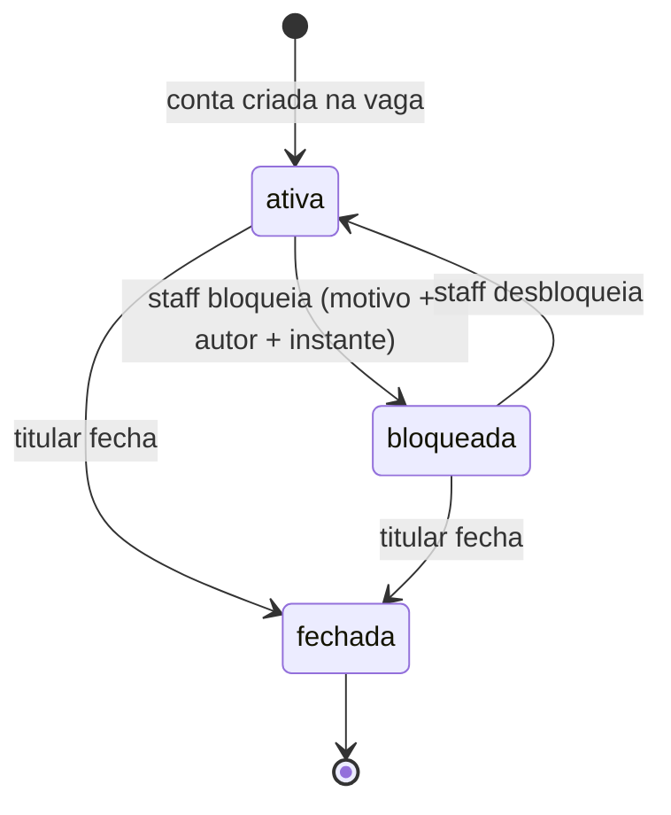

> Pergunta: "que estados uma conta de jogo pode ter, como se passa de um para outro e o que acontece com a sessão?"
> Público: Produto / gestão e arquitetura
> Dono: equipe do `wyd-db`
> Base: `ddl-confirmado.md` §5.1–§5.2, §5.5; `lacunas.md` `M1`, `A13`, `B4`; `rascunho-accounts.md` §5
> Revisado em: 2026-11-22

**Estado:** proposto (2026-11-22)

Conta de jogo tem **dois eixos que não se misturam**: `game.account.status` guarda o ciclo de vida
(`active`/`closed`) e `game.account_moderation.blocked` guarda a decisão disciplinar. `suspended` não
existe como estado de conta — foi retirado por `M1`; "banida" também não é estado do schema. Quem
tenta representar bloqueio como status cria duas fontes para o mesmo fato, que é o que o padrão
proíbe (`padrao-banco.md` §5, item 5).

## Diagrama

`bloqueada` não é um valor de `status`: é `status = 'active'` com `blocked = true` em
`game.account_moderation`. O diagrama desenha o estado **observado** (conta ativa e bloqueada ao mesmo
tempo), não uma coluna nova.

## Tabela de transições

| Estado | Evento | Guarda | Próximo estado | Efeito no banco |
|---|---|---|---|---|
| `ativa` | staff bloqueia | motivo não vazio, autor existente, instante preenchido | `bloqueada` | `INSERT`/`UPDATE` em `game.account_moderation`: `blocked = true`, `reason`, `blocked_by`, `blocked_at`; `account.status` **não** muda |
| `bloqueada` | staff desbloqueia | linha de moderação existe | `ativa` | `blocked = false`, `blocked_at = NULL`; `reason`/`blocked_by` são limpos pelo código (o `CHECK` só exige coerência quando bloqueada) |
| `ativa` | titular fecha | pessoa fecha na mesma transação (`A13`) | `fechada` | `status = 'closed'`, `closed_at = now()`; a vaga é liberada (`ux_account_slot` filtra `status <> 'closed'`) |
| `bloqueada` | titular fecha | idem | `fechada` | idem; a linha de moderação permanece |
| `fechada` | reabrir | — | — | **proibido**: `closed` é terminal (`rascunho-accounts.md` §5) |

O `CHECK` `ck_account_fechamento_coerente` exige `(status = 'closed') = (closed_at IS NOT NULL)` nas
duas pontas: nem `closed` sem carimbo, nem carimbo sem `closed`.

## Efeito na sessão de jogo

| Situação | O que o banco garante | O que é de código |
|---|---|---|
| conta `active` e não bloqueada | pode inserir `game.session`; a unicidade por conta vale | conferir moderação e PIN antes do `INSERT` |
| conta `bloqueada` | **nada**: `game.session` não referencia `game.account_moderation` | o servidor recusa nova sessão; nenhum documento decide derrubar a sessão em curso |
| conta `fechada` | a vaga é liberada; o login continua ocupado (`ux_account_login` é total) | o servidor recusa nova sessão |

**O que a página não afirma:** se o bloqueio derruba a sessão viva. Não há gatilho, FK nem decisão
registrada sobre isso; `A10`/`A14` tratam de quem libera a sessão (`disconnect`, `reaper`,
`character_deleted`, `admin`), não de bloqueio. Sem decisão, a página só descreve o que o schema faz.

## Estados e combinações proibidas

| Proibido | Quem recusa |
|---|---|
| conta com `status = 'suspended'` | `ck_account_status` (`23514`) |
| conta `closed` sem `closed_at`, ou `closed_at` com status diferente | `ck_account_fechamento_coerente` (`23514`) |
| bloqueio sem motivo não vazio | `ck_account_moderation_motivo` (`23514`) |
| bloqueio sem autor | `ck_account_moderation_autor` (`23514`) |
| `blocked_at` preenchido com `blocked = false` (ou o contrário) | `ck_account_moderation_instante` (`23514`) |
| duas linhas de moderação para a mesma conta | `pk_account_moderation` (`23505`) |
| moderação para conta inexistente | `fk_account_moderation_account` (`23503`) |
| autor de bloqueio inexistente | `fk_account_moderation_autor` (`23503`) |
| pessoa `closed` com conta `active` | **não** é recusado pelo banco: `A13` fecha pessoa e contas na mesma transação, garantia de código |

## Relação com a pessoa

`portal.person` tem o próprio ciclo (`pending`, `active`, `suspended`, `closed`) e a própria
suspensão com motivo e autor (`B4`). Fechar a pessoa fecha as contas na **mesma transação** (`A13`);
o banco não tem FK nem gatilho que obrigue a isso, e a página não promete o que o schema não garante.
Suspender pessoa não muda `game.account.status`: são estados de sujeitos diferentes.

## Requisitos cobertos

`RF-DB-007`, `RF-DB-012`; `RN-DB-001`, `RN-DB-004`, `RN-DB-006`.
