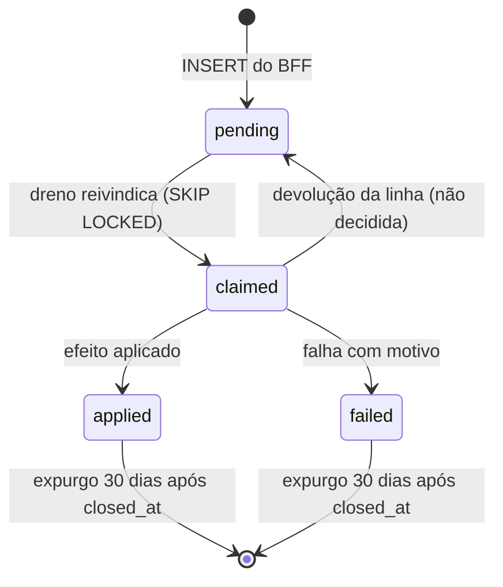

> Pergunta: "que estados uma concessão tem, o que o banco recusa e o que continua sem operação decidida?"
> Público: Produto / gestão e arquitetura
> Dono: equipe do `wyd-db`
> Base: `migrations/0012_ops_delivery.md` §4 e §6–§10; `docs/dicionario-dados/dominio-ponte-web-jogo.md`; `docs/roadmap/WYDDB-018.md`; `lacunas.md` `M17`, `M25`; `docs/specs/requisitos-funcionais.md` `RF-DB-009`
> Revisado em: 2026-11-24

**Estado:** proposto (2026-11-24)

Grant tem **quatro valores de estado** e nenhum é “expirado”: a fila não tem relógio. `pending` é o
pedido na fila, `claimed` é a linha que um processo tomou para si, `applied` e `failed` são os dois
desfechos. “Entregue” não é estado de produto: `applied` diz que o dreno fechou a linha, não que o efeito
foi provado uma única vez.

## Níveis de afirmação

| Nível | O que cobre nesta página | Fonte local |
|---|---|---|
| `V` | colunas, `CHECK`s, índice de pendentes e política de retenção | `0012` §4–§8; `M25` |
| `P` | consumidor que move `pending` → `claimed` → desfecho | `WYDDB-018` |
| `H` | recuperação de linha reivindicada e garantia de ordem | lacunas declaradas nesta página |
| sem marca | comportamento do PostgreSQL | `padrao-banco.md` §13 |

## Diagrama

A seta `claimed → pending` está no diagrama porque o schema a permite: `ck_delivery_queue_reivindicacao`
exige apenas que `status <> 'pending'` equivalha a `claimed_at IS NOT NULL`, e limpar os dois volta a linha
para a fila. **Nenhuma fonte decide quando** essa devolução acontece; ela não é uma transição suportada por
contrato.

## Tabela de transições

| Estado | Evento | Guarda | Próximo estado | Efeito no banco |
|---|---|---|---|---|
| `inexistente` | pedido do staff | chave nova; destino e campos coerentes com `kind` | `pending` | `INSERT`; `status` default, `attempt_count = 0`, carimbos nulos |
| `pending` | dreno reivindica | linha lida com `FOR UPDATE SKIP LOCKED` | `claimed` | `status = 'claimed'`, `claimed_at = now()`; `attempt_count` é do dreno |
| `claimed` | efeito aplicado | efeito confirmado no quente | `applied` | `status = 'applied'`, `closed_at = now()` |
| `claimed` | falha | motivo de 1–200 caracteres | `failed` | `status = 'failed'`, `closed_at`, `failure_reason` |
| `claimed` | devolução | **não decidida** | `pending` | `status = 'pending'`, `claimed_at = NULL`; o schema aceita, o contrato não cobre |
| `applied` | expurgo | 30 dias após `closed_at` | — | `DELETE` da linha pela operação (`M25`) |
| `failed` | expurgo | 30 dias após `closed_at` | — | `DELETE` da linha pela operação (`M25`) |

`pending` **nunca** é expurgada (`M25`): fila parada cresce e é sinal de dreno quebrado, não de retenção.
`applied` e `failed` têm `ix_delivery_queue_fechadas` justamente para essa varredura.

## O que o schema garante

| Situação | Objeto | Resultado |
|---|---|---|
| estado fora dos quatro | `ck_delivery_queue_estado` | `23514` |
| `pending` com `claimed_at`, ou reivindicada sem carimbo | `ck_delivery_queue_reivindicacao` | `23514` |
| `applied`/`failed` sem `closed_at`, ou aberta com carimbo | `ck_delivery_queue_fechamento` | `23514` |
| `failed` sem motivo, ou motivo em linha que não falhou | `ck_delivery_queue_motivo` | `23514` |
| fechamento antes da reivindicação | `ck_delivery_queue_ordem` | `23514` |
| tentativas negativas | `ck_delivery_queue_tentativas` | `23514` |
| reenvio da mesma chave | `uq_delivery_queue_idem` | `23505` |
| destino inexistente | `fk_delivery_queue_*` | `23503` |
| apagar conta ou personagem com linha na fila | `fk_delivery_queue_*` (`RESTRICT`) | `23503` |

`RESTRICT` vale para **qualquer** linha, não só `pending`: um grant `applied` que ainda não foi expurgado
continua impedindo a remoção física da conta ou do personagem (`RF-DB-009`).

## Estados proibidos, por camada

| Estado ou transição | Quem impede | O que não impede |
|---|---|---|
| estado inventado (`done`, `expired`) | banco (`ck_delivery_queue_estado`) | — |
| `failed` sem motivo | banco (`ck_delivery_queue_motivo`) | motivo genérico não vazio passa |
| `applied` sem efeito real | nenhuma constraint: o banco só vê o carimbo | dreno marcando `applied` antes de aplicar; é o risco de ordem de `WYDDB-018` |
| dois efeitos para a mesma chave | `uq_delivery_queue_idem` impede a segunda **linha** | duas aplicações da mesma linha por dois processos; é o teste de dreno |
| expiração automática | nenhuma: não há coluna de prazo | linha parada em `claimed` para sempre |
| reenvio após o expurgo | nada: a chave deixa de existir com a linha | duplicação de pedido depois de 30 dias |

## Relação com o ledger

A fila **não é ledger**. `applied` registra que o dreno fechou o pedido; o saldo real de moeda está em
`game.account_wallet`, com histórico em `game.account_ledger` (`M16`). Um grant de `gold` aplicado sem
linha de ledger é defeito de implementação, não estado representável na fila.

O mesmo vale para item: a linha de `item` aplicada não prova que `game.character_item` recebeu o
exemplar; a prova é do teste de sistema de `WYDDB-019`.

## Dependências externas e lacunas declaradas

| Item | Tipo | O que falta | Dono / marco |
|---|---|---|---|
| consumidor e ordem de marcação | implementação | marcar antes ou depois do efeito é decisão de transação que o teste deve fixar | `WYDDB-018` |
| devolução de `claimed` órfão | regra | quando e por quem a linha volta a `pending` | `WYDDB-018`, `H` |
| limite de tentativas | regra | teto de `attempt_count` e efeito de atingi-lo | `WYDDB-018` |
| expurgo | rotina | `DELETE` das linhas fechadas roda com papel de manutenção | operação + `wyd-ops` |
| ordem entre pedidos | medição | a leitura é por `id`; a garantia de aplicação em ordem não foi medida | `H` desta página |
| interface do staff | contrato | quem enfileira e por qual rota é do `wyd-admin` | `wyd-admin` |

## Rastreabilidade

| Fonte | O que sustenta |
|---|---|
| `0012` §4 | colunas, `CHECK`s de estado e índices |
| `0012` §7 | invariantes do ciclo e o que o banco não expressa |
| `0012` §10 | `M25`: dreno com `SKIP LOCKED`, `claimed` antes de aplicar, retenção |
| `M17` | chave única do pedido e janela de replay de 24 h |
| `M25` | retenção: 30 dias após `closed_at`; `pending` nunca expurgada |
| `RF-DB-009` | linha na fila impede apagar conta e personagem |
| `dominio-ponte-web-jogo.md` | leitura do domínio e armadilhas de estado |

## O que esta página não decide

- Não cria consumidor, transição de devolução, coluna de prazo, tabela ou rotina de expurgo.
- Não transforma `claimed → pending` em operação suportada nem define quem a executa.
- Não afirma que `applied` prova o efeito: a prova é teste do consumidor.
- Não define o formato do pedido, a rota do staff nem o papel que concede.
- Não trata compra de cash, débito de crédito nem estado de item; são de
  [`../fluxos/compra-e-credito.md`](../fluxos/compra-e-credito.md) e
  [`item-e-refino.md`](item-e-refino.md).
