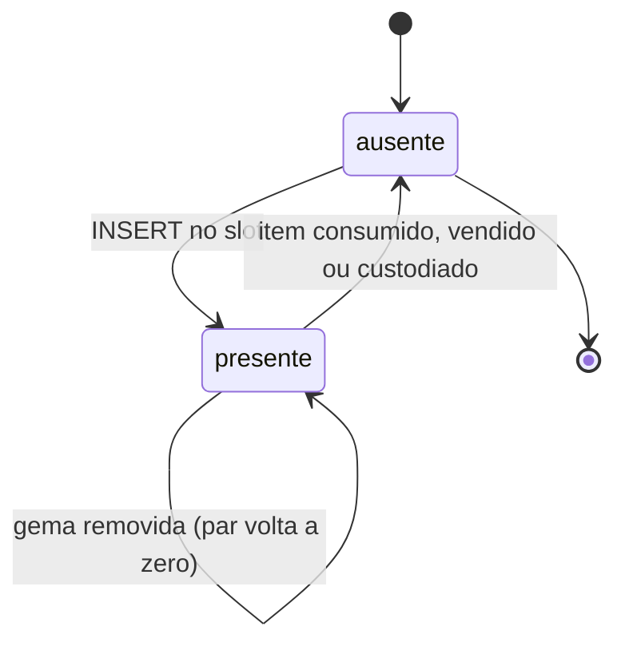

> Pergunta: "que estados um exemplar de item tem, como o refino e a gema são limitados e o que continua sendo regra de jogo?"
> Público: Produto / gestão e arquitetura
> Dono: equipe do `wyd-db`
> Base: `migrations/0009-game-inventory.md` §4 e §6–§10; `migrations/0021-content-rules.md` §4 e §6–§10; `migrations/0022-content-overrides.md` §4 e §6–§10; `docs/dicionario-dados/dominio-inventario.md`; `docs/dicionario-dados/dominio-refino.md`; `docs/glossario.md` (refino, gema, Anct, SANC); `docs/specs/requisitos-funcionais.md` `RF-DB-004`
> Revisado em: 2026-11-24

**Estado:** proposto (2026-11-24)

O banco guarda o **exemplar**, não a regra. Um item é uma linha em `game.character_item` (personagem,
`slot` 0–79) ou em `game.vault_item` (baú da conta, `slot` 0–127) com `qty`, `refine`, `ancient` e o par
`gem_effect`/`gem_value`. A chance de refino, o efeito da gema e a receita do acessório vivem em
`content.*` (`0021`), com override de staff em `0022`. “Refinado”, “com Anct” e “com gema” são
**combinações de coluna**, não valores de um campo de estado.

## Níveis de afirmação

| Nível | O que cobre nesta página | Fonte local |
|---|---|---|
| `V` | colunas, `CHECK`s, FKs, índices e overrides já desenhados | `0009`, `0021`, `0022` |
| `P` | seed das regras e aplicação do override no runtime | `0023`; `COALESCE` de `0022` |
| `H` | qual regra vale para cada item, o que move a piedade e o efeito de falha | lacunas declaradas nesta página |
| sem marca | comportamento do PostgreSQL | `padrao-banco.md` §13 |

## Diagrama

`refine` não tem estado próprio: um item “+0” e um “+15” são a mesma linha com valores diferentes. A
seta de saída vale para `DELETE` da linha — consumo, venda ou custódia —, e é ela que apaga a piedade do
slot pela FK em cascata.

## 1. O que a linha guarda

| Coluna | Faixa / regra | Objeto | Observação |
|---|---|---|---|
| `slot` | 0–79 no personagem; 0–127 no baú | `ck_character_item_slot`, `ck_vault_item_slot` | é a **posição no inventário**, não a vaga de personagem (0–3) nem a de conta (1–5) |
| `item_index` | número do cliente | sem FK para `content.item_catalog` | o catálogo é de `0014`, posterior na série; a integridade é do seed e da aplicação |
| `qty` | `>= 1` | `ck_*_qtd` | item com zero é ausência de linha, não linha zerada |
| `refine` | 0–15 | `ck_*_refino` | teto do campo; o teto por item é de conteúdo (`H`) |
| `ancient` | booleano | — | marca do exemplar; dispensa o `+10` para gema |
| `gem_effect` / `gem_value` | 0–4 e `>= 0`, ambos ou nenhum | `ck_*_gema`, `ck_*_gema_par` | efeito sem valor e valor sem efeito são recusados |
| `flags` | inteiro | — | campo do `STRUCT_ITEM` sem semântica documentada (`H`) |

O baú tem as mesmas colunas de instância, mas **não tem piedade**: `game.refine_pity` referencia
`game.character_item (character_id, slot)` e não existe linha equivalente para `vault_item`.

## 2. Tabela de transições

| Estado | Evento | Guarda | Próximo estado | Efeito no banco |
|---|---|---|---|---|
| `ausente` | item entra no slot | slot livre; `qty >= 1` | `presente` | `INSERT`; `refine`, `ancient` e gema com defaults |
| `presente` | quantidade muda | `qty >= 1` | `presente` | `UPDATE qty`; zero significa apagar a linha |
| `presente` | refino sobe | `refine <= 15` | `presente` | `UPDATE refine`; `updated_at` pelo trigger |
| `presente` | refino desce | `refine >= 0`; com gema exige `ancient` ou `refine >= 10` | `presente` | `UPDATE refine`; abaixo de +10 com gema e sem `ancient` é recusado |
| `presente` | item vira Ancient | nenhuma no schema | `presente` | `UPDATE ancient = true` |
| `presente` | gema aplicada | `ancient` **ou** `refine >= 10` | `presente` | `UPDATE gem_effect`, `gem_value` no mesmo comando |
| `presente` | gema removida | — | `presente` | `UPDATE` dos dois para zero, juntos |
| `presente` | item sai do slot | — | `ausente` | `DELETE`; `refine_pity` do slot cai por `CASCADE` |
| `presente` | personagem com soft-delete | `deleted_at` preenchido | `presente` | linha preservada; o `CASCADE` só age no `DELETE` físico |
| `presente` | personagem ou conta apagada fisicamente | — | `ausente` | `CASCADE` remove item, baú e piedade |

A última linha de soft-delete é a da página de [personagem](personagem.md): `deleted_at` não toca no
inventário; apagar de verdade, sim.

## 3. Estados proibidos, por camada

| Estado ou transição | Quem impede | O que não impede |
|---|---|---|
| duas linhas no mesmo slot | banco (`pk_character_item` / `pk_vault_item`) | trocar o `item_index` do slot por `UPDATE` |
| quantidade zero | banco (`ck_*_qtd`) | `qty` alto sem limite de negócio |
| refino acima de +15 | banco (`ck_*_refino`) | subir de +15 para +15 repetidamente |
| gema sem valor, ou valor sem gema | banco (`ck_*_gema_par`) | efeito 1–4 com valor arbitrário |
| gema em item comum abaixo de +10 | banco (`ck_*_gema_refino`) | gema em Ancient de qualquer refino |
| piedade sem item no slot | banco (`fk_refine_pity_item`) | piedade sobrevivendo à troca do item no slot |
| piedade acima de 20 | banco (`ck_refine_pity_valor`) | subir e descer o contador pelo runtime |
| item de personagem inexistente | banco (`fk_character_item_character`) | `item_index` fora do catálogo |
| portal lendo inventário cru | permissão (sem `USAGE` em `game`) | leitura administrativa pela view de `0029` |

**A troca de item no slot não zera a piedade.** A FK é por `(character_id, slot)`, então `UPDATE
item_index` mantém a linha de `refine_pity`; só o `DELETE` do item a remove. Nenhuma fonte decide se a
troca deveria zerar o contador — é lacuna declarada, não regra desta página.

## 4. A regra de refino vem de `content`

| Tabela | Chave | O que fixa | O que não fixa |
|---|---|---|---|
| `content.refine_rate` | `(kind, step)` | `kind` em `dust`/`compose`; passo 1–15; taxa 0–10000 bps | qual `kind` vale para qual item, e qual passo corresponde ao refino atual |
| `content.refine_gem_effect` | `item_index` | efeito (`FK` para `item_effect`), valor fixo e por nível, faixa de refino, se aceita Ancient | como o efeito é somado ao atributo |
| `content.sanc_rate` | `(powder, refine_index)` | pó `PO`/`PL`/`AMAGO`; índice 0–15; taxa em bps | o que fazer quando a célula não existe |
| `content.combine_value` | `(family, key)` | exatamente uma unidade: taxa em bps **ou** moeda | a semântica de cada família |
| `content.accessory_refine_rule` | `(kind, recipe, step_from)` | `step_to = step_from + 1`; falha `keep`/`reset`/`destroy`; bônus e material | receitas e valores — dependem do seed `0023`, que segue `bloqueada` |

**Taxa ausente é ausência de linha, nunca 0%** (`0021` §8, escolha 10). O `CHECK` não permite gravar uma
célula sem fonte: quem não tem taxa simplesmente não tem linha, e o runtime decide o que fazer — decisão
que ainda não existe.

## 5. Override de staff

`0022` cria uma tabela de override para `refine_rate`, `sanc_rate` e `combine_value`, com **a mesma PK** da
base e FK composta `ON DELETE CASCADE`. As regras fechadas:

| Regra | Efeito |
|---|---|
| override sem linha base | impossível (`fk_*_override_base`) |
| apagar o override | volta ao valor da base; `DELETE` é o reset, sem tombstone |
| leitura | substituição **da linha inteira**, não `COALESCE` coluna a coluna |
| autoria | `updated_at` na tabela; quem editou e o valor anterior ficam em `ops.config_change` (`0002`) |
| escrita | só `wyd_portal`, com `SELECT, INSERT, UPDATE, DELETE`; `wyd_game` continua sem escrita em `content` |
| base | `0021` é seed-only e read-only em runtime |

`accessory_refine_rule` **não** tem override: a decisão de 2026-11-20 manteve o acessório como base
seed-only, sem edição de staff.

## 6. O que o schema não garante

| Propriedade | Por que não é do schema | Dono |
|---|---|---|
| qual regra de refino se aplica ao item | `refine_rate` tem `kind`/`step`, não `item_index`; a seleção é de código | `wyd-sim`/`wyd-core`, `H` |
| o que incrementa e o que zera a piedade | o contador é 0–20; o gatilho é regra de jogo | runtime, `H` |
| sucesso de Anct devolve a arma a +7 | o `CHECK` aceita `ancient` em qualquer refino | produto + `wyd-sim`, `H` |
| custo em ouro ou material do refino | `combine_value.coin` e `accessory_refine_rule.gold_cost` existem; a cobrança não tem contrato | `wyd-core` |
| efeito de `keep`/`reset`/`destroy` na falha | o valor está em `content`; a aplicação no exemplar não tem contrato | `wyd-core` |
| remoção de gema | o `UPDATE` do par para zero é permitido; não há operação de porta | `wyd-core` + `wyd-db` |
| slot 0–15 é equip e 16–79 é mochila | o `CHECK` só limita 0–79 | regra de jogo, `H` |
| `flags` do exemplar | sem semântica documentada | cliente 7662, `H` |
| teto de refino por item | não há coluna; vem do catálogo/conteúdo | curadoria, `H` |

## 7. Dependências externas e lacunas declaradas

| Item | Tipo | O que falta | Dono / marco |
|---|---|---|---|
| seed das regras (`0023`) | dado | valores de refino, SANC, composição e acessório não verificados; a página está `bloqueada` | curadoria + cliente 7662 |
| contrato de carga e save de item | contrato | C4 não tem `load_inventory` nem save de item | `wyd-core` + `wyd-db`, onda 3 |
| regra de refino | regra | seleção de `kind`/`step`, custo e efeito de falha | `wyd-sim` + `wyd-core` |
| piedade | regra | quando sobe, quando zera e o que acontece na troca de item | `wyd-core` |
| catálogo de item | conteúdo | `item_index` sem FK; nome, preço e efeito dependem de `0014` e do seed | curadoria |
| custódia de mercado | schema | o item sai da mochila por `DELETE` e nasce em `game.market_escrow` (`0034`) | [`dominio-economia.md`](../../dicionario-dados/dominio-economia.md) |

## Rastreabilidade

| Fonte | O que sustenta |
|---|---|
| `0009` §4 e §6 | DDL, colunas e faixas de `character_item`, `vault_item` e `refine_pity` |
| `0009` §7 | invariantes, `CASCADE` e o que o banco não expressa |
| `0009` §10 | baú por conta, `qty` sem durabilidade e piedade por `(personagem, slot)` |
| `0021` §4 e §6 | cinco tabelas de regra, unidades em bps e moeda inteira |
| `0021` §8 | decisões de 2026-11-20, incluindo “ausência de taxa não é zero” |
| `0022` §4 e §7 | override com mesma PK, `CASCADE`, `DELETE` como reset e escrita do portal |
| `RF-DB-004` | baú pertence à conta, não ao personagem |
| `dominio-refino.md` | leitura do domínio, armadilhas e `H` de cada família |

## O que esta página não decide

- Não cria coluna de estado, tabela de histórico de refino, operação de porta ou migration.
- Não define qual regra de refino vale para cada item, nem o custo, o bônus ou o efeito de falha.
- Não transforma a troca de item no slot em reset de piedade, nem afirma que Anct volta a arma a +7.
- Não cobre catálogo, preço, custódia de mercado nem save de inventário.
- Não promove as colunas de `0021`/`0022` a `P`: a semântica de cada família continua `H` até o trace.
