> Pergunta: "que estados um personagem pode ter, o que o banco guarda e o que ainda não é uma transição decidida?"
> Público: Produto / gestão e arquitetura
> Dono: equipe do `wyd-db`
> Base: `migrations/0006-game-character.md` §4–§7; `migrations/0007-game-session.md` §6.2 e §7; `lacunas.md` `A14`; `guia-desenvolvedor/portas-e-contratos.md` §5; `../../dicionario-dados/dominio-personagem.md` §Ciclo de vida
> Revisado em: 2026-11-24

**Estado:** proposto (2026-11-24)

O banco não tem coluna de status de personagem. O único estado persistido é **vivo** (`deleted_at IS
NULL`) ou **apagado** (`deleted_at` preenchido). “Criado”, “ativo” e “restaurado” são nomes de evento ou
de produto; os dois primeiros não mudam a linha, e o terceiro **não tem operação fechada**. Esta página
separa o que o schema garante do que o contrato C4 decide e do que ainda depende de decisão.

## Níveis de afirmação

| Nível | O que cobre nesta página | Fonte local |
|---|---|---|
| `V` | coluna, `CHECK`, índice, FK e efeito de soft-delete já desenhados | `0006`, `0007`, 2026-11-24 |
| `P` | restauração e operação de exclusão que ainda não têm contrato | `A14`, `portas-e-contratos.md` §5 |
| `H` | transição sem fonte fechada | lacuna declarada nesta página |
| sem marca | comportamento do PostgreSQL | `padrao-banco.md` §13 |

## Diagrama

```mermaid
stateDiagram-v2
    [*] --> vivo: INSERT válido (criado)
    vivo --> vivo: UPDATE de progressão/estado
    vivo --> apagado: UPDATE deleted_at (soft-delete, A14)
    apagado --> restaurado: limpar deleted_at (não decidido)
    restaurado --> vivo: se nome e vaga livres (não decidido)
    vivo --> [*]: DELETE físico (schema permite; fora do fluxo A14)
    apagado --> [*]: DELETE físico (schema permite; fora do fluxo A14)
```

`restaurado` está no diagrama apenas para mostrar onde a transição **seria** colocada; ela não é uma
operação suportada por C4 nem uma decisão de produto. O caminho `DELETE` físico também não é o fluxo
decidido: `A14` exige soft-delete, mas o DDL não revoga `DELETE` nem instala gatilho que o impeça.

## Estado observado e estado de produto

| Nome usado no produto | O que existe na linha | O que o banco consegue provar |
|---|---|---|
| criado | `id`, `account_id`, `created_at` e os defaults de `0006` | que a linha existe; não há coluna “nunca jogou” |
| ativo | `deleted_at IS NULL` | que a linha está disponível para leitura/seleção; não há coluna `status` |
| em jogo | `game.session.character_id` aponta para ele em sessão viva | que existe uma sessão viva; o estado principal continua vivo |
| apagado | `deleted_at IS NOT NULL` | que a linha foi marcada; a linha não é removida |
| restaurado | não há operação | nada: a transição não foi decidida |

“Ativo” não é um segundo estado do personagem. Uma linha viva pode estar sem sessão, com sessão aberta
sem seleção ou com sessão selecionada; `game.session` é quem registra a seleção, e o índice
`ux_session_viva_por_personagem` impede duas sessões vivas apontando para o mesmo personagem.

## Tabela de transições

| Estado | Evento | Guarda | Próximo estado | Efeito no banco |
|---|---|---|---|---|
| `inexistente` | criação | `account_id` existente; `content_version` existente; `slot` 0–3; nome 1–16; classe 0–5; nível 1–400; `tier` válido | `vivo` | `INSERT game.character`; `created_at`/`updated_at` por default; `deleted_at` nulo; satélites **não** são automáticos |
| `vivo` | progressão/estado | `deleted_at IS NULL` | `vivo` | `UPDATE` dos campos; `updated_at` pelo trigger `trg_character_set_updated_at` |
| `vivo` | soft-delete (`A14`) | personagem vivo | `apagado` | `deleted_at` recebe instante; se houver sessão viva, ela é encerrada com `released_reason = 'character_deleted'` |
| `apagado` | restauração | **não decidida** | `restaurado` | não existe operação; limpar `deleted_at` é apenas a forma possível, não uma regra |
| `restaurado` | retorno à vida | **não decidida** | `vivo` | não existe operação; nome e vaga voltariam a concorrer nos índices parciais |
| `vivo` | `DELETE` físico | nenhuma no schema | — | `DELETE` remove a linha e cascateia satélites/inventário; não é o fluxo de `A14` |
| `apagado` | `DELETE` físico | nenhuma no schema | — | idem; a linha histórica deixa de existir |

**Sobre a linha de soft-delete.** `A14` decide que apagar personagem derruba a sessão e registra o
motivo, mas não diz se o `UPDATE` do personagem e o `UPDATE` da sessão são uma transação, uma chamada do
core ou um gatilho. O DDL de `0006` não tem gatilho de exclusão e o de `0007` não tem gatilho de
liberação. A página não inventa essa atomicidade; ela é uma lacuna de implementação.

## O que o schema garante

| Situação | Objeto | Resultado |
|---|---|---|
| duas linhas vivas com o mesmo nome dobrado | `ux_character_nome` | `23505` |
| duas linhas vivas na mesma vaga da mesma conta | `ux_character_vaga` | `23505` |
| nome vazio ou acima de 16 após `btrim` | `ck_character_nome` | `23514` |
| vaga fora de 0–3 | `ck_character_vaga` | `23514` |
| classe, nível ou `tier` fora da faixa | `ck_character_classe`, `ck_character_nivel`, `ck_character_tier` | `23514` |
| `deleted_at` anterior a `created_at` | `ck_character_exclusao` | `23514` |
| segunda sessão viva para o mesmo personagem | `ux_session_viva_por_personagem` | `23505` |
| remoção física de personagem referenciado por sessão | `fk_session_character` (`RESTRICT`) | `23503` |
| seleção de personagem de outra conta ou apagado | contrato C4 | `InvariantViolation`; o banco sozinho não compara as contas |

O soft-delete libera nome e vaga porque os dois índices são parciais (`WHERE deleted_at IS NULL`). Isso
não é uma restauração: é reutilização de nome/vaga por uma linha **nova** depois que a antiga foi
marcada.

## Estados proibidos, por camada

| Estado ou transição | Quem impede | O que não impede |
|---|---|---|
| dois personagens vivos com o mesmo nome | banco (`ux_character_nome`) | grafias diferentes que dobram para o mesmo `name_fold` são o mesmo nome |
| duas linhas vivas na mesma vaga da conta | banco (`ux_character_vaga`) | uma linha apagada e uma viva na mesma vaga convivem |
| personagem apagado sendo selecionado | C4 | o `UPDATE` direto no banco pode gravar `character_id`; não há constraint que leia `deleted_at` |
| personagem de outra conta sendo selecionado | C4/adapter | a FK de `session.character_id` só verifica existência, não titularidade |
| duas sessões vivas para o mesmo personagem | banco (`ux_session_viva_por_personagem`) | uma sessão liberada não conta, por causa do índice parcial |
| apagar fisicamente como fluxo normal | `A14` decide soft-delete | o schema aceita `DELETE` e cascateia; nenhum `REVOKE` foi decidido |
| restauração automática ou “desfazer” | nenhuma operação | a linha apagada continua existindo, mas não há contrato de retorno |

## Efeito nos dados vizinhos

- `game.character_status`, `character_scores`, `character_special` e `character_short_skill` são 1:1 com
  FK `ON DELETE CASCADE`; o soft-delete **preserva** essas linhas, o `DELETE` físico as apaga.
- `game.character_item` e `game.refine_pity` têm FK para `character` com `CASCADE`; o soft-delete
  preserva inventário e piedade, o `DELETE` físico os apaga (`0009`).
- `game.session.character_id` tem FK `RESTRICT`; enquanto a sessão existir, o personagem não pode ser
  removido fisicamente. A liberação da sessão usa `released_at` e `released_reason`, com o motivo
  `character_deleted` quando o evento é o soft-delete (`A14`, `0007`).
- A linha apagada mantém os valores de nome e vaga no histórico, mas eles não bloqueiam a
  **reutilização** por uma linha viva nova: os índices de unicidade são parciais.

## Restauração — não decidida

A lista de estados de `wyd-db-1.0.0.md` §6.7 inclui “restaurado”, mas nenhuma fonte fecha a operação:
não há `RestoreCharacter` em C4, não há coluna de estado, não há regra para conflito de nome/vaga e não
há decisão sobre auditoria, prazo ou quem pode restaurar. Limpar `deleted_at` é uma possibilidade do
schema, não uma autorização desta página. Enquanto a decisão não existir, **restaurado não é um estado
suportado**.

## Dependências externas e lacunas declaradas

| Item | Tipo | O que falta | Dono / marco |
|---|---|---|---|
| operação de exclusão de personagem | contrato | as operações de UoW de C4 são `OpenSession`, `SelectCharacter` e `ReleaseSession`; não há `DeleteCharacter` | produto + arquitetura, onda 3 |
| atomicidade exclusão + liberação da sessão | implementação | `A14` decide o efeito, não o mecanismo nem a transação | `wyd-core` + `wyd-db` |
| restauração | produto | operação, guarda de nome/vaga, auditoria e permissão | produto + arquitetura |
| regra de progressão entre `tier`s | regra de jogo | a sequência de `tier` está no `CHECK`; a progressão não tem trace | `wyd-core`/`wyd-sim`, `H` |
| posição e cena atuais | schema | não há coluna; só `recall_x`/`recall_y` | schema futuro |
| catálogo de classes | conteúdo | `content.game_class` é a fonte do mapa classe → nome | curadoria + cliente 7662 |
| leitura do personagem apagado | contrato | `load_character` devolve `None`; não há operação de consulta histórica | `wyd-core` + `wyd-db` |

## Rastreabilidade

| Fonte | O que sustenta |
|---|---|
| `0006` §4–§7 | linha, defaults, `CHECK`s, índices parciais, FK e soft-delete |
| `0007` §6.2 e §7 | `character_id`, sessão viva única por personagem e FK `RESTRICT` |
| `A14` | soft-delete derruba a sessão e registra `character_deleted` |
| `portas-e-contratos.md` §5 | `SelectCharacter`, `load_character` e a guarda de conta/exclusão |
| `RN-DB-002` | uma sessão viva por conta e por personagem |
| `dominio-personagem.md` §Ciclo de vida | nascimento, mudança, soft-delete e reutilização de nome/vaga |

Nenhum `RF-DB` cobre o ciclo de vida de personagem; os requisitos do domínio ainda não foram levantados
como `R`.

## O que esta página não decide

- Não cria `DeleteCharacter`, `RestoreCharacter`, gatilho, coluna de status, tabela, índice ou migration.
- Não transforma “restaurado” em operação suportada nem define conflito de nome/vaga na restauração.
- Não afirma que exclusão e liberação de sessão são atômicas.
- Não define progressão de nível/tier, posição, mapa, auditoria de exclusão ou retenção de personagem.
- Não impede `DELETE` físico por schema; isso exigiria decisão e mecanismo próprios.
