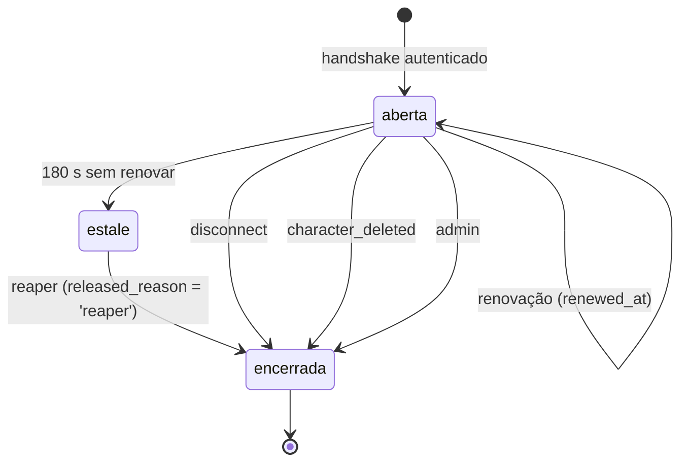

> Pergunta: "que estados uma sessão de jogo pode ter, quem a encerra e o que o banco recusa?"
> Público: Produto / gestão e arquitetura
> Dono: equipe do `wyd-db`
> Base: `ddl-confirmado.md` §5.5; `lacunas.md` `A10`, `A14`, `B5`; `rascunho-accounts.md` §3 e §5
> Revisado em: 2026-11-22

**Estado:** proposto (2026-11-22)

Sessão de jogo nasce no handshake autenticado e morre em `released_at`. "Única" não é estado: é
índice único parcial. "Expirada" também não é coluna: é o resultado do reaper sobre uma sessão sem
sinal de vida há 180 s. A página separa o que o banco guarda do que o processo calcula.

## Diagrama

`estale` é estado **observado** (`released_at IS NULL` e `renewed_at` antigo), não valor de coluna.
O reaper varre a cada 60 s e considera estale o que passou de 180 s (`A10`).

## Tabela de transições

| Estado | Evento | Guarda | Próximo estado | Efeito no banco |
|---|---|---|---|---|
| `aberta` | renovação | `renewed_at >= opened_at` | `aberta` | `UPDATE game.session SET renewed_at = now()` |
| `aberta` | 180 s sem renovar | cálculo do reaper | `estale` | nenhum `UPDATE` ainda |
| `estale` | reaper | varredura de 60 s | `encerrada` | `released_at = now()`, `released_reason = 'reaper'` |
| `aberta` | disconnect do canal | processo do canal | `encerrada` | `released_at = now()`, `released_reason = 'disconnect'` |
| `aberta` | personagem apagado | soft-delete (`A14`) | `encerrada` | `released_at = now()`, `released_reason = 'character_deleted'` |
| `aberta` | ação de staff | `wyd_admin` | `encerrada` | `released_at = now()`, `released_reason = 'admin'` |
| `encerrada` | reabrir a mesma linha | — | — | **proibido**: nova sessão é linha nova |

O `CHECK` `ck_session_motivo` amarra as duas pontas: viva não tem motivo; encerrada tem um dos quatro
motivos. Não existe "liberada sem motivo" nem "motivo sem liberação".

## Sessão única: o que o banco recusa

| Situação | Objeto | Erro |
|---|---|---|
| segunda sessão viva da mesma conta | `ux_session_viva_por_conta` | `23505` |
| segunda sessão viva do mesmo personagem | `ux_session_viva_por_personagem` (`character_id IS NOT NULL`) | `23505` |
| sessão em canal inexistente | `fk_session_canal` (composta `group_id, channel`) | `23503` |
| sessão em `channel = 0` (linha de status) | `ck_session_canal` | `23514` |
| sessão sem conta ou personagem existente | `fk_session_account` / `fk_session_character` (`RESTRICT`) | `23503` |
| liberação antes da abertura | `ck_session_liberacao` | `23514` |
| renovação antes da abertura | `ck_session_sinal` | `23514` |
| `released_at` sem motivo, ou motivo fora dos quatro | `ck_session_motivo` | `23514` |
| `character_id` nulo na seleção | permitido: a sessão nasce antes da escolha | — |
| duas sessões vivas de contas diferentes da mesma pessoa | **permitido** | — |

A última linha é a regra de multibox: cinco contas da mesma pessoa podem estar vivas ao mesmo tempo
(`RN-DB-003`); o banco só barra a repetição da **mesma** conta ou do **mesmo** personagem.

## O que a página não afirma

- Intervalo de renovação do cliente: não há número decidido; o que existe é o limiar de `stale`
  (180 s) e a varredura (60 s) do reaper (`A10`).
- Efeito de bloqueio de conta sobre a sessão viva: não decidido; o schema não tem gatilho.
- Retenção: 365 dias após `released_at` é de `M22`, não desta página.

## Requisitos cobertos

`RF-DB-006`, `RF-DB-014`; `RN-DB-002`, `RN-DB-003`.
