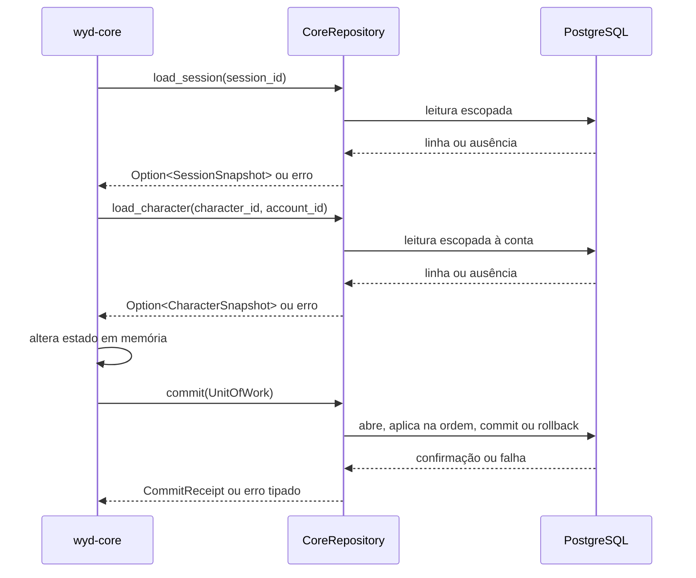

> Pergunta: "como o personagem selecionado chega ao core, o que é gravado e onde o save em lote ainda depende de decisão?"
> Público: Desenvolvedor novo e arquitetura
> Dono: equipe do `wyd-db`
> Base: `guia-desenvolvedor/portas-e-contratos.md` §5; `migrations/0006-game-character.md` §4–§6; `migrations/0007-game-session.md` §6.2; `migrations/0009-game-inventory.md` §4; `docs/roadmap/WYDDB-017.md`; `../../arquitetura/fronteira-hot-cold.md` §3–§4
> Revisado em: 2026-11-24

**Estado:** proposto (2026-11-24)

Carga e save são operações de **C4**, não de SQL solto: o core lê por `load_session` e
`load_character`, altera estado em memória e grava somente por `commit(UnitOfWork)`. A parte de save em
lote, porém, é **planejada** em `WYDDB-017` e pertence à fase 4; a primeira fatia não prova save. A
posição/cena é durável eventual, mas `game.character` não tem coluna de posição atual: só
`recall_x`/`recall_y`.

## Níveis de afirmação

| Nível | O que cobre nesta página | Fonte local |
|---|---|---|
| `V` | DDL, colunas e operações C4 existentes | `0006`, `0007`, `0009`, `portas-e-contratos.md` §5 |
| `P` | save em lote, flush de shutdown e checkpoint de posição | `WYDDB-017`; `LCORE-02` |
| `H` | conjunto de campos do snapshot e representação da versão otimista | lacuna declarada nesta página |
| sem marca | comportamento do PostgreSQL | `padrao-banco.md` §13 |

## Atores e gatilho

| Ator | Gatilho | Resultado | Fonte |
|---|---|---|---|
| `wyd-core` | sessão viva e personagem selecionado | chama `load_character` pela porta C4 | C4 |
| `CoreRepository` (adapter no `wyd-db`) | leitura ou `commit` | devolve snapshot, `CommitReceipt` ou erro tipado | C4 |
| `wyd-server` | release da sessão ou shutdown | checkpoint de posição no release; flush no shutdown é DoD planejado | `LCORE-02`, `WYDDB-017` |

## 1. Sequência de contrato

As duas leituras são **independentes**: C4 diz que elas não abrem uma transação longa nem garantem um
snapshot comum entre as chamadas. A ausência é `None`, nunca erro; o core decide se ela significa sessão
inexistente, personagem de outra conta ou personagem excluído.

## 2. O que a carga devolve

| Operação | Entrada | Saída fechada | Limite |
|---|---|---|---|
| `load_session` | identificador da sessão | `Option<SessionSnapshot>` ou erro tipado | o snapshot contém `session_id`, `account_id`, `character_id`, `group_id`, `channel`, `client_version`, `opened_at`, `released_at` e `released_reason` |
| `load_character` | identificador do personagem e da conta | `Option<CharacterSnapshot>` ou erro tipado | leitura escopada à conta; outra conta ou excluído é `None` |

`CharacterSnapshot` contém, por contrato, `character_id`, `account_id`, `deleted_at`, `content_version`
e “os campos de estado que a regra do primeiro domínio exigir”. O contrato **não enumera** esses campos
adicionais; esta página não os inventa nem copia todas as colunas de `0006`. `CharacterSnapshot` não é
uma entidade lazy nem um registro de tabela.

`SessionSnapshot` é a fotografia da sessão, mas não é um join com o personagem. `SelectCharacter` é uma
operação de escrita separada; a leitura do personagem não altera `game.session`.

## 3. Carga e seleção na fronteira

1. A sessão nasce com `character_id` nulo (`0007` §6.2). A seleção usa `SelectCharacter`, que grava o
   personagem somente se a sessão está viva, sem personagem, da mesma conta e o personagem não está
   excluído.
2. `load_character` recebe `character_id` **e** `account_id`; a conta faz parte da chave de leitura, não
   é só um filtro opcional. Personagem de outra conta é `None`.
3. A leitura não devolve linha crua nem SQLSTATE ao core; o adapter mapeia constraint e erro para
   `NotFound`, `VersionConflict`, `InvariantViolation`, `Unavailable` ou `CommitUncertain`.
4. A primeira fatia usa uma operação de escrita por comando, mas a UoW aceita mais de uma quando a
   atomicidade é necessária. O `wyd-db` é dono da transação; o core é dono da ordem e do conteúdo.
5. O adapter não está implementado: C4 é contrato fechado, não prova de execução. O `repo/pg.rs` que
   concentra SQL é planejado em `WYDDB-016`; o save é `WYDDB-017`.

## 4. Save em lote — planejado, não fechado

`WYDDB-017` planeja `transfer/save.rs` com **uma transação por lote**, **versão otimista** e erro que
nomeia o personagem sem expor PII. O DoD planejado inclui provar que um lote grava todos os campos ou
nenhum, que duas versões concorrentes não se sobrescrevem em silêncio e que o shutdown chama o flush.

O que a fonte **não** decide:

| Assunto | Estado | Consequência |
|---|---|---|
| tamanho do lote | fora de escopo por falta de medição | nenhum número é fixado |
| timeout | fora de escopo | nenhum limiar é fixado |
| política de retry | fora de escopo | não há retry automático decidido |
| representação da versão otimista | **não decidida** | `game.character` não tem coluna `version`; `0006` só tem `updated_at`, e a issue não diz que ele é a versão |
| transação do save | planejada como uma por lote | a implementação não existe |
| flush no shutdown | planejado no DoD | não há código nem teste executado |

A ausência de coluna de versão é uma lacuna declarada, não uma autorização para usar `updated_at` como
versão. Se a solução exigir coluna nova, ela muda o schema e precisa de decisão e migration próprias;
esta página não as cria.

## 5. Classificação do estado e posição

`LCORE-02` classifica:

| Classe | Exemplos | Quando grava |
|---|---|---|
| durável crítico | identidade, sessão, personagem, inventário, economia, progressão, quests e auditoria | antes do ack que depende do estado; falha impede o ack |
| durável eventual | posição e cena do personagem | aplicação em memória no passo; checkpoint no release da sessão; sem checkpoint periódico na primeira fatia |
| memória | buffers, caches, entidades, derivados e `content_version` | não grava; reconstrói ou descarta |

**Posição hoje.** `game.character` não tem mapa nem coordenada atual; só `recall_x` e `recall_y`, que são
a posição salva pela gema estelar e podem ser nulos (`0006` §6.1). O checkpoint de posição no release é
durável eventual, mas **não há coluna para gravá-lo**; `LCORE-02` declara que o checkpoint depende de
schema futuro e não inventa DDL. A primeira fatia não prova save.

O `CharacterSnapshot` contém `content_version`, mas C4 não define o que fazer quando a versão do
personagem diverge da versão vigente do catálogo. Essa regra não está nesta página.

## 6. Inventário não é carga desta porta

`LCORE-02` classifica inventário como durável crítico, mas C4 não expõe `load_inventory` nem uma
operação de save de item. `0009` tem `character_item` (slots 0–79), `vault_item` (slots 0–127) e
`refine_pity` (contador 0–20 por personagem/slot), mas essas tabelas não são tocadas por
`load_character` no contrato fechado.

Consequência: a página **não** afirma que o login carrega inventário, que o save em lote inclui item ou
que o fechamento da sessão grava item. O contrato dessa parte ainda não existe.

## 7. Tabelas e fronteira

| Tabela | Operação nesta porta | Fonte |
|---|---|---|
| `game.session` | leitura em `load_session`; escrita por `SelectCharacter`/`ReleaseSession` | `0007` |
| `game.character` | leitura em `load_character`; escrita por UoW de personagem | `0006` |
| `game.character_status`, `character_scores`, `character_special`, `character_short_skill` | o conjunto incluído no snapshot não está fechado | `0006`; lacuna declarada |
| `game.character_item`, `vault_item`, `refine_pity` | fora de C4; sem `load_inventory` ou save de item | `0009` |
| `content.content_version` | o snapshot carrega o identificador; não há operação de conteúdo nesta porta | `0001`/`0016` |

A escrita continua separada por papel: o jogo escreve `game`; o portal não escreve `game`. O detalhe da
fronteira hot/cold fica em `../../arquitetura/fronteira-hot-cold.md`.

## 8. Falhas previstas

| Falha | Onde aparece | Efeito |
|---|---|---|
| sessão ou personagem ausente | C4 | `None`; o core decide o significado |
| personagem de outra conta ou excluído | C4 | `None` na leitura; `InvariantViolation` na seleção |
| estado esperado divergiu | C4 | `VersionConflict`; recarrega e decide de novo |
| constraint de escrita | C4/adapter | `InvariantViolation`; nada é gravado |
| conexão, timeout ou conflito antes do commit | C4 | `Unavailable` com `retryable`; não há retry automático |
| commit aplicado sem resposta | C4 | `CommitUncertain`; nova leitura obrigatória, nunca reenvio cego |
| duas versões concorrentes no save | `WYDDB-017` | a segunda deve receber conflito; a forma depende da versão otimista ainda não decidida |
| lote grande demais | `WYDDB-017` | risco declarado; não há tamanho medido |
| shutdown com lote em memória | `WYDDB-017` | DoD exige flush; implementação não existe |

## 9. Dependências externas e lacunas declaradas

| Item | Tipo | Por que não está fechado | Dono / marco |
|---|---|---|---|
| adapter de C4 e `repo/pg.rs` | interna | contrato existe; implementação não | `WYDDB-016`/`WYDDB-017` |
| conjunto exato de `CharacterSnapshot` | interna | “campos que a regra do primeiro domínio exigir” não enumerado | `wyd-core` + `wyd-db` |
| versão otimista | schema | não há coluna de versão em `character` | arquitetura, decisão nova |
| posição e cena atuais | schema | não há coluna; só `recall_x`/`recall_y` | schema futuro, `LCORE-02` |
| carga e save de inventário | contrato | C4 não tem operação de item | `wyd-core` + `wyd-db`, onda 3 |
| `content_version` divergente | regra de jogo | C4 não define o comportamento | produto + arquitetura |
| tamanho, timeout e retry do lote | medição | `WYDDB-017` os deixa fora de escopo | `WYDDB-017` |
| cliente 7662 | externa | não é necessário para a porta C4, mas condiciona conteúdo, posição e catálogo | frente `wyd-client` |

## Rastreabilidade

| Fonte | O que sustenta |
|---|---|
| `LCORE-02` / `LCORE-04` | classificação durável × memória, porta C4 e `commit` como única escrita |
| `portas-e-contratos.md` §5 | operações, snapshots, erros e proibições da porta |
| `0006` §6.1 | ausência de mapa/posição atual e presença de `recall_x`/`recall_y` |
| `0007` §6.2 | `character_id` anulável e vínculo com a sessão |
| `0009` §4 | inventário, baú e piedade fora de C4 |
| `WYDDB-017` | save em lote, transação, versão otimista e flush de shutdown, todos planejados |
| `RN-DB-002` | uma sessão viva por conta e por personagem |
| `A14` | personagem apagado encerra a sessão com `character_deleted` |

Nenhum `RF-DB` cobre carga e save: requisitos de personagem e inventário não foram levantados como `R`.

## O que esta página não decide

- Não cria `CoreRepository`, adapter, `transfer/save.rs`, versão otimista, posição, tabela ou migration.
- Não enumera os campos de `CharacterSnapshot` que o contrato deixa para “a regra do primeiro domínio”.
- Não define tamanho de lote, timeout, política de retry, checkpoint periódico ou flush de shutdown.
- Não afirma que inventário, mapa ou posição atual são carregados ou salvos.
- Não define spawn, mapa inicial, regra de `content_version` divergente ou restauração de personagem.
