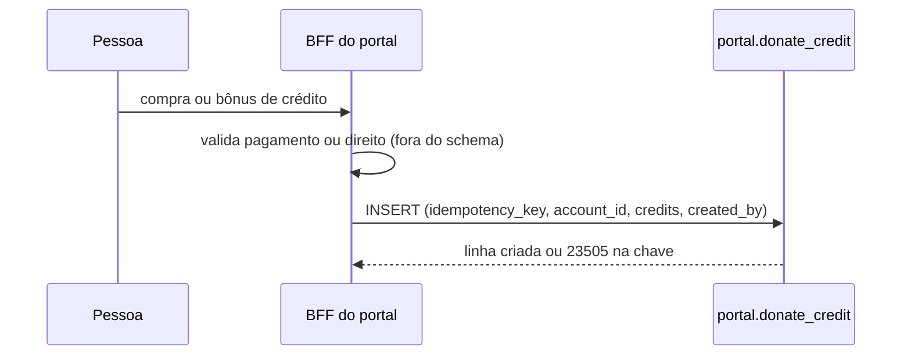
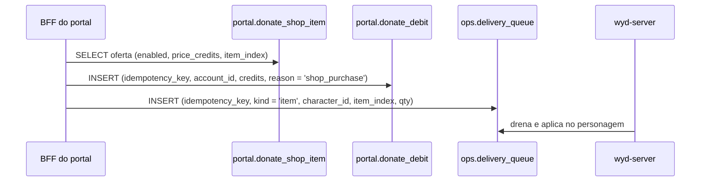

> Pergunta: "como o cash entra, como é gasto e por que o schema não garante saldo, entrega nem reconciliação?"
> Público: Produto / gestão e arquitetura
> Dono: equipe do `wyd-db`
> Base: `migrations/0011-game-economy.md` §4 e §6–§10; `migrations/0005-game-account.md` §4 e §6.2; `migrations/0012-ops-delivery.md` §2–§4; `docs/dicionario-dados/dominio-economia.md`; `docs/specs/requisitos-funcionais.md` `RF-DB-003`, `RF-DB-005`, `RF-DB-008`; `docs/roadmap/WYDDB-020.md`; `lacunas.md` `A19`, `M16`, `M17`
> Revisado em: 2026-11-24

**Estado:** proposto (2026-11-24)

Compra e crédito mexem em **dois dinheiros que não se convertem no schema**. O ouro de jogo é
`game.account_wallet.coin`, inteiro de 32 bits com histórico em `game.account_ledger` (`M16`). O cash é
`portal.donate_credit` e `portal.donate_debit`: duas tabelas de **extrato**, sem coluna de saldo — o saldo
é derivado. A compra com cash é um débito com motivo `shop_purchase`; a entrega do item comprado é da
fila `ops.delivery_queue` (`0012`).

## Níveis de afirmação

| Nível | O que cobre nesta página | Fonte local |
|---|---|---|
| `V` | DDL, `CHECK`s, índices, `GRANT`s e a ausência de saldo de cash | `0011` §4–§8; `0005` §4; `dominio-economia.md` |
| `P` | crédito/débito de moeda de jogo com registro de idempotência | `WYDDB-020` |
| `H` | conversão crédito × ouro, semântica de `duration_days`, entrega do bônus e reconciliação | lacunas declaradas nesta página |
| sem marca | comportamento do PostgreSQL | `padrao-banco.md` §13 |

## 1. Os dois lados do dinheiro

| Aspecto | Ouro de jogo | Cash do portal |
|---|---|---|
| Onde mora o saldo | `game.account_wallet.coin`, uma linha por conta | **não existe coluna de saldo**; `donate_credit`/`donate_debit` são extrato |
| Histórico | `game.account_ledger` (`delta`, `balance_after`, `reason`) | as duas tabelas de crédito e débito, cada uma com sua chave idempotente |
| Faixa | `0`–`2147483647` (`ck_account_wallet_coin`) | `credits > 0` em cada lançamento; sem `CHECK` de saldo |
| Quem escreve | `wyd_game` | `wyd_portal` |
| Escrita do staff | `wyd_admin` tem `SELECT, UPDATE` na carteira e `SELECT, INSERT` no ledger (`0032` §4) | não há `GRANT` de staff nas duas tabelas |
| Implementação | `WYDDB-020`, planejada | **nenhuma issue cobre cash**: `WYDDB-020` declara “não implementar loja ou cash” |

`A19` fixou a divisão: dinheiro real e cash em `portal`, preço e imposto de jogo em `game`. Ela não fixa
conversão entre os dois; a regra de crédito × ouro é contrato do BFF, e o schema só guarda os valores
(`dominio-economia.md` §`H`).

## 2. Crédito de cash

O banco garante uma linha por chave e valor positivo. Ele **não** guarda a cobrança: não há tabela de
pagamento, transação de cartão ou recibo em `0011`. `created_by` é um valor de pessoa/portal, sem FK.

## 3. Compra com cash

Quatro fatos fechados: a oferta exige `price_credits > 0` e `enabled`; o débito exige motivo
`portal` ou `shop_purchase`; a entrega é um grant de `item` e, portanto, exige `character_id`; e a fila
**não** aceita destino em baú de conta (nenhum `kind` endereça `game.vault_item`).

O que a fonte **não** fecha:

| Assunto | Estado | Consequência |
|---|---|---|
| vínculo entre o débito e a entrega | não existe coluna nem FK ligando `donate_debit` a `ops.delivery_queue` | as duas linhas têm chaves próprias; reconciliar exige comparação por dados, não por chave |
| transação do par débito + enfileiramento | não decidida | débito sem entrega e entrega sem débito são estados representáveis |
| reembolso ou estorno | não existe tabela nem motivo próprio | `donate_debit` não tem motivo `refund`; um crédito novo é a única forma representável, sem vínculo com o débito |
| entrega de item à conta | o grant exige personagem | item comprado para o baú não tem caminho na fila |
| `duration_days` da oferta | `H`, sem consumidor provado | nenhum contrato lê a duração; ela não vira expiração de item |
| preço do item | `content.item_catalog.base_price` é preço de catálogo; `donate_shop_item.price_credits` é preço em cash | são dois preços, e o schema não os relaciona |

## 4. Bônus diário e capa de reino

| Objeto | Garantia | O que falta |
|---|---|---|
| `portal.daily_reward_item` | `day` 1–7 ou nulo; `gold >= 0`; `qty > 0`; recompensa com item **ou** ouro (`ck_daily_reward_item_conteudo`) | qual linha vale para cada conta e como `account_wide` é aplicado |
| `portal.daily_reward_claim` | um resgate por `(account_id, claim_date)`: o segundo `INSERT` recebe `23505` (`RF-DB-005`) | como o item ou o ouro da recompensa é entregue: o claim não aponta para a fila |
| `portal.kingdom_cape_price` | linha única (`id = 1`), `version >= 1`, custo 4–32 nas duas moedas | a compra da capa não tem tabela de titularidade nem vínculo com débito |

A fronteira do dia é UTC por decisão de código, não por coluna (`RF-DB-005`). `claim_date` é `DATE` e o
banco só guarda a data.

## 5. O que o schema garante

| Situação | Objeto | Resultado |
|---|---|---|
| crédito ou débito zero/negativo | `ck_donate_*_valor` | `23514` |
| motivo de débito fora de `portal`/`shop_purchase` | `ck_donate_debit_motivo` | `23514` |
| reenvio da mesma chave | `uq_donate_credit_idem` / `uq_donate_debit_idem` | `23505` |
| oferta com preço ≤ 0 ou duração ≤ 0 | `ck_donate_shop_item_*` | `23514` |
| bônus vazio, dia fora de 1–7, quantidade ≤ 0 | `ck_daily_reward_item_*` | `23514` |
| segundo resgate da conta no mesmo dia | `uq_daily_reward_claim_dia` | `23505` |
| segunda linha de preço da capa | `pk_kingdom_cape_price` | `23505` |
| resgate apontando para recompensa inexistente | `fk_daily_reward_claim_reward` (`RESTRICT`) | `23503` |
| portal tentando ler `game` cru | permissão de `wyd_portal` (sem `USAGE` em `game`) | `42501` |

## 6. O que o schema não garante

| Propriedade | Por que não é do schema | Dono |
|---|---|---|
| saldo de cash não negativo | não existe coluna de saldo; dois débitos concorrentes podem exceder o total creditado | BFF, `H` |
| conta existente no lançamento de cash | `donate_*` e `daily_reward_claim` guardam `account_id` **sem FK**, por `P-17` | BFF |
| entrega do que foi comprado | o vínculo débito → fila não existe; a prova é de aplicação | BFF + `WYDDB-019` |
| reconciliação entre extrato e consumo | não há rotina, tabela de fechamento nem issue | operação, `H` |
| conversão crédito × ouro | contrato do BFF; nenhum número no schema | produto + `wyd-portal` |
| item do catálogo | `item_index` de `donate_shop_item` e `daily_reward_item` **sem FK** para `0014` | seed + aplicação |
| cobrança do crédito | `donate_credit` registra o crédito, não o pagamento | `wyd-portal`/provedor |

## 7. Falhas previstas

| Falha | Onde aparece | Efeito |
|---|---|---|
| pagamento aprovado e `INSERT` de crédito falhando | BFF | crédito não existe; conciliar com o provedor é processo externo |
| duplo clique na compra | chave idempotente | o segundo `INSERT` recebe `23505`; o BFF devolve o resultado da primeira |
| débito gravado e enfileiramento falhando | duas escritas | débito sem entrega; não há transação única decidida |
| fila drenada sem débito | aplicação | entrega sem cobrança; o schema não compara as duas linhas |
| resgate do bônus no mesmo dia | `uq_daily_reward_claim_dia` | `23505`; é o sinal de “já resgatou” (`RF-DB-005`) |
| crédito acima do total disponível | nenhum | o schema não tem saldo para recusar |
| reenvio depois da retenção da fila | chave expurgada | pedido pode ser enfileirado de novo; ver [`concessao-de-grant.md`](concessao-de-grant.md) §4 |

## 8. Dependências externas e lacunas declaradas

| Item | Tipo | O que falta | Dono / marco |
|---|---|---|---|
| implementação do cash | implementação | crédito, débito, saldo derivado e compra não têm issue; `WYDDB-020` exclui cash | `wyd-portal` + `WYDDB-020` (moeda de jogo) |
| crédito/débito de moeda de jogo | implementação | soma atômica, ledger e registro de idempotência | `WYDDB-020`, fase 4 |
| vínculo débito → entrega | contrato | nenhuma coluna ou chave liga as duas linhas | produto + arquitetura |
| saldo de cash | regra | derivar do extrato e recusar saldo negativo é do BFF; não há número nem rotina | `wyd-portal` |
| reconciliação | operação | rotina, periodicidade e dono não existem | operação + `wyd-ops` |
| entrega do bônus diário | contrato | `daily_reward_claim` não aponta para a fila | produto + arquitetura |
| conversão crédito × ouro | produto | taxa, momento e autorização | produto + `wyd-portal` |
| preço e duração da oferta | conteúdo | valores vêm de seed; `duration_days` segue `H` | curadoria + cliente 7662 |

## Rastreabilidade

| Fonte | O que sustenta |
|---|---|
| `0011` §4–§8 | DDL, `CHECK`s e `GRANT` das dez tabelas de economia |
| `0011` §10 | `A19`, `M16`, `M17` e os ponteiros para carteira, entrega e imposto |
| `0005` §6.2 | `account_wallet` e `account_ledger`, com `delta <> 0` e faixa de 32 bits |
| `0012` §2–§4 | fila de entrega do item comprado e seus campos por `kind` |
| `M16` | ledger da carteira: saldo derivado com histórico |
| `M17` | chave do BFF, única por tabela, janela de replay de 24 h |
| `A19` | cash e loja em `portal`; preço e imposto de jogo em `game` |
| `RF-DB-003` / `RF-DB-005` / `RF-DB-008` | faixa da moeda, resgate diário único e idempotência de donate |

## O que esta página não decide

- Não cria tabela de pagamento, saldo de cash, reembolso, conciliação ou vínculo entre débito e entrega.
- Não define taxa de conversão entre crédito e ouro, preço, duração de oferta nem regra de bônus.
- Não afirma que a compra entrega o item: o caminho é a fila, e a prova é do consumidor.
- Não cobre imposto de cidade, loja pessoal nem preço de mercador NPC (`0011` §2 e `dominio-economia.md`).
- Não trata o mercado entre jogadores (`0034`), que tem carteira e extrato próprios.
