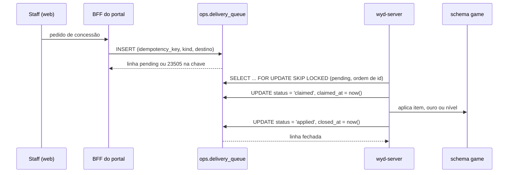

> Pergunta: "como um pedido da web vira grant, quem o aplica e em que ponto do caminho ele pode parar?"
> Público: Desenvolvedor novo e arquitetura
> Dono: equipe do `wyd-db`
> Base: `migrations/0012-ops-delivery.md` §4–§10; `migrations/0033-ops-idempotency.md` §5–§6; `migrations/0032-admin-grants.md` §4; `docs/dicionario-dados/dominio-ponte-web-jogo.md`; `docs/arquitetura/fronteira-hot-cold.md` §2; `docs/roadmap/WYDDB-018.md` e `WYDDB-019.md`; `lacunas.md` `M17`, `M25`, `A12`
> Revisado em: 2026-11-24

**Estado:** proposto (2026-11-24)

Grant é a **concessão que atravessa a fronteira frio → quente**: o portal enfileira um pedido, o servidor
de jogo drena e aplica. O banco guarda o pedido, o destino e o ponto do ciclo; ele **não** prova que o
efeito aconteceu uma única vez. Esta página descreve o contrato de dados fechado em `0012` e o registro de
idempotência de `0033`, e separa o que já está decidido do que depende do consumidor planejado em
`WYDDB-018`/`WYDDB-019`.

## Níveis de afirmação

| Nível | O que cobre nesta página | Fonte local |
|---|---|---|
| `V` | DDL, `CHECK`s, `GRANT`s e política de retenção da fila | `0012` §4–§8; `M25` |
| `P` | consumidor da fila, aplicação do grant e `repo/grants.rs` | `WYDDB-018`, `WYDDB-019` |
| `H` | limite de tentativas, prazo em `claimed`, garantia de ordem e quem pode enfileirar | lacunas declaradas nesta página |
| sem marca | comportamento do PostgreSQL | `padrao-banco.md` §13 |

## Atores e gatilho

| Ator | Gatilho | Resultado | Limite da fonte |
|---|---|---|---|
| Staff, na área administrativa da web | concede item, ouro ou nível | linha `pending` em `ops.delivery_queue` com o autor | quem pode enfileirar não é restrito pela tabela; autoria é `created_by_person_id` |
| BFF do portal | pedido do staff | `INSERT` com `idempotency_key` do pedido | permissão `SELECT, INSERT` (`0012` §8); o portal não escreve em `game` |
| `wyd-server` | varredura da fila | reivindica a linha e aplica o efeito no quente | o consumidor é planejado em `WYDDB-018`; não há implementação |
| Adapter do `wyd-db` | transação do dreno | efeito e marcação da linha (`claimed`/`applied`/`failed`) na mesma transação | `repo/grants.rs` é página planejada de `src/`, não escrita; o dreno **não** escreve `ops.idempotency_record` — o `wyd_game` não tem privilégio nela (`42501`) |

## 1. Sequência de contrato

O `SELECT … FOR UPDATE SKIP LOCKED` em transação curta, com `claimed`/`claimed_at` marcados antes de
aplicar, é a decisão de `M25` (`0012` §10, escolha 5). A linha `pending` é lida em ordem de `id` pelo
índice `ix_delivery_queue_pendentes`.

## 2. O que o pedido carrega

| `kind` | Destino obrigatório | Campos exigidos | Campos que precisam ser nulos | Fonte |
|---|---|---|---|---|
| `item` | `character_id` | `item_index`, `qty >= 1` | `gold_amount`, `level_delta` | `ck_delivery_queue_campos` |
| `gold` | `account_id` | `gold_amount > 0` | `item_index`, `qty`, `level_delta` | idem |
| `level` | `character_id` | `level_delta > 0` | `item_index`, `qty`, `gold_amount` | idem |

`account_id` e `character_id` são as FKs de destino (`RESTRICT`); `created_by_person_id` aponta para
`portal.person`, também `RESTRICT`, porque pessoa nunca é apagada (`A12`). `item_index` é o número do
cliente e **não tem FK** para `content.item_catalog`: o catálogo é de `0014` e a integridade é verificada
na aplicação (`0009` §7).

O grant de `item` entrega a um **personagem**, não ao baú da conta: não existe `kind` que enderece
`game.vault_item`, e o `CHECK` não aceita `character_id` nulo para esse tipo.

## 3. Recusas do banco

| Situação | Objeto | Resultado |
|---|---|---|
| duas linhas com a mesma chave do pedido | `uq_delivery_queue_idem` | `23505` |
| tipo fora de `item`/`gold`/`level` | `ck_delivery_queue_tipo` | `23514` |
| estado fora dos quatro do ciclo | `ck_delivery_queue_estado` | `23514` |
| item sem personagem ou sem `qty`; ouro sem conta; nível sem personagem; campo de outro tipo preenchido | `ck_delivery_queue_campos` | `23514` |
| `pending` com `claimed_at`, ou linha reivindicada sem carimbo | `ck_delivery_queue_reivindicacao` | `23514` |
| `applied`/`failed` sem `closed_at`, ou linha aberta com carimbo | `ck_delivery_queue_fechamento` | `23514` |
| `failed` sem motivo, ou motivo em linha que não falhou | `ck_delivery_queue_motivo` | `23514` |
| fechamento anterior à reivindicação | `ck_delivery_queue_ordem` | `23514` |
| conta, personagem ou pessoa autora inexistente | `fk_delivery_queue_*` | `23503` |
| conta ou personagem com qualquer linha na fila | `ON DELETE RESTRICT` | `23503` (`RF-DB-009`) |
| portal tentando `UPDATE`/`DELETE` na fila | permissão de `wyd_portal` | `42501` |
| jogo tentando `INSERT` ou `DELETE` na fila | permissão de `wyd_game` | `42501` |

A fila aceita mais de uma linha para o mesmo destino e o mesmo tipo: não há unicidade por
`(character_id, item_index)` nem por `(account_id, kind)`. Concessões repetidas de verdade são pedidos
distintos, com chaves distintas.

## 4. Duas chaves de idempotência, dois donos

| Chave | Onde mora | Quem escreve | Janela |
|---|---|---|---|
| `ops.delivery_queue.idempotency_key` | na própria fila (`UUID`) | BFF do portal, na criação do pedido | enquanto a linha existir; `applied`/`failed` são expurgadas 30 dias após `closed_at` (`M25`) |
| `ops.idempotency_record` | tabela do contrato C4 do `wyd-admin` | `wyd_admin`, na mesma transação da ação | 7 dias após `created_at` (`M30`) |

As duas **não se substituem**. `0033` registra o contrato HTTP do staff e declara explicitamente que não
guarda a chave da fila; a fila guarda a chave do pedido e não conhece o registro do `wyd-admin`.

Consequência declarada: `M17` fixa a janela de replay do BFF em **24 h**, mas a linha da fila vive até
**30 dias** após fechar. A chave protege por mais tempo do que a janela prometida — o que é seguro —, e
depois do expurgo o mesmo `UUID` volta a ser aceito. Reenviar um pedido depois da retenção não é protegido
pelo banco.

## 5. O que o banco não garante

| Propriedade | Por que não é do schema | Dono |
|---|---|---|
| efeito aplicado uma única vez | o `CHECK` garante coerência de estado, não o efeito no personagem ou na carteira | `WYDDB-018`, teste de dreno com dois processos (`M25`) |
| limite de tentativas | `attempt_count` só registra; o teto é política do dreno | `WYDDB-018` |
| prazo máximo em `claimed` | não há coluna de prazo nem expiração automática | `WYDDB-018` |
| ordem de aplicação entre pedidos | o índice entrega a leitura em ordem de `id`; a garantia de ordem não foi medida | `H` desta página |
| autorização de quem enfileira | a tabela não restringe papel; o `GRANT` é por schema | `wyd-admin`/produto |
| entrega ao baú da conta | `kind = 'item'` exige personagem | decisão de produto, se o baú precisar de destino |

## 6. Dependências externas e lacunas declaradas

| Item | Tipo | O que falta | Dono / marco |
|---|---|---|---|
| consumidor da fila | implementação | drenar, aplicar e fechar com efeito único | `WYDDB-018`, fase 4 |
| aplicação de grant | implementação | validação de conta/personagem, transação com o registro de idempotência | `WYDDB-019`, fase 4 |
| contrato de `repo/grants.rs` | contrato | a página de `src/` não existe; `portas-e-contratos.md` §4 registra a ausência | `wyd-db`, onda 7 |
| limite e retry do dreno | medição | `WYDDB-018` deixa fora de escopo; nenhum número fixado | `WYDDB-018` |
| recuperação de `claimed` órfão | regra | o schema permite voltar a `pending` zerando `claimed_at`; nenhuma fonte decide quando | `WYDDB-018` |
| autorização do staff que concede | regra | papel e rota vivem no `wyd-admin` | `wyd-admin` |
| destino em baú | produto | o grant entrega a personagem, não à conta | produto + arquitetura |

## Rastreabilidade

| Fonte | O que sustenta |
|---|---|
| `0012` §4–§8 | DDL, `CHECK`s, índices e `GRANT` da fila |
| `0012` §10 | escolhas de forma aprovadas, incluindo dreno e retenção de `M25` |
| `M17` | chave gerada pelo BFF, única por tabela, janela de replay de 24 h |
| `M25` | `SKIP LOCKED`, `claimed` antes de aplicar, expurgo 30 dias, `pending` nunca expurgada |
| `0033` §5–§6 | registro de idempotência do C4, retenção de 7 dias e separação das chaves |
| `RF-DB-009` | grant na fila impede apagar conta e personagem |
| `A12` | pessoa não é apagada, então a FK do autor pode ser `RESTRICT` |

## O que esta página não decide

- Não cria consumidor, `repo/grants.rs`, fila, tabela, índice ou rotina de expurgo.
- Não define frequência de drenagem, tamanho de lote, limite de tentativas ou prazo em `claimed`.
- Não afirma que a entrega é exactly-once; a garantia desenhada é efeito único por chave, provada por teste.
- Não define quem pode conceder, qual rota enfileira nem o formato HTTP do pedido — isso é do `wyd-admin`.
- Não cobre compra de cash, crédito de donate nem movimentação de `account_wallet`; essas são de
  [`compra-e-credito.md`](compra-e-credito.md).
