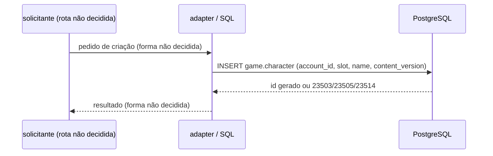
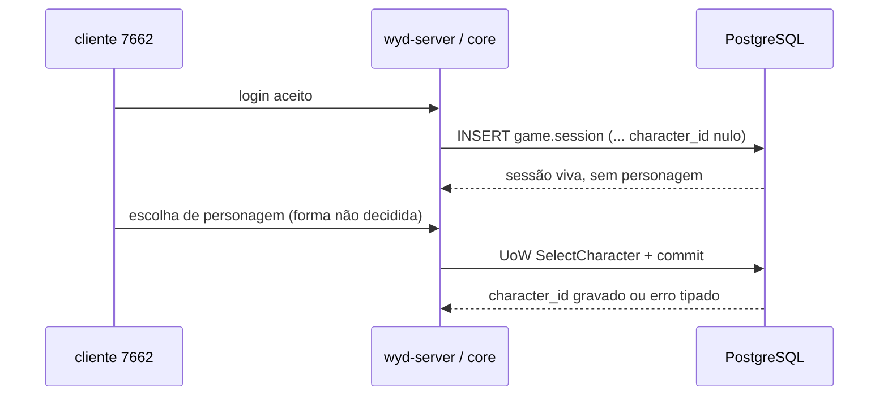

> Pergunta: "como um personagem nasce, como nome e vaga são reservados e como a sessão passa a apontar para ele?"
> Público: Produto / gestão e arquitetura
> Dono: equipe do `wyd-db`
> Base: `migrations/0006_game_character.md` §3–§7; `migrations/0007_game_session.md` §6.2 e §7; `migrations/0009_game_inventory.md` §4; `guia-desenvolvedor/portas-e-contratos.md` §5; `lacunas.md` `A14`; `pendencias-de-fechamento.md` §4.2
> Revisado em: 2026-11-24

**Estado:** proposto (2026-11-24)

Este fluxo tem duas metades com níveis de fechamento diferentes. **Criação** tem DDL fechado e nenhuma
operação de contrato: não existe `CreateCharacter` em C4. **Seleção** tem a operação `SelectCharacter`
fechada em C4, mas a autoridade sobre “o personagem pertence à mesma conta” é do adapter, não de uma
constraint. A página descreve só o que essas duas fontes decidem; a rota, a tela e o protocolo que
disparam a criação não estão decididos aqui.

## Níveis de afirmação

| Nível | O que cobre nesta página | Fonte local |
|---|---|---|
| `V` | coluna, `CHECK`, índice, FK e operação C4 já fechados | `0006`, `0007`, `portas-e-contratos.md` §5, 2026-11-24 |
| `P` | operação ou efeito planejado que ainda não existe | roadmap e C4, quando a fonte declara planejamento |
| `H` | lacuna nomeada, sem decisão | `lacunas.md` e dicionário, item citado |
| sem marca | comportamento do PostgreSQL | `padrao-banco.md` §13 |

## Atores e gatilho

| Ator | Gatilho | Resultado | Limite da fonte |
|---|---|---|---|
| Conta de jogo (`game.account`) | criação de uma linha de personagem | linha em `game.character`; satélites e inventário não são automáticos | o **solicitante** e a rota não estão decididos; C4 não tem operação de criação |
| Pessoa autenticada, via cliente 7662 | sessão de jogo aberta | `game.session` nasce com `character_id` nulo | o handshake é do fluxo de login, não desta página |
| `wyd-core` | seleção do personagem | `SelectCharacter` grava `character_id` na sessão viva | a operação é C4; o adapter que a executa não existe |

## 1. Criação — o que o schema fixa

1. `account_id` é obrigatório e precisa existir em `game.account`; a FK é `ON DELETE CASCADE`, então
   apagar a conta leva os personagens junto (`fk_character_account`, `0006` §4). O fluxo de exclusão de
   conta não é desta página.
2. `slot` é `SMALLINT` obrigatório e o `CHECK` aceita **0–3** (`ck_character_vaga`). O índice
   `ux_character_vaga` é único por `(account_id, slot)` **apenas entre vivos**
   (`WHERE deleted_at IS NULL`). Não há regra fechada de “menor vaga livre” para personagem; essa
   política não é a mesma da vaga de conta (`RN-DB-001`) e não é afirmada aqui.
3. `name` é obrigatório, com `btrim` entre 1 e 16 caracteres (`ck_character_nome`). `name_fold` é
   gerado por `lower(btrim(name))`; `ux_character_nome` é único entre vivos. “Kersef”, “ kersef ” e
   “KERSEF” colidem no índice.
4. `class` tem default `0` e `CHECK` 0–5 (`ck_character_classe`); `level` default `1` e `CHECK` 1–400
   (`ck_character_nivel`); `tier` default `'mortal'` e `CHECK` na lista de seis valores
   (`ck_character_tier`). `exp`, `coin`, `magic` e os bônus começam em zero por default do DDL.
5. `content_version` é obrigatório e tem FK para `content.content_version`
   (`fk_character_content_version`). Não há default: a linha de versão precisa existir antes do
   `INSERT`.
6. `created_at` e `updated_at` usam `now()`; `deleted_at` nasce nulo. O `CHECK`
   `ck_character_exclusao` exige `deleted_at >= created_at` quando preenchido.

**O que o DDL não fixa.** Os quatro satélites (`character_status`, `character_scores`,
`character_special`, `character_short_skill`) não são criados por gatilho e não são obrigatórios pela
chave estrangeira do pai. A fonte não decide se a criação grava esses quatro registros, em que ordem, nem
em que transação. `character_item`, `vault_item` e `refine_pity` (`0009`) também não recebem linha por
gatilho; não há kit inicial decidido.

## 2. Criação — recusas do banco

| Situação | Objeto | Resultado |
|---|---|---|
| conta inexistente | `fk_character_account` | `23503` |
| `content_version` inexistente | `fk_character_content_version` | `23503` |
| vaga fora de 0–3 | `ck_character_vaga` | `23514` |
| nome vazio, só espaços ou acima de 16 após `btrim` | `ck_character_nome` | `23514` |
| classe fora de 0–5 | `ck_character_classe` | `23514` |
| nível fora de 1–400 | `ck_character_nivel` | `23514` |
| `tier` fora dos seis valores | `ck_character_tier` | `23514` |
| nome já usado por personagem vivo | `ux_character_nome` | `23505` |
| vaga já usada por personagem vivo da mesma conta | `ux_character_vaga` | `23505` |
| `deleted_at` anterior a `created_at` | `ck_character_exclusao` | `23514` |

Essas recusas são do banco. Elas não substituem a validação de produto sobre nome, classe, conteúdo ou
disponibilidade de vaga; nenhuma dessas políticas foi decidida nesta página.

## 3. Seleção — a sessão nasce sem personagem

`game.session.character_id` é anulável (`0007` §6.2). A operação C4 `SelectCharacter` só grava quando a
sessão está **viva**, **ainda sem personagem**, **pertence à conta** e o personagem **não está excluído**;
em qualquer outro caso a operação falha sem escrita (`VersionConflict`/`InvariantViolation`, conforme
C4). O contrato não define uma operação para trocar o personagem de uma sessão já selecionada.

A unicidade de personagem vivo por sessão é do índice parcial
`ux_session_viva_por_personagem (character_id) WHERE released_at IS NULL AND character_id IS NOT NULL`
(`0007` §5). Duas sessões vivas apontando para o mesmo personagem recebem `23505`.

**Limite importante.** O schema **não** tem uma constraint que compare `game.session.account_id` com
`game.character.account_id`; a FK de `character_id` só verifica que o personagem existe. A obrigação de
“mesma conta” é explicitamente do contrato C4 e precisa ser aplicada pelo adapter. Chamar
`SelectCharacter` diretamente no banco não prova essa regra.

Para leitura, `load_character(character_id, account_id)` devolve `None` quando o personagem é de outra
conta ou está excluído; a ausência não vira erro (`portas-e-contratos.md` §5). A seleção não carrega
inventário: C4 não tem `load_inventory`, e `0009` não define um contrato de carga.

## 4. Recusas da seleção

| Situação | Onde falha | Efeito |
|---|---|---|
| sessão inexistente | C4 | `NotFound`; nada é gravado |
| sessão já liberada | C4 | `VersionConflict`; nada é gravado |
| sessão já tem `character_id` | C4 | `VersionConflict`; não troca o personagem |
| personagem de outra conta | C4 | `InvariantViolation`; nada é gravado |
| personagem com `deleted_at` preenchido | C4 | `InvariantViolation`; nada é gravado |
| segunda sessão viva para o mesmo personagem | `ux_session_viva_por_personagem` | `23505`; a segunda seleção não passa |
| remoção física de personagem referenciado por sessão | `fk_session_character` (`RESTRICT`) | `23503`; o schema prefere bloquear a remoção |

## 5. Transação e fronteira

| Escrita | Fronteira fechada? | Fonte |
|---|---|---|
| criação de `game.character` | **não**: C4 não tem operação de criação; o DDL só define a linha | lacuna declarada |
| criação dos quatro satélites | **não**: não há gatilho nem ordem decidida | lacuna declarada |
| inventário inicial | **não**: não há linha automática nem kit inicial | lacuna declarada |
| seleção | **sim**: `SelectCharacter` é uma operação de UoW; `commit` é a única porta de escrita, e uma falha desfaz a UoW inteira | C4, `LCORE-04` |

## 6. Dependências externas e lacunas declaradas

| Item | Por que não está nesta página | Dono / dependência |
|---|---|---|
| versão inicial de `content.content_version` | `0006` exige a versão semeada por `0016` antes da criação; o seed está bloqueado | curadoria + cliente 7662 medido (`0016-seed-taxonomy`) |
| significado de `class` 0–5 | o mapa classe → nome vem de `content.game_class`; a correspondência numérica é do cliente | catálogo/conteúdo, `H` |
| operação, rota e tela de criação | C4 cobre sessão e seleção, não criação | produto + arquitetura, onda 3 |
| satélites e inventário iniciais | o schema permite a linha sem eles; nenhum documento decide o conjunto inicial | produto + arquitetura |
| política de nome e vaga | o DDL impõe faixa e unicidade; não há regra de menor vaga, reserva ou palavra proibida para personagem | produto |
| mapa e posição iniciais | `game.character` não tem mapa nem coordenada atual; só `recall_x`/`recall_y` | schema futuro, declarado em `carregamento-e-save.md` |
| restauração de personagem apagado | `A14` decide soft-delete, não um fluxo de restauração | produto + arquitetura |

## Rastreabilidade

Nenhum `RF-DB` cobre personagem: os requisitos de personagem, inventário e economia não foram
levantados como `R` (`requisitos-funcionais.md` §“O que este recorte não cobre”). Esta página se apoia em:

| Fonte | O que ela sustenta |
|---|---|
| `0006_game_character.md` §4–§7 | colunas, defaults, `CHECK`s, índices e FKs da criação e do soft-delete |
| `0007_game_session.md` §6.2 e §7 | `character_id` anulável e unicidade da sessão viva por personagem |
| `portas-e-contratos.md` §5 / `LCORE-04` | `SelectCharacter`, `load_character` e a fronteira de transação |
| `lacunas.md` `A14` | soft-delete derruba a sessão e registra `character_deleted` |
| `RN-DB-002` | uma sessão viva por conta e por personagem, garantida por índice |

## O que esta página não decide

- Não cria endpoint, mensagem de protocolo, tela ou fluxo de UX para criação ou seleção.
- Não cria tabela, coluna, índice, gatilho ou operação de UoW; nenhuma linha de SQL é executada.
- Não afirma que os satélites, o inventário ou a posição inicial são gravados.
- Não define a política de escolha de vaga, o catálogo de classes ou a versão de conteúdo a usar.
- Não trata restauração, exclusão física, transferência de personagem entre contas ou item/refino.
