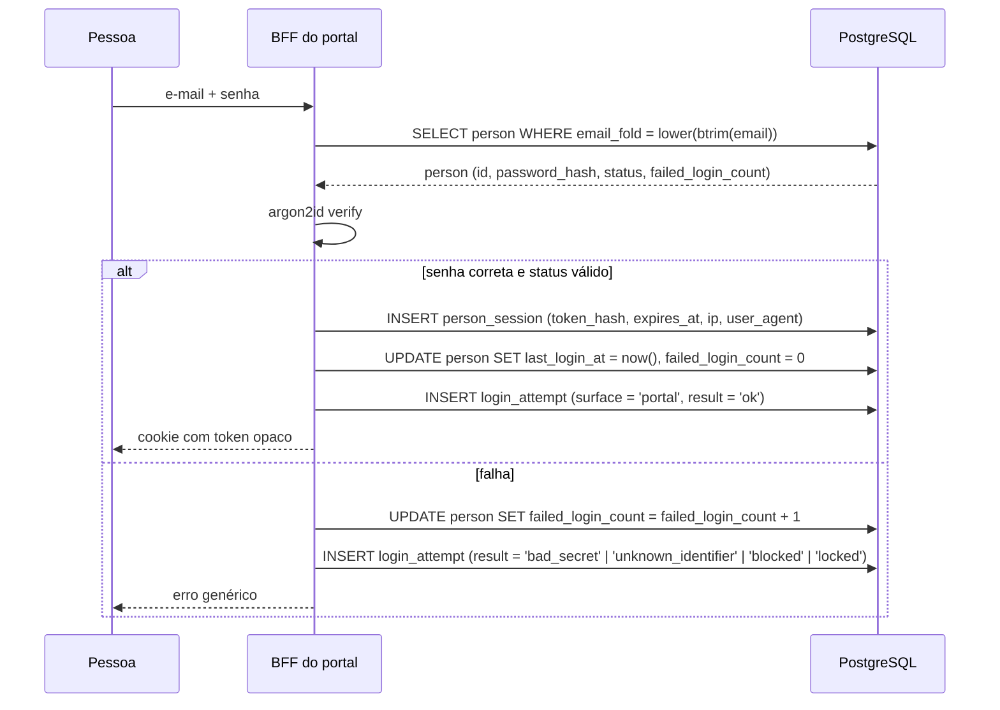

> Pergunta: "como a pessoa autentica no portal, como a conta abre sessão de jogo e onde cada escrita acontece?"
> Público: Desenvolvedor novo e arquitetura
> Dono: equipe do `wyd-db`
> Base: `ddl-confirmado.md` §4, §5.1–§5.2, §5.4–§5.5; `lacunas.md` `A10`, `A14`, `A16`, `B1`, `B3`, `M6`; `rascunho-accounts.md` §3
> Revisado em: 2026-11-22

**Estado:** proposto (2026-11-22)

O fluxo tem duas entradas e uma saída: a pessoa autentica no **portal** (identidade), a conta
autentica no **cliente 7662** (jogo) e a sessão de jogo termina por disconnect, personagem apagado,
staff ou reaper. São dois tokens diferentes, dois bancos de credencial e duas tabelas de sessão; o
que os une é a FK `game.account.person_id`, nunca uma cópia de e-mail.

## Atores e gatilho

| Ator | Gatilho | Resultado |
|---|---|---|
| Pessoa | envia e-mail e senha ao BFF do portal | `portal.person_session` viva |
| Cliente 7662 | handshake com login, senha e PIN | `game.session` viva |
| Canal / reaper / staff | disconnect, personagem apagado, tempo, ação administrativa | `game.session.released_at` com motivo |

## 1. Login no portal



**Passo a passo com o dado que muda:**

1. o BFF dobra o e-mail (`email_fold`) e busca a pessoa pelo índice total — nenhuma linha é escrita;
2. verifica a senha com argon2id;
3. no sucesso, gera token opaco, calcula o `sha256` e grava `person_session.token_hash`, `ip`,
   `user_agent`, `last_seen_at` e `expires_at` (**8 h**, absoluto, `D7`/`M4`);
4. atualiza `person.last_login_at` e zera `failed_login_count`;
5. grava `ops.login_attempt` com `surface = 'portal'`, `identifier_hash` (sha256 do `email_fold`) e
   `result = 'ok'`;
6. na falha, incrementa `failed_login_count`, preenche `locked_until` quando o limiar for atingido e
   grava a tentativa com o resultado fechado (`M6`);
7. a resposta ao cliente é genérica: não distingue e-mail inexistente de senha errada.

## 2. Sessão de jogo

```mermaid
sequenceDiagram
    participant C as Cliente 7662
    participant S as wyd-server
    participant D as PostgreSQL
    C->>S: login (16 B) + senha (12 B) + PIN (6 B) + versão
    S->>D: SELECT account WHERE login_fold = lower(btrim(login))
    D-->>S: account (id, password_hash, pin_hash, status, contadores)
    S->>D: SELECT account_moderation WHERE account_id = ?
    D-->>S: blocked, reason
    S->>S: argon2id verify (senha e PIN)
    S->>D: SELECT server_channel WHERE (group_id, channel) = ?
    D-->>S: canal existente e jogável
    S->>D: INSERT session (account_id, group_id, channel, client_version, ip)
    S->>D: INSERT login_attempt (surface = 'game', result = 'ok')
    S-->>C: sessão aberta; personagem ainda nulo
```

**Passo a passo com o dado que muda:**

1. o servidor busca a conta por `login_fold`; não há e-mail no fio nem em `game`;
2. verifica senha e PIN; PIN errado incrementa `pin_failure_count` e, no limiar, preenche
   `pin_locked_until` (`B3`; o limiar é código);
3. confere `game.account_moderation.blocked`; conta bloqueada não abre sessão nova;
4. confere que o canal `(group_id, channel)` existe em `game.server_channel`; ausência é erro, nunca
   permissivo (`§5.5`);
5. grava `game.session` com `account_id`, `group_id`, `channel`, `client_version`, `ip` e
   `character_id` nulo; o índice `ux_session_viva_por_conta` arbitra a segunda conexão;
6. grava `ops.login_attempt` com `surface = 'game'` e o hash do `login_fold`.

## 3. Encerramento

| Quem encerra | Coluna | Motivo |
|---|---|---|
| canal, no disconnect | `released_at`, `released_reason` | `disconnect` |
| reaper (60 s, stale 180 s) | idem | `reaper` |
| apagar personagem (`A14`) | idem | `character_deleted` |
| staff (`wyd_admin`) | idem | `admin` |

O `CHECK` `ck_session_motivo` recusa liberação sem motivo e motivo sem liberação. O evento auditável
vai para `ops.audit_log`; a coluna é o estado operacional, o log é a trilha.

## Transação e fronteira

| Escrita | Fronteira | Por quê |
|---|---|---|
| login do portal | uma transação: `person_session` + `person` + `login_attempt` | sessão sem `last_login_at` ou sem trilha é estado parcial |
| sessão de jogo | uma transação: `game.session` + `ops.login_attempt` | a unicidade decide no `INSERT`; a trilha nasce junto |
| encerramento | um `UPDATE` em `game.session`; o `audit_log` é `INSERT` separado | auditoria não bloqueia a liberação |
| troca de senha | mesma transação: `password_changed_at` + revogação das sessões de portal (`M4`) | senha nova não convive com sessão antiga |

O portal escreve `portal` e `ops`; o jogo escreve `game` e `ops`. Nenhum dos dois escreve no schema do
outro — a leitura de identidade pelo jogo é por view (`0029`).

## Falhas previstas

| Falha | Onde aparece | Efeito |
|---|---|---|
| senha ou PIN errado | código | incrementa contador; `login_attempt.result = 'bad_secret'`; resposta genérica |
| identificador inexistente | código | `unknown_identifier`; mesma resposta |
| conta bloqueada | `game.account_moderation` | recusa; `result = 'blocked'` |
| limiar de PIN ou de login atingido | colunas de contador | recusa até `locked_until`; `result = 'locked'` |
| segunda sessão da mesma conta | `ux_session_viva_por_conta` | `23505`; conexão recusada |
| sessão em canal inexistente | `fk_session_canal` | `23503`; configuração de canal faltando |
| token com forma inválida | `ck_person_session_token_forma` / `ck_person_token_hash_forma` | `23514`; bug de borda, não do usuário |
| jogo tentando ler `portal.person` cru | privilégio de schema | `42501`; a leitura é por view |

## Tabelas tocadas

| Tabela | Operação | Migration dona |
|---|---|---|
| `portal.person` | `SELECT`, `UPDATE` de contador e `last_login_at` | `migrations/0003-portal-person.md` |
| `portal.person_session` | `INSERT`, `UPDATE` de `last_seen_at`/`revoked_at` | `migrations/0004-portal-access.md` |
| `game.account` | `SELECT`, `UPDATE` de contador de PIN e senha | `migrations/0005-game-account.md` |
| `game.account_moderation` | `SELECT` | `migrations/0005-game-account.md` |
| `game.server_channel` | `SELECT` | `migrations/0007-game-session.md` |
| `game.session` | `INSERT`, `UPDATE` de renovação e liberação | `migrations/0007-game-session.md` |
| `ops.login_attempt` | `INSERT` | `migrations/0002-ops-audit.md` |
| `ops.audit_log` | `INSERT` | `migrations/0002-ops-audit.md` |

## O que este fluxo não cobre

- **Seleção de personagem:** a sessão nasce com `character_id` nulo; o fluxo de criação e seleção
  está bloqueado (`lacunas.md` §3).
- **Recuperação de senha e verificação de e-mail:** o token existe (`portal.person_token`, `M5`), a
  entrega é `B1` (provedor na onda 6) e o fluxo não foi escrito.
- **Segundo fator do staff:** o DDL existe (`0031`), o uso é do `wyd-portal` (`A20`, externa).
- **Limite de conexões por IP:** é transporte (`RF-DB-016`), não escrita do banco.
