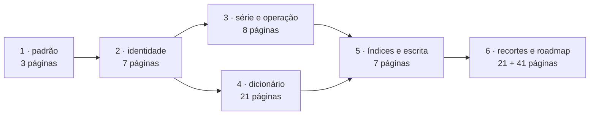

> Pergunta: "quais páginas de `docs/` já podem ser escritas com dado confirmado, de onde vem esse dado e o que falta para as demais?"
> Público: Produto / gestão
> Dono: equipe do `wyd-db`
> Base: `ddl-confirmado.md`, `lacunas.md`, `migrations-checklist.md`, `padrao-banco.md`, `plano-migrations.md`, `rascunho-accounts.md`
> Revisado em: 2026-11-24

**Estado:** proposta (2026-11-18), com o censo de páginas remedido em 2026-11-24 e as migrations recontadas na mesma data.

> **Revisão de 2026-11-24 (lote C e teto em 144):** `Q-BLK-01` retirou do teto três páginas de
> `guia-documentacao/` que repetiam `docs/convencoes.md` — `markdown-e-mkdocs.md`, `diagramas.md` e
> `links-referencias-e-ids.md` — e o lote C escreveu `guia-documentacao/imagens-e-evidencias.md`,
> `planos/plano-de-manutencao.md`, `guia-administrador/backup-e-restore.md` e
> `guia-administrador/recuperacao-de-desastre.md`. O teto autoral vai a **144**; o censo no worktree em
> 2026-11-24, depois do lote D (`Q-BLK-04` e `Q-BLK-05` em A): **137** páginas com corpo em `docs/`,
> **0 escrevíveis**, **0 de recorte** e **7 bloqueadas**. O **lote E** (`Q-BLK-06` e `Q-BLK-07` em A)
> escreveu `guia-desenvolvedor/pool-e-transacoes.md` e `specs/requisitos-nao-funcionais.md` na mesma data:
> **143** páginas com corpo, **0 escrevíveis**, **0 de recorte** e **1 bloqueada**. O **lote F** (`Q-BLK-08` a
> `Q-BLK-11` em A, 2026-11-24) escreveu `specs/rastreabilidade.md`, `specs/stakeholders.md`,
> `arquitetura/implantacao.md` e `arquitetura/modelo-conceitual.md`. O registro da decisão e da execução está
> em `pendencias-de-fechamento.md` §6.6 a §6.6.19.
>
> **Revisão de 2026-11-24, antes do lote C (dois lotes de `Q-PAG-1` escritos):** o lote A escreveu
> `specs/fluxos/criacao-e-selecao-de-personagem.md`, `specs/fluxos/carregamento-e-save.md` e
> `specs/estados/personagem.md`; o lote B escreveu `specs/fluxos/concessao-de-grant.md`,
> `specs/fluxos/compra-e-credito.md`, `specs/estados/grant.md` e `specs/estados/item-e-refino.md`.
> O censo no worktree em 2026-11-24: **128** páginas com corpo em `docs/`, **28 de 34** em
> `migrations/` e **37 de 59** em `src/`. O que falta escrever fica em
> **0 escrevíveis**, **0 de recorte** e **19 bloqueadas** — **147** páginas autorais, o teto de
> `wyd-db-1.0.0.md` §4 com o 19º domínio.
>
> **Revisão de 2026-11-23 (lotes 1–6 escritos):** os lotes 1–5 fecharam 58 páginas; o lote 6 escreveu
> os **21 recortes** e as **40 páginas `WYDDB-nnn`**, além de transformar o índice do roadmap em
> página. O censo no `HEAD` em 2026-11-23: **121** páginas com corpo em `docs/`, **28 de 34** em
> `migrations/` e **37 de 59** em `src/`. O que faltava escrever ficava em **0 escrevíveis**, **0 de
> recorte** e **26 bloqueadas** — **147** páginas autorais, o teto de `wyd-db-1.0.0.md` §4 com o 19º
> domínio. A revisão anterior (19 domínios, 36 páginas) fica no histórico do git.

Esta página é a ponte entre as seis fontes de planejamento e a árvore de `docs/` de
`wyd-db-1.0.0.md` §4. Ela responde uma pergunta só: **das 144 páginas autorais de `docs/`, quantas já
podem ser escritas sem inventar desenho, com que fonte e com que lacuna declarada.** Ela não escreve
página nenhuma e não decide lacuna: aponta dono e marco, como `lacunas.md`.

A intenção declarada é que as seis fontes **desapareçam diluídas** na documentação final. §3 diz onde
cada seção de cada uma aterrissa; a página que não recebe nada é página que não precisa existir.

## 0. Como ler o veredito

| Veredito | Significa | Critério |
|---|---|---|
| **escrever** | toda seção obrigatória do molde de §7.2 é preenchível hoje, com fonte e marca | nenhuma decisão aberta muda o que a página afirma |
| **recorte** | a página inteira não fecha, mas um bloco declarado fecha | o que falta é desenho de outro domínio, e a página diz isso em uma seção |
| **bloqueada** | escrever agora é inventar forma ou número | falta coluna desenhada, decisão de produto ou número medido |

Duas regras valem para as três colunas:

1. **Dado do legado não é fonte de decisão.** Contagem, volume e comportamento da série herdada não
   entram como afirmação; o número permitido é o **planejado** (`plano-migrations.md` §3: 34 arquivos,
   109 tabelas, `SCHEMA_VERSION = 34` na troca) ou o **medido depois** da série (`M20`). Página que só
   existiria para descrever o legado não entra — é o caso de `guia-teste/dados-de-teste.md`.
2. **Nada de valor redigitado.** A página cita a seção dona. `padrao-banco.md` §1 enuncia a decisão de
   forma; a página de arquitetura cita "P-03" e não recopia o DDL.

## 1. O que cada fonte sustenta

| Fonte | É dona de | Alimenta | Sai da árvore quando |
|---|---|---|---|
| `padrao-banco.md` | forma: `P-01`…`P-22`, nomes, tipos, integridade, índices, o **modelo** de permissão (a tabela de quem pode o quê é de `seguranca.md`) | `arquitetura/` (5 páginas), `guia-desenvolvedor/` (3) | a série existir e as páginas citarem o catálogo |
| `ddl-confirmado.md` | texto DDL de `0001`, `0003`, `0004` e `0007` + 6 tabelas em arquivo `parcial` | `migrations/` (5 páginas), dicionário (2), `integridade-e-constraints` | a série for escrita; o texto passa a ser o dos `.sql` |
| `plano-migrations.md` | ordem, escopo, seeds, gates e riscos da série | `migrations/` (2), `planos/` (4), `arquitetura/migracoes` | a série for aplicada e `metricas.md` medir |
| `migrations-checklist.md` | estado por arquivo e derivação do estado de tabela (§1.2) | `migrations/index.md`, `planos/metricas.md`, dicionário | a série existir; o estado passa a vir do ledger |
| `lacunas.md` | o que falta, com dono e marco | `specs/restricoes-e-premissas.md`, `planos/riscos.md`, ADRs, `specs/estados/*` | as 3 linhas externas fecharem |
| `rascunho-accounts.md` | requisitos de identidade (`R1`–`R16`), multibox, defeitos que não voltam | `specs/requisitos-funcionais.md`, `regras-de-negocio.md`, `estados/*` | `R1`–`R16` virarem `RF-DB-nnn` |

Duas fontes **fora das seis** já estão fechadas e são citadas como donas, não repetidas aqui:
`src/migrate/spec.md` (runner, ledger, checksum, lock, comandos, erros) e `src/provision/spec.md`
(papéis, estado de `public`, DSN por papel, arquivo gerado). Elas alimentam `src/` — fora de `docs/` —
e, dentro de `docs/`, `guia-administrador/configuracao.md`, `arquitetura/migracoes.md` (escrita) e
`ADR-DB-0001`/`ADR-DB-0002` (escritas).

## 2. O que já está escrito (medido em 2026-11-24)

**143 páginas com corpo em `docs/`**, 139 com `**Estado:**` e 4 portas de navegação sem estado editorial
(`index`, `convencoes`, `glossario` e `arquitetura/adr/index`):

| Pasta | Páginas escritas |
|---|---|
| raiz | `index.md`, `convencoes.md`, `glossario.md` |
| `arquitetura/` | `migracoes.md`, `seguranca.md`, `adr/index.md`, `adr/adr-db-0001-…`, `adr/adr-db-0002-…`, `padroes-postgres.md`, `integridade-e-constraints.md`, `contexto-c4.md`, `visao-geral.md`, `index.md`, `componentes-c4.md`, `fronteira-hot-cold.md`, `modelo-logico.md`, `retencao-e-capacidade.md`, `fluxo-de-dados.md`, `implantacao.md` e `modelo-conceitual.md` — `retencao-e-capacidade` é a entrega de `Q-CAP-1` (2026-11-23); `fluxo-de-dados` e as duas últimas foram escritas em 2026-11-24 (lote F), e a pasta fecha as **17** |
| `dicionario-dados/` | `index.md`, `como-ler.md` e as 19 páginas `dominio-*.md` — escritas em 2026-11-21 |
| `planos/` | `plano-de-implantacao.md`, `riscos.md`, `plano-de-dados-e-seeds.md`, `plano-de-qualidade-e-gates.md`, `registro-de-execucao.md`, `index.md`, `plano-de-documentacao.md`, `plano-de-testes.md`, `plano-de-manutencao.md` — o penúltimo é do lote 6 e o último do lote C |
| `guia-desenvolvedor/` | `como-adicionar-migration.md`, `como-adicionar-tabela.md`, `checklist-de-pr.md`, `index.md`, `setup-ambiente.md`, `mapa-do-crate.md`, `portas-e-contratos.md`, `modelos-e-invariantes.md`, `como-escrever-teste.md`, `erros-e-logs.md` e `pool-e-transacoes.md` — os sete primeiros do bloco são do lote 6 e o último é do lote E |
| `guia-administrador/` | `configuracao.md`, `index.md`, `instalacao.md`, `diagnostico.md`, `backup-e-restore.md`, `recuperacao-de-desastre.md`, `sustentacao.md` e `manutencao-rotineira.md` — os dois últimos são do lote D e fecham a pasta no teto de 8 |
| `guia-teste/` | `testes-de-sistema.md`, `testes-de-contrato.md`, `index.md`, `piramide-e-alvos.md`, `gates-e-anti-skip.md`, `fixtures-e-factories.md` e `dados-de-teste.md` — os dois últimos são do lote D e fecham a pasta no teto de 7 |
| `guia-documentacao/` | `index.md`, `estilo-e-linguagem.md`, `estrutura-e-navegacao.md`, `revisao-e-publicacao.md`, `imagens-e-evidencias.md` — os dois do lote 6 e o último do lote C; as três páginas retiradas do teto por `Q-BLK-01` não estão aqui |
| `specs/` | `index.md`, `restricoes-e-premissas.md`, `requisitos-funcionais.md`, `regras-de-negocio.md`, `casos-de-uso.md`, `estados/conta-e-moderacao.md`, `estados/sessao.md`, `estados/personagem.md`, `estados/grant.md`, `estados/item-e-refino.md`, `fluxos/login-e-sessao.md`, `visao-e-escolpo.md`, `fluxos/carga-de-conteudo.md`, `requisitos-nao-funcionais.md` (lote E), `fluxos/criacao-e-selecao-de-personagem.md`, `fluxos/carregamento-e-save.md`, `fluxos/concessao-de-grant.md`, `fluxos/compra-e-credito.md`, `rastreabilidade.md` e `stakeholders.md` (lote F) — os dois do lote 6, os sete de 2026-11-24 e as duas últimas, e a pasta fecha as **20** |
| `roadmap/` | `index.md`, `fases.md` e as **40** páginas `WYDDB-nnn` — escritas no lote 6 |

Fora de `docs/`: **28 de 34** em `migrations/` e **37 de 59** em `src/`.

**Todos os índices de pasta contam como página**: cada um responde à pergunta da sua pasta e tem corpo
próprio, inclusive `roadmap/index`, `guia-desenvolvedor/index` e `guia-teste/index`, que já passaram de
marcador de uma linha para página no lote 6. `dicionario-dados/gerado/index.md` é a exceção: é o índice
auxiliar das 109 páginas por tabela, fora desta contagem, e não entra nas 132.

## 3. Mapa de diluição das seis fontes

### 3.1 `padrao-banco.md` → arquitetura, guia do dev, gates

| Seção | Aterrissa em |
|---|---|
| §0 as quatro perguntas | `arquitetura/padroes-postgres.md` (abertura) |
| §1 `P-01`…`P-22` | `padroes-postgres.md` (tipo, índice, trigger), `integridade-e-constraints.md` (`P-14`, `P-15`, `P-20`), `como-adicionar-tabela.md` (checklist) |
| §2 schemas e fronteiras | `arquitetura/contexto-c4.md` (quem lê/escreve), `seguranca.md` (já absorvido) |
| §3 convenções de nome | `guia-desenvolvedor/como-adicionar-tabela.md` |
| §4 tipos por intenção | `arquitetura/padroes-postgres.md` §2 recebe o **critério** de escolha; a **lista fechada** continua aqui (§4), que é a dona do valor |
| §5 integridade (7 regras) | `arquitetura/integridade-e-constraints.md` |
| §6 índices | `arquitetura/padroes-postgres.md` §5 recebe o **critério** (invariante × desempenho); as regras fechadas continuam aqui (§6) |
| §7 triggers, funções e views | `padroes-postgres.md` + `migrations/0001-bootstrap.md` (a função) |
| §8 papéis e permissões | a **tabela de quem pode o quê** é de `seguranca.md` (escrita); §8 fica com o **modelo de permissão** que ela não explica (`USAGE` × *default privileges*, leitura só por view, append-only por permissão, exceção de `public`, RLS fora); efeito por papel em `migrations/0001-bootstrap.md`, com o DDL gerado de `src/provision/spec.md` (não copiado) |
| §9 migrations | **já é ponteiro, não fonte**: as regras da série são de `plano-migrations.md` §2 (→ `migrations/serie-e-regras.md`, quando existir) e o porquê, de `arquitetura/migracoes.md` §2 (escrito). A linha de `expand`/`contract` — operação futura — fica em §9 até `serie-e-regras` nascer |
| §10 testes e gates | `planos/plano-de-qualidade-e-gates.md` + `guia-teste/testes-de-contrato.md` |
| §11 antipadrões | `arquitetura/padroes-postgres.md` §7 agrupa em quatro **famílias de defeito**; a lista nominal continua aqui (§11) — lista única, as outras páginas citam |
| §12 dívida documental | morre com a árvore de planejamento — é registro de pagamento, não conteúdo |
| §13 fontes externas | nota de rodapé das páginas de destino |

**Estado da nota de enunciação**, usado nas cinco tabelas abaixo: `existe` — a seção fecha com a nota
declarando o dono; `falta` — há página escrita enunciando o conteúdo e a seção ainda não declara; `—`
— nenhuma página escrita enuncia ainda, então a nota não é devida. A contagem viva está em
`matriz-donos.md`; aqui interessa o que já mudou de dono.

### 3.2 `ddl-confirmado.md` → páginas de migration e dicionário

| Seção | Aterrissa em | Nota |
|---|---|---|
| §1 critério e contagem de DDL fechado | `migrations/index.md` (o que tem DDL fechado) | — |
| §2 veredito por arquivo | `migrations/index.md` (coluna de estado; valor derivado de `migrations-checklist.md` §1.2) | — |
| §3 `0001` | `migrations/0001-bootstrap.md` (escrita; cita esta seção) | — |
| §4 `0004` | `migrations/0004-portal-access.md` (escrita; cita esta seção) | — |
| §5.1–§5.7 DDL | `migrations/0003`, `0004`, `0005`, `0002`, `0007` (o `up`/`down` e a tabela de colunas) | — |
| §5.1–§5.7 significado | `dicionario-dados/dominio-acesso.md` §Tabela de tabelas, §Ciclo de vida do dado e §Regras e armadilhas (escrita) | **existe** (nota em §5, cobre as seis) |
| §5.3, §5.4 e o canal de §5.5 | `dominio-auditoria.md` e `dominio-canal.md` — escritas em 2026-11-21 | — |
| §6 adaptações contra o rascunho | não se publica: é comparação com desenho descartado; o que vale já está em §3 e nas páginas | — |
| §7 provas | `guia-teste/testes-de-contrato.md` + seção "verificação" de cada página de migration | — |

**Consequência:** as páginas de `migrations/` são as **donas** do texto SQL. Quando a série for escrita,
`ddl-confirmado.md` deixa de existir e o DDL mora só no `.sql` e na página daquele arquivo.

### 3.3 `plano-migrations.md` → série, planos e riscos

| Seção | Aterrissa em | Nota |
|---|---|---|
| §1 ferramentas que recusam o desenho | `guia-desenvolvedor/como-adicionar-tabela.md` §6 (estado `V` do gate, escrito) + `plano-de-implantacao.md` §Pré-requisitos + `planos/riscos.md` (escrito) | **existe** (nota de §1) |
| §2 formato e numeração | `migrations/serie-e-regras.md` (regra, a escrever) + `arquitetura/migracoes.md` §2 (porquê, escrito) | **existe** (nota de §2) |
| §3 a série (34/109) | `migrations/index.md` (lista) + `dicionario-dados/index.md` (contagem `P`) | — |
| §3.1 por que esta ordem | `migrations/serie-e-regras.md` | — |
| §3.2 corte vertical | `planos/plano-de-testes.md` (critério de saída) | — |
| §4 seeds | `planos/plano-de-dados-e-seeds.md` | — |
| §5 o que sai e o que entra | `arquitetura/modelo-logico.md` (recorte) | — |
| §6 troca da série | `arquitetura/migracoes.md` (escrito) + `planos/plano-de-implantacao.md` (escrito) — nenhum dos dois enuncia a troca | — |
| §7 gates | `planos/plano-de-qualidade-e-gates.md` | — |
| §8 riscos | `planos/riscos.md` | — |
| §9 ordem de execução | `planos/plano-de-implantacao.md` §Ordem (escrito) + `planos/plano-de-documentacao.md` | **existe** (nota de §9) |
| §10 o que não decide | `specs/restricoes-e-premissas.md` (as três de produto) | — |

### 3.4 `migrations-checklist.md` → índice da série e métrica

| Seção | Aterrissa em | Nota |
|---|---|---|
| §1 estados e §1.2 derivação | `migrations/index.md` (tabela da série com a coluna de estado); hoje `docs/convencoes.md` §Estados define o significado dos três estados e aponta §1.2 como dono único da derivação, **sem copiar o mapeamento** | **existe** (nota de §1.2) |
| §2 checklist dos 34 | `migrations/index.md` | — |
| §3 bloqueios agrupados | `specs/restricoes-e-premissas.md` (por ID) | — |
| §4 contagem | `planos/metricas.md` (quando houver medido) | — |
| §5 o que toda página de migration tem | `guia-desenvolvedor/como-adicionar-migration.md` (escrito; cita o molde, não reproduz) | — |
| §6 manutenção | morre com o controle | — |

**Dívida paga em 2026-11-18:** `docs/convencoes.md` §Estados deixou de copiar a tabela de derivação e
passou a apontar `migrations-checklist.md` §1.2 como dono único; a nota de §1.2 registra a divisão —
significado dos estados na página, mapeamento e estado por arquivo na seção. Quando o controle morrer,
o ponteiro passa a `migrations/index.md`.

### 3.5 `lacunas.md` → restrições, riscos, estados e ADRs

| Seção | Aterrissa em | Nota |
|---|---|---|
| §0 estados, marcos e donos | `specs/restricoes-e-premissas.md` (abertura) | — |
| §1 decisões fechadas | a página dona de cada uma (coluna "Refletida em"), não uma lista nova | — |
| §2.1–§2.3 as 38 lacunas | `restricoes-e-premissas.md` (as 3 externas) + `planos/riscos.md` (as que são risco) + a página dona de cada fechada | **existe** (nota ao fim de §2.4) |
| §2.4 resumo por marco | `restricoes-e-premissas.md` (a tabela de marcos) | coberta pela mesma nota |
| §3 `P1`–`P11` | `planos/riscos.md` (`P3` fechada; `P1` e `P5` também fechadas) | — |
| §4 `D-A`, `D-B`, `D-C` | `planos/riscos.md` + `planos/plano-de-documentacao.md` (`D-A`) | — |
| §5 o que não fazer | `planos/plano-de-qualidade-e-gates.md` (condição de reprovação) | — |
| §6 manutenção | morre com o registro | — |

### 3.6 `rascunho-accounts.md` → requisitos, regras e estados

| Seção | Aterrissa em | Nota |
|---|---|---|
| §2 `R1`–`R16` | `specs/requisitos-funcionais.md` (um `RF-DB-nnn` por requisito, com critério de aceitação) | — |
| §3 multibox, auto-attack e limite por IP | `docs/arquitetura/integridade-e-constraints.md` §6 (escrita) + `specs/regras-de-negocio.md` (`RN-DB-nnn`, escrita) | **existe** (nota de §3) |
| §4 defeitos que não voltam | `specs/regras-de-negocio.md` (o que a violação impede) | — |
| §5 estados que o desenho exige | `specs/estados/conta-e-moderacao.md`, `sessao.md`, `personagem.md` | — |
| §6 `D1`–`D14` | índice histórico — cada decisão já vive na página dona (coluna "Onde vive hoje") | — |
| §7 `UNVERIFIED` | `specs/restricoes-e-premissas.md` (premissa com o que a invalida) | — |
| §8 seções removidas | morre com o arquivo | — |

## 4. Páginas que já podem ser escritas (0)

Nenhuma página autoral resta na lista de escrevíveis: as **6** que fechavam em 2026-11-22 foram
escritas com o lote 5 (§8) — `arquitetura/index`, `planos/index`, `checklist-de-pr`,
`guia-administrador/index`, `guia-documentacao/index` e `estilo-e-linguagem`. A distribuição por pasta
está em §2; o que falta é bloqueio (§6), e a soma agora é **144** (143 + 0 + 0 + 1).

### 4.1 `arquitetura/` (0)

`index.md` foi escrito em 2026-11-22 com o lote 5, os três recortes com o lote 6, os dois ADRs com o
lote 1 e `fluxo-de-dados.md` em 2026-11-24; a pasta tem **15** páginas com corpo (12 + os 3 de `adr/`).
O que resta é bloqueio — `implantacao.md` e `modelo-conceitual.md` —, não página escrevível.

### 4.2 `specs/` (0)

As cinco páginas do lote 2, os dois recortes do lote 6 — `visao-e-escolpo.md` e
`fluxos/carga-de-conteudo.md` — e as sete de 2026-11-24 (três de personagem e quatro de economia e
custódia) estão escritas; a pasta tem **17** páginas com corpo. Nenhuma página de `specs/` permanece na
lista de escrevíveis; as restantes — `stakeholders`, `requisitos-nao-funcionais` e `rastreabilidade` —
seguem em §6.

### 4.3 `dicionario-dados/` (0)

Nenhuma: as **21** páginas do dicionário — `index.md`, `como-ler.md` e as **19** de domínio — estão
escritas desde 2026-11-21 e contam em §2. O que falta ali são as **109** páginas por tabela, fora desta
conta e medidas por `docs/dicionario-dados/gerado/index.md`, dono da contagem.

### 4.4 `planos/` (0)

`index.md` foi escrito em 2026-11-22 com o lote 5, `plano-de-documentacao.md` no mesmo dia,
`plano-de-testes.md` no lote 6 e `plano-de-manutencao.md` no lote C; a pasta tem **9** páginas com corpo. O
que resta é `metricas.md`, bloqueada pelo número medido (`M20`).

### 4.5 `guia-desenvolvedor/` (0)

`checklist-de-pr.md` foi escrito em 2026-11-22 com o lote 5 e os sete recortes no lote 6; a pasta tem
**10** páginas com corpo. O que resta é `pool-e-transacoes.md`, bloqueado por desenho/medição.

### 4.6 `guia-administrador/` (0) e `guia-teste/` (0) e `guia-documentacao/` (0)

`guia-administrador` tem **6** páginas (2 do lote 5, 2 recortes e 2 do lote C), `guia-teste` tem **5** (2
escritas + 3 recortes) e `guia-documentacao` tem **5** (2 do lote 5, 1 recorte e `imagens-e-evidencias` do
lote C). Em `guia-documentacao` o teto da pasta caiu de 8 para 5: `Q-BLK-01` retirou três páginas que
repetiam `convencoes.md`. O restante das três pastas é bloqueio.

## 5. Páginas de recorte escritas (21)

As 21 páginas de recorte foram escritas em 2026-11-22, **limitando o escopo declarado**. O recorte é a
única defesa contra inventar desenho; a coluna “por que não inteira” continua sendo o que a página
não cobre.

| Página | Recorte que fechou | Por que não inteira |
|---|---|---|
| `arquitetura/componentes-c4.md` | `migrate` (21 arquivos) e `provision` (13) têm desenho por arquivo em `src/migrate/spec.md` §10 e `src/provision/spec.md` §5 | o resto do crate (`model`, `pool`, `repo`, `transfer`) só tem nome de página |
| `arquitetura/fronteira-hot-cold.md` | o princípio (regra de jogo fora do banco, `padrao-banco.md` §0) e as duas views de leitura cruzada (`P-17`, §7) | a ponte única depende de `ops.delivery_queue`, desenhada e aprovada em `ddl-confirmado.md` §5.16 |
| `arquitetura/modelo-logico.md` | ER das 109 tabelas com DDL fechado + as 2 views | todas as tabelas têm coluna desenhada e aprovada desde 2026-11-21 |
| `specs/visao-e-escolpo.md` | problema, escopo dentro/fora e o que a `1.0.0` entrega (`wyd-db-1.0.0.md` §1.2) | números só `P` até a série |
| `specs/fluxos/carga-de-conteudo.md` | `content_version` (`0001`) e proveniência por dataset (`plano-migrations.md` §4) | a leitura no boot depende de `content.*` (13–27) e de `repo/content.rs` |
| `planos/plano-de-testes.md` | escopo, 5 alvos planejados (`wyd-db-1.0.0.md` §6.17), ambiente e critério de saída da `1.0.0` (§6.9) | matriz `CAP-nn` não existe |
| `roadmap/fases.md` | as 7 fases com escopo e critério de saída (`§6.10`) | `D-7` aprovada em 2026-11-22; a página foi escrita e as 40 issues têm DoD |
| `guia-desenvolvedor/index.md` | trilha de leitura e pré-requisitos | os "3 comandos que provam o ambiente" não existem |
| `guia-desenvolvedor/setup-ambiente.md` | variáveis por nome (`src/provision/spec.md` §3) e banco local | ferramentas, versões e comandos |
| `guia-desenvolvedor/mapa-do-crate.md` | árvore planejada e a regra de dependência (`§6.16`) | só `dsn` existe; o resto é `P` |
| `guia-desenvolvedor/portas-e-contratos.md` | as 5 portas de `migrate` e as 2 de `provision` | as portas de `repo/` não têm contrato |
| `guia-desenvolvedor/modelos-e-invariantes.md` | `GameLogin` 16 B, `GamePassword` 12 B, `NumericPin` 6 B (`padrao-banco.md` §4); `Dsn` (`src/dsn.md`), versão e `Sql` (`src/migrate/spec.md` §2) e checksum (`src/migrate/spec.md` §4) | modelos de personagem, item e economia |
| `guia-desenvolvedor/como-escrever-teste.md` | proibição de id mágico e de `sleep` (`wyd-db-1.0.0.md` §5.13); escolha de alvo e padrão de nome (§6.11) | fixtures e factories dependem do desenho da suíte |
| `guia-desenvolvedor/erros-e-logs.md` | taxonomia e código de saída de `migrate` (`src/migrate/spec.md` §11) e de `provision` (`src/provision/spec.md` §6) | erros de runtime não têm desenho |
| `guia-administrador/instalacao.md` | pré-requisito e ordem: `provision render` → `apply` → série, com DSN de dono do banco (`ADR-DB-0001`, `src/provision/spec.md` §3) | instalação de serviço, porta e volume |
| `guia-administrador/diagnostico.md` | migration travada e lock de sessão com chave própria (`src/migrate/spec.md` §5) | pool saturado, disco e conexões: sem medição |
| `guia-teste/index.md` | os 5 alvos planejados e o que cada um prova | a suíte não existe; comando único é `P` |
| `guia-teste/piramide-e-alvos.md` | níveis unitário, contrato e sistema, e o que cada nível pode tocar (`wyd-db-1.0.0.md` §6.13) | custo e tempo por nível não medidos |
| `guia-teste/gates-e-anti-skip.md` | `SKIP` proibido (`wyd-db-1.0.0.md` §5.9); como o gate detecta e cobertura por capacidade, não por linha (§6.13) | matriz de capacidades |
| `guia-documentacao/estrutura-e-navegacao.md` | nome de arquivo (`P8`), uma página por pasta com `index.md`, árvore citada de `§4` | `nav` do mkdocs: não existe config |
| `guia-documentacao/revisao-e-publicacao.md` | fluxo de revisão e checklist de pronto (`§10`) | a publicação é do `wyd-docs` (`LPDOC`), não desta pasta; a página fecharia só o fluxo de revisão |

## 6. Páginas bloqueadas (1)

Agrupadas pelo bloqueio — o dono e o marco são os de `lacunas.md`. O registro de fechamento, com o
caminho de cada página, dono e o que ela desbloqueia, está em `pendencias-de-fechamento.md` §5; esta
seção continua sendo a dona da fila e do motivo do bloqueio.

**O que fazer com cada grupo está em §6.6 de `pendencias-de-fechamento.md`** (proposto em 2026-11-24):
o pacote de decisões que transforma cada bloqueio em pergunta fechada, com recomendação, evidência,
quantas páginas caem e pré-requisito. **`Q-BLK-01` a `Q-BLK-11` foram aprovadas em 2026-11-24**, todas em
A: os lotes C, D, E e F escreveram as páginas que cada uma liberava, e esta fila está em **1** —
`planos/metricas.md`, que espera a série aplicada (`M20`).

**Saíram da lista em 2026-11-24:** as três páginas do lote de entrada na cena — criação/seleção de
personagem, carregamento e save, e estado do personagem — e as quatro de economia e custódia —
concessão de grant, compra e crédito, estado de grant e estado de item e refino. Elas foram escritas com
o DDL fechado de `0006`/`0009`, `0011`/`0012` e `0021`, e o contrato C4; a fila caiu de **26** para
**19** e as dependências externas de cada uma ficaram declaradas na própria página.

**Saíram da lista em 2026-11-24 (lote C):** três páginas de `guia-documentacao/` **retiradas do teto** por
`Q-BLK-01` — `markdown-e-mkdocs.md`, `diagramas.md` e `links-referencias-e-ids.md`, porque o conteúdo já
é de `docs/convencoes.md` — e quatro **escritas**: `guia-documentacao/imagens-e-evidencias.md`,
`planos/plano-de-manutencao.md`, `guia-administrador/backup-e-restore.md` e
`guia-administrador/recuperacao-de-desastre.md`. O teto caiu de **147 para 144** e a fila de **19 para
12**.

**Saiu da lista em 2026-11-24, depois do lote C:** `arquitetura/fluxo-de-dados.md`, escrita a partir do
DDL fechado e do dicionário. Era a única das páginas da fila que não dependia de decisão nem de medição;
com ela a fila ficou em **11** naquele dia.

**Saíram da lista em 2026-11-24 (lote D):** `guia-administrador/sustentacao.md`,
`guia-administrador/manutencao-rotineira.md`, `guia-teste/fixtures-e-factories.md` e
`guia-teste/dados-de-teste.md`, escritas depois de `Q-BLK-04` = A e `Q-BLK-05` = A. As duas pastas
fecharam no teto — `guia-administrador` em **8** e `guia-teste` em **7** — e a fila caiu para **7**.

**Saíram da lista em 2026-11-24 (lote E):** `guia-desenvolvedor/pool-e-transacoes.md`, que declara os
defaults reais do pool e o orçamento de **53 de 97** conexões (`Q-BLK-06` = A), e
`specs/requisitos-nao-funcionais.md`, que abre a série `RNF-DB` com **3** limiares de fonte real e **2**
métricas sem limiar até `M20` (`Q-BLK-07` = A). A fila caiu de **7** para **5**.

**Saíram da lista em 2026-11-24 (lote F):** `specs/rastreabilidade.md`, `specs/stakeholders.md`,
`arquitetura/implantacao.md` e `arquitetura/modelo-conceitual.md`, escritas depois de `Q-BLK-08` a
`Q-BLK-11` = A. As duas pastas fecharam no teto — `specs/` em **20** e `arquitetura/` em **17** — e a fila
caiu de **5** para **1**.

**Saiu da lista em 2026-11-22:** `planos/plano-de-documentacao.md`, escrito depois do lote 5 porque
`D-A` já estava fechada e ele era o primeiro item de §6 sem bloqueio de fonte. A página foi para §2 e
não fecha a Onda 8; o critério dela continua em `planos/plano-de-documentacao.md` §2.

**Saíram da lista em 2026-11-22:** as **21 páginas de recorte** e as **40 `WYDDB-nnn`**, escritas no
lote 6; com isso o bloqueio caiu de 68 para **27**. Em **2026-11-23**, `retencao-e-capacidade.md`
saiu como `proposto` com volume pendente de medição (`Q-CAP-1`), e o bloqueio caiu para **26**. Em
**2026-11-24**, as três páginas de entrada na cena e as quatro de economia e custódia saíram, e o
bloqueio caiu para **19**; o lote C fechou mais sete, `fluxo-de-dados.md` fechou a oitava, o lote D fechou
quatro, o lote E fechou duas, o lote F fechou as quatro de §6.6.19 e o bloqueio está em **1**. As 109 páginas por tabela continuam fora desta conta; quantas já existem é de
`gerado/index.md`, dono da contagem.

| Grupo | Páginas | Bloqueio | Dono / marco |
|---|---|---|---|
| arquitetura — deploy | `implantacao.md` | não há desenho de processo, porta, volume nem supervisor | arquitetura, depois da série |
| arquitetura — modelo | `modelo-conceitual.md` | a forma das 109 tabelas está fechada; falta o agrupamento conceitual | arquitetura (marco `P3`) |
| specs — qualidade e matriz | `requisitos-nao-funcionais.md`, `rastreabilidade.md` | nenhum limiar medido; porta, teste e issue não existem para preencher a matriz | arquitetura, ondas 3/7/8 |
| specs — atores | `stakeholders.md` | os 16 `RF-DB` do bloco de identidade existem; falta a matriz ator → requisito dos demais domínios | onda 3 |
| planos — métrica | `metricas.md` | o número medido só existe depois da série aplicada (`M20`); não é decisão | arquitetura (`M20`, marco `P2`) |
| guia do desenvolvedor — pool | `pool-e-transacoes.md` | pool, timeout e saturação sem desenho e sem medição | arquitetura, onda 7 |

**Fora da conta:** as 109 páginas por tabela do dicionário estão escritas (**109/109**, 2026-11-22) e `gerado/index.md` é o índice auxiliar; não são páginas bloqueadas nem entram nas 147.

## 7. Fora de `docs/`

| Pasta | Escrito | O que já dá para escrever | O que não dá |
|---|---|---|---|
| `migrations/` | 28 de 34 | faltam `index.md` e `serie-e-regras.md`; as 28 páginas de arquivo e o `spec.md` do runner estão escritos | restam as 6 de seed, bloqueadas pelo dado de origem |
| `src/` | 37 de 59 | 34 páginas de `migrate/` e `provision/` têm o desenho de módulo em `src/migrate/spec.md` §10 e `src/provision/spec.md` §5, e 4 contratos fechados na revisão de 2026-11-18 (`lacunas.md` §1) | as 24 do resto do crate, que só têm nome de página |
| `tests/` | **12 de 12** (2026-11-24, §6.6.21) | nada — as 12 saíram: `index`, `fixtures-e-factories`, `dados-de-teste`, `resources/README`, 5 `alvos/*` e 3 `specs/*`, com a matriz `CAP-nn` | o código: `Cargo.toml`, os 5 alvos, `tests/common/` e as fixtures; `CAP-08` declarada não executável na `1.0.0` (`Q-BLK-20` = A) |

## 8. Ordem proposta (6 lotes; lotes 1 a 6 escritos)

| Lote | Páginas | O que fecha com ele |
|---|---|---|
| **1 · padrão** | `padroes-postgres`, `integridade-e-constraints`, `como-adicionar-tabela` | **escrito em 2026-11-18** — o vocabulário de modelagem que todas as outras citam; `padrao-banco.md` §1–§6 e §11 deixam de ser a única porta (a página enuncia o **critério**; a **lista fechada** de tipos, índices e antipadrões fica aqui, em §4/§6/§11) |
| **2 · identidade** | `restricoes-e-premissas`, `requisitos-funcionais`*, `regras-de-negocio`*, `casos-de-uso`*, `estados/conta-e-moderacao`, `estados/sessao`, `fluxos/login-e-sessao` | **escrito em 2026-11-22** — o bloco de identidade inteiro, de requisito a estado; `rascunho-accounts.md` sai da raiz e o aberto fica só em `lacunas.md` |
| **3 · série e operação** | `contexto-c4`, `visao-geral`, `riscos`, `plano-de-dados-e-seeds`, `plano-de-qualidade-e-gates`, `configuracao`, `testes-de-contrato`, `registro-de-execucao` | **escrito em 2026-11-22** — `riscos` já estava escrito desde 2026-11-20; `plano-migrations.md` e `lacunas.md` §4 saem da raiz. Os seis seeds seguem `bloqueada` e o registro começa vazio, sem linha inventada |
| **4 · dicionário** | `dicionario-dados/index`, `como-ler` e as 19 páginas de domínio | **escrito em 2026-11-21** — o dicionário tem porta de entrada, regra de leitura e os 19 domínios |
| **5 · índices e escrita** | `arquitetura/index`, `specs/index`, `planos/index`, `guia-administrador/index`, `guia-documentacao/index`, `estilo-e-linguagem`, `checklist-de-pr` | **escrito em 2026-11-22** — `specs/index` já tinha sido antecipado no lote 2; os seis restantes fecharam agora. As pastas com conteúdo passam a ter índice de verdade, e a regra de escrita sai de `convencoes.md` |
| **6 · recortes e roadmap** | 21 páginas de recorte + `roadmap/index`, `roadmap/fases` e 40 `WYDDB-nnn` | **escrito em 2026-11-22** — os 21 recortes fecham o que tinha fonte sem medição nova; as 40 páginas têm DoD e serão a origem das issues |

`*` página de recorte (§5): entra no lote já com a seção "o que não cobre" preenchida.

**Ordem interna do lote 3 (2026-11-22):** `riscos` já estava escrito (2026-11-20, fechou `P3`); os
sete restantes foram escritos na ordem da tabela — `contexto-c4` e `visao-geral` primeiro, porque dão
o vocabulário que os planos citam, e `registro-de-execucao` no fim, porque não depende de entrega
para existir. Nenhuma página do lote ficou de fora: o que segue bloqueado é o **dado** dos seis seeds
e o conteúdo de `plano-de-dados-e-seeds`, não a página. `specs/stakeholders`,
`specs/requisitos-nao-funcionais` e `specs/rastreabilidade` **não** pertencem ao lote 3 (são §6) e
continuam bloqueadas; `specs/visao-e-escolpo` é recorte (§5).

**`specs/index` antecipado do lote 5 (2026-11-22):** o índice da pasta foi escrito junto do lote 2,
não no lote 5, porque `wyd-db-1.0.0.md` §6.5 exige que `specs/` tenha porta de entrada e o lote 2
sozinho deixaria oito páginas sem índice. O lote 5 fechou os seis restantes — índices de
`arquitetura`, `planos`, `guia-administrador` e `guia-documentacao`, `estilo-e-linguagem` e
`checklist-de-pr` —, e a dependência `L3/L4 → L5` está satisfeita.

**Ordem interna do lote 5 (2026-11-22):** `specs/index` já estava escrito; os quatro índices de pasta
foram escritos primeiro, porque são a porta que os outros conteúdos citam, e depois `checklist-de-pr`
e `estilo-e-linguagem`, que fecham o caminho de quem escreve. Nenhuma página do lote ficou bloqueada:
as páginas que seguem fora são recorte ou bloqueio de §5–§6, não item deste lote.

**Página fora dos lotes (2026-11-22):** com os cinco lotes escritos, §4 ficou em **0 escrevíveis**. O lote 6 foi executado em seguida: escreveu os 21 recortes, o índice do roadmap, `fases` e as 40 páginas de issue, sem tocar nos 27 bloqueios restantes.
O primeiro item de §6 sem bloqueio de fonte era `planos/plano-de-documentacao`: `D-A` foi fechada em
2026-11-19, a timeline única está decidida e nenhum dado de origem falta. Ele pertence à **Onda 8**,
mas foi escrito antes das outras páginas da onda porque é o próprio plano que define a timeline;
escrevê-lo **não fecha** a Onda 8 nem conta como entrega de roadmap. Os demais itens de §6 continuam
bloqueados por medição da série, suíte, issues ou decisão de operação, e não foram tocados.

**Regra de parada de cada lote:** página nova só entra quando as anteriores do lote estão com `Base:`
preenchido, link conferido e a citação de número com fonte e data. Lote não se abre com página do lote
anterior em rascunho — é o mesmo critério de §11 do plano diretor, aplicado a 46 páginas em vez de 9
ondas.

## 9. O que esta proposta não decide

1. **Não cria página sozinha.** A escrita é de quem executa o lote; esta proposta diz o que fecha e com
   qual fonte.
2. **Não decide lacuna.** As três `externa` (`A11`, `A20` e `M21`) continuam com dono e marco em
   `lacunas.md`; nenhuma lacuna `aberta` resta no registro (0 em 2026-11-22).
3. **Não numera requisito.** Os `RF-DB`/`RN-DB` nascem com o próximo número livre, na hora da escrita;
   os do lote 2 já existem e a convenção está em `specs/index.md`.
4. **Não mede nada.** 34, 109 e a distribuição por arquivo são planejados (`plano-migrations.md` §3);
   o medido sai do catálogo depois da série.
5. **Não substitui `metricas.md`.** Ela diz o que dá para escrever; quanto está escrito continua sendo
   contagem de página com cabeçalho, como em §2.
6. **Não decide o bloqueio.** As perguntas fechadas, com recomendação, impacto e ordem, estão em
   `pendencias-de-fechamento.md` §6.6; esta proposta só diz de que fonte cada página depende.

---

*Proposta. A escrita das páginas acontece nas entregas dos lotes; este documento não altera `docs/`.*
