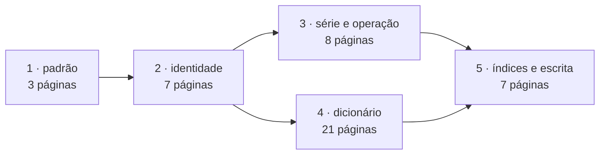

> Pergunta: "quais páginas de `docs/` já podem ser escritas com dado confirmado, de onde vem esse dado e o que falta para as demais?"
> Público: Produto / gestão
> Dono: equipe do `wyd-db`
> Base: `ddl-confirmado.md`, `lacunas.md`, `migrations-checklist.md`, `padrao-banco.md`, `plano-migrations.md`, `rascunho-accounts.md`
> Revisado em: 2026-11-22

**Estado:** proposta (2026-11-18), com o censo de páginas remedido em 2026-11-22 e as migrations recontadas na mesma data.

> **Revisão de 2026-11-22 (lote 2 escrito):** o lote de identidade fechou — 7 páginas e o
> `specs/index`. O censo no `HEAD` desta data: **44** páginas com corpo em `docs/`, **28 de 34** em
> `migrations/` e **0 de 59** em `src/`. O que falta escrever fica em **13 escrevíveis**, **21 de
> recorte** e **69 bloqueadas** — **147** páginas autorais, o teto de `wyd-db-1.0.0.md` §4 com o
> 19º domínio. A revisão anterior (19 domínios, 36 páginas) fica no histórico do git.

Esta página é a ponte entre as seis fontes de planejamento e a árvore de `docs/` de
`wyd-db-1.0.0.md` §4. Ela responde uma pergunta só: **das 147 páginas autorais de `docs/`, quantas já
podem ser escritas sem inventar desenho, com que fonte e com que lacuna declarada.** Ela não escreve
página nenhuma e não decide lacuna: aponta dono e marco, como `lacunas.md`.

A intenção declarada é que as seis fontes **desapareçam diluídas** na documentação final. §3 diz onde
cada seção de cada uma aterrissa; a página que não recebe nada é página que não precisa existir.

## 0. Como ler o veredito

| Veredito | Significa | Critério |
|---|---|---|
| **escrever** | toda seção obrigatória do molde de §7.2 é preenchível hoje, com fonte e marca | nenhuma decisão aberta muda o que a página afirma |
| **recorte** | a página inteira não fecha, mas um bloco declarado fecha | o que falta é desenho de outro domínio, e a página diz isso em uma seção |
| **bloqueada** | escrever agora é inventar forma ou número | falta coluna desenhada, decisão de produto ou número medido |

Duas regras valem para as três colunas:

1. **Dado do legado não é fonte de decisão.** Contagem, volume e comportamento da série herdada não
   entram como afirmação; o número permitido é o **planejado** (`plano-migrations.md` §3: 34 arquivos,
   109 tabelas, `SCHEMA_VERSION = 34` na troca) ou o **medido depois** da série (`M20`). Página que só
   existiria para descrever o legado não entra — é o caso de `guia-teste/dados-de-teste.md`.
2. **Nada de valor redigitado.** A página cita a seção dona. `padrao-banco.md` §1 enuncia a decisão de
   forma; a página de arquitetura cita "P-03" e não recopia o DDL.

## 1. O que cada fonte sustenta

| Fonte | É dona de | Alimenta | Sai da árvore quando |
|---|---|---|---|
| `padrao-banco.md` | forma: `P-01`…`P-22`, nomes, tipos, integridade, índices, o **modelo** de permissão (a tabela de quem pode o quê é de `seguranca.md`) | `arquitetura/` (5 páginas), `guia-desenvolvedor/` (3) | a série existir e as páginas citarem o catálogo |
| `ddl-confirmado.md` | texto DDL de `0001`, `0003`, `0004` e `0007` + 6 tabelas em arquivo `parcial` | `migrations/` (5 páginas), dicionário (2), `integridade-e-constraints` | a série for escrita; o texto passa a ser o dos `.sql` |
| `plano-migrations.md` | ordem, escopo, seeds, gates e riscos da série | `migrations/` (2), `planos/` (4), `arquitetura/migracoes` | a série for aplicada e `metricas.md` medir |
| `migrations-checklist.md` | estado por arquivo e derivação do estado de tabela (§1.2) | `migrations/index.md`, `planos/metricas.md`, dicionário | a série existir; o estado passa a vir do ledger |
| `lacunas.md` | o que falta, com dono e marco | `specs/restricoes-e-premissas.md`, `planos/riscos.md`, ADRs, `specs/estados/*` | as 3 linhas externas fecharem |
| `rascunho-accounts.md` | requisitos de identidade (`R1`–`R16`), multibox, defeitos que não voltam | `specs/requisitos-funcionais.md`, `regras-de-negocio.md`, `estados/*` | `R1`–`R16` virarem `RF-DB-nnn` |

Duas fontes **fora das seis** já estão fechadas e são citadas como donas, não repetidas aqui:
`src/migrate/spec.md` (runner, ledger, checksum, lock, comandos, erros) e `src/provision/spec.md`
(papéis, estado de `public`, DSN por papel, arquivo gerado). Elas alimentam `src/` — fora de `docs/` —
e, dentro de `docs/`, `guia-administrador/configuracao.md`, `arquitetura/migracoes.md` (escrita) e
`ADR-DB-0001`/`ADR-DB-0002` (escritas).

## 2. O que já está escrito (medido em 2026-11-22)

**44 páginas com corpo em `docs/`**, todas com cabeçalho de §7.1:

| Pasta | Páginas escritas |
|---|---|
| raiz | `index.md`, `convencoes.md`, `glossario.md` |
| `arquitetura/` | `migracoes.md`, `seguranca.md`, `adr/index.md`, `adr/adr-db-0001-…`, `adr/adr-db-0002-…`, `padroes-postgres.md`, `integridade-e-constraints.md` |
| `dicionario-dados/` | `index.md`, `como-ler.md` e as 19 páginas `dominio-*.md` — escritas em 2026-11-21 |
| `planos/` | `plano-de-implantacao.md`, `riscos.md` |
| `guia-desenvolvedor/` | `como-adicionar-migration.md`, `como-adicionar-tabela.md` |
| `guia-teste/` | `testes-de-sistema.md` |
| `specs/` | `index.md`, `restricoes-e-premissas.md`, `requisitos-funcionais.md`, `regras-de-negocio.md`, `casos-de-uso.md`, `estados/conta-e-moderacao.md`, `estados/sessao.md`, `fluxos/login-e-sessao.md` — escritas em 2026-11-22 |

Fora de `docs/`: **28 de 34** em `migrations/` e **0 de 59** em `src/`.

**Os outros 7 arquivos `index.md` são título de uma linha** — `arquitetura`, `planos`,
`roadmap`, `guia-desenvolvedor`, `guia-administrador`, `guia-teste`, `guia-documentacao`. Eles não
contam como página: são o marcador de que a pasta existe. Índice só é página quando responde à
pergunta de §6.2/§6.5/§6.8/§6.9. `dicionario-dados/index.md`, `dicionario-dados/gerado/index.md` e
`specs/index.md` deixaram de ser título de uma linha: o primeiro é a porta do dicionário, o segundo é
o índice auxiliar das páginas por tabela (fora da contagem) e o terceiro é a porta de `specs/`; a
porta do dicionário e a de `specs/` estão nas 44, e o auxiliar não.

## 3. Mapa de diluição das seis fontes

### 3.1 `padrao-banco.md` → arquitetura, guia do dev, gates

| Seção | Aterrissa em |
|---|---|
| §0 as quatro perguntas | `arquitetura/padroes-postgres.md` (abertura) |
| §1 `P-01`…`P-22` | `padroes-postgres.md` (tipo, índice, trigger), `integridade-e-constraints.md` (`P-14`, `P-15`, `P-20`), `como-adicionar-tabela.md` (checklist) |
| §2 schemas e fronteiras | `arquitetura/contexto-c4.md` (quem lê/escreve), `seguranca.md` (já absorvido) |
| §3 convenções de nome | `guia-desenvolvedor/como-adicionar-tabela.md` |
| §4 tipos por intenção | `arquitetura/padroes-postgres.md` §2 recebe o **critério** de escolha; a **lista fechada** continua aqui (§4), que é a dona do valor |
| §5 integridade (7 regras) | `arquitetura/integridade-e-constraints.md` |
| §6 índices | `arquitetura/padroes-postgres.md` §5 recebe o **critério** (invariante × desempenho); as regras fechadas continuam aqui (§6) |
| §7 triggers, funções e views | `padroes-postgres.md` + `migrations/0001-bootstrap.md` (a função) |
| §8 papéis e permissões | a **tabela de quem pode o quê** é de `seguranca.md` (escrita); §8 fica com o **modelo de permissão** que ela não explica (`USAGE` × *default privileges*, leitura só por view, append-only por permissão, exceção de `public`, RLS fora); efeito por papel em `migrations/0001-bootstrap.md`, com o DDL gerado de `src/provision/spec.md` (não copiado) |
| §9 migrations | **já é ponteiro, não fonte**: as regras da série são de `plano-migrations.md` §2 (→ `migrations/serie-e-regras.md`, quando existir) e o porquê, de `arquitetura/migracoes.md` §2 (escrito). A linha de `expand`/`contract` — operação futura — fica em §9 até `serie-e-regras` nascer |
| §10 testes e gates | `planos/plano-de-qualidade-e-gates.md` + `guia-teste/testes-de-contrato.md` |
| §11 antipadrões | `arquitetura/padroes-postgres.md` §7 agrupa em quatro **famílias de defeito**; a lista nominal continua aqui (§11) — lista única, as outras páginas citam |
| §12 dívida documental | morre com a árvore de planejamento — é registro de pagamento, não conteúdo |
| §13 fontes externas | nota de rodapé das páginas de destino |

**Estado da nota de enunciação**, usado nas cinco tabelas abaixo: `existe` — a seção fecha com a nota
declarando o dono; `falta` — há página escrita enunciando o conteúdo e a seção ainda não declara; `—`
— nenhuma página escrita enuncia ainda, então a nota não é devida. A contagem viva está em
`matriz-donos.md`; aqui interessa o que já mudou de dono.

### 3.2 `ddl-confirmado.md` → páginas de migration e dicionário

| Seção | Aterrissa em | Nota |
|---|---|---|
| §1 critério e contagem de DDL fechado | `migrations/index.md` (o que tem DDL fechado) | — |
| §2 veredito por arquivo | `migrations/index.md` (coluna de estado; valor derivado de `migrations-checklist.md` §1.2) | — |
| §3 `0001` | `migrations/0001-bootstrap.md` (escrita; cita esta seção) | — |
| §4 `0004` | `migrations/0004-portal-access.md` (escrita; cita esta seção) | — |
| §5.1–§5.7 DDL | `migrations/0003`, `0004`, `0005`, `0002`, `0007` (o `up`/`down` e a tabela de colunas) | — |
| §5.1–§5.7 significado | `dicionario-dados/dominio-acesso.md` §Tabela de tabelas, §Ciclo de vida do dado e §Regras e armadilhas (escrita) | **existe** (nota em §5, cobre as seis) |
| §5.3, §5.4 e o canal de §5.5 | `dominio-auditoria.md` e `dominio-canal.md` — escritas em 2026-11-21 | — |
| §6 adaptações contra o rascunho | não se publica: é comparação com desenho descartado; o que vale já está em §3 e nas páginas | — |
| §7 provas | `guia-teste/testes-de-contrato.md` + seção "verificação" de cada página de migration | — |

**Consequência:** as páginas de `migrations/` são as **donas** do texto SQL. Quando a série for escrita,
`ddl-confirmado.md` deixa de existir e o DDL mora só no `.sql` e na página daquele arquivo.

### 3.3 `plano-migrations.md` → série, planos e riscos

| Seção | Aterrissa em | Nota |
|---|---|---|
| §1 ferramentas que recusam o desenho | `guia-desenvolvedor/como-adicionar-tabela.md` §6 (estado `V` do gate, escrito) + `plano-de-implantacao.md` §Pré-requisitos + `planos/riscos.md` (a escrever) | **existe** (nota de §1) |
| §2 formato e numeração | `migrations/serie-e-regras.md` (regra, a escrever) + `arquitetura/migracoes.md` §2 (porquê, escrito) | **existe** (nota de §2) |
| §3 a série (34/109) | `migrations/index.md` (lista) + `dicionario-dados/index.md` (contagem `P`) | — |
| §3.1 por que esta ordem | `migrations/serie-e-regras.md` | — |
| §3.2 corte vertical | `planos/plano-de-testes.md` (critério de saída) | — |
| §4 seeds | `planos/plano-de-dados-e-seeds.md` | — |
| §5 o que sai e o que entra | `arquitetura/modelo-logico.md` (recorte) | — |
| §6 troca da série | `arquitetura/migracoes.md` (escrito) + `planos/plano-de-implantacao.md` (escrito) — nenhum dos dois enuncia a troca | — |
| §7 gates | `planos/plano-de-qualidade-e-gates.md` | — |
| §8 riscos | `planos/riscos.md` | — |
| §9 ordem de execução | `planos/plano-de-implantacao.md` §Ordem (escrito) + `planos/plano-de-documentacao.md` | **existe** (nota de §9) |
| §10 o que não decide | `specs/restricoes-e-premissas.md` (as três de produto) | — |

### 3.4 `migrations-checklist.md` → índice da série e métrica

| Seção | Aterrissa em | Nota |
|---|---|---|
| §1 estados e §1.2 derivação | `migrations/index.md` (tabela da série com a coluna de estado); hoje `docs/convencoes.md` §Estados define o significado dos três estados e aponta §1.2 como dono único da derivação, **sem copiar o mapeamento** | **existe** (nota de §1.2) |
| §2 checklist dos 34 | `migrations/index.md` | — |
| §3 bloqueios agrupados | `specs/restricoes-e-premissas.md` (por ID) | — |
| §4 contagem | `planos/metricas.md` (quando houver medido) | — |
| §5 o que toda página de migration tem | `guia-desenvolvedor/como-adicionar-migration.md` (escrito; cita o molde, não reproduz) | — |
| §6 manutenção | morre com o controle | — |

**Dívida paga em 2026-11-18:** `docs/convencoes.md` §Estados deixou de copiar a tabela de derivação e
passou a apontar `migrations-checklist.md` §1.2 como dono único; a nota de §1.2 registra a divisão —
significado dos estados na página, mapeamento e estado por arquivo na seção. Quando o controle morrer,
o ponteiro passa a `migrations/index.md`.

### 3.5 `lacunas.md` → restrições, riscos, estados e ADRs

| Seção | Aterrissa em | Nota |
|---|---|---|
| §0 estados, marcos e donos | `specs/restricoes-e-premissas.md` (abertura) | — |
| §1 decisões fechadas | a página dona de cada uma (coluna "Refletida em"), não uma lista nova | — |
| §2.1–§2.3 as 36 lacunas | `restricoes-e-premissas.md` (as 3 externas) + `planos/riscos.md` (as que são risco) + a página dona de cada fechada | **existe** (nota ao fim de §2.4) |
| §2.4 resumo por marco | `restricoes-e-premissas.md` (a tabela de marcos) | coberta pela mesma nota |
| §3 `P1`–`P11` | `planos/riscos.md` (as abertas: `P1`, `P3`, `P5`) | — |
| §4 `D-A`, `D-B`, `D-C` | `planos/riscos.md` + `planos/plano-de-documentacao.md` (`D-A`) | — |
| §5 o que não fazer | `planos/plano-de-qualidade-e-gates.md` (condição de reprovação) | — |
| §6 manutenção | morre com o registro | — |

### 3.6 `rascunho-accounts.md` → requisitos, regras e estados

| Seção | Aterrissa em | Nota |
|---|---|---|
| §2 `R1`–`R16` | `specs/requisitos-funcionais.md` (um `RF-DB-nnn` por requisito, com critério de aceitação) | — |
| §3 multibox, auto-attack e limite por IP | `docs/arquitetura/integridade-e-constraints.md` §6 (escrita) + `specs/regras-de-negocio.md` (`RN-DB-nnn`, a escrever) | **existe** (nota de §3) |
| §4 defeitos que não voltam | `specs/regras-de-negocio.md` (o que a violação impede) | — |
| §5 estados que o desenho exige | `specs/estados/conta-e-moderacao.md`, `sessao.md`, `personagem.md` | — |
| §6 `D1`–`D14` | índice histórico — cada decisão já vive na página dona (coluna "Onde vive hoje") | — |
| §7 `UNVERIFIED` | `specs/restricoes-e-premissas.md` (premissa com o que a invalida) | — |
| §8 seções removidas | morre com o arquivo | — |

## 4. Páginas que já podem ser escritas (13)

Cada linha é uma página que fecha **inteira** hoje. A coluna "declara em aberto" é seção obrigatória da
própria página — não é pendência escondida.

### 4.1 `arquitetura/` (3)

| Página | O que já está confirmado (fonte) | Declara em aberto |
|---|---|---|
| `contexto-c4.md` | três consumidores com poderes diferentes (`padrao-banco.md` §0), schema × dono × escrita × leitura (§2), seis papéis (`seguranca.md`), uma DSN por papel (`src/provision/spec.md` §3) | — |
| `visao-geral.md` | escopo da edição (`wyd-db-1.0.0.md` §1.2), 34/109/34 planejados (`plano-migrations.md` §3) | os três números são `P`; o runtime assíncrono do crate não está decidido em documento |
| `index.md` | mapa das 13 páginas e ordem de leitura (`wyd-db-1.0.0.md` §6.2) | estado de cada página, que muda por escrita |

### 4.2 `specs/` (0)

As cinco páginas desta pasta que fechavam hoje — `restricoes-e-premissas.md`, `fluxos/login-e-sessao.md`,
`estados/conta-e-moderacao.md`, `estados/sessao.md` e `index.md` — foram escritas em 2026-11-22 com o
lote 2 (§8). Nenhuma página de `specs/` permanece na lista de escrevíveis; as quatro restantes da
pasta — `visao-e-escolpo`, `stakeholders`, `requisitos-nao-funcionais` e `rastreabilidade` — seguem
em §5 ou §6, e os fluxos e estados restantes, em §6.

### 4.3 `dicionario-dados/` (0)

Nenhuma: as **21** páginas do dicionário — `index.md`, `como-ler.md` e as **19** de domínio — estão
escritas desde 2026-11-21 e contam em §2. O que falta ali são as **109** páginas por tabela, fora desta
conta e medidas por `docs/dicionario-dados/gerado/index.md`, dono da contagem.

### 4.4 `planos/` (4)

| Página | O que já está confirmado (fonte) | Declara em aberto |
|---|---|---|
| `index.md` | quais são os 9 planos e qual é vigente (`wyd-db-1.0.0.md` §6.9) | — |
| `plano-de-dados-e-seeds.md` | 6 arquivos de seed, sem seed de patch, `content_source` com `sha256`, idempotência por dataset, `content_version` (`plano-migrations.md` §4, §5) | sem gerador: escrito à mão quando o dado de origem for verificado (`plano-migrations.md` §4); senha de dev é `M19` |
| `plano-de-qualidade-e-gates.md` | camadas de prova (`padrao-banco.md` §10), 8 gates da série (`plano-migrations.md` §7), 10 itens da página de migration (`migrations-checklist.md` §5), checklist de PR (§6.11) | gate automático de catálogo até o PR de ferramentas |
| `registro-de-execucao.md` | formato: uma linha por entrega, sem narrativa (§6.9) | as linhas entram conforme a entrega |

### 4.5 `guia-desenvolvedor/` (1)

| Página | O que já está confirmado (fonte) | Declara em aberto |
|---|---|---|
| `checklist-de-pr.md` | fmt, lint, teste, catálogo regenerado, issue vinculada, doc atualizada, sem segredo, sem `unwrap` novo (`wyd-db-1.0.0.md` §6.11), tipos proibidos (`padrao-banco.md` §11) | o gate automático citado acima |

### 4.6 `guia-administrador/` (2) e `guia-teste/` (1) e `guia-documentacao/` (2)

| Página | O que já está confirmado (fonte) | Declara em aberto |
|---|---|---|
| `guia-administrador/index.md` | mapa dos 7 guias; nível de acesso por tarefa pelos seis papéis (`seguranca.md`), com o modelo de permissão de `padrao-banco.md` §8, e uma DSN por papel (`src/provision/spec.md` §3) | — |
| `guia-administrador/configuracao.md` | o contrato de ambiente de `src/provision/spec.md` §3 — que variáveis existem, qual papel conecta, qual é dado de instalação e o que fazer sem DSN — e a regra de credencial de §7; a página **cita**, não redigita a tabela | valores e rotação: ato do operador |
| `guia-teste/testes-de-contrato.md` | o que o contrato prova: série contígua, toda tabela derrubada no `down` do próprio arquivo, nenhuma FK para arquivo posterior, seed só em tabela criada, 100% das constraints nomeadas, nenhum tipo proibido (`padrao-banco.md` §10); fixture e gates (`plano-migrations.md` §1.1) | o teste é `P`: nenhum alvo existe |
| `guia-documentacao/index.md` | mapa dos 7 guias por tarefa (`wyd-db-1.0.0.md` §6.14) | — |
| `guia-documentacao/estilo-e-linguagem.md` | as 11 regras editoriais (`wyd-db-1.0.0.md` §3), o que reprova (`convencoes.md`), termos e voz | — |

## 5. Páginas de recorte (21)

Escrever agora **limitando o escopo declarado**. O recorte é a única defesa contra inventar desenho.

| Página | Recorte que fecha hoje | Por que não inteira |
|---|---|---|
| `arquitetura/componentes-c4.md` | `migrate` (21 arquivos) e `provision` (13) têm desenho por arquivo em `src/migrate/spec.md` §10 e `src/provision/spec.md` §5 | o resto do crate (`model`, `pool`, `repo`, `transfer`) só tem nome de página |
| `arquitetura/fronteira-hot-cold.md` | o princípio (regra de jogo fora do banco, `padrao-banco.md` §0) e as duas views de leitura cruzada (`P-17`, §7) | a ponte única depende de `ops.delivery_queue`, desenhada e aprovada em `ddl-confirmado.md` §5.16 |
| `arquitetura/modelo-logico.md` | ER das 109 tabelas com DDL fechado + as 2 views | todas as tabelas têm coluna desenhada e aprovada desde 2026-11-21 |
| `specs/visao-e-escolpo.md` | problema, escopo dentro/fora e o que a `1.0.0` entrega (`wyd-db-1.0.0.md` §1.2) | números só `P` até a série |
| `specs/fluxos/carga-de-conteudo.md` | `content_version` (`0001`) e proveniência por dataset (`plano-migrations.md` §4) | a leitura no boot depende de `content.*` (13–27) e de `repo/content.rs` |
| `planos/plano-de-testes.md` | escopo, 5 alvos planejados (`wyd-db-1.0.0.md` §6.17), ambiente e critério de saída da `1.0.0` (§6.9) | matriz `CAP-nn` não existe |
| `roadmap/fases.md` | as 7 fases com escopo e critério de saída (`§6.10`) | a distribuição das 40 issues é `D-7`, não aprovada |
| `guia-desenvolvedor/index.md` | trilha de leitura e pré-requisitos | os "3 comandos que provam o ambiente" não existem |
| `guia-desenvolvedor/setup-ambiente.md` | variáveis por nome (`src/provision/spec.md` §3) e banco local | ferramentas, versões e comandos |
| `guia-desenvolvedor/mapa-do-crate.md` | árvore planejada e a regra de dependência (`§6.16`) | o crate não existe; tudo é `P` |
| `guia-desenvolvedor/portas-e-contratos.md` | as 5 portas de `migrate` e as 2 de `provision` | as portas de `repo/` não têm contrato |
| `guia-desenvolvedor/modelos-e-invariantes.md` | `GameLogin` 16 B, `GamePassword` 12 B, `NumericPin` 6 B (`padrao-banco.md` §4); `Dsn` (`src/dsn.md`), versão e `Sql` (`src/migrate/spec.md` §2) e checksum (`src/migrate/spec.md` §4) | modelos de personagem, item e economia |
| `guia-desenvolvedor/como-escrever-teste.md` | proibição de id mágico e de `sleep` (`wyd-db-1.0.0.md` §5.13); escolha de alvo e padrão de nome (§6.11) | fixtures e factories dependem do desenho da suíte |
| `guia-desenvolvedor/erros-e-logs.md` | taxonomia e código de saída de `migrate` (`src/migrate/spec.md` §11) e de `provision` (`src/provision/spec.md` §6) | erros de runtime não têm desenho |
| `guia-administrador/instalacao.md` | pré-requisito e ordem: `provision render` → `apply` → série, com DSN de dono do banco (`ADR-DB-0001`, `src/provision/spec.md` §3) | instalação de serviço, porta e volume |
| `guia-administrador/diagnostico.md` | migration travada e lock de sessão com chave própria (`src/migrate/spec.md` §5) | pool saturado, disco e conexões: sem medição |
| `guia-teste/index.md` | os 5 alvos planejados e o que cada um prova | a suíte não existe; comando único é `P` |
| `guia-teste/piramide-e-alvos.md` | níveis unitário, contrato e sistema, e o que cada nível pode tocar (`wyd-db-1.0.0.md` §6.13) | custo e tempo por nível não medidos |
| `guia-teste/gates-e-anti-skip.md` | `SKIP` proibido (`wyd-db-1.0.0.md` §5.9); como o gate detecta e cobertura por capacidade, não por linha (§6.13) | matriz de capacidades |
| `guia-documentacao/estrutura-e-navegacao.md` | nome de arquivo (`P8`), uma página por pasta com `index.md`, árvore citada de `§4` | `nav` do mkdocs: não existe config |
| `guia-documentacao/revisao-e-publicacao.md` | fluxo de revisão e checklist de pronto (`§10`) | publicação: `D-B` removeu a config; build é `EXT` |

## 6. Páginas bloqueadas (69)

Agrupadas pelo bloqueio — o dono e o marco são os de `lacunas.md`.

**Saíram da lista em 2026-11-21:** as **19 páginas de domínio**, escritas no dicionário. Na proposta
original de 2026-11-18, 15 delas formavam o grupo "dicionário — 15 domínios"; o bloqueio de 84 cai
para **69**. As 109 páginas por tabela continuam fora desta conta; quantas já existem é de `gerado/index.md`, dono da contagem.

| Grupo | Páginas | Bloqueio | Dono / marco |
|---|---|---|---|
| arquitetura — deploy e fluxo | `implantacao.md`, `fluxo-de-dados.md` | não há desenho de processo, porta, volume nem mapa das 42 tabelas restantes | arquitetura, depois da série |
| arquitetura — modelo e retenção | `modelo-conceitual.md`, `retencao-e-capacidade.md` | entidade sem coluna não tem cardinalidade; retenção por tabela não decidida | arquitetura / operação, `M22` (marco `P3`) |
| specs — qualidade e matriz | `requisitos-nao-funcionais.md`, `rastreabilidade.md` | nenhum limiar medido; porta, teste e issue não existem para preencher a matriz | arquitetura, ondas 3/7/8 |
| specs — fluxos e estados sob DDL aberto | `fluxos/criacao-e-selecao-de-personagem.md`, `carregamento-e-save.md`, `concessao-de-grant.md`, `compra-e-credito.md`, `estados/personagem.md`, `estados/grant.md`, `estados/item-e-refino.md` | `0006`, `0009`, `0011`, `0012` e `0021` têm DDL fechado desde 2026-11-21; `A14`, `A19`, `M16` e `M17` estão fechadas — resta o texto do fluxo | produto + arquitetura (marco `P1`/`P3`) |
| specs — atores | `stakeholders.md` | ator → requisito exige `RF-DB` com número, que nascem na onda 3 | onda 3 |
| dicionário — páginas por tabela (**fora das 147**) | uma página por cada uma das 109 tabelas planejadas em `plano-migrations.md` §3; `gerado/index.md` é índice auxiliar e não conta como página de tabela | **escritas à mão em lotes** (`M26`, 2026-11-21): sem gerador e sem `Makefile`; cada página resume e liga para a de `migrations/`; quantas das 109 estão escritas é de `gerado/index.md`, dono da contagem | arquitetura + documentação, onda 4 |
| planos — documentação | `plano-de-documentacao.md` | `D-A` aberta: duas numerações de onda concorrentes | arquitetura, marco `P2` |
| planos — manutenção e métrica | `plano-de-manutencao.md`, `metricas.md` | rotina depende de retenção; número medido só depois da série | operação (marco `P3`) / arquitetura (`M20`, marco `P2`) |
| roadmap | `index.md` + 40 `WYDDB-nnn` | a distribuição das 40 issues é `D-7`, não aprovada; issue sem DoD executável não entra | produto, onda 8 |
| guia do administrador | `backup-e-restore.md`, `manutencao-rotineira.md`, `recuperacao-de-desastre.md`, `sustentacao.md` | política de backup e retenção não decidida; inventário organizacional não existe | operação |
| guia de teste | `fixtures-e-factories.md`, `dados-de-teste.md` | desenho da suíte ausente; catálogo de contas de teste não existe e `M19` (senha de dev) segue `proposta` | QA + arquitetura |
| guia do desenvolvedor — pool | `pool-e-transacoes.md` | pool, timeout e saturação sem desenho e sem medição | arquitetura, onda 7 |
| guia de documentação | `markdown-e-mkdocs.md`, `diagramas.md`, `links-referencias-e-ids.md`, `imagens-e-evidencias.md` | `D-B`: config do site removida, build é `EXT`; e `diagramas`/`links` duplicariam `convencoes.md` §Diagramas e §Links e citações | arquitetura + `wyd-docs` |

## 7. Fora de `docs/`

| Pasta | Escrito | O que já dá para escrever | O que não dá |
|---|---|---|---|
| `migrations/` | 28 de 34 | `index.md` e `serie-e-regras.md`; as páginas `0003-portal-person` e `0007-game-session` (DDL fechado); `0002-ops-audit` e `0005-game-account` só com as tabelas fechadas, declarando o resto | 0 páginas de arquivo com DDL aberto; restam as 6 de seed, bloqueadas pelo dado de origem |
| `src/` | 0 de 59 | 34 páginas de `migrate/` e `provision/` têm o desenho de módulo em `src/migrate/spec.md` §10 e `src/provision/spec.md` §5, e 4 contratos fechados na revisão de 2026-11-18 (`lacunas.md` §1) | as 24 do resto do crate, que só têm nome de página |
| `tests/` | 0 de 12 | 2 páginas de `specs/` — `contrato` e `sistema` | `capacidades` (matriz `CAP-nn`), os 5 alvos e as fixtures: a suíte não existe |

## 8. Ordem proposta (5 lotes; lotes 1, 2 e 4 escritos)

| Lote | Páginas | O que fecha com ele |
|---|---|---|
| **1 · padrão** | `padroes-postgres`, `integridade-e-constraints`, `como-adicionar-tabela` | **escrito em 2026-11-18** — o vocabulário de modelagem que todas as outras citam; `padrao-banco.md` §1–§6 e §11 deixam de ser a única porta (a página enuncia o **critério**; a **lista fechada** de tipos, índices e antipadrões fica aqui, em §4/§6/§11) |
| **2 · identidade** | `restricoes-e-premissas`, `requisitos-funcionais`*, `regras-de-negocio`*, `casos-de-uso`*, `estados/conta-e-moderacao`, `estados/sessao`, `fluxos/login-e-sessao` | **escrito em 2026-11-22** — o bloco de identidade inteiro, de requisito a estado; `rascunho-accounts.md` sai da raiz e o aberto fica só em `lacunas.md` |
| **3 · série e operação** | `contexto-c4`, `visao-geral`, `riscos`, `plano-de-dados-e-seeds`, `plano-de-qualidade-e-gates`, `configuracao`, `testes-de-contrato`, `registro-de-execucao` | `plano-migrations.md` e `lacunas.md` §4 saem da raiz |
| **4 · dicionário** | `dicionario-dados/index`, `como-ler` e as 19 páginas de domínio | **escrito em 2026-11-21** — o dicionário tem porta de entrada, regra de leitura e os 19 domínios |
| **5 · índices e escrita** | `arquitetura/index`, `specs/index`, `planos/index`, `guia-administrador/index`, `guia-documentacao/index`, `estilo-e-linguagem`, `checklist-de-pr` | as pastas com conteúdo passam a ter índice de verdade, e a regra de escrita sai de `convencoes.md` |

`*` página de recorte (§5): entra no lote já com a seção "o que não cobre" preenchida.

**`specs/index` antecipado do lote 5 (2026-11-22):** o índice da pasta foi escrito junto do lote 2,
não no lote 5, porque `wyd-db-1.0.0.md` §6.5 exige que `specs/` tenha porta de entrada e o lote 2
sozinho deixaria oito páginas sem índice. O resto do lote 5 — índices de `arquitetura`, `planos`,
`guia-administrador` e `guia-documentacao`, `estilo-e-linguagem` e `checklist-de-pr` — **não** foi
aberto; a dependência `L3 → L5` continua valendo para ele.

**Regra de parada de cada lote:** página nova só entra quando as anteriores do lote estão com `Base:`
preenchido, link conferido e a citação de número com fonte e data. Lote não se abre com página do lote
anterior em rascunho — é o mesmo critério de §11 do plano diretor, aplicado a 46 páginas em vez de 9
ondas.

## 9. O que esta proposta não decide

1. **Não cria página.** Nenhum arquivo de `docs/` foi escrito por causa desta proposta.
2. **Não decide lacuna.** As linhas ainda abertas de `lacunas.md` — `A7`, `A21` e `P3` — continuam com
   o estado do registro; as demais foram fechadas em 2026-11-19.
3. **Não numera requisito.** Os `RF-DB`/`RN-DB` do lote 2 nascem com o próximo número livre, na hora da
   escrita; esta proposta só diz que o conteúdo existe.
4. **Não mede nada.** 34, 109 e a distribuição por arquivo são planejados (`plano-migrations.md` §3);
   o medido sai do catálogo depois da série.
5. **Não substitui `metricas.md`.** Ela diz o que dá para escrever; quanto está escrito continua sendo
   contagem de página com cabeçalho, como em §2.

---

*Proposta. Nenhum arquivo de `docs/` foi criado ou alterado por este documento além do cabeçalho
faltante de dois índices, registrado no plano diretor §4.*
